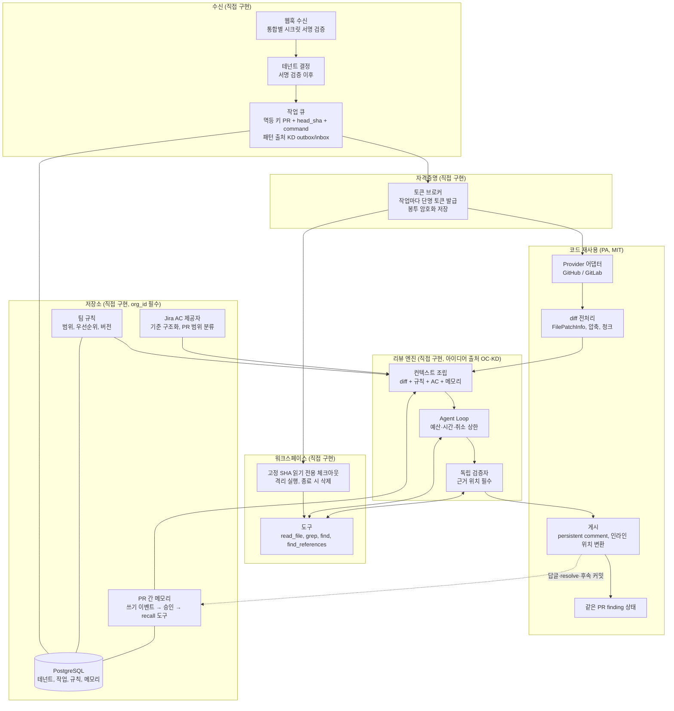

# 우리 서비스 적용안: 재사용·직접 구현·운영 의존성 (최종 종합 의견)

- 작성일: 2026-10-13
- 정정 반영: 2026-10-13 보고서 정정 반영
- 대상 SHA (`../repos.lock.tsv`와 일치)
  - pr-agent: `330f0813b5fe0d1f54b794077c2d02aa85a1fb63` (MIT)
  - open-code-review: `57273a9ea28548b94b3d67c247ff13a63c01fc47` (Apache-2.0)
  - kodus-ai: `45676c5fe7ac016b6206ccea006e459677d92842` (AGPL-3.0 + 상용 EE)
- 대상 서비스: GitHub/GitLab PR·MR 웹훅을 받아 diff, 관련 기존 코드(동적 탐색), Jira 요구사항(AC), 팀 규칙, 과거 리뷰 피드백을 함께 검토하고 근거를 검증하는 **멀티팀 SaaS**. 비공개 저장소 토큰 관리와 팀 간 격리 필수. PR-Agent 사용 경험이 있고 고정 주변 줄 확장의 한계를 느낌.
- **이 문서 전체가 분석자 의견이다.** 근거가 되는 사실은 링크한 레포 보고서에 있고 여기서는 복제하지 않는다. 3개 보고서는 모두 **정적 추적만** 했고 실행으로 확인한 항목이 없다. 라이선스 항목은 **법률 자문이 아니다.**
- 링크 약어: PA = [pr-agent](../reports/pr-agent/00-overview.md), OC = [open-code-review](../reports/open-code-review/00-overview.md), KD = [kodus-ai](../reports/kodus-ai/00-overview.md) 보고서. 번호는 보고서 파일 번호(예: PA-06 = `reports/pr-agent/06-fit.md`)
- 재사용 방식 표기: **코드 재사용**(라이선스상 가능, 결합 해소 필요) / **아이디어 참고**(설계만 가져와 재구현) / **라이선스상 불가**(상용 EE)

---

## 1. 한 줄 결론

**provider 어댑터·diff 전처리·댓글 게시·같은 PR 상태는 PR-Agent(MIT)에서 코드로 가져오고, 동적 탐색 Agent Loop·독립 검증자·PR 간 메모리·Jira 근거 판정·테넌트 격리·자격증명 관리는 직접 만든다.** open-code-review(Apache-2.0)는 루프·도구·위치 복원의 참고 구현으로, Kodus는 큐 설계(outbox/inbox)와 finder+verifier 구조의 **아이디어 출처**로만 쓴다. Kodus는 리뷰 경로가 상용 EE 파일에 걸려 있고 나머지는 AGPL이라 **코드째 도입은 선택지에서 제외**한다. 격리·토큰은 3개 중 어느 곳에서도 "가져올 수 있는 보장"이 없다.

세 레포가 서로 다른 층을 채워 주므로 하나를 고르는 문제가 아니다(PA는 플랫폼 연동·diff, OC는 루프, KD는 SaaS 실행 기반). 다만 서비스 구현 언어는 이 분석에서 정해지지 않았다. PA 코드를 직접 재사용하려면 Python이 전제다(OC는 Go, KD는 TypeScript). 이 문서의 추천은 **Python 구현을 가정**한다(의견, 언어가 다르면 PA도 아이디어 참고로 내려간다).

---

## 2. 기능 영역별 판단

"가져올 곳"은 레포·모듈·재사용 방식을 적었다. 코드 위치와 라인 근거는 비고의 링크에 있다.

### 2.1 요약표

| # | 영역 | 가져올 곳 (레포·모듈·재사용 방식) | 직접 만들 것 | 비고 (근거) |
|---|---|---|---|---|
| 1 | **웹훅·Provider 연동** | **PA** `git_providers/github_provider.py`, `gitlab_provider.py`: 변경 파일 수집(수집 중 PR 변경 감지), 50개 초과 시 본문 폴백, GitLab SHA·라인 매핑, persistent comment. **코드 재사용** **PA** `servers/utils.py` 서명 검증·이벤트 필터(`request_policy.py`). **코드 재사용** **KD** Provider 5종 어댑터 구성: **아이디어 참고** | 웹훅 수신 서버(GitHub App 서명 + GitLab `X-Gitlab-Token`을 통합별 시크릿으로 검증), 이벤트 정규화, 서명 검증 **후** 테넌트 결정, 실행 모델(프로세스 내 `BackgroundTasks` 대체) | PA provider는 Dynaconf `get_settings()`에 결합돼 요청마다 컨텍스트로 감싸야 함([PA-06 §3](../reports/pr-agent/06-fit.md), [PA-04 Q10-5](../reports/pr-agent/04-saas-and-isolation.md)). **KD는 Git 4종 웹훅 서명 검증이 없고 repository id로 테넌트를 결정**하므로 가져오지 않음([KD-04 §1.3](../reports/kodus-ai/04-saas-and-isolation.md)). OC는 Provider 연동 미지원([OC-07 Q13-1](../reports/open-code-review/07-credentials.md)) |
| 2 | **diff 전처리** | **PA** `algo/types.py`(`FilePatchInfo`), `git_patch_processing.py`(주변 줄 확장), `pr_processing.py`(토큰 예산 압축·청크). **코드 재사용**(첫 입력 용도) **OC** `internal/diff/resolver.go`, `relocation.go`: 모델이 줄 번호를 말하지 않고 `existing_code`로 위치를 복원하는 3단 해석. **코드 재사용**(Go일 때) 또는 아이디어 **KD** `libs/common/utils/patch.ts` 줄 번호 부여, 유효 줄 스냅, 위치 불일치 재시도: **아이디어 참고** | 대형 diff에서 **제외·잘림을 모델과 사용자에게 알리는 것**, rename 구경로 보존, 옛/새(side) 정보를 가진 위치 모델, 잘린 patch 복구 | PA 주변 줄 확장은 정규식·hunk 헤더 부분 문자열 휴리스틱이며 동적 탐색을 대체하지 못함([PA-00 결론 1](../reports/pr-agent/00-overview.md)). PA는 부분 잘림 patch를 감지하지 못함([PA-06 §8](../reports/pr-agent/06-fit.md)). OC는 큰 diff 파일을 조용히 제외하고 side 표기가 없음([OC-06 이슈 5·8](../reports/open-code-review/06-fit.md)). KD GitHub 빌더는 `previous_filename`을 버림([KD-01 §2.3](../reports/kodus-ai/01-execution-and-diff.md)) |
| 3 | **코드 확보 (clone·SHA 고정)** | **OC** `internal/tool/filereader.go`, `code_search.go`, `file_find.go`: `git show <ref>:<path>`, `git grep <ref>`, `git ls-tree`로 고정 ref를 읽는 방식. **코드 재사용 후보/아이디어** **PA** `git_provider.py` `_clone_inner`: URL의 userinfo를 제거하고 `http.extraHeader`로 인증, argv·`.git/config`에 토큰을 남기지 않음. **코드 재사용 가능하나** 유일한 호출자가 비활성 **KD** 로컬 샌드박스의 `GIT_CONFIG_*` 환경변수 방식, 서브모듈 헤더 origin 한정 규칙: **아이디어 참고** | **PR head SHA로 고정한 읽기 전용 워크스페이스**(미러/clone + 작업별 체크아웃), 작업 종료 시 삭제, 컨테이너 등 격리 실행, 도구 결과에 `path@sha:line`을 붙이는 증거 객체 | 3개 모두 SHA를 하나로 고정하지 않거나(KD: 파일 목록·본문·체크아웃·앵커가 서로 다른 시점, [KD-01 §2.2](../reports/kodus-ai/01-execution-and-diff.md)) 전제만 둠(OC: 로컬 ref 존재 가정). PA는 clone 자체를 리뷰 경로에서 안 씀([PA-01 §2.1](../reports/pr-agent/01-execution-and-diff.md)). **KD 로컬 샌드박스는 컨테이너 격리 없이 워커 호스트에서 clone·실행**([KD-06 §6](../reports/kodus-ai/06-fit.md)) |
| 4 | **동적 탐색 Agent Loop** | **OC** `internal/agent/agent.go:848-1074`: 라운드 상한, 도구 결과를 대화에 누적, 도구 오류를 문자열로 반환. 구조 참고 후 재구현 권장([OC-06 §12.2](../reports/open-code-review/06-fit.md)). Go일 때만 **코드 재사용** **KD** `libs/agent-harness`(예산·압축·완료 게이트·강제 종료 정책), finder 프롬프트의 호출 체인 추적 지시: **아이디어 참고**(AGPL). 코드로 가져온다면 디렉터리만으로는 안 됨: `libs/llm`과 순환 의존, `libs/core/log`(logger·langfuse 두 파일만 필요, 디렉터리 통째 복사 시 `observability.service.ts`의 `@libs/llm` 역 import), `libs/common/utils`(`crypto.ts`는 import 시점에 `API_CRYPTO_KEY` 길이 검사), `libs/code-review` 파일 2개(타입만 남은 `collectCrossFileContexts.service.ts`, 13줄 `shell-quote.ts` — sandbox 쪽 의존)가 따라오고 AGPL 범위가 그만큼 넓어짐([KD-06 §3.1](../reports/kodus-ai/06-fit.md#reuse-coupling)) **PA**: 없음 | Tool Calling 루프(선택한 LLM SDK로), 도구 스키마(`read_file`, `grep`, `find_files` + **`find_references`/`find_definition`**), 종료·예산·취소 정책, **총 토큰·비용·시간 상한** | **PA는 Agent Loop·동적 탐색·MCP가 없음**(단발 호출, 유지보수자도 "no tool-use loop"라고 적음, [PA-00 결론 2](../reports/pr-agent/00-overview.md)). 3개 모두 **모델에 노출된 AST·LSP 도구가 없음**(KD `getCallers`는 주입된 call graph 문자열 파서, [KD-02 §3.2](../reports/kodus-ai/02-context-loop-verify.md)). OC 프롬프트는 "다른 파일에서 발견한 문제는 무시하라"고 지시해 **우리 목표와 상충**([OC-02 §3.2](../reports/open-code-review/02-context-loop-verify.md)). OC·KD 모두 실행 전체의 총 비용 상한이 없음([OC-04 §10.1](../reports/open-code-review/04-saas-and-isolation.md), [KD-05 §5](../reports/kodus-ai/05-dependencies.md)) |
| 5 | **검증** | **KD** finder 직후 **후보별 verifier**(같은 도구로 반증 시도, "제거 기준은 의심이 아니라 반증"), 결정적 필터(줄 유효성·경로·claim checker fail-closed), evals 구조(프로덕션 코드를 로드하고 도구 출력을 재생, golden bug recall): **아이디어 참고** **OC** 반증 필터의 오탐 억제 의도: 아이디어만 **PA** `/improve` 자기 반성: 참고하지 않음 | **독립 모델·독립 문맥의 verifier**, `verdict{confirmed, refuted, inconclusive, evidence[path, line, quote]}`와 **근거 위치 없는 confirmed 금지**, 기본값(KEEP/DROP) 정책, 평가 세트 | KD verifier는 새 실행이지만 **같은 모델 슬롯·같은 프롬프트 계열**이고 기본 KEEP([KD-02 §5.1](../reports/kodus-ai/02-context-loop-verify.md)). OC 필터는 **diff만 보고 추가 파일 접근 불가**([OC-02 §5](../reports/open-code-review/02-context-loop-verify.md)). PA `/review`는 검증이 없고 `/improve`도 같은 diff만 봄([PA-00 결론 3](../reports/pr-agent/00-overview.md)). 실제 경로와 연결된 평가는 KD만 있음(PA·OC 없음) |
| 6 | **증분 리뷰** | **PA** GitLab 증분(compare 결과 ∩ MR 전체 diff로 병합 딸려 온 파일 제외), persistent comment 편집, 인라인 fingerprint 중복 제거 `inline_comment_dedup.py`(저장 백엔드 교체 인터페이스 명시). **코드 재사용** **KD** `lastAnalyzedCommit` 기준 + 고아 커밋(리베이스·force-push) 시 전체 리뷰 폴백: **아이디어 참고** | 마지막 리뷰한 **head SHA** 저장, 이벤트 멱등 키 `(PR, head_sha, command)`, **새 head 도착 시 진행 중 작업 취소·오래된 결과 폐기**, 게시 전 기존 댓글 조회 | PA 기준점은 SHA가 아니라 **이전 리뷰 댓글의 시각**이라 리베이스에 취약(추론, [PA-03 Q6](../reports/pr-agent/03-incremental-memory-rules.md)). **3개 모두 실행 중 head 변경 시 취소·폐기가 없음**(PA·KD 확인, OC는 증분 자체 미지원). KD는 게시 전 기존 댓글 조회가 없어 재시도 중복 가능(추론, [KD-03 §6.2](../reports/kodus-ai/03-incremental-memory-rules.md)) |
| 7 | **팀 규칙** | **KD** 규칙 스키마 필드(범위 전역/저장소/디렉터리/path, severity, examples, status, origin), 승인 게이트(pending/apply/discard), `.kody/rules/**` 파일 동기화: **아이디어 참고**. 구현이 `libs/ee/` → **라이선스상 불가** **OC** `rules.Resolver` 인터페이스(파일 기반을 저장소 구현으로 교체하는 이음새): 아이디어 **PA** 저장소가 못 바꾸는 키를 코드로 막는 `config_security.py` 개념: 아이디어 | **팀 범위** 규칙, **우선순위·충돌 해결·버전 이력**, 경로 매칭으로 선별해 프롬프트·도구로 제공, 규칙 저장소 | **3개 모두 팀 범위·우선순위·버전 관리가 없음.** KD는 조직당 문서 1개에 `rules` 배열이고 `teamId` 필드가 없고 팀 키는 설정(`parameters`)에만 있음([KD-03 Q8 범위 키 표](../reports/kodus-ai/03-incremental-memory-rules.md#q8-scope)). OC는 4계층 중 **첫 일치 1개만** 사용하고 저장소 `rule.json`을 **PR head 작업 트리에서 읽어** 신뢰 경계 문제가 있음([OC-04 §C](../reports/open-code-review/04-saas-and-isolation.md)). KD 저장소 설정은 기본 브랜치에서 읽음 |
| 8 | **PR 간 피드백 메모리** | **PA** `algo/review_finding_state.py`: 같은 PR 안의 ACTIVE/RESOLVED 상태를 댓글 마커에 저장. **코드 재사용**(PR 간 메모리의 출발점) **KD** 사람 PR 댓글에서 규칙 생성(자기 댓글 제외 → 필터 → 생성 → dedup → 품질 필터), `MEMORY` 규칙을 시스템 프롬프트에 주입, 승인 흐름: **아이디어 참고** **OC** 세션 JSONL(`uuid/parentUuid` 체인): 평가 데이터 설계 참고 | **전부.** 쓰기(답글·resolve·후속 커밋 → `proposed` → 사람 승인), 읽기(프롬프트 주입 + `recall(path\|symbol\|rule)` 도구, `tenant`·`repo` 필터 필수), 무효화·충돌 처리 | **3개 모두 "다른 PR로 이어지는 피드백 학습"이 없다.** PA 미지원([PA-03 §7.5](../reports/pr-agent/03-incremental-memory-rules.md)), OC 미지원(세션 JSONL은 쓰기만, [OC-03 Q7](../reports/open-code-review/03-incremental-memory-rules.md)), KD는 학습 stage가 **파이프라인에 등록돼 있지 않고 공식 문서도 비활성이라고 명시**([KD-03 §7.1](../reports/kodus-ai/03-incremental-memory-rules.md)). 기록만 있고 조회가 없으면 학습이라 부르지 않는다(GUIDE 3.3) |
| 9 | **Jira AC 대조** | **PA** 티켓 키 추출·허용 목록·인증 경계 `tools/ticket_pr_compliance_check.py:90-338`: **코드 부분 재사용** **KD** `fetchTaskContext`의 `acceptanceCriteria[]` 정규화, 기준별 IMPLEMENTED/MISSING/PARTIAL 판정 프롬프트와 "티켓 원문 인용 없으면 finding 무효" 규칙: **아이디어 참고** **OC** `RequirementProvider`·`verifyRequirements` 확장 지점 제안: 설계 참고 | AC 항목 구조화, **이번 PR 범위의 기준 분류**, 기준별로 **워크스페이스 도구로 저장소에서 구현 근거를 찾는 루프**, Jira 인증(테넌트별 토큰) | **3개 모두 diff 안에서만 판정**한다. PA는 텍스트를 프롬프트에 넣고 모델이 diff만 보고 분류, KD는 도구 없는 1회 호출, OC는 `--background` 문자열 슬롯뿐([PA-03 §9.2](../reports/pr-agent/03-incremental-memory-rules.md), [KD-03 §9.2](../reports/kodus-ai/03-incremental-memory-rules.md), [OC-03 Q9](../reports/open-code-review/03-incremental-memory-rules.md)). KD Business Logic 단계는 **샌드박스보다 앞**이라 재배치가 필요. Jira Cloud와 Data Center 지원 범위는 PA가 Cloud REST만 확인됨 |
| 10 | **큐·재시도** | **KD** 트랜잭셔널 outbox + inbox + 지연 재시도 + DLX 파킹, 스테일 잡·inbox 리퍼, 드레인, 헬스 가드: **아이디어 참고**(재구현, [KD-06 §2.1](../reports/kodus-ai/06-fit.md)). 비-ee이지만 AGPL **PA** 슬롯·delivery dedup: 프로세스 로컬이라 **참고 가치 낮음** | 큐(선택은 §4.3), 작업 메시지 스키마, 멱등 키, **실패 분류**(영구 실패와 재시도 구분), DLQ 소비자·알림, 테넌트별 공정성, 취소 | KD는 구조가 견고하지만 **파이프라인 오류가 삼켜져 잡이 COMPLETED로 끝나고 큐 재시도가 일어나지 않음**, DLQ에 소비자 없음, **웹훅은 200을 먼저 반환해 Postgres 장애 시 유실**, PR 락 TTL 60초에 갱신 없음([KD-04 §2](../reports/kodus-ai/04-saas-and-isolation.md)). 지연 재시도에 RabbitMQ delayed-message 플러그인이 필요하나 prod compose에는 RabbitMQ 서비스가 없음([KD-05 §4.1](../reports/kodus-ai/05-dependencies.md#rabbitmq-compose)). PA는 큐·ack·재시도·실패 저장이 모두 없음([PA-04 Q10-2](../reports/pr-agent/04-saas-and-isolation.md)) |
| 11 | **테넌트 격리·토큰** | **PA** 요청 범위 설정 사본에 토큰 주입하는 패턴(`gitlab_webhook.py:299-300` + `git_providers/utils.py:151-159`), GitHub App `installation.id`로 provider 인스턴스를 만들 때마다 `AppInstallationAuth` 생성(도구가 `get_git_provider()(pr_url)`로 추가 인스턴스를 만들 수 있어 요청당 한 번이 아님, [PA-07 §3.2](../reports/pr-agent/07-credentials.md)), 저장소·댓글이 토큰 설정을 못 바꾸게 막는 필터, clone 토큰 헤더 처리. **패턴 코드 재사용 가능** **KD** `(org, team, platform)` 통합 저장 모델(DB 유일 제약은 없고 1행 유지는 앱 로직에 의존, [KD-07 §2.1](../reports/kodus-ai/07-credentials.md)), 조직별 BYOK 암호화 저장·마스크 응답, 서브모듈 헤더 origin 한정: **아이디어 참고** | **전부.** 통합별 웹훅 시크릿 HMAC, **`org_id`를 모든 큐 메시지·캐시 키·쿼리·clone 경로·도구 요청의 필수 인자로**, **GitHub 설치 소유권 검증**, 봉투 암호화(KMS, 테넌트별 키, 인증 암호화, 키 ID), 설치 토큰은 저장하지 않고 작업마다 발급(+단일 저장소·최소 권한 범위 축소), GitLab OAuth refresh 또는 프로젝트·그룹 토큰, 로그 정화 목록, **모델 도구에 토큰을 주지 않는 서버 측 읽기** | **팀 A의 코드·규칙·메모리가 팀 B에 섞이지 않는다는 보장은 3개 어디에서도 가져올 수 없다.** PA는 테넌트 데이터 모델 자체가 없음([PA-04 Q10-3](../reports/pr-agent/04-saas-and-isolation.md)). KD는 앱 수준 격리이고 RLS 없음, outbox/inbox에 조직 컬럼 없음, `repositories`·AST 조회에 조직 조건 없음, GitHub 설치 토큰 캐시 키가 `installationId` 원문([KD-04 §3](../reports/kodus-ai/04-saas-and-isolation.md)). KD는 **설치 ID 소유권 검증 코드가 없고**, GitLab OAuth refresh가 없으며, OAuth 토큰·설치 토큰 스냅샷을 평문 저장, 암호화는 전역 단일 키·MAC 없는 CBC([KD-07 §2·§9](../reports/kodus-ai/07-credentials.md)). PA는 `CI_JOB_TOKEN` 미지원, GitLab 인스턴스 URL이 전역 한 벌([PA-07 §6](../reports/pr-agent/07-credentials.md)) |
| 12 | **관측** | **PA** 명령 스팬·토큰·비용 집계(`run_details`, `output_run_cost`): 아이디어 **OC** 계측 지점(LLM 호출·도구·파일 단위 span)과 세션 JSONL 트레이스 구조: 아이디어 **KD** Langfuse 트레이싱 선택, harness 정책 이벤트: 아이디어 | **테넌트별 비용 귀속**, 토큰·비용 상한과 알림, 소스·토큰이 로그·트레이스에 남지 않도록 **마스킹 규칙**, 보존 기간 | OC는 세션 로그를 끌 수 없고 **소스를 평문으로 기록**([OC-04 §C](../reports/open-code-review/04-saas-and-isolation.md)). KD는 로거 민감 키 목록에 `authToken`·`appPassword`·`githubPat`이 없고, Langfuse는 기본 마스킹이 없으며, 자체 호스팅도 하트비트를 보냄([KD-07 §5](../reports/kodus-ai/07-credentials.md), [KD-05 §3](../reports/kodus-ai/05-dependencies.md)). KD는 기본 키 폴백 시 조직 간 비용이 섞임 |

### 2.2 가져오지 않을 것 (의견)

| 항목 | 이유 |
|---|---|
| Kodus 코드 통째(포크·자체 호스팅 기반) | 파이프라인 조립·실행 진입·설정 로더·규칙 서비스가 EE 경로라 AGPL-only 트리는 그대로 컴파일되지 않는다고 보고서가 추론([KD-05 §6.3](../reports/kodus-ai/05-dependencies.md)). 상용 SaaS에서 AGPL 코드의 소스 공개 의무 검토도 선행되어야 함 |
| Kodus의 웹훅 처리 방식, 자격증명 저장 방식, 격리 방식 | 서명 검증 없음, 평문·단일 키, 앱 수준 격리. 보고서 자체가 "가져오지 않는다"고 의견을 냄([KD-07 §8](../reports/kodus-ai/07-credentials.md)) |
| PR-Agent의 `PRReviewer` 전체, LiteLLM 핸들러(3666줄), 프롬프트 | 입력 수집·프롬프트·청크·상태·게시가 한 클래스에 섞였고 diff만 본다는 지시와 Agent Loop가 충돌([PA-06 §3](../reports/pr-agent/06-fit.md)) |
| PR-Agent의 웹훅 서버 실행 모델 | 큐·ack 없음, 프로세스 로컬 슬롯. 서명 검증·필터 **함수**만 가져옴 |
| open-code-review 엔진을 바이너리로 호출하는 방식 | 검증·메모리·Jira·규칙 주입이 불가능하고 홈 디렉터리 설정·소스 평문 세션 로그·취소 약함. 비교 기준선 용도에 그침([OC-06 §12.4](../reports/open-code-review/06-fit.md)) |
| OC의 "다른 파일 발견 무시" 프롬프트 | 변경하지 않은 호출부 근거 탐색이 목표인 우리 서비스와 반대 |
| KD 피드백 학습(임베딩·k-means) 코드 | 호출되지 않는 죽은 코드. 가져올 동작이 없음 |

### 2.3 운영해야 할 의존성 (추천 구성 기준, 의견)

| 의존성 | 필요성 | 이유·근거 |
|---|---|---|
| LLM API (1곳 이상) | **필수** | 3개 모두 필수. 호출 추상화는 직접 선택(PA는 LiteLLM, KD는 AI SDK, OC는 provider SDK 직접) |
| Git 호스팅 API, GitHub App 등록, GitLab 토큰 방식 결정 | **필수** | PA provider를 쓰면 `PyGithub`·`python-gitlab`이 따라옴([PA-05 §2](../reports/pr-agent/05-dependencies.md)) |
| PostgreSQL | **필수** | 테넌트·통합·작업 상태·규칙·메모리·자격증명. KD는 Postgres와 MongoDB를 둘 다 요구하는데 하나로 합치는 설계를 고려할 수 있다는 의견이 보고서에 있음([KD-06 §2.3](../reports/kodus-ai/06-fit.md)) |
| `git` 바이너리 + 워커 로컬 디스크 + **격리 런타임**(컨테이너 등) | **필수** | 워크스페이스. OC·KD 모두 `git` 바이너리 전제. KD 로컬 샌드박스는 격리가 없으므로 따르지 않음 |
| `ripgrep` | 권장 | KD 도구가 사용([KD-05 §3](../reports/kodus-ai/05-dependencies.md)). OC는 `git grep`만 사용 |
| 큐 | **필수**(종류는 선택) | §4.3. Postgres 기반 outbox/작업 테이블로 시작할 수 있는지는 미검증(의견) |
| 시크릿 저장·KMS | **필수** | 3개 중 어디에도 팀별 키 저장·회전 계층이 없음. 가져올 수 없음 |
| OpenTelemetry 수집기 | 권장 | PA·OC·KD 모두 선택 기능으로 계측 코드가 있음 |
| Jira API (Cloud/Data Center) | 선택 | 대상 Jira 형태가 정해지지 않음(미확인) |
| 벡터 저장소·임베딩 | 선택 | PR 간 메모리를 의미 검색으로 하려면 필요. 3개 레포에는 동작하는 선례가 없음(KD는 확장만 생성, 쿼리 없음) |
| AST·심볼 인덱서(tree-sitter 또는 LSP) | 선택(권장) | 3개 레포의 모델 도구에 없음. KD는 call graph를 외부 CLI(`kodus-graph`)로 생성 |
| **도입하지 않음**: MongoDB, E2B·Morph·Exa, Redis, MCP 서버 | - | 추천 구성에서 필요한 근거가 없음. Jira는 MCP 대신 직접 REST/OAuth로 붙이는 편이 의존이 적다는 것이 의견 |

의존성 세부와 선언만 있고 쓰이지 않는 패키지는 [dependency-matrix.md](dependency-matrix.md)에 있다.

---

## 3. 권장 조립 구조 (의견)

읽는 순서: ①수신·테넌트·큐(직접) → ②작업마다 토큰 발급 → ③PA provider·diff로 초기 입력 → ④고정 SHA 워크스페이스 → ⑤컨텍스트 조립·Agent Loop·독립 검증 → ⑥PA 게시 모듈로 인라인 게시 → ⑦피드백 이벤트가 메모리로 돌아감.

설계 원칙(의견): **PA는 `PRReviewer`를 쓰지 않고 provider·diff·게시 함수만 호출하는 자체 오케스트레이터**를 둔다([PA-06 §5.2 접점 B](../reports/pr-agent/06-fit.md)). 모든 경계(큐 메시지, 캐시 키, 쿼리, clone 경로, 도구 요청, 메모리 조회)에 `org_id`를 필수 인자로 둔다.

---

## 4. 먼저 만들 순서

### 4.1 선택지 비교

| 선택지 | 내용 | 장점 | 단점·위험 | 근거 |
|---|---|---|---|---|
| A. 인프라 우선 | 웹훅·큐·자격증명·격리를 먼저 완성하고 엔진은 나중 | 격리·토큰을 나중에 끼워 넣을 위험이 줄어듦 | **핵심 가설(동적 탐색이 PA보다 나은가)을 검증하기까지 가장 오래 걸림.** 인프라가 엔진 요구를 모른 채 설계됨 | KD가 인프라를 먼저 키운 사례: 큐는 견고하지만 파이프라인 오류가 삼켜짐([KD-04 §2.3](../reports/kodus-ai/04-saas-and-isolation.md)) |
| B. 엔진 우선 수직 슬라이스 | PA 조각으로 단발 리뷰를 end-to-end로 먼저 만들고 워크스페이스·루프·검증을 순서대로 추가 | 사용자가 PA를 써 봤으므로 **기준선과 직접 비교** 가능. 가설을 가장 빨리 검증 | 격리·큐를 나중에 붙이면 retrofit 비용이 큼 | [PA-06 §6](../reports/pr-agent/06-fit.md) 시나리오 C(라이브러리화 + 자체 오케스트레이터) |
| C. 평가 우선 | 과거 PR로 골든 세트·측정 도구를 먼저 만들고 설계 | 개선 여부를 숫자로 판단 | 기준선 시스템 없이 평가만 만들면 무엇을 비교할지 불명확. 3개 레포 중 실제 경로와 연결된 평가는 KD뿐이라 가져올 것이 적음 | [KD-02 §5.2](../reports/kodus-ai/02-context-loop-verify.md), PA·OC는 평가 없음 |
| D. PA 거의 그대로 + 문맥 주입 | `repo_context_files`·`extra_instructions`·티켓 경로로 규칙·요구사항 텍스트만 넣음 | 구현량 최소 | 동적 탐색·검증·메모리 불가. 사용자의 불만(고정 확장의 한계)을 해결하지 못함 | [PA-06 §6 시나리오 A](../reports/pr-agent/06-fit.md) |
| E. Kodus 도입 | 자체 호스팅 또는 포크 | SaaS 기반과 리뷰 알고리즘이 한꺼번에 있음 | EE·AGPL 제약, 웹훅 서명 없음, 격리 앱 수준, 규칙·메모리·Jira가 우리 목표에 못 미침 | [KD-00 §6](../reports/kodus-ai/00-overview.md), [KD-06 §1](../reports/kodus-ai/06-fit.md) |

### 4.2 추천: B (엔진 우선 수직 슬라이스) + 세 가지 불변식을 첫날부터

**추천은 B다.** 단, B의 약점(격리 retrofit)은 **코드가 거의 없는 불변식 세 개를 0단계에서 정해 막는다.**

| 단계 | 내용 | 가져오는 것 | 완료 기준(의견) |
|---|---|---|---|
| **0** | **불변식**: ①작업 메시지 스키마 `{org, installation, repo, pr, head_sha, delivery_id, command}`와 멱등 키 ②모든 저장·조회·캐시 키에 `org_id` 필수 ③자격증명은 장기 저장하지 않고 작업 시작 시 발급 | KD가 놓친 항목을 체크리스트로 사용([KD-04 §3](../reports/kodus-ai/04-saas-and-isolation.md)) | 문서화, 스키마만 있고 구현은 단순해도 됨 |
| **1** | 수직 슬라이스: 웹훅(서명 검증은 직접) → PA provider·diff로 **단발 리뷰** → PA 게시 모듈로 인라인 게시 | PA provider·diff·게시(코드 재사용) | PA와 같은 PR에서 같은 수준의 출력. **기준선 확보** |
| **2** | 고정 SHA **워크스페이스 + 읽기 도구 + Agent Loop**(라운드·토큰·시간 상한, 취소) | OC 루프·도구 형태, KD harness 정책(아이디어) | 사용자가 "문맥이 부족했다"고 느낀 PR들에서 기준선보다 **근거 있는 지적**이 늘었는지 확인 |
| **3** | **독립 검증자**(근거 위치 필수) + 결정적 필터(줄 유효성) | KD finder+verifier 구조, OC 위치 해석 | 근거 없는 finding이 게시되지 않음 |
| **4** | 팀 규칙 저장소(범위·우선순위) + **Jira AC 구조화·기준별 판정** | KD 규칙 스키마·Jira 판정 프롬프트(아이디어), PA 티켓 추출 | AC별 충족/미충족/확인 불가와 코드 근거 위치 |
| **5** | 증분 리뷰 + **stale 취소** + 큐 하드닝(outbox/inbox·재시도·DLQ 소비자) | KD 큐 패턴, PA GitLab 증분 | 새 push가 오면 이전 작업이 취소되고 중복 댓글이 없음 |
| **6** | **PR 간 메모리**(쓰기 → 승인 → recall 도구) + 격리 샌드박스 + 테넌트 하드닝(RLS 등) | PA finding 상태(확장), KD 규칙 생성 파이프라인(아이디어) | 팀 A의 메모리가 팀 B 리뷰에 나타나지 않는 테스트 |

이 순서의 근거: ①사용자의 핵심 불만이 문맥 확보라서 가설 검증을 먼저 해야 하고(GUIDE 0절), ②PA 코드 재사용으로 1단계의 구현량이 가장 작으며, ③3개 레포 모두 PR 간 메모리가 없으므로 앞단이 안정된 뒤에 설계해야 한다. 이것은 코드 구조에서 도출한 판단이며 정량 측정은 하지 않았다.

### 4.3 큐 선택 (단계 5에서)

| 선택 | 내용 | 비고 |
|---|---|---|
| Postgres 작업 테이블(+outbox) | 운영 의존성이 늘지 않음 | KD도 outbox/inbox/advisory 락은 Postgres. 단 KD는 락이 연결 1개를 점유하고 TTL 갱신이 없어 105분 리뷰와 맞지 않음 → 그대로 따르지 않음(의견) |
| RabbitMQ + delayed-message 플러그인 | KD가 쓰는 구성(앱 요구; dev·bench compose에만 정의되고 **prod compose 미정의**, [KD-05 §4.1](../reports/kodus-ai/05-dependencies.md#rabbitmq-compose)). 지연 재시도 토폴로지 선례 | 플러그인 운영 부담, 우리 규모에서 필요한지는 미확인 |

의견: 처음에는 **Postgres 기반**으로 시작하고 처리량·지연 요구가 확인되면 외부 브로커를 검토한다. 이는 측정 없이 구조에서 낸 의견이다.

---

## 5. 위험과 미확인 항목 (운영 전 실제 실행 검증 필요)

3개 보고서는 정적 추적만 했다. 아래는 **실제로 실행·측정·법무 검토가 필요한 것**이다. 검증 유형: 실행 / 측정 / 법무.

| # | 항목 | 왜 위험한가 | 검증 유형 | 근거 |
|---|---|---|---|---|
| 1 | **PA provider를 라이브러리로 import할 때 Dynaconf·`starlette_context` 결합을 얼마나 얇게 감쌀 수 있는가** | 전체 재사용 이득이 이 결합 비용에 달림. 컨텍스트 없이 호출하면 **프로세스 전역 설정**으로 떨어짐 | 실행(프로토타입) | [PA-next Q7](../reports/pr-agent/next.md), [PA-04 Q10-3](../reports/pr-agent/04-saas-and-isolation.md) |
| 2 | PA의 50개 초과 파일·잘린 patch가 조용히 누락되는지 | 대형 PR에서 일부 변경이 리뷰되지 않을 수 있음 | 실행 | [PA-next Q1](../reports/pr-agent/next.md), [PA-06 §8](../reports/pr-agent/06-fit.md) |
| 3 | **GitHub 설치 토큰 발급·갱신은 PyGithub에 위임**되어 라이브러리 내부 동작이 미확인. 도구가 provider를 새로 만들 때마다 토큰이 따로 발급될 수 있음 | rate limit·비용·만료 처리 | 실행 | [PA-07 §3](../reports/pr-agent/07-credentials.md), [PA-07 §8](../reports/pr-agent/07-credentials.md) |
| 4 | **GitLab 토큰 방식**: 3개 모두 `CI_JOB_TOKEN` 미지원, PA는 PAT 전용, KD는 OAuth refresh 없음, 프로젝트·그룹 액세스 토큰 동작은 모두 미확인. 팀마다 GitLab 인스턴스 URL이 다르면 PA는 전역 한 벌 | 만료 시 팀 전체 리뷰가 멈출 수 있음 | 실행 | [PA-07 §4](../reports/pr-agent/07-credentials.md), [KD-07 §1.1](../reports/kodus-ai/07-credentials.md) |
| 5 | **프롬프트 주입·도구 권한**: 저장소 파일·PR 본문이 모델 입력이 되는 구조에서 읽기 도구가 토큰·환경변수에 닿는지. KD `readReference`는 clone 토큰을 플랫폼 확인 없이 `api.github.com`으로 보냄, KD 로컬 샌드박스는 `process.env`를 자식에 넘김, OC는 PR head의 `rule.json`을 로드 | 비공개 저장소 토큰·타 팀 정보 유출 경로 | 실행(레드팀) | [KD-07 §4.6](../reports/kodus-ai/07-credentials.md), [OC-next 질문 5](../reports/open-code-review/next.md) |
| 6 | **GitHub App 설치 소유권 검증**: KD는 검증 코드를 찾지 못했다(추론). 우리 구현에서 같은 실수를 하지 않는지 | 다른 팀이 설치한 저장소 접근권을 내 팀에 연결할 수 있는 경로 | 실행(테스트) | [KD-07 §2.5](../reports/kodus-ai/07-credentials.md) |
| 7 | **동적 탐색의 비용·지연·오탐**: OC·KD 모두 실행 전체 총 비용 상한이 없다. OC는 파일당 최대 30라운드 × 동시 8. 모델이 30라운드를 소진하는 비율, 압축 오동작, "다른 파일 무시" 지시를 바꿨을 때 오탐 증가는 미측정 | 비용 폭주, 근거 없는 지적 증가 | 측정 | [OC-next 질문 2·4](../reports/open-code-review/next.md), [OC-04 §10.1](../reports/open-code-review/04-saas-and-isolation.md) |
| 8 | **verifier 효과**: KD의 verifier 효과와 코드 주석 속 수치(170+ runs, recall %, 154회 중 20%)는 **직접 측정이 아니라 주석 인용**이다. 같은 모델 슬롯이라 오류가 상관될 수 있음(추론) | 검증 단계가 실제로 오탐을 줄이는지 모름 | 측정 | [KD-02 §5.1](../reports/kodus-ai/02-context-loop-verify.md) |
| 9 | **라이선스**: AGPL 코드를 SaaS에 포함할 때의 의무 범위, `@license … All rights reserved` 헤더 18개 파일 중 ee 표지 없는 경로의 10개(`libs/code-review` 5, `libs/core` 4, `libs/kodyFineTuning` 1)가 경로 규칙(AGPL)과 어긋나는 점의 해석(세 재사용 후보 모듈에는 헤더 없음, [KD-06 §3.2](../reports/kodus-ai/06-fit.md#license-header)), 전이 의존성 라이선스(3개 모두 미조사) | 소스 공개 의무·사용 제한 | **법무** | [dependency-matrix §6](dependency-matrix.md), [KD-05 §6.1](../reports/kodus-ai/05-dependencies.md) |
| 10 | **PA 업스트림 유지**: README가 "community-maintained legacy project of Qodo"라고 밝힘. 포크·vendoring 전략과 업스트림 변경 추적 부담 | 장기 유지 | 판단 | [PA-05 §5](../reports/pr-agent/05-dependencies.md), [PA-06 §8](../reports/pr-agent/06-fit.md) |
| 11 | **중복 방지 장치의 한계**: PA의 delivery dedup·push 슬롯은 프로세스 로컬이고, KD는 enqueue 시점의 SHA 중복 키가 없다. 다중 워커·레플리카에서 같은 PR이 중복 리뷰될 수 있는지 | 중복 댓글·비용 | 실행 | [PA-04 Q10-2](../reports/pr-agent/04-saas-and-isolation.md), [KD-03 §6.2](../reports/kodus-ai/03-incremental-memory-rules.md) |
| 12 | **Jira 형태**: Cloud/Data Center, 인증 방식, AC가 어느 필드에 있는지는 우리 쪽 미정. PA는 Cloud REST와 일부 필드만 확인됨. "이번 PR 범위의 기준" 분류 정확도는 3개 모두 구현 선례가 없음 | AC 대조의 핵심 | 실행·측정 | [PA-03 §9.1](../reports/pr-agent/03-incremental-memory-rules.md), [KD-03 §9.2](../reports/kodus-ai/03-incremental-memory-rules.md) |
| 13 | **OC 포크 시(Go일 때)**: `internal/` 경계, 전역 stdout writer(동시 리뷰 안전하지 않음), 세션 로그 끌 수 없음, 병합 커밋 파싱, `task_done FAILED` 무시 등 알려진 이슈 | 서비스 워커에 옮길 때 수정 필요 | 실행 | [OC-04 §A·B·E](../reports/open-code-review/04-saas-and-isolation.md), [OC-06 이슈 표](../reports/open-code-review/06-fit.md) |
| 14 | **서비스 구현 언어 미정**: 이 문서의 PA 코드 재사용 판단은 Python 전제 | 언어가 다르면 PA는 아이디어 참고로 내려가 구현량이 늘어남 | 판단 | §1 |
| 15 | **이 분석 자체의 한계**: 해석 버전은 락파일을 읽은 값이고 실제 설치 해석이 아님, kodus-ai 01 줄 번호와 02~05의 긴 범위 일부는 아직 재대조되지 않음(02~05 인용 약 650개는 2026-10-13에 대조·약 30건 정정, 각 문서 머리 참조) | 근거 인용 시 재확인 필요 | - | [dependency-matrix §7](dependency-matrix.md) |

---

## 6. 정리

- 가져올 것(코드): PA provider·diff·게시·finding 상태·서명 검증 함수, (Go일 때) OC 루프·도구·위치 해석.
- 가져올 것(아이디어): KD outbox/inbox·finder+verifier·harness 정책·규칙 스키마·Jira 판정 프롬프트, OC 도구 형태·`Resolver` 이음새.
- 직접 만들 것: 워크스페이스와 Agent Loop, 독립 검증자, 심볼 도구, PR 간 메모리, Jira 근거 판정과 PR 범위 분류, 팀 규칙 저장소, 큐·취소·멱등, **테넌트 격리와 자격증명 계층 전부**.
- 운영할 의존성: LLM API, Git 호스팅 API, PostgreSQL, git+격리 런타임, 큐(처음엔 Postgres), 시크릿·KMS, OTel. 선택: Jira, 벡터·임베딩, AST 인덱서.
- 추천 순서: 불변식 3개 → PA 조각으로 단발 end-to-end → 워크스페이스·Agent Loop → 독립 검증 → 규칙·Jira → 증분·큐 하드닝 → 메모리·격리 하드닝.
