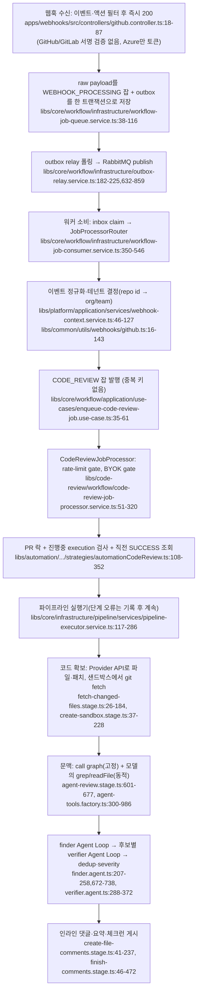

# kodus-ai — 개요 (입구 문서)

- 분석 SHA: `45676c5fe7ac016b6206ccea006e459677d92842` (repos.lock.tsv와 일치)
- 분석일: 2026-10-13
- 관련 공통 항목: Q1~Q12 전체 (입구 문서)
- 검증 수준 요약(검증 열이 있는 표의 행을 스크립트로 센 값, 2026-10-13 재집계. 복수 표기 행은 각 수준에 중복 계산하고 검증 열이 없는 표·본문 서술은 제외): 코드 확인 19 / 실행 확인 0 / 추론 1 / 미확인 0
- 실행 여부: **정적 추적만**. `repos/kodus-ai`는 읽기만 했고 설치·빌드·실행·테스트를 하지 않았다. 작업트리는 detached HEAD가 고정 SHA와 일치하고 `git status --porcelain`이 비어 있음(clean)을 확인했다.
- 조사 방식 메모: 후반부 세부 추적(파이프라인 단계, 에이전트 루프, 규칙·메모리, 의존성)은 병렬 조사 에이전트 4개가 파일을 열어 확인한 줄 번호를 받았고, 작성자가 그중 핵심 근거 약 20곳을 다시 열어 대조했다(전부 일치). 대조하지 않은 줄 번호는 조사 에이전트가 연 값이다. 이 사실을 신뢰도 판단에 반영하라. **2026-10-13 정정 후속**: 02~05의 줄 번호는 추가로 재대조했고 문서별 재대조 범위는 각 문서 머리에 적었다. 변경 이력은 [next 정정 이력](next.md#corrections-2026-10-13).

문서 목록: [01 실행 경로·Diff](01-execution-and-diff.md) · [02 문맥·루프·검증](02-context-loop-verify.md) · [03 증분·메모리·규칙·Jira](03-incremental-memory-rules.md) · [04 SaaS·격리](04-saas-and-isolation.md) · [05 의존성](05-dependencies.md) · [06 적용 의견](06-fit.md) · [07 자격증명](07-credentials.md) · [next](next.md)

---

## 1. 메타데이터

| 항목 | 값 | 근거 | 검증 |
|---|---|---|---|
| URL | https://github.com/kodustech/kodus-ai | `repos.lock.tsv` | 코드 확인 |
| SHA / 커밋 | `45676c5fe7ac016b6206ccea006e459677d92842` ("Merge pull request #2055 from andyst-dev/fix/2050-prlevel-comment-marker") | `git log -1` | 코드 확인 |
| 커밋일 | 2026-10-12 (`2026-10-12T17:29:07-03:00`) | `git log -1` | 코드 확인 |
| 버전 표기 | 루트 `package.json` 2.1.8, `git describe`는 `selfhosted-2.2.6-rc.151-39-g45676c5fe` | `package.json:3` | 코드 확인 |
| 주 언어 | TypeScript. 백엔드 NestJS 11, 프런트 Next.js(별도 설치) | `package.json`, `AGENTS.md` Stack | 코드 확인 |
| 라이선스 | **듀얼**. `.ee.` 파일명 또는 `ee/` 경로는 Enterprise(상용), 나머지는 AGPL-3.0. 자세한 경계는 [05 6절](05-dependencies.md#license). 법률 자문 아님 | `license.md:5-10`, `license_ee.md:5-8` | 코드 확인 |
| 지원 Git Provider | GitHub, GitLab, Bitbucket(Cloud/Data Center), Azure Repos, Forgejo | `libs/platform/infrastructure/webhooks/*`, `apps/webhooks/src/controllers/*` | 코드 확인 |
| 지원 LLM | AI SDK 기반: Anthropic, OpenAI, Google Gemini, Vertex, Bedrock, Azure, OpenAI-compatible. 조직 BYOK 슬롯 또는 환경변수 기본 모델 | `libs/llm/model-builders.ts`, `libs/llm/llm.ts:160-236` | 코드 확인 |
| 진입점 | `apps/webhooks`(수신 전용), `apps/worker`(큐 소비·리뷰 실행), `apps/api`(REST·cron), `apps/mcp-manager`(선택) | `apps/*/src/main.ts` | 코드 확인 |
| 미실행 항목 | 전부. 호출 순서·줄 번호는 정적 읽기 결과다 | - | - |
| 제품 문구와 코드가 다른 곳 | 아래 7절 | - | 코드 확인 |

## 2. 한 줄 정의

Kodus는 **GitHub/GitLab 등의 웹훅을 받아 PostgreSQL(트랜잭셔널 outbox) → RabbitMQ → 워커 파이프라인(약 18단계)으로 PR을 리뷰해 인라인 댓글을 게시하는 멀티테넌트 SaaS형 NestJS 모노레포**이며, 리뷰 주체는 **고정 순서 파이프라인 안의 Agent Loop(도구 호출 반복, AI SDK `generateText`)**다. 파이프라인 자체는 고정 순서이고, 그 안의 "finder"와 "finder 결과별 verifier"가 샌드박스 체크아웃 위에서 `grep`/`readFile` 등을 호출하며 반복한다. 근거: `libs/code-review/pipeline/strategy/code-review-pipeline.strategy.ts:70-109`, `libs/code-review/infrastructure/agents/core/core-agent-loop.adapter.ts:57-244`, `libs/llm/agent-loop-call.ts:207-243`. 코드 확인.

단, 이것은 **조건부**다. 체크아웃(샌드박스)이 없으면 같은 에이전트가 도구 없이 diff만 보는 "self-contained" 모드로 떨어진다([02 Q3](02-context-loop-verify.md#q3)).

## 3. 호출 흐름 다이어그램

노드의 위치는 `레포 기준 상대경로:줄`이다. 모두 정적 추적.

(축약 경로: `libs/code-review/pipeline/stages/`, `libs/code-review/infrastructure/agents/` 아래. 풀 경로는 [01](01-execution-and-diff.md), [02](02-context-loop-verify.md)의 표.)

## 4. 핵심 결론과 참고할 구현 3개

핵심 결론:

1. **가져올 가치가 가장 큰 곳은 "SaaS 실행 기반(큐·outbox·inbox·락·재시도)"과 "리뷰 엔진(finder+verifier Agent Loop, 샌드박스 도구)"이다.** 규칙 관리는 Mongo+API+동기화까지 있으나 **핵심 구현이 `libs/ee/`(상용) 안에 있다.** "피드백 학습 메모리"는 이 SHA에서 **동작하지 않는다**(코드·공식 문서 모두 비활성 명시).
2. **리뷰 파이프라인을 조립하는 파일 3개가 `.ee.` 파일명이고(`libs/core/providers/*.ee.ts`), 리뷰 진입 유스케이스(`libs/ee/automation/runCodeReview.use-case.ts`)·설정 로더(`libs/ee/codeBase/codeBaseConfig.service.ts`)·규칙 서비스(`libs/ee/kodyRules/service/kodyRules.service.ts`)도 `ee/` 경로**다. AGPL 부분만으로는 리뷰 경로를 조립할 수 없다(비교적 확실한 추론, 빌드는 시도하지 않음).
3. **GitHub/GitLab/Bitbucket/Forgejo 웹훅은 서명·시크릿 검증이 없다.** 테넌트는 페이로드의 repository id로 결정된다(Azure만 전역 공유 토큰).
4. **Jira는 직접 연동이 아니라 MCP(Atlassian Rovo 등)를 통한 별도 "Business Logic" 단계**이고, 티켓 텍스트는 메인 리뷰 에이전트 입력에 들어가지 않는다. 판정은 diff만 보는 도구 없는 1회 호출이다.
5. **테넌트 격리는 "조직 ID를 쿼리 조건에 넣는 애플리케이션 수준"이다.** Postgres RLS 없음, 큐·outbox/inbox에 조직 컬럼 없음, AST 그래프 조회는 `(platform, externalId)`로 조직 조건 없이 조회한다.

참고할 구현 3개:

| 구현 | 근거 | 이유 |
|---|---|---|
| 트랜잭셔널 outbox + inbox + 지연 재시도 + DLX | `libs/core/workflow/infrastructure/workflow-job-queue.service.ts:51-103`, `workflow-job-consumer.service.ts:387-546`, `libs/core/infrastructure/queue/rabbitmq-error.handler.ts:83-185` | 웹훅 수신과 처리를 분리하는 검증된 구조. RabbitMQ와 delayed-message 플러그인이 필요하고(`RABBITMQ_TOPOLOGY_CONFIG`가 `x-delayed-message` 교환을 선언), 이 레포의 `docker-compose.prod.yml`에는 RabbitMQ 서비스가 없다([05 4.1절](05-dependencies.md#rabbitmq-compose)) |
| Finder + 후보별 Verifier Agent Loop와 harness 정책(예산·완료 게이트·강제 종료) | `libs/code-review/infrastructure/agents/core/finder.agent.ts:207-258,672-738`, `libs/agent-harness/infrastructure/ai-sdk/ai-sdk-agent-runner.ts:63-404`, `libs/agent-harness/infrastructure/policies/completion-gate.policy.ts:81-96` | 동적 탐색+검증의 구체 구현. `libs/agent-harness`, `libs/llm`, `libs/sandbox`는 비-spec 소스에 `@libs/ee` import가 없다(재확인). 다만 `@libs/core`(로거·enum·락·Mongo 베이스)·`@libs/common/utils`와 `libs/sandbox`→`@libs/code-review` 서비스 파일 2개에 의존하고 harness↔llm은 순환이라 함께 가져가야 한다([06 3.1절](06-fit.md#reuse-coupling)) |
| 샌드박스 리스(`orgId:repoId:prNumber` 키) + 로컬/E2B/null 선택 | `libs/sandbox/modules/sandbox.module.ts:26-51`, `libs/code-review/pipeline/stages/create-sandbox.stage.ts:98-102` | 도구 백엔드를 격리 환경에서 교체 가능하게 한 경계 |

SHA 고정 permalink (핵심 근거 2개):
- 파이프라인 단계 순서: https://github.com/kodustech/kodus-ai/blob/45676c5fe7ac016b6206ccea006e459677d92842/libs/code-review/pipeline/strategy/code-review-pipeline.strategy.ts#L70-L109
- 웹훅 수신(서명 검증 없음): https://github.com/kodustech/kodus-ai/blob/45676c5fe7ac016b6206ccea006e459677d92842/apps/webhooks/src/controllers/github.controller.ts#L18-L87

## 5. 공통 항목 요약표

| 항목 | 지원 수준 | 요약 | 문서 |
|---|---|---|---|
| Q1 실행 경로 | 지원 | 웹훅→outbox→RabbitMQ→워커→18단계 파이프라인→댓글 게시를 함수 단위로 추적. 단계 오류는 기록 후 계속 진행 | [01](01-execution-and-diff.md#q1) |
| Q2 코드 접근·Diff | 부분 지원 | 파일·패치는 Provider API, 저장소 체크아웃은 샌드박스(`git fetch --depth=1`). 주변 줄 자동 확장은 활성 경로에 없음(모델이 `readFile`). Head SHA 고정 안 됨 | [01](01-execution-and-diff.md#q2) |
| Q3 동적 탐색 | 지원(조건부) | 체크아웃이 있으면 `grep/readFile/listDir/findFile/getCallers/checkTypes`를 모델이 호출. 없으면 diff만. call graph는 고정 문맥 | [02](02-context-loop-verify.md#q3) |
| Q4 Agent Loop | 지원 | finder·verifier·재합성·resample이 AI SDK 도구 호출 루프. Kody Rules 판정은 도구 없는 1회 호출 | [02](02-context-loop-verify.md#q4) |
| Q5 검증 | 부분 지원 | finder 후보별 verifier(같은 모델 슬롯·같은 도구)가 있고 기본값은 "유지". 독립 모델은 아님 | [02](02-context-loop-verify.md#q5) |
| Q6 증분 리뷰 | 부분 지원 | 직전 SUCCESS 실행의 `lastAnalyzedCommit` 기준. 잡 단위 중복 키 없음. 실행 중 Head SHA 변경 취소 없음 | [03](03-incremental-memory-rules.md#q6) |
| Q7 장기 메모리 | 미지원(학습) / 부분 지원(규칙형 메모리) | 반응 수집·임베딩 파인튜닝 코드는 있으나 파이프라인에서 호출되지 않음. `type: MEMORY` 규칙은 읽기·쓰기 모두 있음(수동/MCP/채팅 작성) | [03](03-incremental-memory-rules.md#q7) |
| Q8 팀 규칙 | 부분 지원 | Mongo 조직 문서의 규칙 배열. 범위는 전역/저장소/디렉터리/path이고 **규칙에는 팀 키가 없다(조직 범위). 팀 키는 `parameters`의 설정(config)에만 있다** ([03 8.1절 표](03-incremental-memory-rules.md#q8-scope)). 우선순위·버전 없음. 승인 게이트 선택. **핵심이 ee** | [03](03-incremental-memory-rules.md#q8) |
| Q9 Jira | 부분 지원 | MCP 기반 Business Logic 단계만. 메인 리뷰 입력엔 없음. 기준별 판정은 diff 한정 | [03](03-incremental-memory-rules.md#q9) |
| Q10 SaaS | 부분 지원 | outbox/inbox/재시도/DLX/리퍼는 견고. 웹훅 서명 검증 없음, 조직 격리는 앱 수준 | [04](04-saas-and-isolation.md) |
| Q11 의존성 | - | 백엔드 의존성은 루트 `package.json`에 몰려 있음. 선언만 있고 안 쓰는 패키지 다수(pgvector, openai 등) | [05](05-dependencies.md) |
| Q12 적용 | (의견) | 06 참조 | [06](06-fit.md) |

## 6. 최종 질문에 대한 답

질문: "Kodus에서 가져올 가치는 리뷰 알고리즘, SaaS 기반, 규칙 관리, 피드백 메모리 중 어디에 있으며, 외부 서비스와 기능 제한 없이 어느 범위까지 사용할 수 있는가?" (아래는 분석자 **의견**을 포함한다.)

- **가치의 중심은 SaaS 실행 기반과 리뷰 알고리즘**이다. 전자는 outbox/inbox/지연 재시도/락/리퍼/드레인이 코드에 구체적으로 있고, 후자는 finder+verifier Agent Loop, 샌드박스 도구, 토큰 예산 배치, dedup/severity 후처리가 있다. 규칙 관리는 구조(범위·승인·동기화)는 참고할 만하나 **구현이 `libs/ee/`에 있어 그대로 쓸 수 없고**, 피드백 메모리는 **이 SHA에서 비활성**이라 가져올 동작 구현이 없다(데이터 모델·클러스터링 아이디어만 참고).
- **외부 서비스 없이 쓸 수 있는 범위**: 코드로 볼 때 E2B·Morph·Exa·Langfuse·pgvector 확장 쿼리 없이도 리뷰 경로가 동작한다. 필수 인프라는 PostgreSQL(+vector 확장 생성 마이그레이션), MongoDB, RabbitMQ(delayed-message 플러그인), git/ripgrep 바이너리, LLM API 한 곳이다. **RabbitMQ는 이 레포의 dev·bench compose에서는 서비스로 정의되지만 자체 호스팅용 `docker-compose.prod.yml`에는 정의되어 있지 않다.** prod compose는 외부에서 제공되는 브로커(`API_RABBITMQ_URI`)를 가정한다(근거와 확인 범위는 [05 4.1절](05-dependencies.md#rabbitmq-compose)). E2B 없이 `local` 샌드박스를 쓰면 `rg/npx/tsc` 실행이 막혀 `checkTypes`가 안 되고, 로컬 샌드박스는 컨테이너 격리 없이 워커 호스트에 클론한다(코드 주석이 위험을 명시).
- **라이선스 제약**: 리뷰 파이프라인 조립(`*.provider.ee.ts`), 실행 진입(`libs/ee/automation`), 설정 로더, 규칙 서비스가 Enterprise 경로라, **AGPL 구성요소만으로 현 구조를 재현하려면 해당 부분을 새로 써야 한다**. AGPL 코드를 SaaS로 제공하면 소스 공개 의무가 따를 수 있으므로 법무 확인이 필요하다(법률 자문 아님). 따라서 "가져온다"의 현실적 범위는 **아이디어와 패턴 재구현 + AGPL 비-ee 모듈(`libs/agent-harness`, `libs/llm`, `libs/sandbox`)의 라이선스 검토 후 선택적 재사용**이다. 선택적 재사용에는 `libs/core`·`libs/common/utils` 파일과 `libs/code-review` 파일 2개가 딸려 오는 결합 비용이 있고([06 3.1절](06-fit.md#reuse-coupling)), `@license … All rights reserved` 헤더는 이 세 디렉터리에는 없다(헤더는 `libs/code-review`·`libs/core`·`libs/kodyFineTuning`·`libs/ee`의 18개 파일에만 있음, [06 3.2절](06-fit.md#license-header)).
- 사용자의 서비스 목표(diff+기존 코드+Jira+팀 규칙+과거 피드백+팀 간 격리)와의 간극: **Jira 요구사항·과거 피드백은 메인 리뷰 입력에 들어가지 않고, 조직 격리는 DB 쿼리 수준**이다. 이 둘은 직접 설계해야 한다([06](06-fit.md)).

## 7. README·제품 문구 ↔ 코드 차이 (코드 기준)

| 문구 | 코드 | 위치 | 검증 |
|---|---|---|---|
| `AGENTS.md`: "Project management integrations: Jira, Linear, Azure Boards" | 직접 연동 어댑터 없음. `PlatformType.JIRA` 등 enum만 있고 MCP 경유 Business Logic 단계에서만 사용 | `AGENTS.md` Key Concepts vs `libs/core/domain/enums/platform-type.enum.ts:5,10`, `libs/code-review/pipeline/stages/business-logic-validation.stage.ts:401-471` | 코드 확인 |
| `AGENTS.md`: "Retry ... (max 5 retries)" | 핸들러 상수 기본 2, 설정 로더 기본 5, `.env.example`은 3. 실효값은 환경변수에 따름(런타임 미관측) | `libs/core/infrastructure/queue/rabbitmq-error.handler.ts:23`, `libs/core/infrastructure/config/loaders/workflow-queue.loader.ts:36-39` | 코드 확인 + 추론 |
| `apps/webhooks/AGENTS.md`: outbox가 RabbitMQ 장애에도 전달 보장 | 브로커 장애엔 맞음. 컨트롤러가 200을 먼저 반환하므로 Postgres 장애 시 이벤트 손실 | `apps/webhooks/src/controllers/github.controller.ts:53-87` | 코드 확인 |
| docs: Kody Learning/피드백이 이후 리뷰를 개선 | 공식 문서가 "Reaction-based fine-tuning is not currently active"라고 명시. 코드도 stage 미등록 | `docs/en/how_to_use/code_review/learning/kody_learning.mdx:7`, `libs/code-review/pipeline/strategy/code-review-pipeline.strategy.ts:70-109` | 코드 확인 |
| docs: Business Logic이 "every PR review"에서 실행 | 설정 on + task MCP 연결 + 티켓 신호 + PR당 1회 | `docs/en/how_to_use/code_review/business_logic_validation.mdx:32` vs `business-logic-validation.stage.ts:401-471` | 코드 확인 |
| docs `sandbox.mdx`: `auto`는 "no sandbox"로 폴백, `none`이 AST 그래프 끔 | `auto`는 E2B 키 없으면 `LocalSandboxService`. 코드는 `'null'`만 인식, `none`은 `auto` 분기로 떨어짐 | `docs/en/how_to_deploy/deploy_kodus/sandbox.mdx:49-51` vs `libs/sandbox/modules/sandbox.module.ts:28-50` | 코드 확인 |
| `.env.example`: Morph 키가 없으면 메인 LLM으로 폴백 | 폴백 없음. 오류는 null 반환, 제안은 committable이 아닌 채로 남음 | `.env.example:454-460` vs `libs/code-review/pipeline/stages/validate-suggestions.stage.ts:561-568` | 코드 확인 |
| `agent-review.stage.ts` 주석: "Verify/Discover removed" | finder 내부에 후보별 verifier가 활성 | `libs/code-review/pipeline/stages/agent-review.stage.ts:1043-1044` vs `libs/code-review/infrastructure/agents/core/finder.agent.ts:672-738` | 코드 확인 |
| `verifier-prompt.ts`: "up to 4 tool-call steps" | verifier 설정은 light 5 / full 10 단계 | `libs/code-review/infrastructure/agents/prompts/verifier-prompt.ts:47` vs `libs/code-review/infrastructure/agents/core/verifier.agent.ts:317-327` | 코드 확인 |
