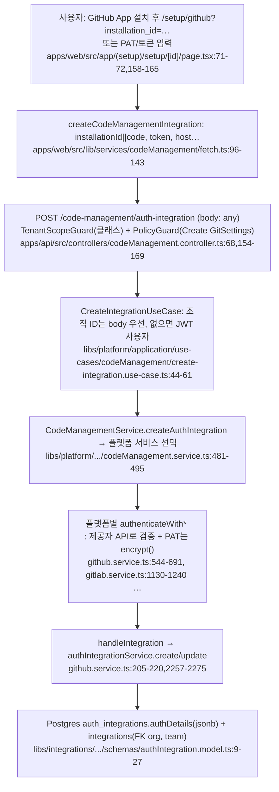
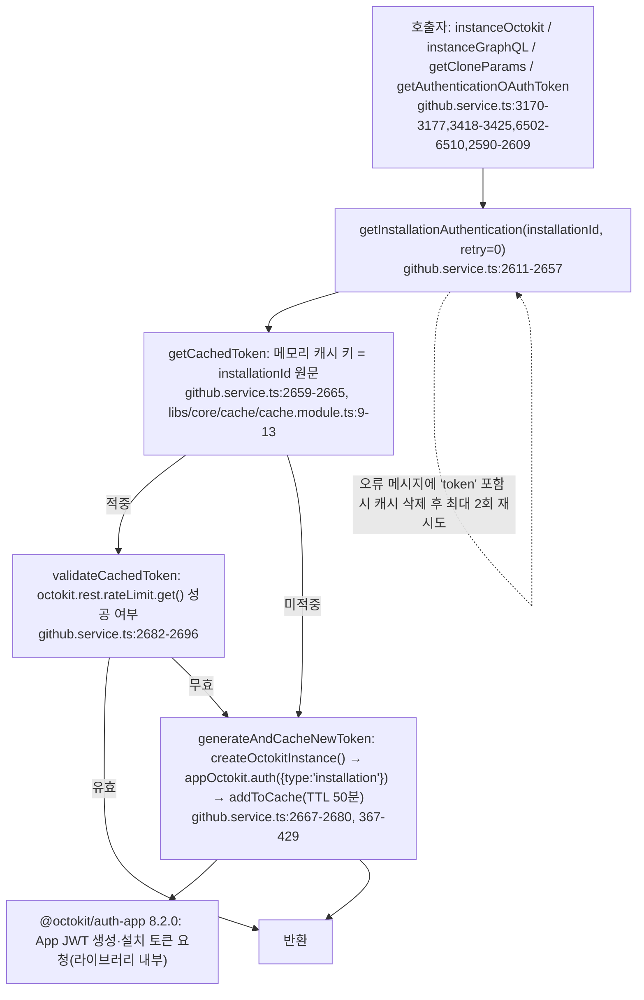
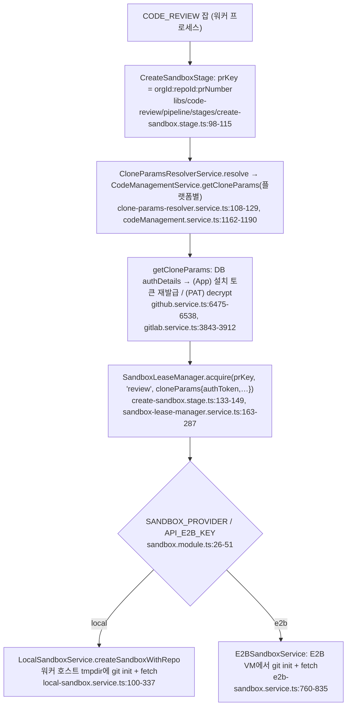

# kodus-ai — 자격증명 관리: 비공개 저장소 접근 토큰 (Q13)

- 분석 SHA: `45676c5fe7ac016b6206ccea006e459677d92842` (repos.lock.tsv와 일치. 시작 시 `git rev-parse HEAD`로 확인, 작업트리 clean)
- 분석일: 2026-10-13
- 관련 공통 항목: Q13 (Q10 인증·격리, Q2 코드 접근, Q9 Jira/MCP, Q11 외부 서비스와 연결)
- 검증 수준 요약(검증 열이 있는 표의 행을 스크립트로 센 값, 2026-10-13 재집계. 복수 표기 행은 각 수준에 중복 계산하고 검증 열이 없는 표·본문 서술은 제외): 코드 확인 98 / 실행 확인 0 / 추론 10 / 미확인 6
- 실행 여부: **정적 추적만**. `repos/kodus-ai`는 읽기만 했고 설치·빌드·실행·테스트를 하지 않았다. 조사 에이전트는 쓰지 않았고, 이 문서의 줄 번호는 모두 작성자가 파일을 직접 열어 확인한 값이다.
- 규칙: 실제 토큰·키 값은 적지 않았고 환경변수 이름과 설정 키 경로만 적었다. 경로 앞부분은 문서 끝의 "경로 사전"으로 줄였다.
- 표기: **[EE]** = `libs/ee/` 또는 `.ee.ts` 경로의 Enterprise 로직. 표기가 없으면 Community(AGPL) 경로다(`license.md:5-10`, [00 1절](00-overview.md#1-메타데이터)). 이 문서가 다루는 자격증명 핵심 파일(`github.service.ts`, `gitlab.service.ts`, `libs/integrations`, `libs/sandbox`, `libs/llm`, `libs/common/utils/crypto.ts`, `apps/mcp-manager`)은 `@libs/ee`를 import하지 않는다(`libs/sandbox libs/llm libs/integrations github.service.ts gitlab.service.ts`에서 `libs/ee|@libs/ee` 검색, 일치 없음). 다만 리뷰 파이프라인 조립 자체가 EE 경로에 있다는 [00 4절](00-overview.md#4-핵심-결론과-참고할-구현-3개)의 결론은 그대로다.

기존 문서와 겹치는 부분은 서술하지 않고 링크한다: 웹훅 컨트롤러별 검증 표와 큐·outbox·격리 매트릭스는 [04](04-saas-and-isolation.md), 실행 경로와 샌드박스 단계는 [01](01-execution-and-diff.md), Jira/MCP 단계 동작은 [03 Q9](03-incremental-memory-rules.md#q9)에 있다.

---

## 0. 한눈 요약

1. 저장소 자격증명은 **Postgres `auth_integrations.authDetails`(jsonb)** 에 **(조직, 팀) 단위 행**으로 저장된다. 암호화는 DB 계층이 아니라 **각 플랫폼 서비스가 PAT 필드만 `encrypt()`** 한다(AES-256-CBC, IV 랜덤, MAC 없음, 전역 키 `API_CRYPTO_KEY`). **GitLab OAuth 토큰(access/refresh)과 GitHub App 설치 토큰 스냅샷은 평문**이다.
2. GitHub App은 **배포 하나당 App 하나**를 모든 테넌트가 공유한다. 리뷰 경로는 저장된 토큰이 아니라 `installationId`로 `@octokit/auth-app`을 통해 설치 토큰을 **재발급**하고, 프로세스 메모리에 50분 캐시한다. **GitLab OAuth refresh 교환 코드는 없다.**
3. git clone은 **URL에 토큰을 넣지 않고** `Authorization: Basic` 헤더를 쓴다. 로컬 샌드박스는 `GIT_CONFIG_*` 환경변수로 넘겨 argv·`.git/config`에 남기지 않는다. 반면 **E2B 경로와 linked-repo 경로는 `git -c http.extraHeader="$GIT_AUTH_HEADER"`** 라서 헤더가 git 프로세스 argv에 들어간다(코드 주석이 스스로 인정).
4. 새로 확인한 위험 후보: (a) GitHub App 연결 시 **설치 ID의 소유권 검증이 없다**, (b) `readReference` 도구가 **clone 토큰을 플랫폼과 무관하게 `api.github.com`으로 보낸다**, (c) `mcp-manager`의 `AuthGuard`가 JWT를 **`decode`만** 한다(서명 검증 없음), (d) 로거의 민감 키 목록에 `authToken`·`appPassword`·`githubPat`이 없다.
5. 웹훅 시크릿 검증은 **재확인 결과 "없음"이 맞다**(Azure Repos의 전역 공유 토큰만 예외). 기존 보고서와 결론이 달라진 항목은 9절에 따로 정리했다.

---

## 1. 자격증명 종류 (플랫폼별)

기능 지원 수준은 3.3절 기준이다. "권한" 열은 **코드가 요구·검증하는 것**과 **문서(제품 문구)가 안내하는 것**을 구분했다. 문서만 본 항목은 `코드 확인`이 아니라 `문서 확인`으로 적었다.

### 1.1 Git 플랫폼

| 플랫폼 | 방식(`AuthMode`) | 지원 | 권한·scope | 저장 형태 | 코드 위치 | 검증 |
|---|---|---|---|---|---|---|
| GitHub | **GitHub App 설치** (`OAUTH`) | 지원 | 코드: 설치 토큰의 `permissions.pull_requests === 'write'`를 쓰기 가능 여부로 판정. 문서: Contents RO, Pull requests RW, Issues RW, Checks RW, Metadata RO, 이벤트 4종 | `installationId`, `org`, `accountType` + **`authToken`(설치 토큰 스냅샷, 평문)** | `libs/platform/.../github/github.service.ts:544-628`(등록), `:7451-7468`(권한 판정), 문서 `docs/en/how_to_deploy/platforms/github/github_app.mdx:62-76` | 코드 확인 / 문서 확인 |
| GitHub | **PAT** (`TOKEN`) | 지원 | 코드: 클래식 PAT는 `x-oauth-scopes`에 `repo`(또는 공개 저장소면 `public_repo`)가 있어야 쓰기 가능으로 판정. fine-grained PAT는 scope를 알 수 없어 `unknown`. 문서: fine-grained, Contents RW, Pull requests RW, Webhooks RW, Members(org) R 등 | `authToken`(**암호화**), `org`, `host`(GHES), `accountType` | `github.service.ts:630-691`, `:7427-7449`, 문서 `docs/en/how_to_use/code_review/general_config/github_pat.mdx:48-60` | 코드 확인 / 문서 확인 |
| GitHub | GHES(자체 호스팅) | 부분 지원 | PAT 경로에서 `host`로 `/api/v3`·`/api/graphql` 기본 URL을 만든다. App 경로의 GHES는 확인하지 못함 | `host` | `github.service.ts:222-253`, `:635-639` | 코드 확인 / 미확인(App+GHES) |
| GitHub | OAuth App(user-to-server) | 미지원(저장소 접근용) | `login/oauth/access_token` 호출은 **사용자 로그인**에만 있다. 저장소 접근 토큰 교환은 찾지 못함. 찾은 곳: `libs/platform libs/integrations libs/identity apps/api/src`에서 `createOAuthUserAuth|exchangeWebFlowCode|login/oauth/access_token|listInstallationsForAuthenticatedUser` | - | `libs/identity/.../auth/auth.service.ts:429`(로그인) | 코드 확인(부정 grep) |
| GitLab | **OAuth** (`OAUTH`) | 부분 지원 | 요청 scope 기본값 `read_api read_user read_repository`(웹이 인가 URL을 만들 때 사용). 문서의 PAT 안내는 `api`까지 요구하고, 코드는 액세스 토큰의 scope에 `api`가 없으면 "쓰기 불가"로 판정(OAuth 토큰은 이 호출이 안 돼 역할 기준만 사용) | `accessToken`·`refreshToken`·`tokenType`·`scope`·`host` **전부 평문** | `libs/platform/.../gitlab.service.ts:1130-1193`, `:4833-4849`, `.env.example:848`, `apps/web/src/app/layout.tsx:53-54` | 코드 확인 |
| GitLab | **PAT** (`TOKEN`) | 지원 | 문서: `api`, `read_api`, `read_user`, `read_repository`, `write_repository`. 코드: `GET {host}/api/v4/user` 200과 프로젝트 목록 1개 이상이면 통과 | `accessToken`(**암호화**), `host` | `gitlab.service.ts:1195-1240`, `:1249-1287`, 문서 `gitlab_pat.mdx:30-35` | 코드 확인 / 문서 확인 |
| GitLab | 프로젝트·그룹 액세스 토큰 | 부분 지원 | 별도 분기는 없다. PAT 입력칸에 넣으면 같은 경로로 처리되고, 코드 주석이 "personal/project/group access tokens report their scopes"라고 적어 이 입력을 가정한다. 봇 사용자 동작은 미확인 | PAT와 동일 | `gitlab.service.ts:4833-4849` | 추론(주석 근거) |
| GitLab | `CI_JOB_TOKEN` | 미지원 | 찾은 곳: `libs apps docs/en`에서 `CI_JOB_TOKEN` 검색, 일치 없음 | - | - | 코드 확인(부정 grep) |
| Bitbucket Cloud | **API 토큰/앱 비밀번호** (`TOKEN`) | 지원 | 문서: `read/write/admin:repository`, `read/write:pullrequest`, `read/write:webhook` 등 12개 scope. git 인증은 토큰이 `ATATT`로 시작하면 사용자명 `x-bitbucket-api-token-auth`, 아니면 계정 사용자명 | `appPassword`(**암호화**), `username`, `email`, `host` | `.../bitbucket/bitbucket-cloud.service.ts:3849-3927`, `libs/sandbox/.../git-auth-header.ts:16-33`, 문서 `bitbucket_pat.mdx:28-41` | 코드 확인 / 문서 확인 |
| Bitbucket Cloud | OAuth | 미지원 | 코드가 `Authenticating on Bitbucket via OAuth not implemented`를 던진다 | - | `bitbucket-cloud.service.ts:3163-3166` | 코드 확인 |
| Bitbucket Data Center | PAT(Bearer) 또는 Basic | 지원 | `host` 필수. `TOKEN`이면 `Bearer`, 아니면 `Basic` | `appPassword`(**암호화**), `username`, `host` | `.../bitbucket/bitbucket-data-center.service.ts:135-165`, `:192-222` | 코드 확인 |
| Azure DevOps | **PAT** (`TOKEN`) | 지원 | 문서: Code R&W, Analytics R, Graph R, Identities and Groups R, Project and Team R, User Profile R. API는 `Basic base64(":" + PAT)` | `token`(**암호화**), `orgUrl`, `orgName` | `.../azureRepos/azureRepos.service.ts:2660-2698`, `:2332`, 문서 `azure_devops_pat.mdx:31-38` | 코드 확인 / 문서 확인 |
| Azure DevOps | OAuth | 미지원 | `Authenticating on Azure Devops Repos via OAuth not implemented` | - | `azureRepos.service.ts:2621-2624` | 코드 확인 |
| Forgejo | **Access token** (`TOKEN`) | 부분 지원 | 문서: repository RW, issue RW, notification R, user R. 문서가 "community maintained"라고 표기 | `accessToken`(**암호화**), `host` | `.../forgejo.service.ts:1034-1075`, 문서 `forgejo_pat.mdx:6-8,32-37` | 코드 확인 / 문서 확인 |

- GitHub 설치 방식은 `authMode`가 비어 있으면 `OAUTH`로 간주한다(`github.service.ts:1682-1695`). GitLab·Bitbucket·Azure도 각자 기본값이 다르다(`bitbucket-data-center.service.ts:177-180`, `azureRepos.service.ts:2298-2302`).
- 문서가 안내하는 PAT 권한과 기능의 관계: GitHub PAT로 연결하면 "리뷰가 사용자 프로필 이름으로 게시되고 GitHub Checks/PR 상태는 쓸 수 없다"(`github_pat.mdx:72`). 코드에도 fine-grained 토큰이 check-runs 엔드포인트에 닿지 못한다는 주석이 있다(`github.service.ts:2778-2791`). 문서 확인 / 코드 확인.
- `.env.example`에 `GITHUB_TOKEN=`이 있으나(`.env.example:488-489`) 서버 코드(`libs`, `apps/api`, `apps/worker`, `apps/webhooks`)에서 읽는 곳을 찾지 못했다(검색 일치는 `libs/mcp-server/mcp-adapter/index.ts:29` 주석뿐). 선언만 있고 쓰이지 않는 변수로 본다. 코드 확인(부정 grep).

### 1.2 그 외 자격증명

| 종류 | 저장·사용 | 위치 | 검증 |
|---|---|---|---|
| GitHub App 자체 비밀 | env: `API_GITHUB_APP_ID`, `API_GITHUB_PRIVATE_KEY`(PEM, `\n` 이스케이프 보정), `GLOBAL_GITHUB_CLIENT_ID`, `API_GITHUB_CLIENT_SECRET` | `github.service.ts:324-364`, `:367-429` | 코드 확인 |
| GitLab OAuth 앱 | env: `GLOBAL_GITLAB_CLIENT_ID`, `GLOBAL_GITLAB_CLIENT_SECRET`, `GLOBAL_GITLAB_REDIRECT_URL`, `API_GITLAB_TOKEN_URL`(토큰 엔드포인트, 이 URL의 origin을 `host`로 저장) | `gitlab.service.ts:1132-1162` | 코드 확인 |
| 웹훅 시크릿 | Git 4종: **없음**. Azure: `CODE_MANAGEMENT_SECRET`+`CODE_MANAGEMENT_WEBHOOK_TOKEN`. 과금: `API_BILLING_WEBHOOK_SECRET` | 7절 | 코드 확인 |
| LLM API 키 | 조직별 BYOK(암호화) 또는 env 기본 키 | 6절 | 코드 확인 |
| Jira·Linear·Notion 등 MCP 토큰 | `apps/mcp-manager` 전용 Postgres 스키마에 AES-256-CBC로 암호화 | 5.4절 | 코드 확인 |
| 서버 내부 키 | `API_CRYPTO_KEY`(컬럼 암호화), `API_JWT_SECRET`(사용자·MCP 토큰 서명), `API_MCP_MANAGER_ENCRYPTION_SECRET`, `API_E2B_KEY`, `E2B_PROXY_PASSWORD`(E2B VM에 `SS_PASSWORD`로 전달) | `.env.schema:391-394`, `libs/mcp-server/services/mcp-manager.service.ts:151-160`, `e2b-sandbox.service.ts:1073-1090` | 코드 확인 |
| 시크릿 매니저/KMS | **미사용**. 찾은 곳: `libs apps package.json`에서 `secretsmanager|SecretManager|vault|@aws-sdk/client-kms|parameter store` 검색, 일치 없음 | - | 코드 확인(부정 grep) |

---

## 2. 연결(integration) 흐름과 저장 (Q13 저장·주입)

### 2.1 등록 경로

| 단계 | 사실 | 위치 | 검증 |
|---|---|---|---|
| API 입력 | 본문은 `@Body() body: any`로 DTO 검증이 없다. `TenantScopeGuard`가 body의 `organizationId`·`teamId`를 JWT 조직과 대조한다 | `codeManagement.controller.ts:167`, `apps/api/src/guards/tenant-scope.guard.ts:17-83` | 코드 확인 |
| 권한 | `PolicyGuard`로 `Action.Create`/`ResourceType.GitSettings`를 요구 | `codeManagement.controller.ts:154-161` | 코드 확인 |
| 저장소 | **Postgres**. `auth_integrations`(`authDetails` jsonb, `status`, `organization_id`·`team_id` FK)와 `integrations`(`platform`, `auth_integration_id` FK). Mongo에는 자격증명이 없다 | `authIntegration.model.ts:9-27`, `integration.model.ts:19-59` | 코드 확인 |
| 암호화 위치 | **리포지토리·서비스 계층은 암호화하지 않는다.** `AuthIntegrationRepository.create`는 받은 객체를 그대로 `save`한다. 필드 단위 `encrypt()`는 플랫폼 서비스가 호출한다 | `authIntegration.repository.ts:149-166`, `github.service.ts:650`, `gitlab.service.ts:1212`, `bitbucket-cloud.service.ts:3897`, `azureRepos.service.ts:2671`, `forgejo.service.ts:1058` | 코드 확인 |
| 조회 | `integrationService.getPlatformAuthDetails`가 `{organization, team, platform}`으로 찾고 `authDetails`를 풀어 반환. 리포지토리는 `organization.uuid`가 없으면 `undefined`를 반환 | `integration.service.ts:125-153`, `integration.repository.ts:77-124`(조직 가드는 `:87`) | 코드 확인 |
| 테넌트 분리 | 행이 **(조직, 팀)** 단위로 만들어진다. 같은 조직의 다른 팀은 별도 `auth_integrations` 행을 가진다. `integrations`에는 `(platform, organization, team)` **일반 인덱스**만 있고 **DB 유일 제약은 없다**(2026-10-13 마이그레이션까지 확인): 엔티티는 `@Index`만 선언했고(`integration.model.ts:25-31`), 마이그레이션 `1774034826247-indexes.ts:10`은 `CREATE INDEX CONCURRENTLY IF NOT EXISTS "IDX_integrations_platform_org_team"`(UNIQUE 아님), 베이스라인 `CREATE TABLE "integrations"`의 유일 제약은 `auth_integration_id`에 대한 `REL_bcc9e3193d26aa3a235ed4d967`(1:1 관계용) 하나뿐이다(`1763402134271-baseline.ts:103-115`). `UNIQUE`와 `integration`을 `libs/core/infrastructure/database/typeorm/migrations/` 59개 파일에서 검색해도 이 1건뿐이고 `synchronize: false`(`ormconfig.ts:42`, `typeORM.factory.ts:77`)다. 따라서 "(org, team, platform)당 1행"은 DB가 보장하지 않고 앱 로직(`handleIntegration`: 기존 integration이 있으면 update, 없으면 `addAccessToken`, `github.service.ts:205-220,2257-2275`)에 의존한다. 동시 요청 경쟁으로 중복 행이 생기는지는 확인하지 않았다(미확인). 대조: 같은 디렉터리의 `parameters`는 `UQ_parameters_one_active_per_team_key`로 유일 제약을 선언·마이그레이션함(`parameters.model.ts:16-20`, `2026052600000-DedupeAndEnforceOneActiveParameter.ts:49`) | `integration.model.ts:20-31`, 위 마이그레이션 | 코드 확인 |
| 팀 간 복제 | `CloneIntegrationUseCase`가 한 팀의 `authDetails`를 **통째로** 같은 조직의 다른 팀 행으로 복사한다(암호문은 그대로, 평문 필드는 평문 그대로). 두 팀 ID가 JWT 조직 소속인지는 확인한다 | `libs/integrations/application/use-cases/clone-integration.use-case.ts:39-52,81-99` | 코드 확인 |
| 감사 로그 | 연결·삭제 이벤트는 `org`, `accountType`, `authMode`만 기록하고 토큰 필드는 담지 않는다 | `libs/ee/codeReviewSettingsLog/infrastructure/adapters/services/integrationLog.handler.ts:34-62` **[EE]** | 코드 확인 |

### 2.2 암호화 방식

| 항목 | 내용 | 위치 | 검증 |
|---|---|---|---|
| 알고리즘 | `aes-256-cbc`, 암호화마다 `randomBytes(16)` IV, 출력 `"<iv hex>:<cipher hex>"`. **MAC/인증 태그 없음**(CBC 무결성 보장 없음) | `libs/common/utils/crypto.ts:4,11-34` | 코드 확인 |
| 키 | env **`API_CRYPTO_KEY`**(32바이트 hex). 모듈 import 시점에 길이를 검증하고 틀리면 부팅이 실패한다. `.env.schema`는 "컬럼 암호화용 대칭 키", `@required @sensitive`로 표기 | `crypto.ts:5-9`, `.env.schema:391-394` | 코드 확인 |
| 키 회전·버전 | 없음. 키 ID·버전 필드, 재암호화 코드를 찾지 못했다. 찾은 곳: `libs/common libs/integrations`에서 `rotate|rotation|re-?encrypt` 검색 | - | 코드 확인(부정 grep) |
| 테넌트별 키 | 없음. **전역 키 하나**가 모든 조직·팀 자격증명을 암호화 | `crypto.ts:5` | 코드 확인 |
| 복호화 시점 | 사용 직전 인-메모리 복호화. 예: `instanceOctokit`(PAT), `instanceGitlabApi`, `getCloneParams` | `github.service.ts:3300-3308`, `gitlab.service.ts:344-356`, 각 `getCloneParams` | 코드 확인 |
| MCP 매니저 | **별도 키**. `sha256(API_MCP_MANAGER_ENCRYPTION_SECRET)`을 키로 AES-256-CBC(base64, `iv:cipher`) | `apps/mcp-manager/src/common/utils/encryption.ts:12-35`, `src/config/configuration.ts:5-7` | 코드 확인 |

### 2.3 평문으로 저장되는 것

| 대상 | 평문 이유(코드 기준) | 위치 | 검증 |
|---|---|---|---|
| GitHub App `authDetails.authToken` | 연결 시점의 **설치 토큰 스냅샷**을 암호화 없이 저장. 리뷰 경로는 이 값을 쓰지 않고 `installationId`로 재발급하므로 사실상 쓰기 전용 | `github.service.ts:570-579`, 읽는 쪽은 3.1절 | 코드 확인 |
| GitLab OAuth `accessToken`·`refreshToken` | 토큰 응답을 그대로 저장 | `gitlab.service.ts:1152-1162` | 코드 확인 |
| 분기 | `authMode`가 `OAUTH`면 평문으로 쓰고, 아니면 `decrypt()` | `gitlab.service.ts:344-356`, `:3892-3898` | 코드 확인 |
| BYOK `baseURL`, `vertexLocation`, `awsRegion` 등 비밀이 아닌 설정 | 평문 jsonb | 6절 | 코드 확인 |

기존 [04 1.1절](04-saas-and-isolation.md#11-자격증명-보관)의 "GitLab OAuth·설치 토큰 스냅샷 평문" 결론과 같다. 다만 04가 `추론`으로 둔 "리뷰 경로가 재발급한다"는 부분을 이 문서에서 코드로 확인했다(3.1절).

### 2.4 연결 해제와 취소(revoke)

| 항목 | 내용 | 위치 | 검증 |
|---|---|---|---|
| DB 삭제 | 해제 시 웹훅 삭제(실패해도 계속) → `integration_configs` 삭제 → `integrations` 삭제 → **`auth_integrations` 행 삭제**. 감사 이벤트 발행 | `libs/platform/application/use-cases/codeManagement/delete-integration.use-case.ts:47-135` | 코드 확인 |
| GitHub App | `deleteWebhook`의 `OAUTH` 분기가 **`apps.deleteInstallation`을 호출해 GitHub 쪽 설치까지 삭제**한다. 같은 설치 ID가 복제로 다른 팀에도 있다면 그 팀도 끊긴다(추론: 복제 경로는 2.1절, 팀 간 설치 공유 여부는 코드로 보장되지 않음) | `github.service.ts:7507-7533`, `delete-integration.use-case.ts:71-89` | 코드 확인 / 추론 |
| PAT·GitLab OAuth·Bitbucket·Azure·Forgejo | 제공자 쪽 토큰 revoke 호출을 찾지 못했다. 찾은 곳: `delete-integration.use-case.ts`, 각 플랫폼 서비스의 `deleteWebhook`. 사용자가 직접 폐기해야 한다 | - | 미확인(해당 범위에서 없음) |
| 설치 토큰 캐시 | 연결 해제가 캐시를 비우지 않는다(`removeFromCache`는 토큰 검증 실패 경로에서만 호출). 해당 프로세스의 캐시는 최대 50분 남는다 | `github.service.ts:2625,2641`, `delete-integration.use-case.ts` 전체(호출 없음) | 코드 확인 / 추론(영향) |

### 2.5 설치 ID 소유권 검증 부재 (새 발견)

- 브라우저가 GitHub 설치 후 돌아오는 URL의 `installation_id`를 그대로 `code`로 서버에 보낸다(`fetch.ts:119-133`, `setup/[id]/page.tsx:71-72,158-165`).
- 서버는 이 값을 `appOctokit.auth({type:'installation', installationId: params.code})`와 `apps.getInstallation`에 넣는다. App 키로 서명하므로 **어떤 설치 ID든** 토큰이 발급된다(`github.service.ts:551-558`). 호출한 Kodus 사용자가 그 GitHub 계정의 소유자인지 확인하는 코드(사용자 OAuth 토큰으로 `listInstallationsForAuthenticatedUser` 대조, `state` 검증 등)는 이 경로에 없다. 찾은 곳은 위 1.1절 부정 grep과 `authenticateWithCodeOauth` 전체(`:544-628`).
- 결과(**추론**): 같은 App을 공유하는 배포(특히 클라우드의 전역 App)에서 인증된 Kodus 사용자가 **다른 GitHub 계정이 설치한 설치 ID**를 제출하면 그 설치의 저장소 접근권을 자기 팀에 연결할 수 있다. 설치 ID가 추측 가능한지는 외부 지식(순차 정수)에 의존한다. 실행으로 확인하지 않았다.

---

## 3. 토큰 수명과 갱신

### 3.1 GitHub App 설치 토큰

| 항목 | 사실 | 위치 | 검증 |
|---|---|---|---|
| JWT 생성 | Kodus 코드는 `appId`, `privateKey`, `clientId`, `clientSecret`을 `@octokit/auth-app`의 `createAppAuth`에 넘길 뿐이다. 개인 키 PEM은 `trim`, 따옴표 제거, `\\n` 복원, 한 줄 PEM 재포맷 후 사용한다. **JWT 서명·만료 시간·`/app/installations/{id}/access_tokens` 호출은 라이브러리 내부**이고 `node_modules`가 없어 열지 못했다 | `github.service.ts:367-429`, 의존성 `pnpm-lock.yaml:2807`(`@octokit/auth-app@8.2.0`) | 코드 확인(전달부) / 미확인(JWT 내부) |
| App 단위 | **배포 하나에 App 하나**. 모든 테넌트가 같은 App ID·개인 키·클라이언트 시크릿을 쓴다(자체 호스팅은 사용자가 자기 App을 만든다) | `github.service.ts:413-428`, 문서 `github_app.mdx:21-23,64-76` | 코드 확인 |
| 캐시 | `CacheService`는 `cache-manager`의 **프로세스 메모리 저장소**(`store:'memory', max:50000`)에 `JSON.stringify`로 저장. 프로세스 간 공유 없음(Redis 없음). 키는 **`installationId` 원문**으로 조직 접두사가 없다 | `libs/core/cache/cache.service.ts:11-30`, `cache.module.ts:9-13`, `github.service.ts:2659-2680` | 코드 확인 |
| 만료 | TTL **50분**(`this.TTL = 50 * 60 * 1000`). 저장되는 응답에 `expiresAt`이 있으나 Kodus 코드는 비교하지 않는다. 대신 **캐시 적중마다 `GET /rate_limit`을 호출**해 유효성을 확인하고 실패하면 캐시 삭제 후 재발급 | `github.service.ts:140-146,174,2616-2626,2682-2696` | 코드 확인 |
| 재시도 | 오류 메시지에 `token`이 들어 있으면 캐시를 지우고 최대 `MAX_RETRY_ATTEMPTS = 2`회 재귀 호출. 그 외는 로그 후 던진다 | `github.service.ts:173,2629-2656` | 코드 확인 |
| 저장된 스냅샷 | 리뷰·clone·GraphQL 경로 모두 `authDetails.authToken`을 읽지 않고 `installationId`로 재발급한다(`authMode===OAUTH && 'installationId' in …` 조건) | `github.service.ts:3170-3183`, `:3418-3433`, `:6502-6527` | 코드 확인 |
| 만료 시 실패 | App 서명이 유효하면 재발급되므로 만료로 실패하는 경로는 없다. 설치가 GitHub에서 삭제되면 발급이 실패해 단계 오류가 된다([04 2.3절](04-saas-and-isolation.md#23-파이프라인-오류의-의미-중요)) | 같은 곳 | 추론 |
| 호출처 없는 메서드 | `accessToken()`이 설치 토큰을 `"<type> - <token>"` 문자열로 반환하지만 호출하는 코드를 찾지 못했다(`\.accessToken\(` 검색) | `github.service.ts:3469-3548` | 코드 확인(부정 grep) |

### 3.2 GitLab OAuth refresh

- **지원하지 않는다.** 토큰 교환은 `grant_type: 'authorization_code'` 한 곳뿐이다(`gitlab.service.ts:1132-1142`). `refresh_token` 값은 저장만 하고(`:1154`) 쓰지 않는다. 찾은 곳: `libs/platform libs/integrations libs/identity/.../auth`에서 `refresh_token|refreshToken|grant_type|expires_in|expiresAt` 검색. `auth.service.ts`의 refresh는 **Kodus 사용자 로그인 토큰**이다. 코드 확인(부정 grep).
- 만료 시간은 이 SHA에서 저장하지 않는다(`GitlabAuthDetail`에 `expiresAt` 없음, `libs/integrations/domain/authIntegrations/types/gitlab-auth-detail.type.ts:3-16`). GitLab 액세스 토큰이 만료되면 재인증 전까지 API·clone이 실패할 가능성이 크다. 만료 기간은 외부 지식이므로 **추론**으로 둔다.
- PAT 계열(GitHub PAT, GitLab PAT, Bitbucket, Azure, Forgejo)은 갱신이 없고 만료되면 사용자가 새 토큰으로 재연결해야 한다. 만료 임박 알림 코드는 찾지 못했다(미확인).
- MCP/Jira OAuth는 갱신이 **있다**(5.4절).

---

## 4. git clone/fetch 경로 (Q13 사용 지점·유출 방지)

### 4.1 토큰이 sandbox까지 가는 길

- 토큰은 **같은 워커 프로세스의 메모리**로만 전달된다. 큐 메시지나 Mongo 리스 문서에 실리지 않는다(5.1절). `CreateSandboxParams.authToken`은 `string`으로 `provider.createSandboxWithRepo`까지 그대로 간다(`libs/sandbox/domain/contracts/sandbox.provider.ts:4-30`). 코드 확인.
- clone URL은 **토큰이 없는 URL**이다. GitHub `https://<host>/<fullName>`(`github.service.ts:6512`), GitLab `…/<encodedPath>`(`gitlab.service.ts:3879-3883`), Bitbucket Cloud `https://bitbucket.org/<fullName>`(`bitbucket-cloud.service.ts:781`), Data Center `…/scm/<project>/<repo>.git`(`bitbucket-data-center.service.ts:783-784`). 코드 확인. (Bitbucket 쪽 주석에 "empty token in the URL"이 남아 있는 것은 과거 URL 임베드 설계의 흔적으로 보이며 현재 코드에는 URL 임베드가 없다. 추론.)
- 헤더 형식은 플랫폼별로 `Authorization: Basic base64(<user>:<token>)`이다. GitHub `x-access-token`, GitLab·Azure `oauth2`, Bitbucket은 4.4절, 그 외(Forgejo 포함)는 `default` 분기의 `x-access-token`이다(`git-auth-header.ts:8-40`). `GitCloneParams.auth.username: 'oauth2'`를 Forgejo가 넘기지만(`forgejo.service.ts:1680-1684`) 헤더 빌더는 그 값을 쓰지 않는다(`git-auth-header.ts:37-38`). 코드 확인.

### 4.2 경로별 전달 방식과 흔적

| 경로 | 전달 방식 | argv(`ps`)에 남는가 | `.git/config`에 남는가 | 위치 | 검증 |
|---|---|---|---|---|---|
| **로컬 샌드박스** 본 clone | `git init` → `git -C <dir> fetch --depth=1 <cloneUrl> <refspec>`를 **`GIT_CONFIG_COUNT=1`, `GIT_CONFIG_KEY_0=http.extraHeader`, `GIT_CONFIG_VALUE_0=<header>` 환경변수**로 실행. 주석: "keep the token out of ps/proc/cmdline" | **아니오**(환경변수만) | **아니오**. `remote add`를 하지 않고 `core.hooksPath=/dev/null`만 쓴다 | `local-sandbox.service.ts:122-124,138-174` | 코드 확인 |
| 로컬 샌드박스 서브모듈 | 헤더를 **`http.<origin>/.extraHeader`로 origin에 한정**한 `GIT_CONFIG_*` 환경변수로 전달. base 브랜치에 같은 선언이 있고 같은 호스트인 서브모듈만. 외부 호스트는 헤더를 받지 않음 | 아니오 | 아니오 | `submodule-fetch.ts:1-32,439-455,632-656`, `local-sandbox.service.ts:348-397` | 코드 확인 |
| **E2B** clone·sync·base fetch | E2B 명령 문자열 `git -c http.extraHeader="$GIT_AUTH_HEADER" fetch …`를 실행하고 **`GIT_AUTH_HEADER`는 그 명령의 `envs`**로만 전달. 쉘이 변수를 풀어 git에 `-c` 인자로 넘긴다. `Sandbox.create`에는 `envs`가 없어 VM 전역 환경에는 토큰이 없다 | **예(VM 안에서)**. `submodule-fetch.ts:523-528` 주석이 "the E2B clone path still passes it via `-c`"라고 인정한다 | 아니오(`-c`는 저장하지 않음). 단 clone 뒤 `git remote add origin <토큰 없는 URL>` | `e2b-sandbox.service.ts:442-444,453-464,815-835,979-987,1034-1059` | 코드 확인(주석) / 추론(쉘 확장) |
| **linked-repo clone [EE]** | E2B와 같은 `-c http.extraHeader="$GIT_AUTH_HEADER"` + `sandbox.run(cmd,{envs})`. 주석: "keeps the token out of .git/config, which agent tools could otherwise read". 로컬 샌드박스의 `run`은 `/bin/sh`로 명령 문자열을 실행하므로(`local-sandbox.service.ts:274-301`) **워커 호스트 `ps`에 헤더가 보일 수 있다**. 이 기능은 플랜 검증을 통과한 조직만 쓴다 | 예(추론: 쉘 확장) | 아니오 | `libs/ee/linked-repositories/infrastructure/linked-repo-access.ts:306-350` **[EE]**, `agent-review.stage.ts:2945-2950,3278-3314` | 코드 확인 / 추론 |
| 셀프호스팅 doctor `ls-remote` | `GIT_CONFIG_*` 환경변수 + `credential.helper=` 비움 + `GIT_TERMINAL_PROMPT=0`. 주석이 "never argv … same as local-sandbox"라고 명시 | 아니오 | 해당 없음 | `apps/api/src/doctor/self-hosted-doctor.service.ts:706-737` | 코드 확인 |

- 요약: **환경변수 방식(로컬 본 clone, doctor)이 가장 엄격하고, E2B와 linked-repo는 코드 주석("never touches disk/process args")과 달리 argv에 남는다.** E2B에서 argv는 VM 안에서만 보이고 에이전트 도구(`grep`, `readFile` 등)는 그 시점에 돌지 않는다(clone이 먼저 끝난다). 이 순서 가정은 [01 실행 경로](01-execution-and-diff.md)의 단계 순서에 의존한다.
- 로그: 로컬·E2B 모두 clone 시작 로그에 `cloneUrl`을 남기지만 URL에 토큰이 없다(`e2b-sandbox.service.ts:794-805`, `create-sandbox.stage.ts:117-128`은 `hasAuthToken: boolean`만 기록). git 오류는 `stderr`를 500자로 잘라 예외 메시지에 넣는다(`e2b-sandbox.service.ts:847-854`). 헤더 방식이라 stderr에 토큰이 들어갈 일은 코드상 없다(추론).
- 호스트 환경변수 상속: 로컬 샌드박스의 모든 자식 프로세스(`git`, `grep`, `find`, `sandbox.run`)는 **`{...process.env}`**를 받는다(`local-sandbox.service.ts:70-78`). 즉 워커의 `API_CRYPTO_KEY`, DB 접속 정보, GitHub 개인 키, LLM 키가 자식 프로세스 환경에 있다. 에이전트가 쓰는 `exec`는 읽기 전용 프로그램 화이트리스트와 경로 검사로 막혀 있고(`:516-649`) 코드 주석도 "no container isolation … RCE vector"라고 위험을 명시한다(`:523-533`). 이 방어를 우회하는 경로가 있는지는 확인하지 못했다(미확인). E2B VM에는 워커 환경이 전달되지 않는다(`Sandbox.create`에 `envs` 없음, `e2b-sandbox.service.ts:1034-1059`).

### 4.3 clone 후 정리와 테넌트 혼입

| 항목 | 사실 | 위치 | 검증 |
|---|---|---|---|
| 로컬 디렉터리 | `mkdtemp(join(tmpdir(), 'kodus-sandbox-'))`로 **리뷰마다 랜덤 디렉터리**. 경로에 조직·저장소 ID가 없다 | `local-sandbox.service.ts:115` | 코드 확인 |
| 삭제 | 스테이지가 `sandbox.cleanup`을 `leaseManager.release(...)`로 **교체**한다. 리스 카운트가 0이 되면 로컬 디렉터리는 **즉시** `deleteLocalSandbox`(`rm -rf`)로 삭제하고, 실패하면 재시도 표시를 남긴다. E2B는 30초 유휴 후 kill 예약 | `create-sandbox.stage.ts:23,154-158`, `sandbox-lease-manager.service.ts:309-370`, `local-sandbox-cleanup.service.ts:12-46` | 코드 확인 |
| 삭제 경로 안전 | `tmpdir` 직속 자식이고 `kodus-sandbox-` 접두사인 경로만 삭제 | `local-sandbox-cleanup.service.ts:12-27` | 코드 확인 |
| 로컬 리스가 워커 간 공유되는가 | **아니오**. 같은 `prKey`의 두 번째 소비자(joiner)는 `API_E2B_KEY`가 없으면 `connectToExisting`에서 **NullSandbox**를 받는다. 로컬 경로를 다른 소비자가 재사용하지 않는다. [04 3절](04-saas-and-isolation.md#3-테넌트-격리-매트릭스)이 "미추적"으로 둔 항목을 닫는다 | `sandbox-lease-manager.service.ts:821-835` | 코드 확인 |
| 리스 문서 | Mongo `sandbox_leases`에는 `sandboxId`, `organizationId`, `repositoryId`, `baseBranch`, `prNumber`, 정리 상태만 있고 **토큰·URL 필드가 없다** | `libs/sandbox/infrastructure/repositories/schemas/sandbox-lease.model.ts:49-143` | 코드 확인 |
| 다른 테넌트 토큰과 섞일 가능성 | clone 토큰은 호출마다 `(organizationId, teamId)`로 DB에서 읽는다. 설치 토큰 캐시 키가 조직 접두사 없이 `installationId`인 점은 04가 지적한 대로이며, **같은 설치를 두 조직이 공유한 경우**에만 같은 토큰이 재사용된다(2.5절과 연결). 로컬 디렉터리는 랜덤 이름이라 섞이지 않는다 | `github.service.ts:2659-2680`, `local-sandbox.service.ts:115` | 코드 확인 / 추론 |
| 비동기 AST 잡 | 그래프 빌드·증분 잡도 같은 `getCloneParams` 결과로 `authToken`을 넘긴다 | `libs/code-review/workflow/ast-graph-build-job.processor.ts:174-175`, `ast-graph-incremental-job.processor.ts:172-173` | 코드 확인 |

### 4.4 Bitbucket 토큰 형식(참고)

`git`은 REST와 달리 Atlassian API 토큰을 `<email>:<token>`으로 받지 않는다. 토큰이 `ATATT`로 시작하면 사용자명을 `x-bitbucket-api-token-auth`로 바꾸고, 아니면 저장된 `username`을 쓰며 둘 다 없으면 예외를 던진다(`git-auth-header.ts:16-33`). 같은 함수가 `e2b-sandbox.service.ts:257-282`와 `linked-repo-access.ts:392-418`에 **복제**되어 있어 한쪽만 고치면 어긋날 수 있다(코드 확인, 유지보수 위험은 추론).

### 4.5 CLI 경로와 clone 대상 URL

| 항목 | 사실 | 위치 | 검증 |
|---|---|---|---|
| 팀 키 CLI | CLI가 보낸 `gitRemote`를 파싱해 `fullName`을 얻고, **조직 통합의 토큰**으로 서버가 만든 URL(`getCloneParams`)을 clone한다. 서버가 만든 URL이 있으면 클라이언트 URL을 덮어쓴다 | `clone-params-resolver.service.ts:137-217` | 코드 확인 |
| 저장소 허용 목록 대조 | **Azure만** `getRepositories()`에서 요청 저장소가 있는지 확인한다. GitHub·GitLab·Bitbucket Cloud·Forgejo의 `getCloneParams`는 `fullName`을 목록과 대조하지 않는다. 팀 키 사용자가 임의 `owner/repo`를 지정하면 PAT로 닿는 모든 저장소가 clone 대상이 될 수 있다 | Azure `azureRepos.service.ts:2254-2263` / GitHub `github.service.ts:6512` | 코드 확인 / 추론(영향) |
| 체험(trial) 모드 | 인증 없는 `POST /cli/trial/review`가 `githubPat`와 임의 `gitRemote`를 받아 **API 프로세스에서 직접** 실행한다(큐를 거치지 않음). 사용자 PAT를 `cloneUrl=gitContext.remote`로 clone한다. 팀 키 경로의 `enqueue`는 `githubPat`을 **넘기지 않는다**. PAT는 `dataExecution.git`에 저장하지 않는다 | `apps/api/src/controllers/cli/cli-review.controller.ts:684-699,919-935,975-983`, `clone-params-resolver.service.ts:165-170`, `execute-cli-review.use-case.ts:259-268,694-705` | 코드 확인 |
| CLI 클라이언트 | 체험 모드에서 `--github-pat`, `KODUS_GITHUB_PAT`, **`GITHUB_TOKEN`, `GH_TOKEN`** 순으로 개발자 환경의 토큰을 골라 서버로 보낸다. 인증 리뷰가 실패하면 자동으로 체험 모드로 폴백하며 같은 토큰을 보낸다 | `apps/cli/src/features/review/command.ts:69-84,268-281,336-347`, `apps/cli/src/services/api/review.api.ts:262-278` | 코드 확인 |
| GitHub Action | 이 SHA의 `.github/actions/`는 내부 알림용(`report-signal`, `discord-notify`)뿐이고 리뷰 실행용 Action은 없다 | `.github/actions/*/action.yml` | 코드 확인 |

### 4.6 `readReference` 도구가 clone 토큰을 쓴다 (새 발견)

- `AgentReviewStage.resolveGitHubToken`은 `getFreshCloneParams()`의 **`authToken`을 플랫폼 확인 없이** 반환한다(`agent-review.stage.ts:2926-2938`). 이 값이 `gitHubToken`으로 도구 레지스트리에 들어가고(`:715`), 토큰이 있으면 `readReference` 도구가 등록된다(`agent-tools.factory.ts:1469-1470`).
- 도구는 모델이 준 `repo`·`path`·`branch`로 **`https://api.github.com/repos/${repo}/contents/…`** 를 호출하며 `Authorization: Bearer ${gitHubToken}`을 붙인다(`agent-tools.factory.ts:1492-1505`). 호스트가 고정이다.
- 결과 1(**추론**): GitLab·Bitbucket·Azure·Forgejo·GHES 조직의 clone 토큰이 모델의 도구 호출 한 번으로 **`api.github.com`에 전송**될 수 있다(제3자 서비스로의 토큰 노출).
- 결과 2(**추론**): GitHub 조직에서는 모델이 **토큰이 닿는 임의의 저장소**(PAT 모드는 PAT 소유자가 보는 모든 저장소, App 모드는 설치된 저장소)를 읽을 수 있다. 읽은 내용은 리뷰 댓글로 나올 수 있다. PR 본문·코드의 프롬프트 인젝션이 호출을 유도할 가능성은 이 문서가 실험하지 않았다.
- `readReference`는 파일 내용만 반환하고 토큰을 모델에 노출하지 않는다(코드 확인). 위의 두 가지는 정적 추적 결과이며 실행으로 확인하지 않았다.

---

## 5. 큐·로그·관측·에러, MCP·Jira

### 5.1 큐와 outbox/inbox

| 항목 | 사실 | 위치 | 검증 |
|---|---|---|---|
| RabbitMQ 메시지 본문 | `jobId`, `correlationId`, `workflowType`, `handlerType`, `organizationId`, `teamId`뿐. **토큰·clone URL 없음** | `libs/core/workflow/infrastructure/workflow-job-queue.service.ts:61-69` | 코드 확인 |
| outbox 행 | 위 메시지를 `outbox_messages.payload`에 저장 | `workflow-job-queue.service.ts:77-88`, `outbox-message.model.ts:33` | 코드 확인 |
| `workflow_jobs.payload`(jsonb) | 웹훅 원본 페이로드 또는 잡 입력이 들어간다. 코드리뷰 잡은 저장소 ID·PR 번호 등이고, 팀 키 CLI 잡은 `gitContext`(remote, branch, SHA)와 diff가 들어가지만 `githubPat`은 넣지 않는다 | `workflow-job.model.ts:43-44`, `enqueue-cli-review.use-case.ts:39-60`, `cli-review.controller.ts:692-699` | 코드 확인 |
| `CliReviewJobGitContext.githubPat` | 타입에는 필드가 있으나(`cli-review-job.types.ts:16-21`) 큐에 넣는 경로는 이를 채우지 않는다. 체험 모드는 큐를 쓰지 않는다 | 4.5절 | 코드 확인 |
| 잡 행 정리 | `workflow_jobs` 삭제·TTL 코드는 찾지 못했다(찾은 곳: `libs/core/workflow`의 `DELETE FROM|retention|purge`는 이벤트 브리지 테이블뿐, `cross-process-events.bridge.ts:763`). 토큰이 payload에 들어가는 경로가 없으므로 영향은 제한적이다 | - | 미확인(보존 기간) |

### 5.2 로그·에러 메시지

| 항목 | 사실 | 위치 | 검증 |
|---|---|---|---|
| 로거 | `SimpleLogger.log/error/warn`은 `metadata`를 `deepSanitize`한 뒤 pino로 출력한다. pino `redact.paths`에는 `password`, `token`, `secret`, `apiKey`, `authorization`, `cookie`, `accessToken`, `refreshToken`, `clientSecret`, `privateKey`, `bearerToken`, `jwt`, `credential`, `connectionString`을 깊이 0~2에 두었다 | `libs/core/log/logger.ts:112-185`, `:1104-1141` | 코드 확인 |
| 민감 키 목록 | `SENSITIVE_KEYS`는 정규화(소문자, 영숫자만) 후 **정확히 일치**한다. `privatetoken`, `xgitlabtoken`, aws 자격증명 4종까지 있으나 **`authtoken`, `apppassword`, `githubpat`은 없다** | `logger.ts:268-310` | 코드 확인 |
| 문자열 정화 | `error.message/stack`, 문자열 값은 URL userinfo(`user:secret@`), `Authorization:` 헤더 줄, `key=value`, JSON 쌍을 정화한다. **`message` 인자는 정화를 거치지 않고** `childLogger[level](logObject, message)`로 그대로 나간다 | `logger.ts:431-433,459-484,1012-1015` | 코드 확인 |
| 토큰이 로그에 실릴 수 있는 지점 | (a) GitHub `checkRepositoryPermissions` 실패 로그가 `metadata: params`를 통째로 남기고 `params.authDetails.authToken`은 App 모드에서 **평문 설치 토큰**이며 키 이름이 목록에 없다(`authToken` → 정화 안 됨). (b) GitLab·GitHub `createAuthIntegration` 실패 로그도 `params`를 통째로 남기지만 키가 `token`·`accessToken`·`refreshToken`이라 **정화된다** | (a) `github.service.ts:1299-1311,1364-1371`, (b) `github.service.ts:531-540`, `gitlab.service.ts:1277-1281`, `bitbucket-cloud.service.ts:3914-3922` | 코드 확인 / 추론(a의 실제 발생은 실패 경로에서만) |
| BYOK 저장 실패 로그 | `configValue`를 로그에 넣지 않는다고 주석으로 명시 | `create-or-update.use-case.ts:126-138` | 코드 확인 |
| 클론 오류 | `e2b-sandbox.service.ts:847-854`는 `stderr`를 500자 잘라 던진다. 토큰은 헤더로 전달되므로 stderr에 들어갈 이유가 없다 | 같은 곳 | 추론 |
| 설치 토큰 캐시 오류 로그 | `installationId`만 기록 | `github.service.ts:2634-2654` | 코드 확인 |

### 5.3 Langfuse·텔레메트리

| 항목 | 사실 | 위치 | 검증 |
|---|---|---|---|
| 활성 조건 | `LANGFUSE_TRACING==='true'`이고 `LANGFUSE_PUBLIC_KEY`·`LANGFUSE_SECRET_KEY`가 있을 때만 | `libs/core/log/langfuse.ts:17-23` | 코드 확인 |
| 마스킹 설정 | `LangfuseSpanProcessor({ environment })`만 만들며 **입력·출력 마스크 설정이 없다** | `langfuse.ts:60-73` | 코드 확인 |
| 스팬 메타데이터 | `organizationId`, `teamId`, `pullRequestId`, `repositoryId`, `provider`(LLM 제공자 이름)만 붙인다. 토큰·clone URL·API 키는 메타데이터에 없다 | `langfuse.ts:263-279` | 코드 확인 |
| 프롬프트·도구 입출력 | AI SDK 통합(`LangfuseVercelAiSdkIntegration`)이 등록돼 모델 호출 단위 스팬이 만들어진다. 프롬프트·도구 결과가 스팬에 실리는 범위는 라이브러리 기본 동작이며 이 문서는 열지 않았다. 코드와 diff는 실릴 수 있다. 토큰은 프롬프트 어디에도 넣지 않는다(4.6절의 `readReference`는 결과만 반환) | `langfuse.ts:107-113` | 코드 확인(등록) / 미확인(실리는 범위) |

### 5.4 MCP·Jira 토큰

| 항목 | 사실 | 위치 | 검증 |
|---|---|---|---|
| 구조 | Jira는 직접 연동이 아니라 `mcp-manager`의 **관리형 MCP "Atlassian Rovo"**(`atlassian-rovo-default`, `https://mcp.atlassian.com/v1/mcp`)를 쓴다. 인증 방식 2개: OAuth(동적 등록) 또는 **API 토큰**(필드: Atlassian 계정 이메일 + `apiToken`, 타입 `basic`). Linear·Notion·Sentry 등도 같은 구조 | `apps/mcp-manager/src/config/managed-mcp-servers.json:92-126` | 코드 확인 |
| 저장소 | **Postgres 별도 스키마 `mcp-manager`**. `mcp_integrations`(`auth`, `headers` 컬럼: 암호문 text), `mcp_integration_oauth`(`auth` 암호문, `(organizationId, integrationId)` 유일), 연결 `mcp_connections`. 키는 **조직 단위**(팀 단위 아님) | `entities/mcp-integration.entity.ts:14-60`, `entities/mcp-integration-oauth.entity.ts:11-42` | 코드 확인 |
| 암호화 | `encryptAuth`는 인증 유형별 페이로드(Bearer, API 키+헤더명, Basic, OAuth2)를 JSON으로 만들어 `EncryptionUtils.encrypt`. 헤더도 암호화. 관리형 토큰 자격증명은 `saveTokenCredential`이 암호화해 `mcp_integration_oauth.auth`에 저장 | `integrations.service.ts:58-135`, `integration-oauth.service.ts:398-436` | 코드 확인 |
| OAuth 갱신 | **있다**. `refreshOAuthStateIfNeeded`가 토큰 엔드포인트로 갱신하고 새 상태를 다시 암호화해 저장한다. 실패하면 기존 상태를 그대로 반환한다 | `integration-oauth.service.ts:151-249` | 코드 확인 |
| 사용 | 리뷰 워커가 `MCPManagerService.getConnections`로 연결 목록을 받고 `formatConnection`이 `connection-config` 엔드포인트에서 **복호화된 자격증명**을 받아 `Authorization` 헤더 등으로 조립한다. 이 헤더가 MCP 클라이언트의 HTTP 전송 `requestInit.headers`로 외부 MCP 서버에 나간다. 모델 프롬프트에는 들어가지 않는다 | `libs/mcp-server/services/mcp-manager.service.ts:173-262,378-481`, `libs/mcp-server/mcp-adapter/client.ts:1668-1698`, `apps/mcp-manager/src/modules/mcp/mcp.service.ts:533-586` | 코드 확인 |
| 서비스 간 인증 | 워커/API가 `API_JWT_SECRET`으로 `{organizationId}` JWT를 서명해 `mcp-manager`에 보낸다. 그러나 **`mcp-manager`의 `AuthGuard`는 `jwtService.decode(token)`만 호출하고 서명을 검증하지 않는다.** `JwtModule`에 `API_MCP_MANAGER_JWT_SECRET`이 등록돼 있으나 `verify`가 없다 | `mcp-manager.service.ts:151-171`, `apps/mcp-manager/src/common/guards/auth.guard.ts:20-45`, `app.module.ts:20-23`(`verify` 검색 일치 없음) | 코드 확인 |
| 영향 | `mcp-manager` HTTP에 닿을 수 있으면 `organizationId` 클레임이 있는 임의 JWT로 해당 조직의 `integration/custom/:id/connection-config`, `integration/kodusmcp/:id/connection-config`(주석: "Internal use only", 복호화된 자격증명 반환)를 읽을 수 있다. dev compose는 포트를 호스트에 게시한다(`docker-compose.dev.yml:346-350`). **운영 배포의 네트워크 노출은 `docker-compose.prod.yml`에 mcp-manager가 없어 확인하지 못했다** | `mcp.controller.ts:421-467`, `docker-compose.dev.yml:346-350` | 코드 확인 / 미확인(운영 노출) |
| 기능 지원 | Jira 토큰 저장·갱신·사용: **지원**(MCP 경유). 리뷰 입력에서의 사용 범위는 [03 Q9](03-incremental-memory-rules.md#q9) | - | 코드 확인 |

---

## 6. LLM API 키 (BYOK와 기본 키 폴백)

| 항목 | 사실 | 위치 | 검증 |
|---|---|---|---|
| BYOK 지원 | **조직 단위**로 지원. 설정 키 `OrganizationParametersKey.BYOK_CONFIG`가 Postgres `organization_parameters.configValue`(jsonb)에 저장된다. v2 형식 `credentials[]`(제공자, `apiKey`, `settings`) + `models[]` + `routing` | `libs/organization/.../organizationParameters.model.ts:8-26`, `create-or-update.use-case.ts:68-84,146-229` | 코드 확인 |
| 저장 시 암호화 | 각 credential의 **`apiKey`와 Bedrock 비밀 필드**(`awsBearerToken`, `awsAccessKeyId`, `awsSecretAccessKey`, `awsSessionToken`)만 `encrypt()`. `baseURL`, `vertexLocation`, `awsRegion` 등은 평문. 키는 2.2절의 전역 `API_CRYPTO_KEY` | `create-or-update.use-case.ts:419-486,495-533,612-624` | 코드 확인 |
| 마스크 에코 방지 | 빈 값이나 `••••` 또는 서버 마스크(`첫 2자...끝 3자`)가 돌아오면 기존 암호문을 유지하고 마스크를 암호화하지 않는다 | `create-or-update.use-case.ts:612-640` | 코드 확인 |
| 읽기(API) | 조회 응답은 키를 복호화해 **앞 2자+`...`+뒤 3자**로 마스킹(6자 이하는 `••••`). 복호화 실패 시 `••••` | `find-by-key.use-case.ts:62-82,114-141` | 코드 확인 |
| 실행 시 사용 | 슬롯은 **암호문을 그대로** 들고 다니다가 모델을 만드는 `buildModelFromSlot`에서만 `decrypt()`한다. 평문은 로컬 변수로 제공자 빌더에 직접 넘긴다 | `libs/llm/resolve-model-slot.ts:12-18,48-110`, `libs/llm/byok-to-vercel.ts:58-63,104-113` | 코드 확인 |
| 서버 측 탐침 | 연결 테스트·모델 목록 탐침은 `resolveByokSlot`이 복호화한다. `safeDecrypt`는 복호화에 실패하면 **값을 평문으로 간주해 그대로 쓴다**(과거 평문 호환) | `byok-credentials.util.ts:26-35,51-105` | 코드 확인 |
| SSRF 가드 | 저장 시 `baseURL`이 바뀐 credential만 안전한 대상인지 검사 | `create-or-update.use-case.ts:177-195` | 코드 확인 |
| **기본 키 폴백** | 조직의 슬롯이 없거나 `managed`이면 `buildModelFromSlot(undefined)` → `resolveManagedSlot`이 **env 기본 키**를 쓴다. 자체 호스팅: `API_LLM_PROVIDER_MODEL`(`auto`가 아니면) + `API_OPEN_AI_API_KEY`, `API_OPENAI_FORCE_BASE_URL`, `API_VERTEX_AI_API_KEY`, `API_GOOGLE_AI_API_KEY`/`GOOGLE_GENERATIVE_AI_API_KEY`, `API_VERTEX_AI_LOCATION`(+ADC용 `GOOGLE_CLOUD_PROJECT`). 클라우드 기본: Fireworks 호스팅 모델, 키 `API_FIREWORKS_API_KEY`/`FIREWORKS_API_KEY`. env 키는 **평문**이며 복호화하지 않는다 | `libs/llm/byok-to-vercel.ts:64-80`, `libs/llm/managed-slot.ts:134-224,305-417` | 코드 확인 |
| 실패 시 폴백 | 조직 BYOK 슬롯이 실패하면 `slot.fallback`(조직이 설정한 두 번째 모델)로 전환한다. **BYOK 실패가 자동으로 Kodus 기본 키로 넘어가지는 않는다**(폴백 대상이 `fallback` 슬롯뿐) | `libs/llm/llm.ts:181-182`(`attempts = [slot, slot?.fallback]`) | 코드 확인 |
| 테넌트 분리 | `findByKey(BYOK_CONFIG, orgAndTeam)`가 `organization_id` 조건을 쓴다. 동시성 게이트 키는 조직 ID와 `sha256(provider+apiKey+baseURL)` 앞 16자를 포함 | [04 3절](04-saas-and-isolation.md#3-테넌트-격리-매트릭스), `byok-concurrency-gate.service.ts:267-290` | 코드 확인 |
| Langfuse·로그 | 스팬 메타데이터에 키 없음(5.3절). 로거의 `apiKey`·`awsSecretAccessKey` 등 키는 정화 목록에 있다 | `logger.ts:268-302` | 코드 확인 |

기능 지원 수준: BYOK 조직별 키 **지원**, 키 회전·감사(키 ID 버전) **미지원**, env 기본 키 폴백 **지원**(조직 간 공유 키).

---

## 7. 웹훅 시크릿 검증 재확인

기존 [04 1.3절](04-saas-and-isolation.md#13-웹훅-서명시크릿-검증-컨트롤러별)의 "GitHub·GitLab·Bitbucket·Forgejo 검증 없음, Azure만 전역 공유 토큰"을 이번에 컨트롤러를 **직접 다시 열어** 확인했다. **결론은 같다(검증 없음).**

| 플랫폼 | 컨트롤러가 읽는 것 | 검증 | 등록 시 시크릿 | 위치 | 검증 수준 |
|---|---|---|---|---|---|
| GitHub | `x-github-event` 헤더, `payload.action` | **없음**. 허용 이벤트·액션 필터 후 즉시 200, `setImmediate`로 큐 저장 | App 모드: 웹훅은 GitHub App 설정(문서가 Secret 비움). PAT 모드: `createWebhook`의 `config`가 `url`, `content_type`, `insecure_ssl:'0'`뿐 | `apps/webhooks/src/controllers/github.controller.ts:9-89`, `github.service.ts:5841-5857`, 문서 `github_webhook.mdx:21` | 코드 확인 |
| GitLab | `x-gitlab-event` | **없음** | `ProjectHooks.add(url, {…, enableSslVerification:true})`에 `token` 옵션 없음. 문서도 "Secret token: Leave blank" | `gitlab.controller.ts:9-63`, `gitlab.service.ts:3081-3086`, 문서 `gitlab_webhook.mdx:21` | 코드 확인 |
| Bitbucket (Cloud/DC) | `x-event-key` | **없음** | Cloud `webhooks.create`에 시크릿 없음, DC `POST …/webhooks`에 시크릿 없음 | `bitbucket.controller.ts:9-60`, `bitbucket-cloud.service.ts:3345-3361`, `bitbucket-data-center.service.ts:929-944` | 코드 확인 |
| Forgejo | `x-forgejo-event`, `x-gitea-event`, `x-github-event`, `x-gogs-event` 중 첫 값 | **없음** | `repoCreateHook`의 `config`가 `url`, `content_type`뿐 | `forgejo.controller.ts:14-50`, `forgejo.service.ts:4076-4091` | 코드 확인 |
| Azure Repos | 쿼리 `?token=` | **있음**: `validateWebhookToken`이 AES-256-CBC 복호화 후 전역 `CODE_MANAGEMENT_WEBHOOK_TOKEN`과 **`===`** 비교, 실패 시 403. **모든 테넌트가 같은 토큰**을 쓰며 만료·회전이 없다(문서가 "does not expire"라고 안내) | 구독 URL에 `generateWebhookToken()` 결과를 넣는다 | `azureRepos.controller.ts:10-29`, `webhookTokenCrypto.ts:1-35`, `azureRepos.service.ts:4543`, 문서 `azdevops_webhook.mdx:82` | 코드 확인 |

- **전역 검색**: `libs apps`(`spec`, `apps/web`, `apps/cli` 제외)에서 `x-hub-signature|x-gitlab-token|x-gitea-signature|x-forgejo-signature|createHmac|timingSafeEqual|hmac|signature|verifyWebhook|validateWebhook`을 대소문자 무시로 검색했다. 일치는 과금 서명(`billing-signature.guard.ts`, `billing-signature.ts`), doctor 토큰(`doctor-listener.ts`), OpenCode 세션 HMAC(`libs/llm/opencode-go.ts:121-127`), Azure `validateWebhookToken`뿐이고 Git 플랫폼 웹훅 서명 검증은 없다. `APP_GUARD`·`UseGuards`·인터셉터도 `apps/webhooks/src`에 없다. 코드 확인(부정 grep).
- 전역 미들웨어는 `helmet`, `express-rate-limit`, 25MB JSON 파서(`rawBody` 보관)뿐이다(`apps/webhooks/src/main.ts:86-95,123-131`). `rawBody`는 만들어 두지만 Git 컨트롤러가 쓰지 않는다. `apps/webhooks/AGENTS.md:10`도 "Only Azure Repos validates webhook tokens"라고 적어 코드와 일치한다. 코드 확인.
- 웹훅 서명 검증 기능 지원 수준: Git 4종 **미지원**(위 검색 범위에서 없음), Azure **부분 지원**(공유 정적 토큰, 상수 시간 비교 아님), 과금 **지원**(Git 웹훅과 무관).
- 의미와 영향은 04가 서술한 대로다(서비스 남용 위험이 주). 이번에 새로 더한 것은 **App 모드 GitHub는 시크릿을 서버 쪽에서 설정할 방법이 없다**는 점이다. App의 웹훅 시크릿은 GitHub App 설정 화면 소관이고, 코드에는 그 값을 읽는 설정 키(`.env.example`, `.env.schema`의 `*WEBHOOK_SECRET*` 중 Git용)가 없다. 코드 확인(부정 grep).

---

## 8. 의견: 우리 서비스(여러 팀, 비공개 저장소)에 맞는 구성

**이 절은 분석자 의견이며 코드 근거가 아니다.** 앞 절의 사실을 전제로 한 판단이다.

1. **GitHub는 App 방식만 쓴다.** PAT는 사용자 소유·조직 전체 권한이고 만료·회전이 사용자 몫이며 Checks를 못 쓴다. App은 설치 단위이고 토큰이 1시간짜리라 유출 반경이 작다. Kodus도 PAT 경로를 "보조"로 두는 모양새다.
2. **설치 소유권 검증은 직접 만든다.** 설치 완료 URL의 `installation_id`를 믿지 말고, 사용자 OAuth 토큰으로 `GET /user/installations`와 대조하거나 서명된 `state`를 쓴다(2.5절의 빈틈).
3. **GitLab은 OAuth refresh를 직접 구현하거나 프로젝트·그룹 액세스 토큰을 1급으로 지원한다.** Kodus는 refresh가 없고 OAuth 토큰이 평문이다. 가져오기보다 재설계 대상이다.
4. **자격증명 저장소는 Kodus 방식을 그대로 가져오지 않는다.** 단일 전역 키, MAC 없는 CBC, 키 버전 없음, 일부 평문은 피한다. 대안: 봉투 암호화(KMS 데이터 키, 테넌트별 키, AES-GCM, 키 ID 저장), 토큰은 전용 테이블·전용 DB 역할로 분리, 설치 토큰은 **저장하지 않고** 발급만 한다(Kodus의 설치 토큰 스냅샷은 쓰이지 않는데 평문으로 남는다). 캐시 키는 `org:installation`으로 접두사를 붙인다.
3-1. **발급 시 범위 축소.** 설치 토큰을 만들 때 단일 저장소·최소 권한으로 줄이는 방법은 GitHub API가 지원한다(외부 지식, 이 SHA에서는 코드로 확인하지 못함). 리뷰 1건당 그 PR 저장소만 읽는 토큰을 쓰면 4.6절·4.5절 같은 임의 저장소 접근이 구조적으로 막힌다.
4. **clone은 Kodus 로컬 샌드박스의 환경변수 방식(`GIT_CONFIG_*`)을 따르되, 격리 환경에서 최소 환경변수로 실행한다.** Kodus 로컬 경로는 `process.env`를 자식에 그대로 넘긴다. E2B류 클라우드 VM이나 컨테이너를 쓰면 토큰은 clone 한 번의 단명 환경변수로만 넣고, `-c "$VAR"`로 argv에 넣는 방식은 피한다. 서브모듈 헤더를 origin에 한정하는 Kodus의 `submodule-fetch.ts` 규칙(base 선언 일치, 같은 호스트, 헤더 origin 한정, 재귀 금지)은 **그대로 참고할 가치가 크다**.
5. **웹훅은 조직·통합 단위 시크릿으로 HMAC 검증을 직접 만든다.** GitHub `X-Hub-Signature-256`, GitLab `X-Gitlab-Token`, Bitbucket·Forgejo의 서명 헤더를 통합별 무작위 시크릿으로 검증하고 `rawBody`로 상수 시간 비교한다. Kodus의 "검증 없음 + repository id로 테넌트 결정"은 가져오지 않는다([04 1.3절](04-saas-and-isolation.md#13-웹훅-서명시크릿-검증-컨트롤러별), [06](06-fit.md)).
6. **모델 도구에는 clone 토큰을 주지 않는다.** 교차 저장소 읽기가 필요하면 허용 목록(연결된 저장소)에 한정한 서버 측 읽기 API를 두고, 플랫폼별 호스트를 코드로 고정한다(4.6절).
7. **로그 규칙.** 구조화 로거의 민감 키 목록에 `authToken`, `appPassword`, `githubPat`, `installationToken`을 넣고, 오류 로그에 요청 파라미터 객체를 통째로 넣지 않는다(5.2절). 관측(Langfuse)은 기본이 마스킹 없음이므로 입력·출력 마스킹과 보존 기간을 정한다.
8. **LLM 키.** 조직별 BYOK + 서버 암호화 + 마스크 응답은 Kodus 설계를 따를 만하다(6절). 다만 키 회전과 사용량 귀속, 기본 키 폴백의 비용 책임(공유 키로 조직 간 비용이 섞임)은 직접 정한다.
9. **MCP·Jira 토큰.** 전용 스키마와 별도 키, OAuth 갱신 구조는 참고할 만하다. 서비스 간 JWT는 반드시 **서명을 검증**하고 내부망으로 한정한다(5.4절).
10. **라이선스.** 비-EE 자격증명 코드(`libs/platform`, `libs/sandbox`, `libs/integrations`, `libs/llm`, `apps/mcp-manager`)는 AGPL-3.0이므로 SaaS로 재사용하면 소스 공개 의무가 따를 수 있다. 아이디어와 패턴을 재구현하는 쪽이 안전하다(법률 자문 아님). linked-repo clone(`libs/ee/linked-repositories`)은 상용 라이선스 대상이다.

직접 만들어야 할 부분 요약: 설치 소유권 검증, 자격증명 봉투 암호화·회전, GitLab 갱신, 웹훅 서명 검증, 단명·최소 범위 토큰 발급, 도구용 서버 측 교차 저장소 읽기, 로그 정화 목록.

---

## 9. 기존 보고서와 다른 점 (정정 반영됨, 2026-10-13)

**정정 반영됨(2026-10-13)**: 아래 표 중 기존 04의 서술과 어긋나던 3곳(설치 토큰 재발급, E2B 토큰 전달, `integrations` 유일성)은 [04 1.1·1.2절](04-saas-and-isolation.md#11-자격증명-보관)을 이 문서의 결론에 맞춰 고쳤다. `readReference` 행은 [02](02-context-loop-verify.md)의 도구 표를 같은 날 확인해 반영 여부를 [next 정정 이력](next.md#corrections-2026-10-13)에 적었다. 나머지 행(MCP 인증, 설치 ID 소유권, 설치 삭제, 로거, 팀 복제)은 기존 문서에 없던 새 발견이라 충돌이 없다.

| 항목 | 기존 문서 | 이번 확인 | 근거 |
|---|---|---|---|
| 웹훅 시크릿 검증 | "GitHub·GitLab·Bitbucket·Forgejo 없음, Azure만 있음"([04 1.3](04-saas-and-isolation.md#13-웹훅-서명시크릿-검증-컨트롤러별)) | **같다**(결론 변경 없음). 컨트롤러 5개, 등록 코드 5곳, 전역 부정 grep을 다시 열어 확인. GitHub·GitLab은 **문서도 Secret을 비우라고 안내**함을 추가 | 7절 |
| GitHub 리뷰 경로가 설치 토큰을 재발급하는가 | "재발급하는 것으로 보인다(추론)"([04 1.2](04-saas-and-isolation.md#12-provider별-자격증명)) | **코드 확인으로 격상**. `instanceOctokit`, `instanceGraphQL`, `getCloneParams` 모두 `installationId`로 재발급하고 `authToken`을 읽지 않는다. **정정 반영됨(2026-10-13): 04 1.2절을 "코드 확인"으로 수정** | 3.1절 |
| 로컬 샌드박스 리스의 워커 간 공유 | "미추적"([04 3절](04-saas-and-isolation.md#3-테넌트-격리-매트릭스)) | **공유되지 않는다**. E2B 키가 없으면 joiner는 NullSandbox를 받는다 | 4.3절 |
| 토큰 전달 방식 | "E2B는 `GIT_AUTH_HEADER` env로 전달"([04 1.2](04-saas-and-isolation.md#12-provider별-자격증명)) | env는 맞지만 **쉘이 풀어 argv에 넣는다**(코드 주석이 인정). 로컬은 `GIT_CONFIG_*` env로 argv에 없음. 두 경로의 차이를 구분함. **정정 반영됨(2026-10-13): 04 1.2절의 해당 행을 이 결론으로 수정** | 4.2절 |
| `integrations`의 (org, team, platform) 유일성 | "(org, team, platform)당 1행"([04 1.1](04-saas-and-isolation.md#11-자격증명-보관)) | 엔티티 선언은 **일반 인덱스**(`unique` 아님). 마이그레이션까지 확인한 결과 **DB 유일 제약 없음**(미확인 해소, 2.1절). **정정 반영됨(2026-10-13): 04 1.1절을 이 결론으로 고침** | `integration.model.ts:20-31`, `1774034826247-indexes.ts:10`, `1763402134271-baseline.ts:103-115` |
| `readReference` 도구 | "GitHub contents API(토큰 필요)"([02 도구 표](02-context-loop-verify.md)) | 토큰은 **clone 토큰이고 플랫폼 확인이 없으며 호스트는 `api.github.com` 고정**이다. 비-GitHub 조직의 토큰이 GitHub로 갈 수 있다 | 4.6절 |
| MCP 매니저 인증 | 04·00에 없음 | `AuthGuard`가 JWT를 `decode`만 한다 | 5.4절 |
| 설치 ID 소유권 | 04·06에 없음 | 검증 코드를 찾지 못했다 | 2.5절 |
| 연결 해제 시 GitHub 설치 삭제 | 04·06에 없음 | App 모드는 `apps.deleteInstallation`을 호출한다 | 2.4절 |
| 로거 민감 키 | 04에 "로거" 언급 없음 | `authToken`, `appPassword`, `githubPat` 키가 목록에 없다 | 5.2절 |
| 팀 간 통합 복제 | 04에 없음 | `CloneIntegrationUseCase`가 `authDetails`를 통째로 복사 | 2.1절 |

기존 문서의 줄 번호(`github.service.ts:5784-5889`, `gitlab.service.ts:3067-3089`, `webhookTokenCrypto.ts:24-35`, `crypto.ts:4-34` 등)는 현재 SHA에서 모두 일치했다. 줄 번호 불일치는 찾지 못했다.

---

## 10. 지원 수준 요약, 미확인, 찾아본 범위

| 항목 | 지원 수준 | 비고 |
|---|---|---|
| GitHub App 설치 토큰 발급·캐시·재발급 | 지원 | JWT 내부는 라이브러리 |
| GitHub PAT | 지원 | fine-grained는 Checks 제한 |
| GitLab OAuth | 부분 지원 | refresh 미지원, 평문 저장 |
| GitLab PAT(프로젝트·그룹 토큰 포함 추정) | 지원 / 부분 지원 | 별도 분기 없음 |
| Bitbucket Cloud/DC, Azure, Forgejo | 지원(PAT 한정) | OAuth 미지원 |
| 자격증명 암호화 저장 | 부분 지원 | 단일 전역 키, MAC 없음, 일부 평문, 회전 없음 |
| 토큰의 URL 임베드 clone | 미지원(사용 안 함) | 헤더 방식 |
| clone 후 정리 | 지원 | 로컬 즉시 삭제, E2B 유휴 후 kill |
| 큐·잡 payload의 토큰 | 해당 없음 | 본문은 ID뿐 |
| MCP/Jira 토큰 저장·갱신 | 지원 | 서비스 간 인증 약함 |
| BYOK | 지원 | 회전·버전 없음 |
| 웹훅 서명 검증 | 미지원(Git 4종) / 부분(Azure) | 7절 |
| 제공자 측 revoke | 부분 지원 | GitHub App 설치 삭제만 |

**미확인 항목**

- `@octokit/auth-app` 내부의 JWT 서명·만료·설치 토큰 요청(소스가 로컬에 없음, 외부 라이브러리).
- GitHub App + GHES 조합, GitLab 프로젝트·그룹 토큰의 봇 사용자 동작(실행하지 않음).
- (해소됨, 2026-10-13) `integrations (platform, organization, team)`의 DB 유일 제약: 마이그레이션까지 열어 **없음**을 확인(2.1절). 남은 미확인은 동시 요청 시 중복 행 생성 여부.
- `workflow_jobs` 행의 보존 기간(삭제 코드를 찾지 못함, 토큰은 담기지 않음).
- Langfuse AI SDK 통합이 프롬프트·도구 결과를 스팬에 싣는 범위(라이브러리 기본 동작).
- 운영 배포에서 `mcp-manager`의 네트워크 노출(`docker-compose.prod.yml`에 서비스가 없음).
- 로컬 샌드박스 화이트리스트·경로 검사를 우회해 워커 환경변수를 읽을 수 있는지(심볼릭 링크 등, 실험하지 않음).
- PAT 만료 임박 알림과 GitLab 토큰 만료 시 사용자 안내 코드(찾지 못함).

**찾아본 범위(부정 결과의 근거)**: `libs/platform libs/integrations libs/identity apps/api/src`(OAuth·refresh·설치 소유권), `libs apps docs/en`(`CI_JOB_TOKEN`, 프로젝트·그룹 토큰), `libs apps package.json`(시크릿 매니저·KMS), `libs apps`(웹훅 서명 관련 문자열, 위 7절), `libs/core/workflow`(잡 삭제·보존), `libs/common libs/integrations`(키 회전).

---

## 경로 사전 (짧은 이름 → 풀 경로)

- `github.service.ts`: `libs/platform/infrastructure/adapters/services/github/github.service.ts`; `gitlab.service.ts`, `forgejo.service.ts`, `codeManagement.service.ts`: `libs/platform/infrastructure/adapters/services/`; `bitbucket-cloud.service.ts`, `bitbucket-data-center.service.ts`: `.../services/bitbucket/`; `azureRepos.service.ts`: `.../services/azureRepos/`
- `integration.service.ts`: `libs/integrations/infrastructure/adapters/services/`; `integration.repository.ts`, `authIntegration.repository.ts`: `libs/integrations/infrastructure/adapters/repositories/`; `authIntegration.model.ts`, `integration.model.ts`: `.../repositories/schemas/`
- `local-sandbox.service.ts`, `e2b-sandbox.service.ts`, `git-auth-header.ts`, `submodule-fetch.ts`: `libs/sandbox/infrastructure/providers/`; `sandbox-lease-manager.service.ts`, `local-sandbox-cleanup.service.ts`: `libs/sandbox/infrastructure/services/`; `sandbox.module.ts`: `libs/sandbox/modules/`
- `create-sandbox.stage.ts`, `agent-review.stage.ts`: `libs/code-review/pipeline/stages/`; `clone-params-resolver.service.ts`: `libs/code-review/pipeline/services/`; `agent-tools.factory.ts`: `libs/code-review/infrastructure/agents/engine/`
- `workflow-job-queue.service.ts`: `libs/core/workflow/infrastructure/`; `logger.ts`, `langfuse.ts`: `libs/core/log/`; `cache.service.ts`, `cache.module.ts`: `libs/core/cache/`
- `create-or-update.use-case.ts`, `find-by-key.use-case.ts`, `byok-credentials.util.ts`: `libs/organization/application/use-cases/organizationParameters/`; `byok-to-vercel.ts`, `managed-slot.ts`, `resolve-model-slot.ts`, `llm.ts`: `libs/llm/`
- `mcp-manager.service.ts`, `client.ts`: `libs/mcp-server/{services,mcp-adapter}/`; `auth.guard.ts`, `encryption.ts`: `apps/mcp-manager/src/common/{guards,utils}/`; `integrations.service.ts`, `integration-oauth.service.ts`: `apps/mcp-manager/src/modules/integrations/`; `mcp.controller.ts`, `mcp.service.ts`: `apps/mcp-manager/src/modules/mcp/`
- 웹훅 컨트롤러: `apps/webhooks/src/controllers/*.controller.ts`; `webhookTokenCrypto.ts`: `libs/common/utils/webhooks/`; `crypto.ts`: `libs/common/utils/`
- 문서: `docs/en/how_to_use/code_review/general_config/{github,gitlab,bitbucket,azure_devops,forgejo}_pat.mdx`, `docs/en/how_to_deploy/platforms/*`
