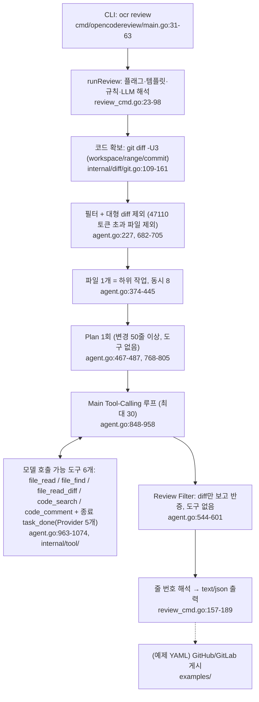

# open-code-review — 개요

- 분석 SHA: `57273a9ea28548b94b3d67c247ff13a63c01fc47` (repos.lock.tsv와 일치)
- 분석일: 2026-10-13
- 관련 공통 항목: Q1-Q12 전체 (입구 문서)
- 검증 수준 요약: 코드 확인 10 / 실행 확인 0 / 추론 0 / 미확인 2 (집계 기준: 이 문서 1절 메타데이터 표의 행 단위, 검증 칸의 맨 앞 판정으로 분류. 5절 이후 표는 요약·목록이라 집계 제외. 2026-10-13 정정: 도구 행 추가로 코드 확인 9→10, 미확인 3→2는 표 행 수 재계산)
- 실행 여부: **정적 추적만.** 설치·빌드·실행·테스트를 하지 않았다. 작업트리 clean(`git status --porcelain` 빈 출력), detached HEAD가 고정 SHA와 일치(`git rev-parse HEAD` 확인).

모든 경로는 `code-review/repos/open-code-review/` 기준 상대경로다. 레포 안의 `graphify-out/`는 근거로 쓰지 않았다.

## 1. 메타데이터

| 항목 | 값 | 근거 | 검증 |
|---|---|---|---|
| URL | https://github.com/alibaba/open-code-review | `repos.lock.tsv`, `git remote -v` | 코드 확인 |
| SHA | `57273a9ea28548b94b3d67c247ff13a63c01fc47` (제목: "docs(benchmark): add Codex GPT-5.5 benchmark results (v0.140.0 /review)") | `git log -1` | 코드 확인 |
| 커밋일 | 2026-06-21 (`2026-06-21 23:34:35 +0800`) | `git log -1` | 코드 확인 |
| 라이선스 | Apache-2.0 (`NOTICE` 없음, 하위 별도 라이선스 파일 없음) | `LICENSE:1-4` | 코드 확인 |
| 주 언어 | Go 1.25 (`go 1.25.0`), 정적 바이너리 `CGO_ENABLED=0`. npm 래퍼(Node)와 안내용 웹페이지(`pages/`, 분석 제외) | `go.mod:3`, `Makefile:22-26`, `package.json:5-9` | 코드 확인 |
| 진입점 | CLI `ocr`(소스 `cmd/opencodereview`): `review`, `rules`, `config`, `llm`, `viewer`. 웹훅 서버·워커 없음 | `cmd/opencodereview/main.go:31-63` | 코드 확인 |
| 지원 Git Provider | **엔진: 없음**(로컬 git 저장소만). 예제 YAML이 GitHub Actions(`createReview`)·GitLab CI(`discussions`)로 결과 JSON을 게시 | `internal/diff/git.go`, `examples/github_actions/ocr-review.yml:228-237`, `examples/gitlab_ci/.gitlab-ci.yml:108-123` | 코드 확인 |
| 지원 LLM | 프로토콜 2종: Anthropic Messages, OpenAI Chat Completions(호환 엔드포인트 포함). 프리셋 12종(anthropic, openai, dashscope, dashscope-tokenplan, volcengine, deepseek, tencent-tokenhub, hy-tokenplan, kimi, z-ai, mimo, minimax) + 사용자 정의 URL. AWS/Bedrock 없음 | `internal/llm/client.go:192-206`, `providers.go:19-217` | 코드 확인 |
| 도구 개수 표기 기준 | `definitions.go`의 `Tool` 값 **7개 = 모델이 호출 가능한 도구 6개**(`file_read`, `file_find`, `code_search`, `file_read_diff`, `code_comment` + 종료 신호 `task_done`) **+ 내부 항목 1개**(`Unknown`: 모르는 이름용 센티널, 모델에 노출 안 됨). 레지스트리에 Provider로 등록되는 것은 5개이고 `task_done`은 Provider 없이 직접 처리. 이 기준을 전 문서가 따른다 | `internal/tool/definitions.go:13-21`, `:32-34`, `internal/config/toolsconfig/tools.json`(6개 정의), `cmd/opencodereview/review_cmd.go:272-280`, `internal/agent/agent.go:969-971` | 코드 확인 |
| 조사 범위 | `cmd/`, `internal/` 비테스트 Go 12,159줄 전수 열람, 프롬프트·도구·규칙·템플릿 JSON/MD, `examples/`, `skills/`·`plugins/` 문서, `go.mod`·`go.sum`·`Makefile`·`package.json`·`scripts/install.js`·`bin/ocr.js`, 테스트 파일 목록 | - | 코드 확인 |
| 열람하지 않은 범위 | `cmd/opencodereview/provider_tui.go`(1,426줄, TUI 세부), `internal/viewer` 세부(핸들러·템플릿·호스트 가드), `pages/`(소개 웹페이지), `*_test.go` 본문, `scripts/update.js`·`platform.js`·release 워크플로 세부 | - | 미확인 |
| **미실행 항목** | 빌드, 테스트, `ocr review` 실제 호출, `go list -m all`/`go mod graph`, LLM 호출 결과(루프 실제 종료 양상) | - | 미확인(정적 추적만) |

기존 분석 확인: `reports/open-code-review/`는 없었고, 상위 `artifacts/open-code-review/`(DeepWiki 등 외부 자료·repo-metadata)가 있으나 2026-06-21 시점 자료이며 이번 분석은 코드로 다시 확인했고 외부 자료를 근거로 쓰지 않았다.

## 2. 한 줄 정의

**로컬 git diff를 파일 1개 단위로 쪼개 파일마다 "Plan(조건부) → Tool-Calling 에이전트 루프(최대 30회) → 위치 해석 → diff만 보는 반증 필터"를 실행하는 단일 사용자 CLI**다. 리뷰 주체는 **Agent Loop**(도구 호출 반복)이지만 반복은 파일 하위 작업 안에서만 일어나고, 파일 간 종합·PR 간 메모리·웹훅·게시는 엔진에 없다. 근거: `internal/agent/agent.go:374-445`, `:448-540`, `:848-958`.

## 3. 호출 흐름 다이어그램

## 4. 핵심 결론과 참고할 구현 3개

1. **반복 탐색은 "파일당 Tool-Calling 루프"로 구현돼 있다.** 모델이 문맥 도구 4개(`file_read`/`code_search`/`file_find`/`file_read_diff`)를 골라 호출하고 결과를 대화에 누적한다. 도구는 `git grep`·`git show`·`git ls-files` 기반이라 심볼 의미는 모르고 모델이 추론한다. 종료는 `task_done`만 정상이며 "도구 호출 없음"은 종료가 아니라 재요청, 최대 30라운드·컨텍스트 80%·파일당 10분이 한도다. 근거: `internal/agent/agent.go:848-958`, `internal/tool/*.go`. 코드 확인.
2. **검증은 별도 단계가 있지만 diff-only 반증 필터다.** 같은 모델이 새 대화에서 diff와 코멘트만 보고 "diff로 틀렸음이 입증되는 것"만 제거하며 추가 파일을 읽을 수 없다. 다른 파일 근거가 필요한 주장은 설계상 통과한다. 근거: `agent.go:544-601`, `review_filter_task_system.md:3-7`. 코드 확인.
3. **영속 메모리·Jira·증분 리뷰·팀 규칙 관리는 없다.** 세션 JSONL은 쓰기만 하고 읽는 건 `ocr viewer`뿐이다. 규칙은 경로별 자연어 체크리스트 파일(4계층, 병합 없음), 요구사항은 `--background` 문자열 하나다. 근거: `internal/session/persist.go:92-112`, `internal/viewer/store.go:1-24`, `system_rules.go:356-367`, `main_task_user.md:14-16`. 코드 확인(부재는 `03-...` 검토 범위 내).
4. **README와 코드가 다른 곳이 있다**: 관련 파일 번들링(코드 없음, 파일당 하위 작업), `--max-tools` 동작, 템플릿 timeout 미사용 등 → `05-dependencies.md`의 "README·문서와 코드가 다른 곳". `07-credentials.md`에서 추가로 확인한 차이(→ [07 "기존 보고서와 다른 점"](07-credentials.md#diff-from-existing)): (a) README는 환경변수가 "highest priority"라 하나 코드 우선순위는 설정 파일 > `OCR_*` env > Claude Code env > 셸 rc(`README.md:168-177` vs `internal/llm/resolver.go:56-59`), (b) `telemetry.content_logging`은 README가 "프롬프트·응답을 내보낸다"고 하나 `ContentLogging()`(`internal/telemetry/provider.go:70`)을 호출하는 곳이 없어 **이 SHA에서는 효과 없는 설정**(`README.md:520`), (c) `OTEL_EXPORTER_OTLP_PROTOCOL`은 읽히지만 쓰이지 않음(`config.go:53-55`), (d) `~/.opencodereview` 디렉터리 권한은 생성 주체에 따라 0755/0700. 코드 확인.

**참고할 구현 3개**

| # | 구현 | 위치 | 이유 |
|---|---|---|---|
| 1 | Tool-Calling 루프와 종료·압축·오류 흐름 | `internal/agent/agent.go:848-1074`, `compression.go:129-241` | 최소한의 코드로 "탐색→코멘트→종료" 구조를 보여 줌. 예산·종료 한도 설계의 출발점 |
| 2 | 코멘트 위치 해석(`existing_code` → 헝크 매칭 → 파일 스캔 → LLM 재해석) | `internal/diff/resolver.go:12-196`, `relocation.go:19-69` | 모델이 줄 번호를 말하지 않게 하는 설계. PR 인라인 게시 위치 계산에 직접 재사용 가능 |
| 3 | ref 기준 읽기 도구 (`git show <ref>:<path>`, `git grep <ref>`, `git ls-tree`) | `internal/tool/filereader.go:115-245`, `code_search.go:52-78`, `file_find.go:66-109` | PR head 고정 상태를 읽는 방식. SHA 일관성에 유리(로컬 clone 전제) |

## 5. 공통 항목 요약표

| 항목 | 지원 수준 | 요약 | 문서 |
|---|---|---|---|
| Q1 실행 경로 | 지원(CLI→출력) / 웹훅·게시는 미지원 | `runReview` → `Agent.Run` → 파일별 하위 작업 → text/JSON 출력. 게시는 예제 YAML(부분 지원) | [01-execution-and-diff.md](01-execution-and-diff.md#q1) |
| Q2 코드 접근·Diff | 부분 지원 | 로컬 git 작업 트리만. `-U3` diff를 정규식으로 파싱, 문맥 확장 없음, 큰 파일은 통째로 제외(분할·압축 없음), 위치는 `existing_code` 매칭(side 정보 없음) | [01-execution-and-diff.md](01-execution-and-diff.md#q2) |
| Q3 동적 탐색 | 지원(텍스트 검색 수준) | 모델이 `file_read`/`code_search`/`file_find`/`file_read_diff` 호출. AST·LSP·임베딩 없음. 프롬프트가 "다른 파일 발견 무시" 지시 | [02-context-loop-verify.md](02-context-loop-verify.md#q3) |
| Q4 Agent Loop | 지원 | 파일당 최대 30라운드, 도구 순차 실행, 종료 `task_done`, 도구 없음은 재요청, 컨텍스트 60/80% 압축, fallback 모델 없음 | [02-context-loop-verify.md](02-context-loop-verify.md#q4) |
| Q5 검증 | 부분 지원 | diff-only 반증 필터 1회(같은 모델·새 대화·도구 없음). 파일 간·재실행 간 중복 제거 없음. evals 미확인 | [02-context-loop-verify.md](02-context-loop-verify.md#q5) |
| Q6 증분 리뷰 | 미지원 | 마지막 리뷰 SHA·코멘트 상태 없음. 예제는 `opened`만 구독, `concurrency`로 취소 | [03-incremental-memory-rules.md](03-incremental-memory-rules.md#q6) |
| Q7 장기 메모리 | 미지원 | 세션 JSONL 쓰기만 있고 읽기는 뷰어뿐. 실행 내 압축 요약은 영속 아님 | [03-incremental-memory-rules.md](03-incremental-memory-rules.md#q7) |
| Q8 팀 규칙 | 부분 지원 | 4계층 JSON 규칙(custom>project>global>내장), 첫 일치 하나만 사용, 승인·버전·팀 범위 없음 | [03-incremental-memory-rules.md](03-incremental-memory-rules.md#q8) |
| Q9 Jira | 미지원 | `--background` 텍스트 슬롯만. 조건별 근거 판정 없음. 확장 지점 제안 있음 | [03-incremental-memory-rules.md](03-incremental-memory-rules.md#q9) |
| Q10 SaaS | 미지원 / 해당 없음 | 단일 사용자 CLI. 서비스 워커화 시 분리할 TUI·파일 시스템·환경변수·전역 상태 정리 | [04-saas-and-isolation.md](04-saas-and-isolation.md#q10) |
| Q11 의존성 | 해당 표 참조 | 직접 의존 16개 모듈(기능 단위로는 Anthropic·OpenAI SDK, tiktoken, doublestar, Bubble Tea 계열 3, OTel 계열 9). MCP·AWS·cobra는 이 SHA에 없음. 외부 요구는 LLM API와 `git` | [05-dependencies.md](05-dependencies.md) |
| Q12 적용(의견) | - | 루프·도구·위치 해석은 참고/재사용, 웹훅·Provider·검증·Jira·메모리·규칙 관리는 직접 구현 | [06-fit.md](06-fit.md#q12) |

## 6. 최종 질문에 대한 답

질문: **"이 프로젝트의 리뷰 엔진을 가져오면, 스스로 관련 코드를 탐색하고 근거를 검증하는 데 무엇을 얻고 무엇을 직접 구현해야 하는가?"**

얻는 것은 **파일 단위 Tool-Calling 루프의 동작하는 골격**(모델 호출 가능 도구 6개(문맥 도구 4 + `code_comment` + 종료 `task_done`, 1절 기준), ref 기준 파일 읽기·검색, 라운드·토큰·시간 한도, 컨텍스트 압축, 코멘트 줄 번호 복원)이고 이는 작은 코드(약 1.2만 줄)로 읽고 포크하기 쉽다. 반면 **근거 검증은 diff만 보는 반증 필터라 추가 근거 탐색을 하지 않으며**, 탐색은 `git grep` 수준이고 프롬프트가 다른 파일의 발견을 무시하라고 지시한다. 직접 구현해야 하는 것은 웹훅·큐·Provider 연동과 SHA 고정, 심볼 단위 탐색 도구, 근거 위치를 강제하는 독립 검증 에이전트, Jira 요구사항 수집·조건별 판정, PR 간 메모리의 쓰기·읽기, 팀 규칙 관리, 증분 리뷰, 예산·취소 제어다. 이 판단은 분석자 의견이며 상세는 [06-fit.md](06-fit.md)에 있다. 한계: 모두 정적 추적이고 실제 모델이 루프에서 어떻게 행동하는지는 실행하지 않아 확인하지 못했다.

## 7. 문서 목록

| 문서 | 내용 |
|---|---|
| [01-execution-and-diff.md](01-execution-and-diff.md) | Q1 실행 경로·호출 흐름도, Q2 코드 접근·Diff 처리·짧은 예·이슈 |
| [02-context-loop-verify.md](02-context-loop-verify.md) | Q3 문맥·동적 탐색(도구 스키마 표), Q4 Agent Loop(상태·종료 조건 표), Q5 검증 단계 표 |
| [03-incremental-memory-rules.md](03-incremental-memory-rules.md) | Q6 증분, Q7 메모리, Q8 규칙, Q9 Jira와 확장 지점 |
| [04-saas-and-isolation.md](04-saas-and-isolation.md) | Q10 해당 없음 판정, 서비스 워커화 시 분리할 의존성 |
| [05-dependencies.md](05-dependencies.md) | Q11 의존성 표, 외부 서비스·바이너리, README↔코드 차이 |
| [06-fit.md](06-fit.md) | Q12 적용 의견, 우선 읽을 파일, 알려진 이슈 |
| [07-credentials.md](07-credentials.md) | Q13 비공개 저장소 접근·자격증명(토큰)·세션 로그/OTel 전송 경로 |
| [next.md](next.md) | 확인 범위, 미확인 체크리스트, 완료 기준 자체 점검 |
