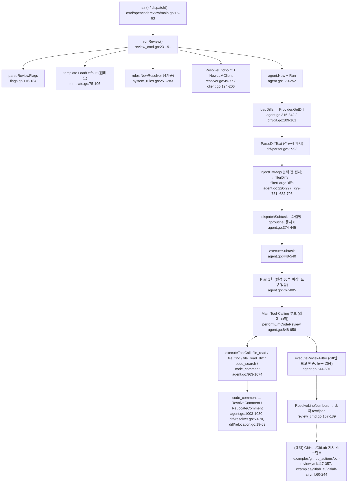

# open-code-review — 실행 경로와 코드 접근·Diff 처리

- 분석 SHA: `57273a9ea28548b94b3d67c247ff13a63c01fc47` (repos.lock.tsv와 일치)
- 분석일: 2026-10-13
- 관련 공통 항목: Q1, Q2
- 검증 수준 요약: 코드 확인 57 / 실행 확인 0 / 추론 1 / 미확인 0 (보조: 코드 확인 행에 추론 병기 4행. 집계 기준: 이 문서 증거 표의 행 단위, 검증 칸 맨 앞 판정으로 분류(1행=1판정). 검증 칸 안에 보조로 병기된 추론·미확인은 괄호로 별도 표기. 설명 칸 안의 인라인 표기와 서술 문단은 집계 제외)
- 실행 여부: 정적 추적만 (설치·빌드·실행·테스트 모두 하지 않음. 아래 "짧은 예"는 코드를 따라가며 손으로 구성한 것)

경로는 모두 `code-review/repos/open-code-review/` 기준 상대경로다. 이 레포의 `graphify-out/`는 근거로 쓰지 않았다.

---

## Q1. 실행 경로: 입력에서 결과 출력까지 {#q1}

### 1.1 진입점 구조 (코드 확인)

open-code-review(이하 OCR)는 **단일 사용자 CLI**다. 웹훅 서버·워커·큐는 엔진 안에 없다. 바이너리 `ocr`(소스 `cmd/opencodereview`)가 하위 명령을 나눠 받는다. 저장소의 GitHub Actions/GitLab CI 예제는 이 CLI를 호출하고, 결과 JSON을 YAML 안의 JS/Python으로 게시한다(엔진 코드가 아님).

| 구분 | 위치 | 식별자 | 설명 | 검증 |
|---|---|---|---|---|
| 프로세스 시작 | `cmd/opencodereview/main.go:15-28` | `main()` | `llm.AppVersion` 설정, 내장 BPE 로더 초기화, telemetry 초기화(기본 꺼짐), `dispatch()` | 코드 확인 |
| 명령 분기 | `cmd/opencodereview/main.go:31-63` | `dispatch()` | `review`/`r`, `config`, `llm`, `rules`, `viewer`, `version`. 표준 라이브러리 `flag` 기반(cobra 아님) | 코드 확인 |
| 리뷰 명령 | `cmd/opencodereview/review_cmd.go:23-191` | `runReview()` | 아래 1.2의 전체 순서를 오케스트레이션 | 코드 확인 |
| 엔진 | `internal/agent/agent.go:206-252` | `(*Agent).Run()` | diff 로드 → 필터 → 파일별 하위 작업 | 코드 확인 |

핵심 permalink:
- 리뷰 오케스트레이션: https://github.com/alibaba/open-code-review/blob/57273a9ea28548b94b3d67c247ff13a63c01fc47/cmd/opencodereview/review_cmd.go#L23-L191
- 엔진 `Run`/`dispatchSubtasks`/`executeSubtask`: https://github.com/alibaba/open-code-review/blob/57273a9ea28548b94b3d67c247ff13a63c01fc47/internal/agent/agent.go#L206-L540

### 1.2 `ocr review` 호출 순서 (코드 확인)

| 단계 | 위치 | 식별자 | 설명 | 검증 |
|---|---|---|---|---|
| 1. 플래그 파싱 | `cmd/opencodereview/flags.go:116-184` | `parseReviewFlags()` | 모드는 `--from/--to`(range), `--commit`, 둘 다 없으면 workspace. 동시 지정 금지, `--from`/`--to` 쌍 필수 | 코드 확인 |
| 2. 저장소 확인 | `cmd/opencodereview/review_cmd.go:33-54`, `:193-250` | `requireGitRepo`, `resolveRepoDir`, `validateReviewRefs` | `git rev-parse --git-dir`, 각 ref를 `rev-parse --verify --end-of-options <ref>^{commit}`로 검증(존재 확인만, SHA로 고정하지 않음) | 코드 확인 |
| 3. 프롬프트 템플릿 | `cmd/opencodereview/review_cmd.go:37-46`, `internal/config/template/template.go:75-106` | `template.LoadDefault()` | 바이너리에 임베드된 `task_template.json` + `prompts/*.md`만 사용. 외부 템플릿 파일 로드 경로 없음 | 코드 확인 |
| 3a. 요구사항 배경 | `cmd/opencodereview/review_cmd.go:56-60` | - | `--commit` 모드이고 `--background`가 비면 커밋 메시지를 배경으로 자동 주입 | 코드 확인 |
| 4. 규칙 로드 | `cmd/opencodereview/review_cmd.go:62-65`, `internal/config/rules/system_rules.go:251-283` | `rules.NewResolver()` | custom(`--rule`) > project(`<repo>/.opencodereview/rule.json`) > global(`~/.opencodereview/rule.json`) > 내장 | 코드 확인 |
| 5. (`--preview`) | `cmd/opencodereview/review_cmd.go:67-69`, `:252-270` | `runPreview()` | LLM 호출 없이 diff 로드 + 필터 결과만 출력 | 코드 확인 |
| 6. 도구 정의 | `cmd/opencodereview/review_cmd.go:71-76`, `internal/config/toolsconfig/toolsconfig.go:24-54` | `toolsconfig.Load`, `agent.BuildToolDefs` | 내장 `tools.json`(또는 `--tools`로 JSON 교체). plan용/main용 정의를 따로 만듦 | 코드 확인 |
| 7. LLM 엔드포인트 | `cmd/opencodereview/review_cmd.go:78-98`, `internal/llm/resolver.go:49-77` | `ResolveEndpointWithModelOverride`, `NewLLMClient` | 설정 파일 → `OCR_*` 환경변수 → `ANTHROPIC_*` 환경변수 → 셸 rc 파일 순 | 코드 확인 |
| 8. 도구 레지스트리 | `cmd/opencodereview/review_cmd.go:101-112`, `:272-280` | `buildToolRegistry()` | Provider 구현 5개(`file_read`, `file_find`, `file_read_diff`, `code_search`, `code_comment`) 등록. 모델 호출 가능 도구 6개 중 `task_done`은 Provider 없이 `agent.go:969-971`에서 직접 처리(기준: [00 1절](00-overview.md)) | 코드 확인 |
| 9. 에이전트 생성 | `cmd/opencodereview/review_cmd.go:114-133`, `internal/agent/agent.go:179-203` | `agent.New()` | 세션 기록기(JSONL) 자동 생성 | 코드 확인 |
| 10. 실행 | `cmd/opencodereview/review_cmd.go:146-154` | `ag.Run(ctx)` | 루트 ctx는 `context.Background()`. 신호 처리 없음(`os/signal` 사용처 없음, grep 범위 `cmd`·`internal`) | 코드 확인 |
| 11. 라인 번호 해석 | `cmd/opencodereview/review_cmd.go:157` | `diff.ResolveLineNumbers()` | `existing_code`를 diff와 대조해 `start_line/end_line` 채움 | 코드 확인 |
| 12. 출력 | `cmd/opencodereview/review_cmd.go:177-189`, `cmd/opencodereview/output.go:35-53`, `:210-244` | `outputTextWithWarnings`, `outputJSONWithWarnings` | 터미널 텍스트 또는 JSON(`comments`, `warnings`, `summary`). **Git 호스팅 API로 게시하는 코드는 엔진에 없음** | 코드 확인 |

### 1.3 명령·모드별 경로 분리

| 명령 | 경로 | LLM 호출 | 검증 |
|---|---|---|---|
| `ocr review` (workspace) | `review_cmd.go` → `diff.NewWorkspaceProvider` | 있음 | 코드 확인 |
| `ocr review --from A --to B` | → `diff.NewProvider` (merge-base 기준) | 있음 | 코드 확인 |
| `ocr review --commit X` | → `diff.NewCommitProvider` | 있음 | 코드 확인 |
| `ocr review --preview` | `runPreview` → `Agent.Preview` (`internal/agent/preview.go:75-113`) | 없음 | 코드 확인 |
| `ocr rules check <file>` | `cmd/opencodereview/rules_cmd.go:26-79` | 없음 | 코드 확인 |
| `ocr llm test` | `cmd/opencodereview/llm_cmd.go:27-80` | 연결 테스트 1회 | 코드 확인 |
| `ocr config provider/model` | `cmd/opencodereview/provider_cmd.go`, `provider_tui.go` (Bubble Tea TUI) | 없음 | 코드 확인 |
| `ocr viewer` | `cmd/opencodereview/viewer_cmd.go:28-40` → `internal/viewer` | 없음, 세션 JSONL 읽기 전용 | 코드 확인 |

### 1.4 호출 흐름도



기능 지원 수준 (Q1): **지원**(CLI → 출력까지 끝까지 추적). 웹훅 검증·이벤트 정규화·작업 발행/소비는 **미지원**(찾은 범위: `cmd/`, `internal/` 전체 파일 목록에서 HTTP 서버는 `internal/viewer`뿐이고 그것은 세션 뷰어. `net/http` 서버 핸들러가 웹훅을 받는 코드 없음). Git 호스팅 게시는 엔진 **미지원**, 예제 YAML에서 **부분 지원**.

---

## Q2. 코드 접근과 Diff 처리 {#q2}

### 2.1 코드 접근

| 항목 | 내용 | 위치 | 검증 |
|---|---|---|---|
| 입력 경로 | **로컬 git 작업 트리(이미 clone된 저장소)** 하나뿐. clone·fetch를 엔진이 하지 않음. Provider API·샌드박스 없음. 모든 git 호출은 `exec.Command("git", ...)` | `internal/gitcmd/runner.go:43-127`, `internal/diff/git.go:335-343` | 코드 확인 |
| 동시 git 프로세스 제한 | 세마포 `Runner`, 기본 16 (`--max-git-procs`) | `internal/gitcmd/runner.go:11-41`, `flags.go:134` | 코드 확인 |
| workspace 모드 | `git diff HEAD`(실패·빈 결과면 `git diff --staged`) + `git ls-files --others --exclude-standard`로 얻은 미추적 파일을 `/dev/null` 대비 신규 파일 diff로 **직접 합성** | `internal/diff/git.go:131-146`, `:267-276`, `:278-333` | 코드 확인 |
| range 모드 | `git merge-base <from> <to>` 후 `git diff <base> <to>` (`--find-renames -U3`) | `internal/diff/git.go:112-123`, `:259-265` | 코드 확인 |
| commit 모드 | `git show <commit>` (`--find-renames -U3`) | `internal/diff/git.go:124-130` | 코드 확인 |
| 파일 원문(변경 후) | 파싱 단계에서 변경된 **모든** 파일에 대해 `git show <ref>:<path>`(range/commit) 또는 디스크 읽기(workspace)로 `NewFileContent`에 저장. 단 **모델 입력에는 들어가지 않고** 라인 번호 보정(`resolveFromFileContent`)에만 쓰임 | `internal/diff/parser.go:97-127`, `internal/diff/resolver.go:169-196`, `internal/model/diff.go:8` | 코드 확인 (`NewFileContent` 사용처 grep: parser.go, resolver.go, model/diff.go뿐) |
| 변경 전 원문 | 읽는 경로 없음. `file_read`는 "변경 후 버전만" 읽는다고 도구 설명에 명시 | `internal/config/toolsconfig/tools.json:75`, `internal/tool/filereader.go:68-77` | 코드 확인 |
| 도구가 읽는 코드 | workspace: 디스크(경로 탈출·심볼릭 링크 검사), range/commit: `git show <to 또는 commit>:<path>` | `internal/tool/filereader.go:79-135` | 코드 확인 |
| 실행 중 SHA 일관성 | `--to`/`--commit` **값을 ref 이름 그대로** 계속 사용. 시작 시 `rev-parse --verify`는 존재 확인일 뿐, 해석된 SHA를 저장하지 않음(`rev-parse` 호출은 `--git-dir`, `--verify`, `--abbrev-ref` 3종뿐). 브랜치 이름을 넘기면 리뷰 도중 ref가 움직일 때 diff와 도구가 읽는 코드가 어긋날 수 있음. 예제 워크플로는 `HEAD_SHA`를 넘겨 이를 회피. workspace 모드는 diff는 시작 시점 스냅샷, `file_read`는 호출 시점 디스크라 편집 중이면 어긋남 | `cmd/opencodereview/review_cmd.go:225-250`, `internal/tool/filereader.go:115-135`, `examples/github_actions/ocr-review.yml:95-110` | 코드 확인(고정 안 함), 도중 변경 시 영향은 추론 |
| "전체 저장소 접근" vs "전체를 모델에 넣음" | 모델은 `file_find`/`code_search`/`file_read`로 저장소 어디든 읽을 수 있지만, **자동으로 넣는 것은 해당 파일의 diff(-U3) + 다른 변경 파일 목록**뿐 | `internal/config/template/prompts/main_task_user.md:1-25` | 코드 확인 |
| 필요한 외부 바이너리 | `git`(`git grep -P` 사용 시 PCRE 지원 빌드 필요) | `internal/tool/code_search.go:52-78` | 코드 확인(PCRE 빌드 필요성은 추론) |

### 2.2 `internal/diff` 의 파일 변경 객체

`model.Diff`는 `OldPath`, `NewPath`, `Diff`(해당 파일의 diff 원문 전체, 헤더 포함), `NewFileContent`, `IsBinary`, `IsDeleted`, `IsNew`, `IsRenamed`, `Insertions`, `Deletions`다(`internal/model/diff.go:4-15`). 생성은 `ParseDiffText`가 `git diff` 출력을 줄 단위로 훑으며 `^diff --git a/(.+?) b/(.+)$` 정규식으로 파일을 나누고, `rename from/to`, `new file mode`, `deleted file mode`, `Binary files`, `--- /dev/null`, `+++ /dev/null`로 플래그를 세우며 `+`/`-` 줄 수를 센다(`internal/diff/parser.go:17-93`). **diff 파싱 라이브러리는 쓰지 않는다.** 문자열 처리(파일 분할)는 `parser.go`, 헝크 해석은 별도 `ParseHunks`(정규식 `^@@ -(\d+)(?:,(\d+))? \+(\d+)(?:,(\d+))? @@`)가 맡는다(`internal/diff/hunk.go:33-110`).

| 케이스 | 처리 | 위치 | 검증 |
|---|---|---|---|
| 삭제 파일 | `finalizeDiff`가 `NewPath`를 `"/dev/null"`로 바꾸고 원문 읽기 생략. 리뷰 대상에서 제외(`IsDeleted`는 dispatch에서 건너뜀) | `internal/diff/parser.go:97-101`, `internal/agent/agent.go:398-400` | 코드 확인 |
| rename | `git diff --find-renames`, `rename from/to` 줄로 OldPath/NewPath 갱신. 유사도 100% rename은 헝크가 없어 변경 줄 수 0인데도 파일 하위 작업은 시작됨(plan만 건너뜀) | `internal/diff/parser.go:63-70`, `internal/agent/agent.go:467-472`, `:398` | 코드 확인(빈 diff 상태의 LLM 호출은 정황상 추론) |
| 바이너리 | `Binary files` 줄로 `IsBinary`. `shouldReview`에서 제외 | `internal/diff/parser.go:55-56`, `internal/agent/preview.go:45-48` | 코드 확인 |
| 경로 제외 | 하드코딩 디렉터리(`.git/`, `vendor/`, `node_modules/`, `target/` 등)와 루트 `.gitignore`를 **직접 파싱한 단순 매칭**(부정 패턴 무시) | `internal/diff/git.go:19-33`, `:163-255` | 코드 확인 |
| 확장자·테스트 파일 필터 | 허용 확장자 목록 + 기본 제외 glob(테스트 파일 등) + 사용자 include/exclude | `internal/agent/preview.go:45-71`, `internal/config/allowlist/allowed_ext.go:72-97`, `internal/config/allowlist/default_exclude_patterns.json` | 코드 확인 |
| **대규모 변경** | 분할·압축 없음. 파일 diff 토큰이 `MAX_TOKENS(58888) × 4/5 = 47110`을 넘으면 **파일 전체를 조용히 제외**(stdout 로그만, `warnings`에는 기록 안 됨). 토큰은 항상 cl100k_base 기준 근사 | `internal/agent/agent.go:682-705`, `internal/config/template/task_template.json:39`, `internal/llm/client.go:252-272` | 코드 확인 |
| 프롬프트 포함 후 초과 | diff + 규칙 + 계획을 합친 초기 프롬프트가 80%를 넘으면 해당 파일 **건너뜀**, `token_threshold_exceeded` 경고 기록 | `internal/agent/agent.go:518-530` | 코드 확인 |
| 모든 파일이 너무 큼 | `all diffs filtered out by token size` 오류로 실행 실패 | `internal/agent/agent.go:381-384` | 코드 확인 |
| Provider API가 diff를 자른 경우 | 해당 없음(Provider API 미사용, 로컬 `git diff` 출력 전체 사용) | - | 코드 확인 |
| 병합 커밋 `--commit` | `git show`는 병합 커밋에 결합 diff(`diff --cc`)를 내므로 `diff --git` 헤더 정규식에 안 맞아 파일이 0개로 파싱될 가능성 | `internal/diff/git.go:125`, `internal/diff/parser.go:18` | 추론 (git 동작 지식 + 정규식, 미실행) |

### 2.3 주변 줄 "확장"의 실체

- 문맥 확장 알고리즘이 **없다.** 모델이 받는 문맥은 `git diff -U3`(`const DiffContextLines = 3`, `internal/diff/git.go:17`)가 만든 헝크 주변 3줄이 전부다. AST·함수 경계·정규식 휴리스틱으로 줄을 늘리는 코드를 `internal/diff`, `internal/agent`에서 찾지 못했다(찾은 범위: 두 패키지 전체 파일, `ParseHunks`는 번호 해석용).
- 더 넓은 문맥은 **모델이 `file_read`로 요청**해야 얻는다(`02-context-loop-verify.md#q3`). `file_read` 도구 설명이 헝크 헤더 `@@ -x,y +m,n @@`에서 `start_line = m-50, end_line = m+n+50`을 계산하라고 모델에게 안내한다(`internal/config/toolsconfig/tools.json:75`).

### 2.4 라인 번호 변환

| 단계 | 내용 | 위치 | 검증 |
|---|---|---|---|
| 모델 입력 번호 | diff 원문 그대로. 줄 번호는 헝크 헤더의 `@@` 값뿐이며 줄마다 번호를 붙이지 않음 | `internal/config/template/prompts/main_task_user.md:8-10` | 코드 확인 |
| 모델 출력 | `code_comment`의 `existing_code`(문자열). **모델이 줄 번호를 말하지 않는다** | `internal/config/toolsconfig/tools.json:27-68` | 코드 확인 |
| 번호 복원 1순위 | 공백·`+`/`-` 접두 제거 후 헝크의 새 쪽(문맥+추가) 줄에서 연속 일치 검색, 실패하면 옛 쪽(문맥+삭제) | `internal/diff/resolver.go:82-112`, `:117-165`, `:212-219` | 코드 확인 |
| 번호 복원 2순위 | `NewFileContent` 전체를 줄 단위 스캔 | `internal/diff/resolver.go:169-196` | 코드 확인 |
| 번호 복원 3순위 | 위가 모두 실패하고 `RE_LOCATION_TASK`가 있으면 LLM에게 "원문 그대로 발췌"를 시켜 재시도(별도 LLM 호출) | `internal/agent/agent.go:1008-1010`, `internal/diff/relocation.go:19-69`, `internal/config/template/prompts/re_location_task_user.md:1-20` | 코드 확인 |
| 실패 시 | 줄 번호 0으로 남은 채 코멘트 유지(삭제하지 않음). GitHub 예제는 줄 번호가 없으면 요약 본문으로 보냄 | `internal/agent/agent.go:1028`, `examples/github_actions/ocr-review.yml:185-190` | 코드 확인 |
| **side 정보 없음** | 옛 쪽에서 일치하면 **옛 파일 줄 번호**가 `start_line/end_line`에 그대로 들어가는데 `LlmComment`에 side 필드가 없다. 게시 스크립트는 항상 `side: 'RIGHT'`로 보냄 → 옛 쪽 일치는 잘못된 위치가 될 수 있음. 도구 설명은 추가된 줄만 쓰라고 안내해 빈도는 낮을 것 | `internal/model/review.go:4-12`, `internal/diff/resolver.go:102-109`, `examples/github_actions/ocr-review.yml:198-209`, `internal/config/toolsconfig/tools.json:49` | 코드 확인(필드 부재), 빈도는 추론 |
| GitLab 위치 | 예제가 MR `versions` API의 `base/start/head sha`로 `position`을 만들고 `new_line`에 `end_line`만 사용(범위 미지원) | `examples/gitlab_ci/.gitlab-ci.yml:108-123`, `:187-218` | 코드 확인(예제 YAML 한정) |

### 2.5 짧은 예 (정적 추적)

입력 (workspace 모드, 파일 `internal/foo/bar.go` 한 줄 수정):

```text
diff --git a/internal/foo/bar.go b/internal/foo/bar.go
index 1111111..2222222 100644
--- a/internal/foo/bar.go
+++ b/internal/foo/bar.go
@@ -10,7 +10,7 @@ func Load(path string) (*Config, error) {
 	data, err := os.ReadFile(path)
-	if err != nil {
+	if err != nil && !os.IsNotExist(err) {
 		return nil, err
 	}
```

1. `ParseDiffText` → `model.Diff{OldPath:"internal/foo/bar.go", NewPath:"internal/foo/bar.go", Diff:<위 전체>, Insertions:1, Deletions:1, NewFileContent:<디스크 전체>}` (`parser.go:27-127`).
2. 필터 통과(`.go` 허용, 테스트 파일 아님) → 변경 50줄 미만이라 plan 건너뜀(`agent.go:467-477`).
3. 모델 입력(user 메시지)의 `{{diff}}`에 위 diff 텍스트가 그대로, `{{change_files}}`에는 **다른** 변경 파일 목록(`MODIFIED   path` 형식, `agent.go:646-670`), `{{system_rule}}`에는 `.go`에 해당하는 규칙(내장 `rule_docs/default.md`, `.go`용 전용 규칙 문서는 없음)(`main_task_user.md:1-25`, `system_rules.json:3-19`).
4. `NewFileContent`는 모델에 가지 않는다. 모델이 `existing_code: "if err != nil && !os.IsNotExist(err) {"`로 코멘트하면 `resolveFromHunk`가 새 쪽 줄에서 일치를 찾아 `start_line=end_line=11`을 채운다(`resolver.go:82-112`).

### 2.6 이슈·주의 (코드 확인, 실행하지 않음)

| 이슈 | 근거 | 영향 | 검증 |
|---|---|---|---|
| 삭제 파일이 `<other_changed_files>`에 `DELETED   /dev/null`로 나옴. `finalizeDiff`가 삭제 파일의 `NewPath`를 `/dev/null`로 바꾼 뒤 `buildChangeFilesExcept`가 `NewPath`를 출력 | `internal/diff/parser.go:98-101`, `internal/agent/agent.go:646-670` | 모델이 삭제된 파일 경로를 알 수 없음 | 코드 확인(실행으로 재현하지 않음) |
| 필터로 제외된 파일(테스트·미지원 확장자·너무 큰 파일)은 `<other_changed_files>` 목록에서 빠지지만, `file_read_diff`용 `DiffMap`은 필터 **전** 전체 diff로 만들어 둠 | `internal/agent/agent.go:220-227` vs `:646-670` (목록은 필터 후 `a.diffs`로 생성) | 모델이 경로를 추측하거나 `file_find`로 찾아야 접근 가능 | 코드 확인 |
| `DiffMap`은 삭제 파일(`NewPath == "/dev/null"`)을 넣지 않음 | `internal/agent/agent.go:347-361` | 삭제 diff는 `file_read_diff`로 못 봄 | 코드 확인 |
| 모든 변경 파일(필터 제외 포함)에 대해 시작 시 `git show`로 원문을 읽음 | `internal/diff/parser.go:36-90`, `:97-127` | 큰 변경에서 불필요한 git 호출 | 코드 확인 |
