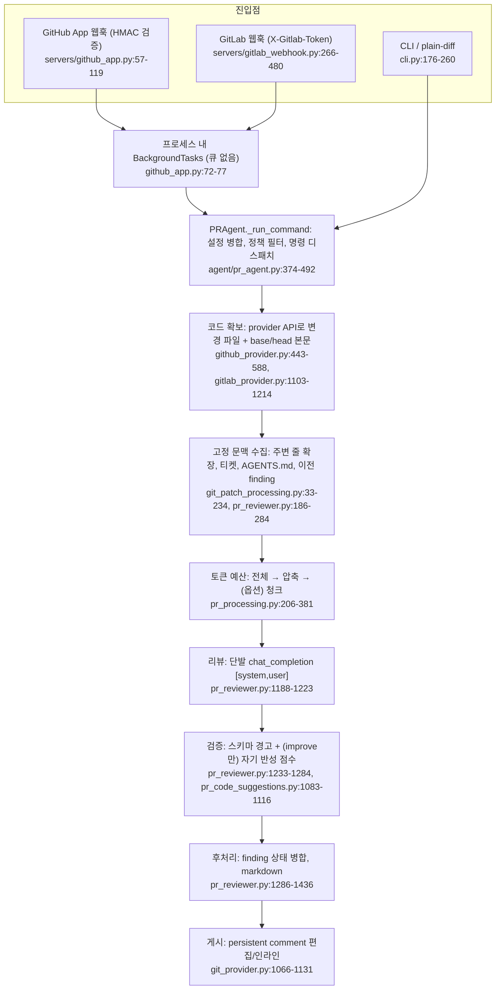

# pr-agent — 개요

- 분석 SHA: `330f0813b5fe0d1f54b794077c2d02aa85a1fb63` (repos.lock.tsv와 일치)
- 분석일: 2026-10-13
- 관련 공통 항목: Q1~Q12 전체 (입구 문서)
- 검증 수준 요약: 코드 확인 14 / 실행 확인 0 / 추론 0 / 미확인 3 (대략 집계: 머리 줄을 뺀 본문에서 각 표기 문자열이 나온 횟수이며, 표 행 수가 아니고 설명 문장 속 언급도 포함. 실행 확인 0은 실제로 실행한 항목이 없다는 뜻이고 본문의 "실행 확인" 문구는 실행하지 않았다는 서술. 2026-10-13 재집계)
- 실행 여부: **정적 추적만.** `repos/pr-agent`는 읽기 전용으로 읽었고 설치·빌드·실행·테스트 실행을 하지 않았다. 코드 작업트리 상태: detached HEAD가 고정 SHA와 일치하고 `git status --porcelain`이 비어 있음(clean)을 분석 시작 시 확인했다.

---

## 1. 메타데이터

| 항목 | 값 | 근거 | 검증 |
|---|---|---|---|
| URL | https://github.com/The-PR-Agent/pr-agent | `repos.lock.tsv` | 코드 확인 |
| SHA | `330f0813b5fe0d1f54b794077c2d02aa85a1fb63` ("Document RelaxAI OpenAI-compatible setup (#4076)") | `git log -1` | 코드 확인 |
| 커밋일 | 2026-10-11 (`2026-10-11T23:25:17+03:00`) | `git log -1` | 코드 확인 |
| 버전 | 0.47.0 | `pyproject.toml:7`, `uv.lock:2488-2489` | 코드 확인 |
| 라이선스 | MIT | `LICENSE:1-3` | 코드 확인 (하위 디렉터리 라이선스는 전수 확인 안 함) |
| 주 언어 | Python ≥ 3.12 | `pyproject.toml:20` | 코드 확인 |
| 지원 Provider | GitHub, GitLab, Bitbucket(Cloud), Bitbucket Server, Azure DevOps, CodeCommit, Gitea, Gerrit, 로컬 git, plain-diff(원문 diff) | `git_providers/__init__.py:11-22` | 코드 확인 (이번 분석은 GitHub·GitLab 중심) |
| 지원 LLM | LiteLLM 경유 다중 provider가 기본. OpenAI·LangChain 핸들러는 설정으로 선택되지 않고 코드 주입 전용 | `litellm_ai_handler.py:314-321`, `openai_ai_handler.py:66-69`, `langchain_ai_handler.py:104-109` | 코드 확인 (provider 전체 목록은 열람하지 않음) |
| 진입점 | CLI `pr-agent`, GitHub App 웹훅, GitLab 웹훅, GitHub Action | `pyproject.toml:133-134`, `servers/github_app.py:57-78`, `servers/gitlab_webhook.py:317-480`, `action.yaml:15-23` | 코드 확인 |
| 조사 범위 | `pr_agent/agent`, `algo`, `git_providers/{git_provider,github,gitlab,plain_diff,local}`, `servers/{github_app,gitlab_webhook,utils,gunicorn_config}`, `tools/{pr_reviewer,pr_code_suggestions,ticket_pr_compliance_check,pr_similar_issue}`, `settings/*.toml`, `pyproject.toml`, `uv.lock`, `docker/` | - | - |
| **미실행 항목** | 설치, 빌드, 테스트, 모델 호출, 웹훅 수신, 이미지 빌드 전부. 문서의 호출 순서·예시는 코드를 손으로 따라간 **정적 추적** | - | - |
| 이번에 열지 않은 범위 | Bitbucket·Azure·Gitea·Gerrit·CodeCommit provider 내부, `/describe`·`/ask` 내부, `mosaico` 상세, `docs/` 전체, `tests/` 내용 | - | 미확인 |

## 2. 한 줄 정의

PR-Agent는 **GitHub/GitLab 등 PR 이벤트를 받아 provider API로 diff와 변경 파일 본문을 모으고, 고정 규칙(주변 줄 확장, 토큰 예산 압축·분할)으로 만든 입력을 프롬프트 한 벌에 담아 모델을 *단발로* 호출한 뒤, 응답(YAML)을 코드로 후처리해 PR 댓글로 게시하는 파이프라인**이다. 리뷰 주체는 **단발 LLM 호출**이며(`/review`는 한 번, 대형 PR은 청크별 병렬 호출 후 병합, `/improve`만 생성 후 자기 반성 호출 1회 추가) **Agent Loop는 없다.** 근거: `tools/pr_reviewer.py:1188-1223`, `algo/ai_handlers/litellm_ai_handler.py:2863-2868,2987-2991`, `configuration.toml:579-591`.

## 3. 호출 흐름 다이어그램 (`/review`)

노드별 상세 위치와 `/improve` 경로는 [01-execution-and-diff.md](01-execution-and-diff.md#q1)에 있다. **"동적 탐색" 단계는 이 그림 어디에도 없다.** 문맥은 `CTX`에서 프로그램이 한 번 정하고, `LLM`은 도구를 호출하지 않는다.

## 4. 핵심 결론과 참고할 구현

### 핵심 결론

1. **문맥은 프로그램이 정한 규칙으로만 확보된다.** 기본 확장은 hunk 앞 5줄·뒤 1줄이며 앞쪽은 git hunk 헤더의 함수 문자열을 부분 문자열 검사로 찾아 최대 10줄까지 당긴다. AST가 아니다. 모델이 파일·호출부를 요청할 수단이 없고 프롬프트도 "diff 밖 코드를 추측하지 말라"고 지시한다. 사용자의 체감은 코드와 일치한다. 근거: `git_patch_processing.py:78-234`, `pr_reviewer_prompts.toml:17,24`. 코드 확인.
2. **Agent Loop·동적 탐색·MCP는 없다.** 모델 요청은 `[system, user]` 두 메시지이고 `tools`/`tool_choice`가 없다. `pr_agent/**/*.py`에서 `tool_calls|tool_choice|tools=|function_call|mcp` 검색 결과 0건이며, 유지보수자도 "single-shot ... no tool-use loop"라고 적었다. 근거: `litellm_ai_handler.py:2863-2868,2987-2991`, `configuration.toml:579-591`, `skills_loader.py:25-27`. 코드 확인(부재는 grep 근거).
3. **검증은 `/review`에 없고 `/improve`에만 약하게 있다.** `/review`는 YAML 스키마 경고뿐이고 `/improve`는 같은 diff만 보는 자기 반성 점수(추가 파일 접근 없음)와 적용 가능성·Python 문법 검사다. 실제 경로와 연결된 evals는 없다. 근거: `pr_reviewer.py:1233-1284`, `pr_code_suggestions.py:1083-1116,1566-1667`. 코드 확인.
4. **메모리는 "같은 PR 안"까지만 있다.** finding 상태(ACTIVE/RESOLVED)를 리뷰 댓글의 숨은 HTML 주석에 저장하고 다음 실행의 프롬프트에 주입한다. 사람이 resolve한 스레드도 읽는다. **다른 PR로 이어지는 저장·조회는 없다**(DB·큐·파일 저장 없음, `push_outputs`는 쓰기 전용). 근거: `review_finding_state.py:168-421`, `pr_reviewer.py:681-717`. 코드 확인.
5. **Jira는 있으나 "텍스트 입력 + 모델 판정"이다.** 제목·설명·브랜치에서 키를 추출해 Jira Cloud에서 제목·설명·요구사항 필드·라벨을 가져와 프롬프트에 넣고, 모델이 diff만 보고 충족 여부를 분류한다. 요구사항별 근거 탐색과 이번 PR 범위 구분은 없다. `atlassian-python-api`는 `bitbucket` extra에 있다. 근거: `ticket_pr_compliance_check.py:167-338`, `pr_reviewer_prompts.toml:83-113`. 코드 확인.

### 참고할 구현 3개

| 구현 | 위치 | 왜 참고할 만한가 | permalink |
|---|---|---|---|
| 주변 줄 확장 + 동적 문맥 | `pr_agent/algo/git_patch_processing.py:78-234` (`process_patch_lines`) | 고정 문맥 확장의 기준선. hunk 검증, 앞/뒤 비대칭, 함수 시작 탐색, 실패 시 폴백이 한 함수에 있다 | [permalink](https://github.com/The-PR-Agent/pr-agent/blob/330f0813b5fe0d1f54b794077c2d02aa85a1fb63/pr_agent/algo/git_patch_processing.py#L78-L234) |
| 토큰 예산 diff 패킹 | `pr_agent/algo/pr_processing.py:206-381,423-552` (`get_pr_diff`, `_pack_pr_multi_diffs`) | 전체 → 압축 → 분할로 내려가며 파일 순서·탈락·클립·커버리지 보고까지 처리 | [permalink](https://github.com/The-PR-Agent/pr-agent/blob/330f0813b5fe0d1f54b794077c2d02aa85a1fb63/pr_agent/algo/pr_processing.py#L206-L381) |
| 같은 PR 안의 finding 상태 | `pr_agent/algo/review_finding_state.py:199-296` (`reconcile_review_findings`) | 댓글 마커에 상태를 저장하고 재발·해결·보존 상한을 처리. PR 간 메모리를 만들 때 출발점 | [permalink](https://github.com/The-PR-Agent/pr-agent/blob/330f0813b5fe0d1f54b794077c2d02aa85a1fb63/pr_agent/algo/review_finding_state.py#L199-L296) |

## 5. 공통 항목 요약표

| 항목 | 지원 수준 | 요약 | 문서 |
|---|---|---|---|
| Q1 실행 경로 | 지원 | 웹훅·CLI·Action → `PRAgent._run_command` → `command2class` → `PRReviewer` 등. 큐·워커 분리 없음(프로세스 내 `BackgroundTasks`) | [01](01-execution-and-diff.md#q1) |
| Q2 코드 접근 | 지원(변경 파일 한정) | provider API로 변경 파일의 base/head 본문 확보(50개 초과 시 본문 생략). clone·샌드박스·저장소 전체 접근 없음. 수집 중 PR 변경은 감지, 게시 직전 SHA 재확인은 없음 | [01](01-execution-and-diff.md#q2a) |
| Q2 Diff 처리 | 지원 | `FilePatchInfo`, 정규식 기반 주변 줄 확장, 토큰 예산 압축·(옵션)청크, 번호 붙은 hunk, provider별 라인 매핑. 부분 잘림 diff는 미감지(부분 지원) | [01](01-execution-and-diff.md#q2b) |
| Q3 동적 탐색 | **미지원** | 고정 문맥 확장은 지원(주변 줄, 지침 파일, 티켓, 이전 finding). 모델이 요청하는 탐색·검색 도구·AST/LSP·MCP 없음 | [02](02-context-loop-verify.md#q3) |
| Q4 Agent Loop | **미지원** | 재시도·fallback·청크 다중 호출·`/improve` 2단계는 있으나 도구 호출 반복은 없음 | [02](02-context-loop-verify.md#q4) |
| Q5 검증 | `/review` 미지원, `/improve` 부분 지원 | 구조 검사는 경고뿐, 동일 diff 기반 자기 반성 점수, 추가 파일 접근 없음, evals 없음 | [02](02-context-loop-verify.md#q5) |
| Q6 증분 리뷰 | 지원(시각 기반) | 이전 리뷰 댓글 시각 이후 커밋 기준. 오래된 결과 폐기 없음. 중복 방지는 프로세스 로컬/옵트인 | [03](03-incremental-memory-rules.md#q6) |
| Q7 장기 메모리 | 같은 PR 지원 / **PR 간 미지원** | 댓글 마커의 finding 상태 + resolve 스레드 읽기. `similar-issue`는 GitHub 이슈 검색이며 팀 메모리가 아님 | [03](03-incremental-memory-rules.md#q7) |
| Q8 팀 규칙 | 부분 지원 | 커스텀 프롬프트, 지침 파일, 계층형 `.pr_agent.toml`. 저장·승인·버전 관리·피드백 추출 없음 | [03](03-incremental-memory-rules.md#q8) |
| Q9 Jira | 부분 지원 | 키 추출·조회·텍스트 삽입·모델 판정은 있음. 요구사항별 근거 탐색, 이번 PR 범위 구분 없음 | [03](03-incremental-memory-rules.md#q9) |
| Q10 SaaS | 부분 지원(서명 검증·이벤트 필터) / 큐·격리 미지원 | 서명·토큰 검증 있음. 큐·ack/재시도·실패 저장·테넌트 격리 계층 없음 | [04](04-saas-and-isolation.md) |
| Q11 의존성 | 분석 완료 | provider SDK는 extras, 벡터 DB는 `similar-issue` 그룹, Docker는 `--extra all`. `GitPython`은 GitHub/GitLab 경로에서 미사용. `anthropic`은 선언돼 있으나 `pr_agent/`가 직접 import하지 않음(LiteLLM 내부 사용 여부는 미확인). 토큰 수는 기본 `tiktoken`, `force_accurate=True`일 때만 `litellm.acount_tokens`(이 SHA에서는 비활성 `/help_docs`만 호출) | [05](05-dependencies.md) |
| Q12 적용 | 의견 | provider·diff·게시·같은 PR 상태는 유지, 워크스페이스·엔진·메모리·요구사항·실행 경계는 신규 | [06](06-fit.md) |

## 6. 최종 질문에 대한 답 (의견)

**질문**: PR-Agent의 어떤 부분을 유지하면 플랫폼 연동과 Diff 처리를 절약할 수 있으며, 동적 탐색과 PR 간 메모리를 구현하려면 어떤 경계를 새로 설계해야 하는가?

GitHub/GitLab provider 어댑터(변경 파일 수집, 완전성 검사, 인라인 위치 변환, persistent comment)와 diff 전처리(`FilePatchInfo`, 주변 줄 확장, 토큰 예산 압축·청크), 같은 PR 안의 finding 상태 마커는 직접 재작성 비용이 커서 **유지·재사용하는 편이 플랫폼 연동과 Diff 처리를 가장 많이 절약**한다. 반면 PR-Agent는 의도적으로 단발 호출 구조여서 **저장소 접근(고정 SHA 워크스페이스와 검색), 에이전트 루프와 독립 검증자, PR 간 메모리(쓰기 이벤트·조회 도구·조직 범위 격리), Jira 기준별 근거 판정, 큐·취소·SHA 고정 실행 경계**는 모두 새로 설계해야 한다. 접점은 `GitProvider.get_pr_file_content`(파일 읽기 도구의 기반), `ai_handler` 주입(`pr_agent.py:329-331`), `extract_jira_tickets` 반환 구조, `InlineCommentStore` 인터페이스이며, 가장 깨끗한 구성은 `PRReviewer`를 쓰지 않고 provider·diff·게시 함수만 가져와 자체 오케스트레이터에서 호출하는 것이다. 상세와 근거는 [06-fit.md](06-fit.md)에 있다.

## 7. README·문서와 코드가 다른 곳 (요약)

| 문서 서술 | 코드 | 상세 |
|---|---|---|
| "코드 구조에 따라 동적으로 문맥 조정" (`dynamic_context.md:61-68`) | git hunk 헤더 문자열 부분 일치 + 최대 10줄 탐색(휴리스틱). 모델 주도 동적 탐색이 아님 | [01 3.9절](01-execution-and-diff.md) |
| 티켓 데이터에 "Subtasks", "Attached Images" 포함 (`fetching_ticket_context.md:22-28`) | Jira 경로는 제목·설명·요구사항 필드·라벨만. 이미지·첨부 처리 코드 없음 | [02 하단 표](02-context-loop-verify.md) |
| 루트의 `pr_compliance_checklist.yaml` | 코드·문서에서 읽는 곳이 없음 | [02 하단 표](02-context-loop-verify.md) |
| `/review`가 커밋 메시지를 사용하는 것으로 오해하기 쉬움 | `commit_messages_str`를 수집하지만 `/review` 프롬프트에는 변수 참조가 없음 | [02 3.1절](02-context-loop-verify.md#q3) |

## 8. 문서 목록

| 문서 | 내용 |
|---|---|
| [01-execution-and-diff.md](01-execution-and-diff.md) | Q1 실행 경로, Q2 코드 접근·Diff 처리, 짧은 예 |
| [02-context-loop-verify.md](02-context-loop-verify.md) | Q3 문맥·동적 탐색, Q4 Agent Loop, Q5 검증 |
| [03-incremental-memory-rules.md](03-incremental-memory-rules.md) | Q6 증분, Q7 메모리, Q8 규칙, Q9 Jira |
| [04-saas-and-isolation.md](04-saas-and-isolation.md) | Q10 인증·큐·격리·복구 |
| [05-dependencies.md](05-dependencies.md) | Q11 의존성·외부 서비스·최소 구성 |
| [06-fit.md](06-fit.md) | Q12 재사용/재구현 판단, 우선 읽을 파일, 알려진 이슈 |
| [07-credentials.md](07-credentials.md) | Q13 비공개 저장소 접근 토큰 관리: 자격증명 종류, 주입·우선순위, GitHub App·GitLab 인증, clone·로그·설정 보호, 팀별 분리 의견 |
| [next.md](next.md) | 확인한 범위, 미확인 항목, 다음에 볼 파일 |
