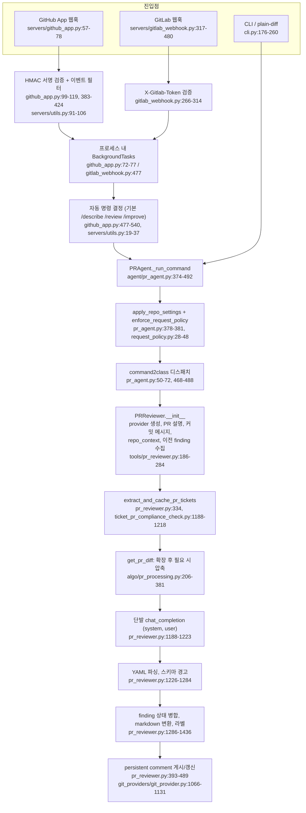

# pr-agent — 실행 경로와 코드 접근·Diff 처리

- 분석 SHA: `330f0813b5fe0d1f54b794077c2d02aa85a1fb63` (repos.lock.tsv와 일치)
- 분석일: 2026-10-13
- 관련 공통 항목: Q1, Q2 (Q3 일부: 고정 문맥 확장의 실제 알고리즘)
- 검증 수준 요약: 코드 확인 67 / 실행 확인 0 / 추론 3 / 미확인 2 (대략 집계: 머리 줄을 뺀 본문에서 각 표기 문자열이 나온 횟수이며, 표 행 수가 아니고 설명 문장 속 언급도 포함. 실행 확인 0은 실제로 실행한 항목이 없다는 뜻이고 본문의 "실행 확인" 문구는 실행하지 않았다는 서술. 2026-10-13 재집계)
- 실행 여부: 정적 추적만. `repos/pr-agent`는 읽기만 했고 설치·실행·테스트 실행을 하지 않았다. 아래 "짧은 예"의 출력은 코드를 손으로 따라가 계산한 값이다(실행 확인 아님).

---

<a id="q1"></a>
## Q1. 실행 경로: 이벤트에서 댓글 게시까지

### 1.1 진입점

| 구분 | 위치 | 식별자 | 설명 | 검증 |
|---|---|---|---|---|
| CLI | `pyproject.toml:133-134`, `pr_agent/cli.py:176-260` | `pr-agent = "pr_agent.cli:run"`, `run()` | `--pr_url`로 PR을 지정하거나 `--stdin`/`--diff-file`로 diff를 직접 준다. 둘 다 `PRAgent().handle_request(...)`로 들어간다 | 코드 확인 |
| GitHub App 웹훅 | `pr_agent/servers/github_app.py:57-78` | `handle_github_webhooks()` | 서명 검증 후 `BackgroundTasks`에 `handle_request`를 등록하고 즉시 `{}` 반환 | 코드 확인 |
| GitLab 웹훅 | `pr_agent/servers/gitlab_webhook.py:317-480` | `gitlab_webhook()` | `X-Gitlab-Token` 검증 후 `inner()`를 `BackgroundTasks`에 등록하고 즉시 200 반환 | 코드 확인 |
| GitHub Action | `action.yaml:15-23`, `github_action/entrypoint.sh:3`, `pr_agent/servers/github_action_runner.py:206-` | `run_action()` | Docker 액션이 `github_action_runner.py`를 실행. `GITHUB_EVENT_NAME`별로 분기 | 코드 확인 |
| 기타 서버 | `pr_agent/servers/` (`bitbucket_app.py`, `azuredevops_server_webhook.py`, `gitea_app.py`, `gerrit_server.py`, `github_polling.py`, `*_lambda_webhook.py`) | - | 파일 존재와 `docker/Dockerfile:37-65`의 빌드 타깃만 확인. 내부 흐름은 이번 범위 밖 | 미확인 |
| A2A(MOSAICO) | `pr_agent/mosaico/server.py:1-60`, `docker/Dockerfile:67-70` | `build_app`, `PRAgentExecutor` | A2A 에이전트 서버. PR URL에 `.diff`를 붙여 가져오거나 붙여넣은 diff를 처리한다(`dispatch.py:1-17`) | 코드 확인(모듈 머리말), 내부는 미확인 |

- 웹훅 서버에 **외부 큐도, 워커 프로세스 분리도 없다**. 요청을 받은 같은 프로세스의 `BackgroundTasks`가 리뷰를 수행한다(상세는 [04-saas-and-isolation.md](04-saas-and-isolation.md)). 근거: `github_app.py:72-77`, `gitlab_webhook.py:477`.
- 모든 진입점은 `PRAgent.handle_request()`로 모인다. `PRAgent`는 `ai_handler`(LLM 호출 클래스)를 주입받는다: `pr_agent/agent/pr_agent.py:329-331`.

### 1.2 호출 흐름 (`/review`)



정적 추적 결과다. 노드마다 위치를 붙였다. 한 문장으로 요약하면 **"프로그램이 정한 순서대로 입력을 모아 프롬프트 한 벌을 만들고, 모델을 한 번 부르고, 결과를 후처리해 게시"**한다.

### 1.3 명령별 경로

| 명령 | 클래스 (`command2class`) | 프롬프트 구성 | LLM 호출 | 응답 파싱·후처리 | 게시 | 위치 | 검증 |
|---|---|---|---|---|---|---|---|
| `/review` (`auto_review`, `answer` 포함) | `PRReviewer` | `self.vars`(제목·브랜치·설명·커밋 메시지·repo_context·이전 finding·티켓·diff)를 `pr_reviewer_prompts.toml`의 Jinja 템플릿에 렌더 | `retry_with_fallback_models`(기본 `ModelType.REGULAR`) 안에서 `ai_handler.chat_completion` 1회. 큰 diff는 옵션(`enable_large_pr_chunking`, 기본 false)에서 청크별 병렬 호출 후 병합 | YAML 파싱 → `PRReview` 스키마 경고 → finding 상태 병합 → markdown | persistent comment 편집, 또는 새 댓글, 옵션으로 인라인·체크런 | `pr_agent.py:50-72,468-488`, `pr_reviewer.py:186-284,295-530,879-951,1188-1436` | 코드 확인 |
| `/improve` | `PRCodeSuggestions` | `pr_code_suggestions_prompts.toml`. 파일 묶음(청크)별 프롬프트 | 청크별 호출(`parallel_calls=true`, `max_number_of_calls=3`) 후 **자기 반성(self-reflect) 호출 1회 추가** | 점수 임계값 필터 → 파일당 상한 → 라인 범위·적용 가능성 검증 | 요약 표 댓글 또는 인라인(committable) 제안 | `pr_code_suggestions.py:367-593,990-1081,1083-1116,2086-2223,2432-2503` | 코드 확인 |
| `/describe` | `PRDescription` | `pr_description_prompts.toml` | `ModelType.WEAK` 모델 체인 | YAML → PR 본문·라벨 갱신 | PR 설명 편집 | `pr_description.py:155,365,415,747` | 코드 확인(호출 지점만) |
| `/ask`, `/ask_line` | `PRQuestions`, `PR_LineQuestions` | diff + 사용자 질문 | `ModelType.WEAK` 체인에서 1회 | 텍스트 그대로 | 댓글 | `pr_questions.py:91,218-257`, `pr_line_questions.py:104,209` | 코드 확인(호출 지점만) |
| `/similar_issue` | `PRSimilarIssue` | 이슈 본문 임베딩 | 임베딩 API + 벡터 검색 (대화 모델 호출 없음) | 유사 이슈 목록 | 이슈 댓글 | `pr_similar_issue.py:16-35,419-447` | 코드 확인(앞부분만) |
| `/help_docs` | (비활성) | - | - | - | - | `pr_agent.py:69-71` 주석: 보안 이슈로 `command2class`에서 제외 | 코드 확인 |

- `/review`와 `/improve`는 **같은 `get_pr_diff`/`get_pr_multi_diffs`를 쓰지만 프롬프트 구성, 호출 횟수, 후처리가 다르다**. `/improve`만 생성 후 별도 LLM 호출로 점수를 매기는 2단계 파이프라인이다([02-context-loop-verify.md](02-context-loop-verify.md#q5)).
- 설정 오버라이드(`.pr_agent.toml`, 명령줄 `--section.key=value`)는 `_run_command`에서 먼저 적용되고(`pr_agent.py:378-410`) 금지된 키는 `CliArgs.validate_user_args`로 거부된다(`pr_agent.py:398-407`).
- 정책 필터(`ignore_pr_title`, `ignore_pr_labels` 등)는 `enforce_request_policy`가 담당하며 provider 조회 오류 시에는 **리뷰를 막지 않고 계속 진행**한다(`request_policy.py:45-47`).

### 1.4 게시와 실패 처리 (`/review`)

| 단계 | 동작 | 위치 | 검증 |
|---|---|---|---|
| 진행 표시 | 수동 명령이면 "Preparing review..." 임시 댓글을 게시했다가 `finally`에서 삭제 | `pr_reviewer.py:351-357,499-505` | 코드 확인 |
| 게시 조건 | `publish_output`이고 "No major issues" 억제 설정, 상태 변경, 실패 청크 중 하나라도 해당할 때 게시 | `pr_reviewer.py:379-391` | 코드 확인 |
| 게시 방식 | persistent comment(기본 `persistent_comment=true`)를 찾아 편집(`#### (Review updated until commit …)` 삽입), 없으면 새로 작성. GitHub은 옵션으로 Check Run | `pr_reviewer.py:435-479`, `git_provider.py:1066-1131`, `configuration.toml:187,190` | 코드 확인 |
| 작성자 검증 | 상태 마커가 있는 경우 PR-Agent가 쓴 댓글만 갱신하고, 신원을 확인 못 하면 "Standalone PR Review"로 따로 게시 | `pr_reviewer.py:398-479,562-578` | 코드 확인 |
| 실패 | 예외를 잡아 `record_command_failure()` 후 실패 사유 댓글 게시(수동 명령 기준) | `pr_reviewer.py:490-525` | 코드 확인 |

기능 지원 수준: **Q1 실행 경로 = 지원**(웹훅/CLI/Action 모두 추적함. 큐·워커는 없음).

---

<a id="q2a"></a>
## Q2-A. 코드 접근

### 2.1 입력 경로 구분

| 입력 경로 | 사용처 | 방식 | 위치 | 검증 |
|---|---|---|---|---|
| Git Provider API | GitHub, GitLab 등 호스팅 PR | 변경 파일 목록·patch는 API, **변경된 파일마다 base/head 전체 본문을 API로 추가 조회** | `github_provider.py:443-588`, `gitlab_provider.py:1103-1214` | 코드 확인 |
| 로컬 git 작업 트리 | `LocalGitProvider` | GitPython `Repo`. `merge_base(HEAD, target_branch)`와의 diff. **dirty 작업 트리는 거부** | `local_git_provider.py:42-72,83-92` | 코드 확인 |
| 원문 diff | `plain-diff` (`--stdin`, `--diff-file`) | `unidiff`로 파싱. 저장소 루트(.git)가 있으면 작업 트리 파일을 head로 읽고, **patch를 역적용해 base를 복원**. 루트가 없으면 patch-only | `plain_diff_provider.py:55-99`, `diff_parsing.py:22-108` | 코드 확인 |
| clone | `GitProvider.clone()` | `git clone --filter=blob:none --depth 1` (얕은 복제, 기본 20초 제한). **호출자는 비활성화된 `/help_docs`뿐** | `git_provider.py:539-601`, `tools/pr_help_docs.py:550`, `pr_agent.py:69-71` | 코드 확인 |
| 샌드박스 | - | 없음 (`subprocess` 사용처는 clone 계열뿐) | `grep subprocess pr_agent`: `git_provider.py`, `bitbucket_server_provider.py:777`, `gerrit_provider.py:31` | 코드 확인(부재는 grep 근거) |

- **리뷰 경로(`get_pr_diff` 계열)는 clone을 쓰지 않는다.** 저장소 전체가 로컬에 있지 않으므로 "호출부를 grep"하는 방식의 탐색은 구조상 불가능하다. 이는 `repo_context_files`(고정 경로 파일) 말고는 저장소의 다른 파일을 읽는 경로가 없다는 뜻이다(`get_repo_file_content`의 호출처는 `repo_context.py:337`뿐이고, `get_pr_file_content`는 provider 내부의 변경 파일 수집과 changelog 도구 `pr_update_changelog.py:379`에서만 호출된다. grep 확인).

### 2.2 Base / Head / Merge Base

| Provider | Head | Base | 위치 | 검증 |
|---|---|---|---|---|
| GitHub | `self.pr.head.sha`의 파일 본문 | `repo.compare(pr.base.sha, pr.head.sha).merge_base_commit`의 본문. 실패하면 `pr.base`로 대체 | `github_provider.py:506,517-529` | 코드 확인 |
| GitHub 증분(`-i`) | head | `incremental.last_seen_commit_sha`의 본문, patch는 `load_large_diff`(difflib)로 두 본문 비교 | `github_provider.py:508-513` | 코드 확인 |
| GitLab | `diff_refs["head_sha"]` | `diff_refs["base_sha"]` (merge base 계산은 코드에 없고 GitLab이 주는 값을 사용) | `gitlab_provider.py:1131-1171` | 코드 확인 |
| 로컬 | `HEAD` 커밋 | `merge_base(HEAD, target_branch)` | `local_git_provider.py:88-92` | 코드 확인 |
| 미커밋 변경 | - | 로컬은 거부, 호스팅 PR은 해당 없음 | `local_git_provider.py:69-70` | 코드 확인 |

### 2.3 파일 원문 확보 방법과 상한

- GitHub: `get_contents(path, ref=sha).decoded_content` (`github_provider.py:1908-1927`). 404나 디코드 오류는 빈 문자열로 처리한다.
- GitLab: `projects.get(...).files.get(path, ref).decode()` (`gitlab_provider.py:1003-1016`).
- **`MAX_FILES_ALLOWED_FULL = 50`**(`git_provider.py:52`): patch가 있는 파일이 50개를 넘으면 그 이후 파일은 base/head 본문을 **빈 문자열**로 둔다(`github_provider.py:496-503`, `gitlab_provider.py:1160-1177`). 본문이 비면 `extend_patch`가 `not original_file_str`로 바로 원본 patch를 돌려주므로(`git_patch_processing.py:35`) **주변 줄 확장이 적용되지 않는다**.
- 변경 목록 수집 중 PR이 바뀌는 것을 감지하려는 장치가 있다: GitHub는 head/base/`changed_files`를 수집 전후로 비교하고 개수가 어긋나면 `IncompletePullRequestFilesError`(`github_provider.py:348-357,370-385`), GitLab은 MR 메타(`sha`, `diff_refs`, `changes_count`)를 diff 수집 전후로 비교하고 최대 2회 시도 후 `IncompleteGitLabDiffError`(`gitlab_provider.py:608-640`). 이 오류는 리뷰 대신 "불완전 파일" 안내 댓글을 낸다(`pr_agent.py:76-133,361-366`).

### 2.4 실행 중 SHA 일관성

| 항목 | 동작 | 위치 | 검증 |
|---|---|---|---|
| 수집 시점 고정 | GitHub: provider 생성 시 `pr`과 `last_commit_id`를 잡고 이후 본문 조회는 `self.pr.head.sha`를 쓴다. 이후 단계에서 head를 다시 조회하지 않는다 | `github_provider.py:136-144,506` | 코드 확인 |
| 인라인 게시 커밋 | GitHub 인라인 리뷰는 init 시점의 `last_commit_id`에 건다 | `github_provider.py:995`(`create_review(commit=self.last_commit_id ...)`), `136-144` | 코드 확인 |
| GitLab 게시 시 재조회 | 인라인 게시 때 `get_relevant_diff`가 MR 변경을 **다시 조회**하고 최신 diff 버전의 SHA를 쓴다. 리뷰 입력과 게시 위치의 SHA가 다를 수 있다 | `gitlab_provider.py:1758-1774` | 코드 확인, 영향은 추론 |
| 상태 마커의 head | finding 상태에는 `get_pr_head_sha()`(provider가 가진 `pr.head.sha`)를 기록 | `pr_reviewer.py:766-782`, `github_provider.py:599-602` | 코드 확인 |
| 게시 직전 stale 폐기 | 게시 직전에 head를 다시 확인해 결과를 버리는 코드는 없다 (`pr_reviewer.py:295-530`, `git_provider.py:1066-1131` 확인) | - | 코드 확인(부재) |

- **"전체 저장소 접근 가능"과 "전체 코드를 모델에 넣음"은 다르다.** provider는 변경 파일의 base/head 전체 문자열을 메모리에 들고 있지만, 모델 입력에는 hunk와 확장된 주변 줄만 들어간다(1.2의 `get_pr_diff`). 전체 본문은 `/improve`의 제안 검증(`_validate_suggestion`, `pr_code_suggestions.py:1631-1656`)에만 쓰인다.

기능 지원 수준: **저장소 전체 접근 = 미지원**(변경 파일 외 임의 파일 조회 경로 없음. 찾아본 곳: `pr_agent/**/*.py`에서 `get_repo_file_content`/`get_pr_file_content` 호출처 전수, `clone()` 호출처, `subprocess`).

---

<a id="q2b"></a>
## Q2-B. Diff 처리

### 3.1 파일 변경 객체 `FilePatchInfo`

`pr_agent/algo/types.py:14-31` (코드 확인)

| 필드 | 의미 |
|---|---|
| `base_file`, `head_file` | 변경 전/후 파일 전체 문자열 (50개 초과 시 빈 문자열) |
| `patch` | hunk만 있는 unified diff 문자열 (`@@`부터 시작) |
| `filename`, `old_filename`, `edit_type` | 경로, rename 전 경로, `ADDED/DELETED/MODIFIED/RENAMED/UNKNOWN` |
| `tokens`, `num_plus_lines`, `num_minus_lines` | 토큰 수(압축 시 계산), 추가/삭제 줄 수 |
| `language`, `ai_file_summary` | 언어 분류, `/describe` 요약(옵션) |
| `head_file_is_complete`, `content_fetch_failed` | 본문이 완전한지, 본문 조회 실패로 신뢰할 patch가 없는지 |

생성 경로:

| Provider | patch 출처 | 위치 | 검증 |
|---|---|---|---|
| GitHub | `pr.get_files()`의 `file.patch`. 비어 있으면 `load_large_diff(base, head)`로 직접 생성 | `github_provider.py:486,530-531` | 코드 확인 |
| GitLab | `/merge_requests/:id/diffs`의 `diff['diff']`. 비어 있으면 `load_large_diff` | `gitlab_provider.py:1192-1194` | 코드 확인 |
| plain-diff | `unidiff.PatchSet`으로 파싱한 파일별 `str(pf)`, 이후 `to_hunk_only_patch` | `diff_parsing.py:22-59`, `plain_diff_provider.py:93-97` | 코드 확인 |
| 로컬 | GitPython `diff(..., create_patch=True)` | `local_git_provider.py:88-120` | 코드 확인 |

### 3.2 rename / delete / 바이너리 / 대규모

| 항목 | 처리 | 위치 | 검증 |
|---|---|---|---|
| rename | GitHub `status == renamed`이면 `previous_filename`으로 base 본문을 조회, `EDIT_TYPE.RENAMED`. patch가 없으면(내용 변경 없음) 건너뜀 | `github_provider.py:487-488,528-529,538-539` | 코드 확인 |
| delete | 새 본문이 비고 타입이 DELETED/UNKNOWN이면 patch를 버리고 "Deleted files:" 목록으로만 알림. 삭제 전용 hunk도 제거 | `git_patch_processing.py:284-354`, `pr_processing.py:27,321-344` | 코드 확인 |
| 바이너리·생성 파일 | 확장자 기반 제외(`bad_extensions`), `*.lock`류, `.min.js`, `.map`은 `is_valid_file`에서 제외하고 파일명만 "Files changed but omitted…"로 알림 | `language_handler.py:8-40`, `pr_processing.py:33-34,129-143` | 코드 확인 |
| ignore 규칙 | `[ignore]` regex/glob과 `ignore_language_framework`를 provider별 경로 필드에 적용 | `file_filter.py:13-102` | 코드 확인 |
| 본문 조회 실패 | 파일을 버리지 않고 "읽을 수 없음, 수동 검토 필요" 안내문을 모델에 준다 | `pr_processing.py:588-601,619-627` | 코드 확인 (이 필드는 Azure DevOps provider만 설정함: `azuredevops_provider.py:1117-1152`, GitHub/GitLab 경로에서 설정하는 코드는 못 찾음) |
| 대규모 파일 | `large_patch_policy="clip"`이면 토큰 예산에 맞춰 patch를 자르고(파일은 `partial_files_list`에 기록), `"skip"`이면 건너뜀 | `pr_processing.py:438-459`, `configuration.toml:71` | 코드 확인 |

### 3.3 주변 줄 확장: 조건과 알고리즘

`extend_patch()` (`pr_agent/algo/git_patch_processing.py:33-53`) → `process_patch_lines()` (`:78-234`). 기본값은 `configuration.toml:60-65`.

| 설정 | 기본값 | 의미 |
|---|---|---|
| `patch_extra_lines_before` / `after` | 5 / 1 (상한 10, `pr_processing.py:38,193-203`) | git 기본 3줄 컨텍스트 **위에** 더 붙이는 줄 수 |
| `allow_dynamic_context` | true | hunk 앞쪽을 "둘러싼 함수/클래스 시작 줄"까지 확장 시도 |
| `max_extra_lines_before_dynamic_context` | 10 | 시작 줄을 찾기 위해 거슬러 올라가는 최대 줄 수 |
| `patch_extension_skip_types` | `.md`, `.txt` | 확장을 건너뛰는 확장자 |

알고리즘 (코드 확인):

1. **적용 조건**: patch가 있고, 앞/뒤 확장 값이 0이 아니고, **base 본문이 비어 있지 않고**, 확장자가 skip 목록에 없을 때만 확장한다(`:35-45`). 새로 추가된 파일, 50개 초과 파일, 본문 조회 실패 파일은 확장되지 않는다.
2. hunk 헤더(`@@ -a,b +c,d @@ section`)를 **정규식**(`RE_HUNK_HEADER`, `:12-13`)으로 읽는다. 헤더 뒤의 `section`은 **git이 hunk 위쪽에서 찾아 붙여 준 "함수 문맥" 문자열**이다. PR-Agent가 직접 함수를 파싱하지 않는다.
3. hunk의 첫 줄이 base 파일의 해당 줄과 일치하는지 검사(`check_if_hunk_lines_matches_to_file`, `:236-271`). 어긋나면(인코딩 차이 포함) 그 hunk는 **확장하지 않는다**.
4. **동적 문맥**(`:137-160`): 위로 최대 10줄을 훑으며 `section_header in line`(**부분 문자열 포함 검사**)인 첫 줄을 찾는다. 찾으면 거기서부터 hunk까지를 앞쪽 문맥으로 쓰고, base와 head에서 그 구간이 동일할 때만 채택한다. 못 찾으면 고정 5줄(`patch_extra_lines_before`)로 대체한다.
5. 뒤쪽은 `patch_extra_lines_after`(기본 1줄)만큼 **base 파일의 줄**을 붙인다(`:98-105,227-231`).
6. 앞쪽 문맥이 base와 head에서 다르면 일치하는 접미부만 남기거나(`:170-196`) 아예 확장을 취소한다.

판정: **함수 경계는 AST가 아니라 git의 hunk 헤더 + 문자열 포함 검사(휴리스틱)**다. `pr_agent/**/*.py` 전체에서 `import ast`는 Bitbucket 웹훅 하나뿐이고 `tree_sitter`/`libcst`/`jedi`/`lsp`는 없다(grep). 문서(`docs/docs/core-abilities/dynamic_context.md:61-68`)는 "코드 구조에 따라 동적으로"라고 쓰지만 구현은 이 휴리스틱이다. 또한 `dynamic`은 **모델이 요청하는 동적 탐색이 아니라** 프로그램이 정한 규칙으로 줄 수를 조절한다는 뜻이다.

주의할 한계(코드 확인):
- 확장은 **같은 파일의 hunk 주변**에 한정된다. 다른 파일(호출부, 구현체)은 들어오지 않는다.
- 토큰 예산을 넘으면(아래 3.4) **확장 자체를 포기**한다. `get_pr_diff`는 확장본이 예산에 들어갈 때만 확장본을 쓰고(`pr_processing.py:259-285`), 넘으면 원본 patch(git 기본 3줄)를 압축해 쓴다(`:287-298`, `:703-711`).

### 3.4 토큰 초과 처리

`get_pr_diff()` (`pr_processing.py:206-381`), `get_pr_multi_diffs()` (`:907-1082`).

| 단계 | 동작 | 위치 | 검증 |
|---|---|---|---|
| 예산 | 모델 컨텍스트 창은 `config.max_model_tokens`(기본 32000)로 **상한이 걸린다**. 프롬프트 토큰과 출력 여유(soft 1500 / hard 1000)를 뺀 값이 diff 예산 | `configuration.toml:51`, `token_budget.py:81-96`, `pr_processing.py:36-37,214-222` | 코드 확인 |
| 토큰 계산 | `tiktoken` 인코더 (모델별 정확 계산은 선택) | `token_handler.py:11,321-339` | 코드 확인 |
| 파일 순서 | `sort_files_by_main_languages`: 저장소 주 언어 파일 먼저, 나머지(`Other`) 나중 | `language_handler.py:89-136`, `pr_processing.py:239` | 코드 확인 |
| 1차 | 확장된 patch를 모두 이어 붙여 예산 이하면 그대로 반환 | `pr_processing.py:247-285` | 코드 확인 |
| 2차 압축 | 확장 없는 patch를 **언어 그룹 안에서 토큰 큰 순서로** 정렬하고 앞에서부터 담는다. 안 들어가는 파일은 `continue`로 건너뛰고 다음 파일을 시도(큰 파일이 먼저 탈락) | `pr_processing.py:677-698,757-800` | 코드 확인 |
| 탈락 파일 안내 | 추가/수정 파일 목록을 "insufficient token budget" 문구로 예산이 남으면 덧붙이고, 리뷰 댓글 하단에 "Review coverage" 푸터로 표시(`enable_review_coverage_footer=true`) | `pr_processing.py:311-358`, `pr_reviewer.py:1360-1376` | 코드 확인 |
| 분할(다중 호출) | `/review`는 `enable_large_pr_chunking=true`일 때만(기본 false) `get_pr_multi_diffs`로 최대 `max_number_of_calls=3`개 묶음 → 청크별 병렬 호출 → 결과 병합. `/improve`는 기본으로 분할 | `pr_reviewer.py:916-942,981-1077`, `configuration.toml:212-213,282` | 코드 확인 |
| 단일 파일 초과 | `clip` 정책이면 `clip_tokens`로 자르고 줄 단위로 마지막 줄 삭제, 잘린 파일은 `partial_files_list`로 기록 | `pr_processing.py:438-459` | 코드 확인 |
| 모델 교체 | 프롬프트에 diff를 끼워 넣어 보니 예산 초과면 `FallbackEligibleError` → 다음 fallback 모델(더 큰 창)로 | `pr_reviewer.py:1202-1214`, `pr_processing.py:830-872` | 코드 확인 |

### 3.5 Provider가 diff를 잘라 반환했을 때

| 상황 | 동작 | 위치 | 검증 |
|---|---|---|---|
| patch 필드가 비어 있음 (GitHub 대형 파일, GitLab `diff` 비어 있음) | base/head 본문을 받아 `difflib.unified_diff`로 patch를 직접 만든다 | `utils.py:732-758`, `github_provider.py:530-531`, `gitlab_provider.py:1193-1194` | 코드 확인 |
| 50개 초과로 본문을 안 받은 파일의 patch가 비어 있음 | 본문이 비어 있으므로 patch도 비고, 안내문 없이 **조용히 빠진다** (`content_fetch_failed`를 설정하지 않음) | `github_provider.py:496-503,530-531`, `pr_processing.py:618-627` | 코드 확인, "빠진다"는 추론(해당 경로를 직접 재현하지 않음) |
| patch가 **일부만** 잘려 반환됨 | 감지 코드 없음. `file.additions/deletions`(API 통계)와 patch를 비교하지 않는다 | `github_provider.py:546-553` | 코드 확인(부재) |
| GitLab 본 MR diff의 `too_large`/`collapsed` 플래그 | 확인하지 않는다. 이 플래그는 서브모듈 비교 경로에서만 본다 | `gitlab_provider.py:528-531` | 코드 확인(부재) |
| 파일 개수 불일치 | 오류로 중단 (위 2.3) | `github_provider.py:380-385`, `gitlab_provider.py:623-632` | 코드 확인 |

기능 지원 수준: 잘린 diff 복구 = **부분 지원**(빈 patch만 복구. 부분 잘림은 미감지).

### 3.6 라인 번호 변환: old/new → 모델 입력 → 게시 위치

1. **모델 입력용**: `decouple_and_convert_to_hunks_with_lines_numbers()`(`git_patch_processing.py:357-487`)가 hunk를 `__new hunk__`(새 파일 기준 **줄 번호를 붙여서**)와 `__old hunk__`(번호 없이 삭제 줄 표시)로 나눠 준다. 추가/삭제가 없는 hunk는 출력에서 제외한다(`:432-433`). 프롬프트가 이 형식을 설명한다(`prompt_fragments.py:12-18`의 `render_diff_hunk_format`, `pr_reviewer_prompts.toml:14-15`; 문구 본체는 `settings/prompt_fragments.toml`이며 이번에 열어 보지 않음).
2. **모델 출력**: `start_line`/`end_line`은 `__new hunk__`의 새 파일 줄 번호다(`pr_reviewer_prompts.toml:70-74`).
3. **게시 위치 변환**은 provider마다 다르다.

| Provider | 변환 | 위치 | 검증 |
|---|---|---|---|
| GitHub (제안/인라인) | `line`/`start_line` + `side=RIGHT`로 직접 지정. committable 제안은 `validate_comments_inside_hunks`로 hunk 범위 안인지 먼저 검증 | `github_provider.py:1335-1364,2202-2230` | 코드 확인 |
| GitHub (텍스트 검색형) | 모델이 준 코드 줄을 patch에서 찾아 diff `position`을 계산. 정확히 없으면 `difflib.get_close_matches(cutoff=0.93)`로 유사 줄 대체 | `algo/utils.py:1388-1475`, `github_provider.py:925-937` | 코드 확인 |
| GitLab | patch의 hunk 헤더에서 `old_line_no/new_line_no`를 직접 세어 `relevant_lines_start`에 해당하는 줄을 찾고(`'+'`면 addition, 아니면 context) `position{base_sha,start_sha,head_sha,new_path,old_path,new_line,old_line}`을 만든다. **hunk 밖이면 낙관적 addition 위치로 시도하고 GitLab이 거부하면 파일 단위 일반 노트로 대체** | `gitlab_provider.py:1846-1882,1648-1659,1691-1752` | 코드 확인 |
| `/review` 인라인 key issue | 파일이 diff에 있는지, `end_line ≤ head_file 줄 수`인지 확인 후 `publish_code_suggestions`로 위임. 의미 검증은 없음 | `pr_reviewer.py:1438-1472,1489-1583` | 코드 확인 |

GitLab 위치 지정은 SHA 3종을 `get_relevant_diff()`가 고른 diff 버전에서 가져온다(`gitlab_provider.py:1648-1652,1758-1774`). 삭제된 줄에 다는 경로는 이 함수에서 만들어지지 않는다(루프가 `-` 줄을 건너뜀, `:1859-1861`).

### 3.7 문자열 diff와 `unidiff` 책임 분리

| 담당 | 하는 일 | 위치 | 검증 |
|---|---|---|---|
| 직접 작성한 문자열/정규식 처리 | 확장, 삭제 hunk 제거, 번호 붙이기, 헤더 파싱, 라인→position 변환 | `git_patch_processing.py`, `algo/utils.py:1388-` | 코드 확인 |
| `unidiff` | **원문 diff 입력(plain-diff)** 파싱과 base 복원(reverse-apply)에만 사용. GitHub/GitLab 경로에서는 쓰지 않는다 | `diff_parsing.py:1-108`, grep: `unidiff` import는 `diff_parsing.py`, `plain_diff_provider.py`뿐. `mosaico/diff_provider.py:57`에 정규식 기반 별도 `parse_unified_diff`가 있고 Gitea provider가 이를 가져다 쓴다(`gitea_provider.py:29,252`) | 코드 확인 |
| `difflib` | patch가 없을 때 생성, 라인 퍼지 매칭 | `utils.py:751-755,1445` | 코드 확인 |

→ GitHub/GitLab 경로의 diff 로직은 `unidiff`에 의존하지 않고 **자체 정규식**에 의존한다. 직접 재사용할 때 `unidiff` 설치는 필수가 아니다.

### 3.8 짧은 예: 함수 수정 + 호출부의 숨은 전제 (정적 추적, 손으로 계산)

**입력**: `billing.py`에서 `apply_discount`가 잘못된 rate일 때 예외 대신 `None`을 반환하도록 바꾼 PR. 호출부 `checkout()`(16행)은 반환값을 `+=`로 더한다. 변경 파일은 이것 하나, 토큰은 예산 이내라고 가정.

base(변경 전) 발췌(줄 번호):

```text
 4 def apply_discount(price, rate):
 5     """Return the discounted price."""
 6     if price < 0:
 7         raise ValueError("price")
 8     if rate > 1:
 9         raise ValueError("rate")
10     return price * (1 - rate)
11
12
13 def checkout(cart):
...
16         total += apply_discount(item.price, item.rate)
```

**① provider가 만든 `FilePatchInfo`** (GitHub): `filename="billing.py"`, `edit_type=MODIFIED`, `base_file`/`head_file`=위 파일 전체, `patch`는 git 기본 3줄 컨텍스트의 hunk 한 개.

```text
@@ -6,7 +6,7 @@ def apply_discount(price, rate):
     if price < 0:
         raise ValueError("price")
     if rate > 1:
-        raise ValueError("rate")
+        return None
     return price * (1 - rate)
 (공백 줄)
 (공백 줄)
```

**② `extend_patch`(앞 5줄, 뒤 1줄, 동적 문맥 최대 10줄)**: `section_header="def apply_discount(price, rate):"`. 위로 10줄(1~5행)을 훑다가 4행에서 부분 문자열이 맞는다 → 시작을 4행으로 당긴다(base와 head의 4~5행이 동일하므로 채택). 뒤쪽은 13행 한 줄을 붙인다. 헤더의 section 문자열은 이미 본문에 포함되어 비운다.

```text
@@ -4,10 +4,10 @@
 def apply_discount(price, rate):
     """Return the discounted price."""
     if price < 0:
         raise ValueError("price")
     if rate > 1:
-        raise ValueError("rate")
+        return None
     return price * (1 - rate)
 (공백) (공백)
 def checkout(cart):
```

**③ 모델 입력**(`decouple_and_convert_to_hunks_with_lines_numbers`):

```text
## File: 'billing.py'

@@ -4,10 +4,10 @@
__new hunk__
4  def apply_discount(price, rate):
5      """Return the discounted price."""
6      if price < 0:
7          raise ValueError("price")
8      if rate > 1:
9 +        return None
10      return price * (1 - rate)
11
12
13  def checkout(cart):
__old hunk__
 def apply_discount(price, rate): ...
-        raise ValueError("rate")
 ...
```

**관찰**: 모델은 4~13행만 본다. **16행의 호출부(`total += apply_discount(...)`)는 입력에 없다.** 시스템 프롬프트도 "you only see changed code segments ... Avoid ... questioning code elements ... defined elsewhere"(`pr_reviewer_prompts.toml:17`)와 "Do not speculate that a change might break other code unless you can identify the specific affected code path from the diff context"(`:24`)라고 지시한다. 따라서 이 PR의 "반환 타입이 바뀌어 호출부가 깨진다"는 결함은 **구조적으로 다룰 수 없거나 억제된다**(추론: 프롬프트 지시와 입력 구성에서 도출. 실제 모델 출력은 실행 확인하지 않음). 호출부가 같은 hunk 근처에 있다면 확장 범위에 우연히 들어올 수는 있다.

### 3.9 제품 문구와 코드의 차이

| 문서·주석의 서술 | 코드 | 위치 | 검증 |
|---|---|---|---|
| "코드 구조(enclosing function/class)에 따라 문맥을 동적으로 조정" | git hunk 헤더 문자열의 부분 문자열 검사 + 최대 10줄 탐색 + 일치 검증. 실패하면 고정 5줄 | `dynamic_context.md:61-68` vs `git_patch_processing.py:137-168` | 코드 확인 |
| 설정 주석 "(+3 default ones) 앞/뒤에 더 붙임" | 맞음. 단 base 본문이 있는 파일에 한정되고 예산 초과 시 포기 | `configuration.toml:64-65` vs `git_patch_processing.py:35`, `pr_processing.py:259-298` | 코드 확인 |
