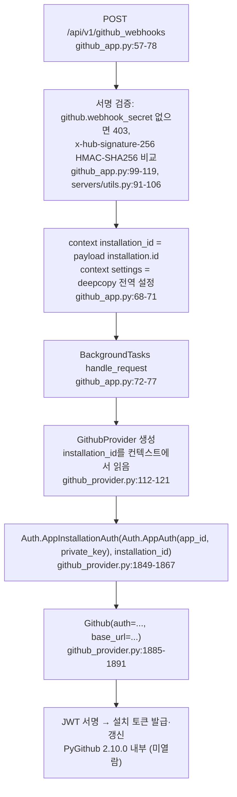

# pr-agent — 자격증명 관리 (비공개 저장소 접근 토큰)

- 분석 SHA: `330f0813b5fe0d1f54b794077c2d02aa85a1fb63` (repos.lock.tsv와 일치, 시작 시 `git rev-parse HEAD`로 확인)
- 분석일: 2026-10-13
- 관련 공통 항목: Q13 (Q10 인증 보강, Q12 의견 연결)
- 검증 수준 요약: 코드 확인 75 / 실행 확인 0 / 추론 8 / 미확인 20 (대략 집계: 머리 줄을 뺀 본문에서 각 표기 문자열이 나온 횟수이며, 표 행 수가 아니고 설명 문장 속 언급도 포함. 실행 확인 0은 실제로 실행한 항목이 없다는 뜻이고 본문의 "실행 확인" 문구는 실행하지 않았다는 서술. 2026-10-13 재집계)
- 실행 여부: 정적 추적만. 설치·실행·테스트·네트워크 호출 없음. 이번에 읽은 `docs/`는 **제품 문구**이며 `문서 확인`으로 구분해 표기했다(코드 확인이 아님).
- 규칙: 실제 토큰·키 값은 기록하지 않았다. 변수명과 설정 키 경로만 적었다.

> 요약
> 1. 비공개 저장소 접근은 **호스트 설정 한 벌**(GitHub PAT `github.user_token`, GitHub App `github.app_id`+`github.private_key`, GitLab `gitlab.personal_access_token`)로 한다. 코드는 scope를 검사하지 않고 권한은 토큰 발급 쪽에 달려 있다.
> 2. GitHub App은 **웹훅 payload의 `installation.id`로 provider 인스턴스를 만들 때마다 PyGithub `AppInstallationAuth`를 만든다**(한 요청 안에서도 도구가 추가 인스턴스를 만들 수 있음, 3.2절). PR-Agent는 설치 토큰을 저장·캐시하지 않는다. 발급·갱신은 라이브러리에 위임(라이브러리 소스는 이 환경에 없어 미확인).
> 3. GitLab은 **`CI_JOB_TOKEN`을 API 자격으로 지원하지 않는다**(PAT만). 웹훅은 `GITLAB.SHARED_SECRET` 또는 `<secret-name>:<webhook-token>`으로 검증하고, 후자만 **웹훅(프로젝트)별 GitLab 토큰**을 시크릿 제공자(AWS/GCS)에서 읽는다.
> 4. 토큰이 들어가는 clone 코드는 있으나(URL 임베딩 후 `http.extraHeader`로 옮기고 argv·`.git/config`에서 제거) **유일한 호출자 `/help_docs`가 이 SHA에서 비활성**이다. 로그 마스킹은 전역 필터가 아니라 **호출 지점별**이다.
> 5. 팀(테넌트)별 토큰 분리를 위한 저장·조회·갱신 계층은 없다. 가져다 쓸 수 있는 접점은 "요청 범위 설정 사본에 토큰을 주입"하는 패턴과 Bitbucket Cloud 앱의 `store_secret` 경로뿐이다.

---

## 1. 자격증명 종류와 권한 (질문 1, Q13)

권한 열의 출처를 구분했다. **코드는 scope·권한을 검사하지 않는다**(토큰을 그대로 클라이언트에 넘김). 필요 권한은 `문서 확인`(제품 문구)과 코드에서 호출하는 API에서 추정한 값을 따로 적었다.

| 플랫폼 · 실행 모드 | 지원 자격증명 | 설정 키(환경변수 표기는 2절) | 문서가 요구하는 권한 (`문서 확인`) | 코드 위치 | 지원 수준 |
|---|---|---|---|---|---|
| GitHub · CLI / Docker / `github_polling` | PAT (classic·fine-grained 구분 없음, `Auth.Token`) | `github.user_token`, `github.deployment_type="user"` | 템플릿 주석: "`repo` scope" (`.secrets_template.toml:69`), `docs/docs/installation/locally.md:11`. fine-grained PAT의 세부 권한은 문서·코드에 없음 → **미확인** | `github_provider.py:1868-1875`, `servers/github_polling.py:410-419` | 지원 |
| GitHub · GitHub Action | 워크플로 `GITHUB_TOKEN`을 `github.user_token`에 대입, 배포 유형 `user` 강제 | env `GITHUB_TOKEN`, `OPENAI_KEY`/`OPENAI.KEY` | `contents: read`, `issues: write`, `pull-requests: write` (`docs/docs/installation/github.md:23-26`). `checks: write`는 check run 게시 시, `contents: write`는 `resolve_threads`·changelog push 시 (`github.md:566-570`). fork PR의 `pull_request`는 읽기 전용 토큰·시크릿 없음(`github.md:63`) | `servers/github_action_runner.py:206-239`, `action.yaml:15-23` | 지원 |
| GitHub · App 웹훅 서버 | App ID + 개인 키(JWT) → 설치 토큰. 웹훅 시크릿 필수 | `github.app_id`, `github.private_key`, `github.webhook_secret`, `github.deployment_type="app"` | Pull requests R/W, Issue comment R/W, Metadata R, Contents R (`resolve_threads`는 R/W) (`github.md:678-682,690`) | `github_provider.py:1849-1867`, `github_app.py:99-119` | 지원 |
| GitHub · Lambda 웹훅 | 위와 동일 + AWS Secrets Manager 일괄 주입 | `config.secret_provider`, `aws_secrets_manager.secret_arn` | (위와 동일) | `servers/github_lambda_webhook.py:8-18`, `config_loader.py:103-159` | 지원 |
| GitHub · OAuth(사용자 위임) 흐름 | 없음 | - | - | 찾아본 곳: `git_providers/`, `servers/`에서 `refresh_token\|authorization_code\|oauth` grep. 토큰 교환·갱신 코드는 없고 GitLab의 `oauth_token=` 헤더 선택과 Bitbucket Cloud 앱의 JWT 교환만 있음 | **미지원** (추적 범위: 좌측 grep) |
| GitLab · CLI / GitLab Pipeline | PAT. 헤더 방식 선택: `oauth_token`(Bearer, 기본) 또는 `private_token`(PRIVATE-TOKEN) | `gitlab.personal_access_token`, `gitlab.auth_type`, `gitlab.url`, `gitlab.ssl_verify` | `api` scope, 사용자 역할 Developer(댓글만이면 Reporter) (`docs/docs/installation/gitlab.md:126-130`). 파이프라인은 마스킹된 CI 변수에 **PAT**를 넣는다(`gitlab.md:55,112`) | `gitlab_provider.py:263-299` | 지원 |
| GitLab · 웹훅 서버 (공유 시크릿) | 호스트 PAT 1개 + 웹훅 공유 시크릿 | `gitlab.shared_secret`, `gitlab.personal_access_token` | (위와 동일) | `servers/gitlab_webhook.py:266-314` | 지원 |
| GitLab · 웹훅 서버 (시크릿 제공자) | 웹훅별 `{gitlab_token, webhook_token}` JSON을 AWS SM/GCS에서 읽음 | `config.secret_provider` | (위와 동일, 토큰별) | `gitlab_webhook.py:272-306`, `secret_providers/__init__.py:19-37` | 지원 |
| GitLab · `CI_JOB_TOKEN` (API 자격) | 없음. `gitlab.Gitlab(...)`을 `oauth_token`/`private_token`으로만 생성 | - | - | `gitlab_provider.py:282-295`. 찾아본 곳: `pr_agent/` 전체 `job.token` 대소문자 무시 grep → 2건뿐: `cli.py:148`(extra config 헤더 **예시 문구**)와 `gitlab_provider.py:946`(주석) | **미지원** |
| GitLab · 프로젝트/그룹 액세스 토큰 | 별도 분기 없음. 토큰 문자열을 PAT 자리에 넣으면 같은 경로로 동작할 수 있음 | `gitlab.personal_access_token` | 문서에 언급 없음 | `gitlab_provider.py:269-271` | **미확인** (동작은 GitLab 쪽 의존, 코드에 전용 분기 없음) |
| Bitbucket Cloud 앱 | Atlassian Connect JWT → 단기 bearer. 설치별 `sharedSecret`을 시크릿 제공자에 저장 | `bitbucket.app_key`, `bitbucket.base_url` | 미열람 | `servers/bitbucket_app.py:93-126,342-379,444-506` | 부분 확인 (이번 범위는 인증 흐름만) |
| Bitbucket Server / Cloud(고정 토큰) / Gitea / Azure DevOps | `bitbucket_server.bearer_token`, `bitbucket.bearer_token`·`basic_token`, `gitea.personal_access_token`, `azure_devops.pat`(없으면 `DefaultAzureCredential`) | 좌측 | 미열람 | `bitbucket_provider.py:91-110`, `bitbucket_server_provider.py:47-62`, `gitea_provider.py:99`, `azuredevops_provider.py:1830-1856` | 부분 확인 (키 이름만) |
| MOSAICO(A2A) 서버 | **토큰 없음.** PR URL에 `.diff`를 붙여 공개 diff만 가져옴 | `mosaico.bearer_tokens`는 **호출자 인증**용 | - | `mosaico/dispatch.py:1-16,239-285`, `mosaico/auth.py:13-51` | 비공개 저장소 **미지원** |
| Jira / Asana 티켓 | `jira.jira_site`, `jira.jira_api_email`, `jira.jira_api_token`, `asana.api_token` | 좌측 | - | `tools/ticket_pr_compliance_check.py:208-221`, `.secrets_template.toml:119-131` | 지원(자세한 동작은 [03](03-incremental-memory-rules.md)) |
| LLM API 키 | `openai.key`, `anthropic.key` 등 | 좌측 | - | [04 Q10-3](04-saas-and-isolation.md)에서 다룸. 중복 서술 생략 | 해당 문서 |

- 코드 확인: GitHub/GitLab 모두 **토큰 종류를 코드가 구분하지 않는다.** GitHub는 `deployment_type`이 `app`이면 App 경로, 그 외 `user`면 `Auth.Token` 경로이다(`github_provider.py:1849-1875`). `app`·`user` 외 값이면 `self.auth`가 `None`이라 `Could not authenticate to GitHub`로 실패한다(`1876-1893`).
- 코드 확인: GitHub Enterprise Server 지원은 `github.base_url`(기본 `https://api.github.com`)로 한다(`github_provider.py:119-120`, `configuration.toml:324`).
- 제품 문구와 코드의 차이: README·문서는 "repo scope PAT"라 하지만 코드는 scope를 읽지 않는다. 권한 부족은 GitHub/GitLab API 응답(403/404)으로만 드러난다. 영구 오류(`401,403,404,...`)는 재시도하지 않는다(`github_provider.py:95-97`).

---

## 2. 주입 경로, 읽는 코드, 우선순위 (질문 2)

### 2.1 비밀 설정 구조

| 항목 | 내용 | 위치 | 검증 |
|---|---|---|---|
| 설정 엔진 | Dynaconf. `envvar_prefix=False`(접두사 없이 환경변수 사용), `load_dotenv=False`(`.env` 로드 안 함), `core_loaders=[]`, 로더는 `custom_merge_loader` → `env_loader` 순서 | `config_loader.py:10-27` | 코드 확인 |
| 비밀 파일 | 설정 파일 목록 끝에 `settings/.secrets.toml`, `settings_prod/.secrets.toml`. 없으면 경고만 하고 건너뜀 | `config_loader.py:51-52`, `custom_merge_loader.py:66-68` | 코드 확인 |
| 파일 위치·추적 | 두 경로 모두 `.gitignore`와 `.dockerignore`에 있음(이미지에 포함되지 않음). 저장소에는 `settings/.secrets_template.toml`만 있음 | `.gitignore:9-10`, `.dockerignore:3-4` | 코드 확인 |
| 템플릿 섹션(키 이름) | `[github] user_token, deployment_type, private_key, app_id, webhook_secret` / `[gitlab] personal_access_token, shared_secret` / `[gitea]` / `[bitbucket] base_url, auth_type, bearer_token, basic_token` / `[bitbucket_server] bearer_token, webhook_secret, app_key, url` / `[azure_devops] org, pat` / `[jira]` / `[asana]` / LLM 키 섹션들 / `[aws_secrets_manager] secret_arn, region_name` | `settings/.secrets_template.toml:67-131,184-186` | 코드 확인 |
| 환경변수 이름 | 중첩 키를 `__`로 쓴다: `GITHUB__USER_TOKEN`, `GITLAB__PERSONAL_ACCESS_TOKEN`, `OPENAI__KEY`, `CONFIG__GIT_PROVIDER`. Action 러너는 `OPENAI_KEY`·`GITHUB_TOKEN`을 직접 읽어 설정에 대입 | `docs/docs/installation/locally.md:22,35`, `gitlab.md:166-171`(`문서 확인`), `github_action_runner.py:210-235`(코드 확인) | 코드 확인 + 문서 확인 |
| 외부 시크릿 매니저 | `config.secret_provider` = `""`/`google_cloud_storage`/`aws_secrets_manager`. AWS는 JSON(`"openai.key"` 같은 2단 키)을 읽어 **값이 비어 있을 때만** 대입(환경변수 우선). 호출은 Lambda 웹훅 시작 시 1회 | `configuration.toml:66`, `config_loader.py:103-159`, `github_lambda_webhook.py:8-18` | 코드 확인 |

### 2.2 우선순위 (낮음 → 높음)

| 순위 | 계층 | 근거 | 검증 |
|---|---|---|---|
| 1 | `configuration.toml` 등 번들 기본값 | `config_loader.py:28-50` | 코드 확인 |
| 2 | `settings/.secrets.toml` → `settings_prod/.secrets.toml` (같은 키는 뒤 파일이 이김, 섹션은 필드 단위 병합) | `config_loader.py:51-52`, `custom_merge_loader.py:84-96` | 코드 확인 |
| 3 | 환경변수 (`env_loader`가 마지막 로더) | `config_loader.py:10-13` 주석과 `loaders` | 코드 확인 |
| 4 | AWS Secrets Manager 값 (`get`이 `None`/`""`일 때만) | `config_loader.py:155-158` | 코드 확인 |
| 5 | `config.extra_config_url`의 TOML (호스트 전용 키. 헤더는 환경변수 `PR_AGENT_EXTRA_CONFIG_AUTH_HEADER`) | `git_providers/utils.py:59-148,267-286` | 코드 확인 |
| 6 | 저장소/조직 `.pr_agent.toml` (호스트 전용 키 제거 후 병합, 병합마다 환경변수 재적용) | `git_providers/utils.py:382-544,162-180` | 코드 확인 |
| 7 | 댓글·CLI 인자 `--section.key=value` (검증 후 `get_settings().set`) | `agent/pr_agent.py:398-410`, `algo/utils.py:761-794` | 코드 확인 |
| 예외 | 요청에서 **검증된** 자격증명(GitLab 시크릿 제공자 토큰)은 위 계층이 재병합돼도 다시 덮어쓴다 | `git_providers/utils.py:151-159`, `gitlab_webhook.py:299-300` | 코드 확인 |

- 코드 확인: 요청 범위 설정은 웹훅 진입에서 `copy.deepcopy(global_settings)`를 컨텍스트에 넣어 만든다(`github_app.py:68-71`, `gitlab_webhook.py:320`). 따라서 위 5~7 계층은 해당 요청의 사본에만 반영된다. 이 구조는 [04 Q10-3](04-saas-and-isolation.md)에 이미 있다.
- 코드 확인: 컨텍스트가 없는 실행(CLI)에서 `get_settings()`는 전역 객체를 반환한다(`config_loader.py:58-71`). CLI 모드에서는 5~7이 전역 객체를 바꾼다.

기능 지원 수준: 환경변수·`.secrets.toml`·외부 시크릿 매니저 주입 = **지원**. DB·요청 헤더로 받은 임의 토큰 주입 = **미지원**(GitLab 웹훅의 `X-Gitlab-Token`은 토큰 자체가 아니라 시크릿 이름과 검증 토큰이다. 4절). Bitbucket Cloud는 설치 시 payload의 `sharedSecret`을 시크릿 제공자에 저장한다(`bitbucket_app.py:444-506`).

---

## 3. GitHub App 인증 (질문 3)

### 3.1 추적 결과

| 단계 | 구현 | 위치 | 검증 |
|---|---|---|---|
| 개인 키·App ID 읽기 | `get_settings().github.private_key`, `str(get_settings().github.app_id)`. 없으면 `AttributeError` → `ValueError("GitHub app ID and private key are required ...")` | `github_provider.py:1853-1860` | 코드 확인 |
| 설치 ID 필수 | `installation_id`가 비어 있으면 `ValueError`. 값은 `context.get("installation_id")`, 컨텍스트가 없으면 `None` | `github_provider.py:114-118,1861-1862` | 코드 확인 |
| JWT·설치 토큰 | PR-Agent 코드에는 JWT 서명, `POST /app/installations/{id}/access_tokens`, 만료 계산이 **없다.** `Auth.AppInstallationAuth`에 위임한다 | `github_provider.py:1863-1867`. 찾아본 곳: `pr_agent/**/*.py`에서 `installation`, `get_access_token`, `AppAuth`, `GithubIntegration` grep → 위 위치와 `649-666`(아래)뿐 | 코드 확인(위임 구조), 라이브러리 동작은 **미확인** |
| 라이브러리 버전 | `PyGithub>=2.10,<3` 선언, `uv.lock` 해석 2.10.0. `PyJWT>=2.15.1,<3`, 해석 2.15.1. 가상환경이 이 저장소에 없어 라이브러리 소스는 열람하지 못함 | `pyproject.toml:44,94`, `uv.lock:3006-3008,3031-3033` | 코드 확인(버전), 내부 미확인 |
| 만료 처리 | 토큰 만료·재발급 코드 없음. 요청 단위로 클라이언트를 새로 만들고 작업은 보통 짧다. 만료 후 재발급이 라이브러리 내부에서 일어나는지는 미확인. 401은 영구 오류로 분류돼 재시도하지 않는다 | `github_provider.py:95-97` | 코드 확인(재시도 분류), 갱신 시점 **미확인** |
| 앱 자신의 로그인 | 설치 토큰은 `GET /user`를 못 부르므로, 앱 JWT로 `GithubIntegration(...).get_app().slug`를 읽어 `<slug>[bot]`을 만든다. 성공만 캐시. 키·ID가 잘못되면 경고 후 빈 문자열 | `github_provider.py:648-679` | 코드 확인 |
| 배포 유형 강제 | App 서버 모듈이 import될 때 `github_app.override_deployment_type`(기본 true)이면 `GITHUB.DEPLOYMENT_TYPE`을 `app`으로 설정 | `github_app.py:548-550`, `configuration.toml:345` | 코드 확인 |

### 3.2 멀티 설치(여러 org)

- 코드 확인: **설치 선택은 전적으로 웹훅 payload의 `installation.id`**이다(`github_app.py:68-69`). PR-Agent는 설치 목록을 조회하거나 설치별 설정·토큰을 저장하지 않는다. App ID·개인 키·웹훅 시크릿은 **서비스 전체에 한 벌**이고, 테넌트 구분은 GitHub의 설치 단위에 위임된다(`github_provider.py:1853-1858`, `github_app.py:105`).
- 코드 확인: 토큰은 **프로세스 메모리의 PyGithub `Auth` 객체**에만 존재한다. 파일·DB·캐시에 쓰지 않는다. PR-Agent가 만드는 캐시 중 자격증명과 관련된 것은 GitLab 봇 사용자 ID 캐시 하나이고 키는 `sha256(url:token)`이다(`gitlab_webhook.py:178-234`). 값은 사용자 ID이며 토큰이 아니다.
- 코드 확인: 한 요청 안에서 `GithubProvider`가 **여러 번 생성될 수 있다.** `get_git_provider_with_context`는 PR URL 단위로 컨텍스트에 캐시하지만(`git_providers/__init__.py:151-181`), 도구가 `get_git_provider()(pr_url)`로 직접 새로 만든다(`tools/pr_questions.py:39`, `pr_config.py:21`, `pr_add_docs.py:29`, `pr_generate_labels.py:37`, `pr_line_questions.py:25`, `pr_update_changelog.py:56`, `servers/github_app.py:338`). 인스턴스마다 `AppInstallationAuth`가 새로 만들어지므로 설치 토큰을 인스턴스마다 따로 발급할 가능성이 있다(추론: 인스턴스 간 토큰 공유 코드가 PR-Agent에 없고, 라이브러리 내부 캐시는 미확인).
- 코드 확인: [04](04-saas-and-isolation.md)와 같이 설치 ID가 PR URL의 저장소에 대응하는지 PR-Agent가 검증하는 코드는 없다. 서명된 payload를 신뢰하고, 접근 제한은 설치 토큰의 권한 범위(GitHub 쪽)에 맡긴다(추론: 위 코드 경로에 대조 로직 없음).

### 3.3 웹훅 서명 검증

| 항목 | 내용 | 위치 | 검증 |
|---|---|---|---|
| 필수 여부 | `github.webhook_secret`이 없으면 **403 거부**(무인증 허용 안 함) | `github_app.py:105-111` | 코드 확인 |
| 알고리즘 | `x-hub-signature-256` 헤더 필수. `sha256=` + HMAC-SHA256(본문, 시크릿)을 `hmac.compare_digest`로 비교. 불일치 403 | `servers/utils.py:91-106` | 코드 확인 |
| 서명 전 파싱 | 본문 바이트로 검증한 뒤 JSON 파싱 | `github_app.py:99-119` | 코드 확인 |
| 예외 | `/api/v1/marketplace_webhooks`는 서명 검증이 없고 로그만 남긴다(코드 주석이 명시) | `github_app.py:81-96` | 코드 확인 |
| 재전송 방어 | 서명은 재전송을 막지 못한다. `X-GitHub-Delivery` 중복 제거는 옵트인·프로세스 로컬 | `github_app.py:49-54`, `configuration.toml:358` ([04 Q10-2](04-saas-and-isolation.md)) | 코드 확인 |
| 다른 서버 | Gitea도 같은 방식(`gitea_app.py:48-62`), Bitbucket Server(`bitbucket_server_webhook.py:106-117`)도 시크릿 없으면 거부 | 좌측 | 코드 확인 |

기능 지원 수준: GitHub App 설치 토큰 사용 = **지원**(발급·갱신은 라이브러리에 위임). 서명 검증 = **지원**. 멀티 설치별 자격증명 저장·관리 = **미지원**(설치 ID만 payload에서 받음).

---

## 4. GitLab (질문 4)

| 항목 | 내용 | 위치 | 검증 |
|---|---|---|---|
| 토큰 종류 | PAT 한 종류의 문자열 `gitlab.personal_access_token`을 `auth_type`에 따라 `oauth_token=`(Bearer) 또는 `private_token=`(PRIVATE-TOKEN)으로 `gitlab.Gitlab(...)`에 전달. 값이 없으면 `ValueError`, 허용되지 않은 `auth_type`도 `ValueError` | `gitlab_provider.py:269-299` | 코드 확인 |
| `CI_JOB_TOKEN` | 클라이언트 생성에 `job_token=` 분기가 없다. 파이프라인 문서도 PAT를 CI 변수로 넣는다 | `gitlab_provider.py:282-295`, `docs/docs/installation/gitlab.md:55,112` | 코드 확인 → **미지원** |
| 웹훅 검증 1 (공유 시크릿) | `X-Gitlab-Token`을 `gitlab.shared_secret`과 `hmac.compare_digest`로 비교. 시크릿이 없거나 불일치면 2로 진행 | `gitlab_webhook.py:267-270` | 코드 확인 |
| 웹훅 검증 2 (시크릿 제공자) | 헤더를 마지막 `:`에서 분리해 `<secret-name>:<webhook-token>`으로 해석. 구분자·이름·토큰 중 하나라도 비면 401. 제공자에서 JSON을 읽어 `webhook_token`을 `compare_digest`로 확인하고 `gitlab_token`이 비어 있지 않아야 통과 | `gitlab_webhook.py:272-298` | 코드 확인 |
| 웹훅별 토큰 적용 | 통과하면 **해당 요청의 설정 사본**에 `GITLAB.PERSONAL_ACCESS_TOKEN`을 설정하고 `authenticated_provider_settings`에도 기록. 이후 설정 재병합에서도 복원된다. 감사용으로 `token_name`/`id`를 로그 컨텍스트에 넣음 | `gitlab_webhook.py:299-301`, `git_providers/utils.py:151-159` | 코드 확인 |
| 시크릿 캐시 | 시크릿 값은 **캐시하지 않는다.** 요청마다 `get_secret(secret_name)`. 제공자 클라이언트만 pid 키로 프로세스 내 캐시(gunicorn `preload_app` fork 안전) | `gitlab_webhook.py:42-61,281-282` | 코드 확인 |
| fail-closed | 토큰이 하나도 없으면 401. 시크릿 제공자 예외도 401 | `gitlab_webhook.py:283-288,302-313` | 코드 확인 |
| 시크릿 제공자 백엔드 | AWS Secrets Manager(`SecretId`로 조회), GCS(버킷 blob 이름). 조회 실패 시 이름을 로그에 남기지 않음 | `aws_secrets_manager_provider.py:78-90`, `google_cloud_storage_secret_provider.py:153-162` | 코드 확인 |
| 셀프호스팅 URL | `gitlab.url` 필수(기본 `https://gitlab.com`). 웹훅 서버는 import 시점에 없으면 예외. API 호출은 **항상 설정된 URL**로 가고, payload의 MR URL의 호스트로 가지 않는다. 서브 경로 배포는 URL이 설정 호스트와 같을 때만 접두 경로를 제거해 파싱 | `gitlab_provider.py:263-267,2342-2356`, `gitlab_webhook.py:517-519`, `configuration.toml:371` | 코드 확인 |
| TLS | `gitlab.ssl_verify`를 python-gitlab에 전달. 문서는 CA 번들 경로도 허용한다고 안내 | `gitlab_provider.py:268,283-293`, `gitlab.md:120-121`(`문서 확인`) | 코드 확인 + 문서 확인 |
| 요청 타임아웃 | 호스트 전용 `config.http_request_timeout`을 세션 옵션에 반영 | `git_providers/request_timeout.py:9-33`, `gitlab_provider.py:287,296` | 코드 확인 |

- 코드 확인: **시크릿 제공자 경로에서 웹훅 시크릿 JSON이 바꿀 수 있는 것은 토큰뿐이다.** `gitlab.url`, `ssl_verify`, `auth_type`, LLM 키는 전역 한 벌이다(`gitlab_webhook.py:293-301`에서 읽는 필드는 `webhook_token`, `gitlab_token`, `token_name`/`id`).
- 추론(낮음): 시크릿 JSON은 프로젝트 정보를 담지 않고, 코드도 payload의 MR URL이 어느 프로젝트인지를 토큰과 대조하지 않는다. 웹훅 시크릿을 아는 호출자가 payload를 위조하면 그 토큰의 권한 범위 안에서 다른 MR을 대상으로 지정할 수 있다. 근거: `gitlab_webhook.py:266-314`에 프로젝트 비교 코드 없음. 현실적 위험은 GitLab이 발급한 웹훅 토큰의 비밀 유지에 달렸다.
- 제품 문구와 코드의 차이: 문서는 "토큰이 요청에 묶인다"고 설명하는데(`docs/docs/usage-guide/configuration_options.md:150-154`) 코드로도 확인된다(`git_providers/utils.py:151-180,267-286`).
- 미확인: GitLab provider가 `ssl_verify`를 문자열 `"true"/"false"`로 정규화하는 코드는 `gitlab_webhook.py:196-198`(봇 ID 조회)에만 보이고 `GitLabProvider.__init__`(`gitlab_provider.py:268-295`)에는 보이지 않는다. 환경변수로 `"false"`가 문자열로 들어올 때 provider에서 어떻게 해석되는지는 실행하지 않아 확인하지 못했다.

기능 지원 수준: PAT 인증·웹훅 시크릿 검증·셀프호스팅 URL = **지원**. 프로젝트별 토큰 = **부분 지원**(시크릿 제공자 경로, 단일 GitLab URL 한정). `CI_JOB_TOKEN`·OAuth 갱신 = **미지원**.

---

## 5. 로컬 git/clone, 로그, 설정 덮어쓰기 (질문 5)

### 5.1 clone 경로의 토큰

| 항목 | 내용 | 위치 | 검증 |
|---|---|---|---|
| 호출자 | `GitProvider.clone()`을 부르는 곳은 `tools/pr_help_docs.py:550`뿐이고, 이 도구는 **`command2class`에서 빠져 있다**("SECURITY: /help_docs is temporarily disabled ...") | `agent/pr_agent.py:69-71`, `tools/pr_help_docs.py:546-552`. 찾아본 곳: `pr_agent/**/*.py`의 `.clone(` grep | 코드 확인 → **리뷰 경로·명령 경로에서 도달 불가** |
| URL 임베딩 | GitHub: `https://<token>@host/...`, App 배포는 `https://git:<token>@host/...`. GitLab: `https://oauth2:<token>@gitlab.<...>` | `github_provider.py:2296-2329`, `gitlab_provider.py:2522-2542` | 코드 확인 |
| argv·`.git/config`에서 제거 | `_clone_inner`가 URL의 userinfo를 제거한 URL로 `git clone --filter=blob:none --depth 1`을 실행하고, 자격은 `Authorization: Basic <base64>`를 `GIT_CONFIG_COUNT/KEY_n/VALUE_n` 환경변수(`http.extraHeader`)로 넘긴다. 따라서 토큰이 **프로세스 인자와 clone된 `.git/config`의 remote URL에 남지 않는다.** 환경변수 설정은 저장되지 않는다 | `git_provider.py:208-220,537-570` | 코드 확인(코드 기준. 실행 확인은 안 함) |
| 환경 상속 | 자식 `git` 프로세스는 현재 환경 전체의 복사본을 받는다(`os.environ.copy()` + CA 설정). 즉 `OPENAI__KEY`, `GITHUB__USER_TOKEN` 같은 환경변수도 git 프로세스에 상속된다 | `git_provider.py:264-325,541-547,564-570` | 코드 확인 |
| 정리 | 호출자는 `TemporaryDirectory`를 쓰고, 래퍼 `ScopedClonedRepo.__del__`이 `rmtree`. 실패 시 `.git`과 새로 만든 폴더를 지운다 | `git_provider.py:523-529,591-601`, `pr_help_docs.py:548-552` | 코드 확인 |
| 로그 | stdout/stderr는 `DEVNULL`. 실패 로그의 URL·에러는 `redact_credentials`를 거친다 | `git_provider.py:570,598-600` | 코드 확인 |
| 제약(코드가 보여주는 한계) | GitLab은 URL에 `"gitlab."`이 있어야 하고 `split("gitlab.")`로 나눠, 호스트명에 `gitlab.`이 없는 셀프호스팅은 `None`(실패)이다. GitHub은 설정 기반 호스트가 URL에 **부분 문자열로** 포함되는지만 확인한다 | `gitlab_provider.py:2523-2526`, `github_provider.py:2312-2320` | 코드 확인(동작은 실행 안 함) |
| 설치 토큰 읽기 | App 배포에서 `self.auth.token`을 읽는 코드가 있으나 `AppInstallationAuth.token`의 동작(발급 시점)은 라이브러리 내부 | `github_provider.py:2304` | 미확인 |

- 코드 확인: `LocalGitProvider`는 GitPython `Repo`로 **로컬 작업 트리**를 쓰며 토큰이 없다(`local_git_provider.py:5,46-47`).
- 코드 확인: [01](01-execution-and-diff.md#q2a)·[05](05-dependencies.md)의 "clone은 `/help_docs`만 호출, `git` 실행 파일은 clone 계열에서만 사용"과 일치한다.

### 5.2 로그·에러 마스킹

| 항목 | 내용 | 위치 | 검증 |
|---|---|---|---|
| 전역 마스킹 | **없다.** 로거는 loguru 래퍼이고 JSON 직렬화만 한다. 마스킹 필터가 설치되지 않는다(botocore 자격 프로세스 경고 필터만 예외) | `log/__init__.py:30-94,112-166` | 코드 확인 |
| `redact_credentials` | URL userinfo, `Authorization` 헤더, `github_token/gitlab_token/ci_job_token/openai_key/pat/webhook_secret/shared_secret/...` 키-값 할당, `glpat-` 토큰, AWS 액세스 키 ID 패턴을 `<redacted>`로 치환 | `git_provider.py:139-153,172-205` | 코드 확인 |
| 적용 범위 | clone URL 오류 로그(github/gitlab/gitea/bitbucket/gerrit provider), CI 아티팩트 본문(프롬프트에 넣기 전). **그 외 일반 로그·예외 메시지에는 적용하지 않는다** | `git_provider.py:598-600`, `algo/artifacts.py:136-138`. 찾아본 곳: `grep redact_credentials pr_agent` 전수 | 코드 확인(부재는 grep 근거) |
| 호출 지점별 방어 | 웹훅 본문 대신 키 목록만 기록(`payload_log_summary`), 병합된 설정 사전은 기록하지 않음(섹션 이름만), 시크릿 제공자 오류는 오류 코드/타입만 기록, 시크릿 이름·토큰 생략 | `servers/utils.py:41-51`, `git_providers/utils.py:196-264`(주석 256-262), `aws_secrets_manager_provider.py:48-57,78-90`, `gitlab_webhook.py:284,303-304` | 코드 확인 |
| 허용 키의 값 로그 | 댓글·CLI 인자로 통과한 설정은 `Updated setting {key} to: "{value}"`로 **값까지** INFO 로그에 남는다. 비밀 키는 아래 5.3에서 차단된다 | `algo/utils.py:789-791` | 코드 확인 |
| diff 본문 | 코드·diff 안에 포함된 비밀(커밋된 토큰)은 마스킹 없이 LLM으로 간다. 마스킹은 CI 아티팩트에만 있다 | `algo/artifacts.py:136-138`, 위 grep | 코드 확인(부재는 grep 근거) |
| `/config` 출력 | `pr_*`·`config` 섹션만, `skip_keys` 및 부분 문자열(`key`, `secret`, `token`, `private`) 포함 키 제외 | `tools/pr_config.py:55-83` | 코드 확인 |
| 구성 오류 댓글 | 저장소 `.pr_agent.toml` 파싱 실패 시 그 파일 내용을 댓글에 렌더링한다(저장소가 작성한 내용). 조직·그룹 공유 설정은 내용을 렌더링하지 않는다 | `git_providers/utils.py:796-848` | 코드 확인 |

### 5.3 댓글·저장소 설정으로 토큰을 바꾸거나 노출시킬 수 있는가

저장소 `.pr_agent.toml`(조직·저장소·하위 디렉터리)과 댓글/CLI 인자는 **서로 다른 두 겹의 필터**를 통과한다.

| 경로 | 차단 방식 | 위치 | 검증 |
|---|---|---|---|
| 저장소 `.pr_agent.toml` | (a) 섹션별 허용 목록: `skills`(`enabled`,`max_skills_tokens`만), `push_outputs`·`prompt_fragments`는 전체 차단 (b) 섹션별 호스트 전용 키: `github.deployment_type`, `gitlab.auth_type/ssl_verify`, `jira.jira_api_email/jira_site/project_keys`, `azure_devops.pat`, `gerrit.webhook_*`, `config.extra_config_url` 등 (c) **키 이름 접미사 규칙**: 모든 섹션에서 `url, base_url, endpoint, org, key, token, secret`으로 끝나는 키는 제거(예외 몇 개) | `config_security.py:22-34,39-106`, `git_providers/utils.py:505-523` | 코드 확인 |
| 하위 디렉터리 `.pr_agent.toml` | 허용된 섹션만(예: `config`는 `model` 등 6개 키), 비밀·배포 설정은 아예 불가 | `config_security.py:225-246`, `git_providers/utils.py:424-471` | 코드 확인 |
| 댓글/CLI 인자 | `validate_user_args`: (a) 위의 저장소용 호스트 전용 규칙을 그대로 적용 (b) 추가로 CLI 전용 호스트 키 목록 (c) base64로 인코딩한 금지 단어 목록: `shared_secret`, `app_id`, `webhook_secret`, `bearer_token`, `PERSONAL_ACCESS_TOKEN`, `private_key`, `openai.key`, `secret_provider`, `git_provider`, `base_url`, `url`, `uri`, `api_base`, `override_deployment_type`, `extra_config_url`, `skip_keys`, `jira_base_url`, `push_outputs.` 등. 매핑 값(`--section={k: v}`)도 중첩 키를 모두 검사 | `algo/cli_args.py:18-34,159-228`, `agent/pr_agent.py:261-298,398-410`, `config_security.py:120-135` | 코드 확인 |
| 검증 후 적용 순서 | 댓글 명령은 저장소 설정 적용 **이후** 인자 검증·적용(`apply_repo_settings` → `validate_user_args` → `update_settings_from_args`) | `agent/pr_agent.py:374-410` | 코드 확인 |
| 노출 경로 | 비밀 키를 읽는 도구는 댓글 명령에 없다. `/config`는 위 필터가 있고 `output_relevant_configurations`는 CLI 전용 호스트 키라 댓글로 켤 수 없다 | `tools/pr_config.py:55-83`, `config_security.py:120-127`, `tools/pr_description.py:212` | 코드 확인 |

기능 지원 수준: 저장소·댓글 입력으로 **토큰 값을 바꾸거나 읽는 경로** = 찾아본 범위에서는 **막혀 있음**. 다만 방어는 허용 목록이 아니라 **금지 목록 + 접미사 휴리스틱**이다.

**관찰한 빈틈**(모두 정적 추적, 실행 확인 안 함):

1. 코드 확인: `github.app_id`는 저장소 설정 금지 목록에도 없고 접미사 규칙(`..._id`)에도 걸리지 않는다(`config_security.py:39-106`). 댓글 인자에서는 금지 단어 `app_id`로 막힌다(`cli_args.py:174-187` 디코딩 결과). 영향(추론): 앱 클라이언트는 저장소 설정 병합 전에 이미 만들어져 컨텍스트에 캐시되므로(`git_providers/utils.py:293-306`, `git_providers/__init__.py:163-167`) 인증 자체는 바뀌지 않는다. 다만 이후 `get_settings().github.app_id`를 다시 읽는 `_resolve_app_login()`(`github_provider.py:648-679`)은 영향받아 PR-Agent 자신의 댓글 식별이 실패할 수 있다.
2. 코드 확인: `config.git_provider`, `config.secret_provider`, `aws_secrets_manager.secret_arn`은 저장소 설정 호스트 전용 목록에 없고 접미사 규칙에도 걸리지 않는다(`config_security.py:85-92`). 댓글 인자에서는 `git_provider`, `secret_provider`가 금지 단어이다. 영향(추론): 저장소 설정 병합 후 도구가 `get_git_provider()`로 provider를 새로 만드는 경로(위 3.2절 목록)가 있어 provider 선택이 저장소 설정에 영향받을 수 있다. 토큰은 설정된 호스트(`gitlab.url`, `github.base_url`)로만 전송되므로 외부로의 토큰 유출 경로는 이 코드에서 확인하지 못했다.
3. 코드 확인: 접미사 규칙 때문에 `openai.org`처럼 의도하지 않은 키도 막힌다(예외는 `progress_gif_url` 등 일부, `config_security.py:28-34`). 새 provider나 새 비밀 키 이름이 접미사에 걸리지 않으면 자동 보호가 아니다. 이 SHA의 [config] 호스트 전용 키 전체 대조는 하지 않았다.

---

## 6. 의견: 여러 팀(테넌트)의 토큰을 분리해 쓰려면 어디가 막히는가

이 절은 코드 근거와 분리한 **분석자 의견**이다. 근거 위치는 앞 절을 따른다.

| 요구 | 막히는 지점 (코드 근거) | 의견 |
|---|---|---|
| 팀별 GitHub App 설치 | 설치는 payload로 구분되므로 **한 App을 여러 org에 설치**하는 방식은 코드 수정 없이 된다(`github_app.py:68-69`). 반면 App ID·개인 키·웹훅 시크릿은 서비스 전체 설정 1벌이라 **팀마다 다른 App**은 안 된다(`github_provider.py:1853-1858`, `github_app.py:105`) | 대부분의 팀에는 "공용 App + 설치 ID" 모델이 맞다. 팀별 App이 필요하면 웹훅 검증 직전 팀을 판별하는 계층을 앞에 둬야 한다 |
| 팀별 PAT·GitLab 토큰 | `github.user_token`/`gitlab.personal_access_token`은 요청 설정 사본에 넣을 수 있다. GitLab 웹훅이 이미 같은 방식(`gitlab_webhook.py:299-300` + `git_providers/utils.py:151-159`)이라 **가장 작은 접점**이다. 단 `authenticated_provider_settings`는 `section.name` 두 단계 키만 복원한다(`utils.py:154-155`) | 우리 웹훅 래퍼가 팀을 식별한 뒤 요청 사본에 토큰을 넣는 어댑터를 둔다. PR-Agent에 팀 개념을 넣는 포크는 피하는 편이 낫다 |
| 팀별 저장소·키 보관 | PR-Agent에는 자격증명 DB가 없다. 외부 저장은 시크릿 제공자 2종(AWS SM, GCS)과 Bitbucket Cloud 설치 시크릿(`store_secret`)뿐이다(`secret_providers/__init__.py:4`, `bitbucket_app.py:497-506`) | 팀별 키 암호화 저장·회전·삭제는 새로 만들어야 한다. Bitbucket 앱의 `bitbucket-app-<sha256(clientKey)>` 이름 규칙(`bitbucket_app.py:66-67`)은 이름 설계의 참고가 된다 |
| GitLab 인스턴스가 팀마다 다름 | `gitlab.url`, `ssl_verify`, `auth_type`이 전역 한 벌(`gitlab_provider.py:263-295`). 시크릿 JSON으로 바꿀 수 있는 필드는 토큰뿐(`gitlab_webhook.py:293-301`) | 팀별 인스턴스 URL이 다르면 프로세스를 나누거나 위 어댑터가 URL도 함께 요청 사본에 주입해야 한다. 이 경로는 코드에서 확인하지 않았다(추론) |
| 팀별 LLM 키 | LLM 키는 환경에서 캡처한 전역 값 ([04 Q10-3,5](04-saas-and-isolation.md)) | `PRAgent(ai_handler=...)` 주입 접점(`pr_agent.py:329-331`, 04 인용)을 쓴다 |
| 토큰 수명·갱신 | 발급·갱신은 PyGithub에 위임. PR-Agent에 만료 감지·재발급 정책·OAuth 갱신 코드가 없다 | 우리 서비스가 설치 토큰을 직접 발급·캐시·회전해야 감사와 비용(요청당 발급)을 통제할 수 있다. 직접 발급할 때는 작업 단위로 토큰을 클라이언트에 넘기는 구조(`Auth.Token`)로 단순화할 수 있다(추론) |
| 동시성 | 환경변수·LiteLLM 전역 상태를 요청마다 바꾸는 부분이 있다([04 Q10-3](04-saas-and-isolation.md)) | 테넌트별 토큰을 환경변수로 주입하는 설계는 피한다. 요청 범위 객체로만 전달한다 |
| 클론 기반 도구가 필요해질 때 | 이 SHA에는 토큰을 헤더로 옮기는 clone 구현이 있다(`git_provider.py:537-570`). 그러나 호출자가 비활성이고 GitLab 도메인 가정 등 제약이 있다(5.1절) | 우리 워크스페이스에서 clone한다면 이 방식(argv·`.git/config`에 토큰을 남기지 않음)을 참고해 직접 구현하되, 임시 디렉터리와 작업 종료 시 삭제를 강제한다 |

종합 의견: PR-Agent의 자격증명 계층은 **"운영자가 한 벌의 자격증명으로 여러 저장소를 처리"**에 맞춰져 있다. 팀별 분리는 (1) 웹훅 진입에서 팀을 식별하고 (2) 요청 범위 설정 사본에 팀의 토큰·URL·LLM 키를 주입하고 (3) 키 저장·회전·삭제를 별도 서비스로 두는 세 부분을 PR-Agent 바깥에서 만들면 된다. 그 위에서 provider·diff·게시 코드는 그대로 쓸 수 있다(요청 범위 설정을 감싸는 경우).

---

## 7. 기존 보고서와 다른 점 / 새로 드러난 점

> 정정 반영됨 2026-10-13: 아래 표 중 "요청마다 새 provider" 행은 04 본문에 반영했다(저장소 설정 차단 등 나머지 행은 이번 정정 대상이 아니라 04를 그대로 두었다). 같은 날 05의 토큰 계산·`anthropic` 서술도 별도로 정정했다. 이력은 [next.md](next.md)의 "정정 이력(2026-10-13)" 참조.

| 기존 서술 | 이번 확인 | 영향 |
|---|---|---|
| [04 Q10-1](04-saas-and-isolation.md): "저장소 `.pr_agent.toml`이 연결 정보·키를 바꾸지 못하도록 차단" | 맞지만 **허용 목록이 아니라 금지 목록 + 키 접미사 휴리스틱**이다. `github.app_id`, `config.git_provider`, `config.secret_provider`, `aws_secrets_manager.secret_arn`은 저장소 경로에서 막히지 않는다(댓글 경로는 일부 막음). 5.3절 | 04의 결론은 유지, 단서만 추가. 새 provider·키를 추가할 때 접미사에 걸리는지 확인해야 함 |
| 04: "요청마다 새 provider(→새 클라이언트)를 만든다" **(정정 반영됨 2026-10-13: 04 Q10-1 토큰 수명 행과 Q10-3 provider 인스턴스 행을 이 내용에 맞춤)** | 컨텍스트 캐시와 별개로 **도구가 `get_git_provider()(pr_url)`로 추가 인스턴스를 만든다.** 인스턴스마다 `AppInstallationAuth`가 새로 생긴다(3.2절). 설치 토큰이 요청당 한 번 발급된다고 단정할 수 없다 | 비용·rate limit 추정 시 반영. 라이브러리 내부 캐시는 미확인 |
| 01·05: clone은 `/help_docs`만 호출(비활성) | 이번에 clone의 **토큰 전달 방식**을 확인했다: URL 임베딩 후 `http.extraHeader` 환경변수로 옮김(5.1절). 비활성이라 도달 불가라는 결론은 같다 | 04의 "clone 경로 해당 없음"에 대한 보완 |
| 04의 GitLab 행: "웹훅별 토큰은 시크릿 제공자로 줄 수 있다" | 토큰 외 값(URL, TLS, LLM 키)은 시크릿으로 바꿀 수 없고, 시크릿 값은 **요청마다 클라우드 조회**(캐시 없음)한다는 세부를 추가(4절) | 서비스 설계 시 조회 지연·비용을 고려 |
| 04에서 GitHub Action의 사용자 토큰은 "CLI/Action용"으로만 언급 | Action 러너가 `GITHUB_TOKEN`을 `github.user_token`에 넣고 배포 유형을 `user`로 **강제**한다(`github_action_runner.py:234-235`) | Action 모드는 설치 토큰이 아니라 워크플로 토큰 모델 |
| `CI_JOB_TOKEN`: 문서·CLI 도움말에 등장 | **extra config 가져오기 헤더 예시**일 뿐 GitLab API 자격이 아님. 리뷰 API 호출은 PAT만(4절) | GitLab CI에서 쓰려면 PAT/프로젝트 토큰을 CI 변수로 주입해야 함 |

---

## 8. 미확인과 찾아본 곳

| 항목 | 상태 | 찾아본 곳 / 이유 |
|---|---|---|
| PyGithub 2.10.0의 JWT 서명, 설치 토큰 발급·만료·갱신, 인스턴스 간 토큰 공유 | 미확인 | 이 저장소에 가상환경·`site-packages` 없음(`.venv` 없음). 설치·실행 금지. 버전만 `uv.lock:3006-3008`로 확인 |
| fine-grained PAT, GitLab 프로젝트·그룹 액세스 토큰의 필요 권한 | 미확인 | 코드에 분기 없고 `docs/docs/installation/{github,gitlab,locally}.md`에도 세부 권한 없음 |
| `GITLAB__SSL_VERIFY` 문자열 `"false"`의 provider 해석 | 미확인 | `gitlab_provider.py:268-295` vs `gitlab_webhook.py:196-198` 코드 차이만 확인, 실행 안 함 |
| Bitbucket Cloud/Server, Azure DevOps, Gitea, Gerrit, CodeCommit 인증의 세부 | 미확인 | 이번엔 키 이름과 Bitbucket Cloud 앱의 시크릿 저장 흐름만 열람 |
| `servers/request_body_limit.py`, `servers/github_polling.py` 본문의 인증 사용 세부 | 미확인 | 토큰 읽는 줄(`github_polling.py:410-430`)만 확인 |
| `.pr_agent.toml` 호스트 전용 키 전체 목록의 누락 전수 점검 | 미확인 | 5.3절 3건 외 전수 비교는 하지 않음 |
| `PR_AGENT_EXTRA_CONFIG_AUTH_HEADER`를 담은 요청이 리다이렉트될 때의 헤더 처리 | 미확인 | `git_providers/utils.py:117-148`은 `urlopen`을 직접 호출. 표준 라이브러리 동작은 확인 안 함 |
| 실제 로그 출력에서 토큰이 나타나는지 | 미확인 (실행 안 함) | 정적 코드 경로만 점검. 외부 라이브러리(PyGithub, python-gitlab, litellm)가 내는 예외 메시지는 열람하지 않음 |
| 설치 ID와 PR URL 저장소의 대응 검증 | 코드 확인(부재, 위 3.2절). 안전성은 GitHub 쪽 권한에 의존(추론) | `github_app.py`, `github_provider.py` 요청 경로 |
