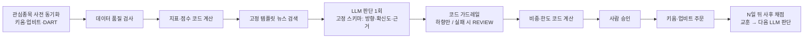

# 우리 시스템 적용안 (의견)

- 작성일: 2026-10-09
- 대상: 업비트(코인) + 키움 REST(국내·미국 주식), AI는 제안만 하고 최종 주문은 사람이 승인
- 이 문서는 전체가 **분석자 의견**이다. 각 근거는 링크한 레포 보고서에 있다.

## 1. 가져갈 구성요소

| # | 구성요소 | 출처 레포 | 라이선스 | 재사용 방식 | 상세 |
|---|---|---|---|---|---|
| 1 | 판단과 실행 분리: LLM은 의견만, 비중·한도·수량은 코드 | ai-hedge-fund | MIT | 코드 참고 가능 | [05-boundary-and-fit](../reports/ai-hedge-fund/05-boundary-and-fit.md) |
| 2 | 지표·점수는 코드로 계산, 강한 합의는 코드가 결정 | QuantDinger | Apache-2.0 | 코드 참고 가능 (상표·프론트 제외) | [03-decision](../reports/QuantDinger/03-decision.md) |
| 3 | 점수 ↔ 액션 대응표, LLM 초안 → 코드 하향 가드레일 | daily_stock_analysis | MIT | 코드 참고 가능 | [03-decision](../reports/daily_stock_analysis/03-decision.md) |
| 4 | 데이터 품질 블록 → 확신도 하향, HOLD 강등 | QuantDinger, daily_stock_analysis | Apache-2.0, MIT | 코드 참고 가능 | [schedule-and-freshness](schedule-and-freshness.md) |
| 5 | 실패 시 `REVIEW` (거래 불가) | TradingAgents | Apache-2.0 | 코드 참고 가능 | [03-decision](../reports/TradingAgents/03-decision.md) |
| 6 | N일 뒤 수익률로 사후 채점 → 교훈을 최종 단계에만 주입 | TradingAgents | Apache-2.0 | 코드 참고 가능 | [03-decision](../reports/TradingAgents/03-decision.md) |
| 7 | 벤더 라우터 + 폴백 체인, 미래 데이터 차단 (날짜 클램프, PIT) | TradingAgents, ai-hedge-fund | Apache-2.0, MIT | 코드 참고 가능 | [01-data](../reports/TradingAgents/01-data.md) |
| 8 | 관심종목만 사전 동기화 + 판단 직전 부족분 보충 | TradingAgents-CN | `app/`, `core/`는 source-available | **아이디어만** | [02-schedule](../reports/TradingAgents-CN/02-schedule.md) |
| 9 | 판단 전 고정 템플릿 뉴스 검색 (차원별) | daily_stock_analysis | MIT | 코드 참고 가능 | [04-research](../reports/daily_stock_analysis/04-research.md) |
| 10 | 숫자 grounding 게이트 (LLM 숫자를 수집 데이터와 대조) | Vibe-Trading | MIT | 코드 참고 가능 | [03-decision](../reports/Vibe-Trading/03-decision.md) |
| 11 | fail-closed 주문 게이트 순서, 파일 킬스위치 | Vibe-Trading | MIT | 코드 참고 가능 | [05-boundary-and-fit](../reports/Vibe-Trading/05-boundary-and-fit.md) |
| 12 | 해시 고정 승인 흐름 (stage → commit(근거) → 사람 승인 → push) | OpenAlice | AGPL-3.0 | **아이디어만** | [05-boundary-and-fit](../reports/OpenAlice/05-boundary-and-fit.md) |
| 13 | 한국 시장 규칙: 호가단위, ±30%, 롱온리 | Vibe-Trading | MIT | 코드 참고 가능 | [05-boundary-and-fit](../reports/Vibe-Trading/05-boundary-and-fit.md) |
| 14 | 리서치 루프: 반복 상한, 컨텍스트 압축, 읽기 전용 서브에이전트 병렬화 | dexter | LICENSE 파일 없음 | **아이디어만** | [04-research](../reports/dexter/04-research.md) |

## 2. 버릴 것

| 항목 | 출처 | 이유 |
|---|---|---|
| fail-open (LLM이나 필터가 실패해도 주문 통과) | QuantDinger, TradingAgents-CN | 실패 시 거래하지 않는 쪽이 맞음 |
| 전체 토론 구조 (기본값으로) | TradingAgents | 호출 15~40회. 효과 검증 전에는 비용만 큼 |
| 결정 스키마 없는 자유 서술 판단 | Vibe-Trading, OpenAlice | 사후 채점과 승인 화면을 만들 수 없음 |
| A주 전용 개념 (용호방, 북향자금, 칩 분포) | CN, DSA | 한국 수급 데이터로 대체 |
| 컴플라이언스 어휘 치환 (매수·매도 금지) | TradingAgents-CN | 우리는 매매 판단이 목적 |
| AI가 승인 없이 주문하는 옵션 | OpenAlice (`allowAiTrading`), Vibe-Trading 라이브 러너 | 사람 최종 승인 원칙과 충돌 |

## 3. 데이터 대체표

| 원본 데이터 | 원본 레포 | 우리 대체 |
|---|---|---|
| 주력 자금 순유입, 북향자금 | DSA, CN | 키움 `ka10059` 종목별 투자자, `ka10008` 외국인, `ka10009` 기관 |
| 재무 (SEC, Financial Datasets, Tushare) | TA, AHF, CN | DART (국내), 키움 미국 종목정보 + 외부 소스 (미국) |
| OHLCV (yfinance 등) | 전체 | 업비트 캔들, 키움 차트 (`ka10081`, `usa06012`) |
| 펀딩비, OI | QD | 해외 거래소 공개 API (업비트에는 없음) |
| 거시 (FRED) | TA, OA | FRED + 한국은행 ECOS |
| 뉴스 (yfinance, Finnhub, Eastmoney) | TA, QD, VT | 한국어 검색 API, 언론사 RSS, DART 공시 |

## 4. 제안하는 판단 파이프라인

## 5. 남은 확인 사항

- 각 레포 `next.md`의 미확인 항목은 우리 설계에 직접 영향이 없으면 추가 확인하지 않는다.
- 실행해야만 확인되는 항목이 있다. 예: DSA에서 한국 종목의 매수가 실제로 강등되는지, QD에서 LLM 실패 시 BUY/SELL이 나오는지. 이 항목들은 우리 시스템을 구현하면서 우리 코드로 재현하는 쪽이 낫다.
