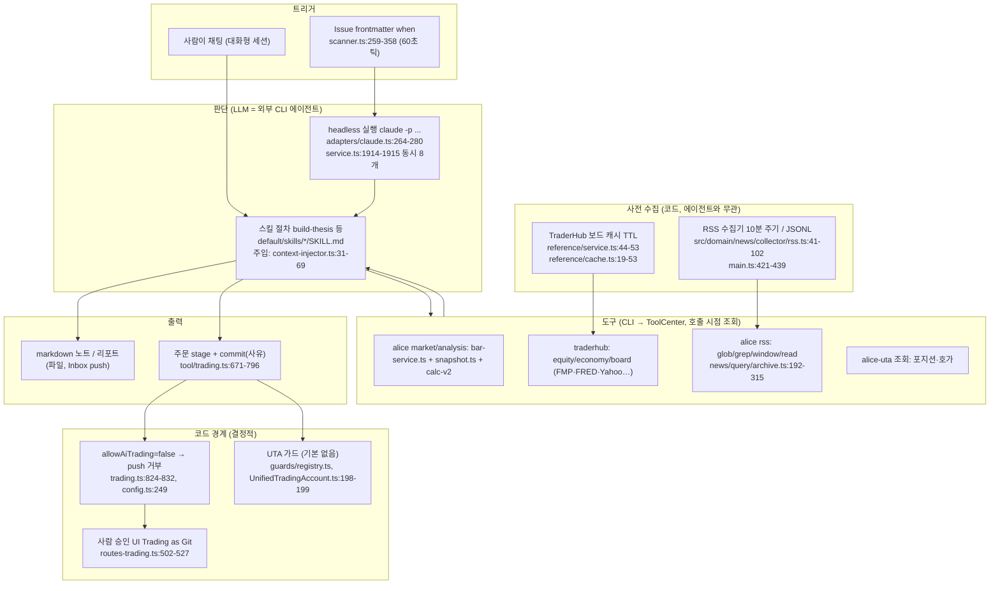

# OpenAlice — 개요

- 분석 SHA: `87bc415260aaac92a072d89a1c6440268a3efdf1` (repos.lock.tsv와 일치)
- 분석일: 2026-10-09
- 관련 공통 항목: Q1–Q7 전체 (입구 문서)
- 검증 수준 요약: 코드 확인 17 / 추론 1 / 미확인 0 (표의 검증 열 기준 집계)

> 이 레포는 "AI가 직접 판단하는 트레이딩 봇"이 아니라 **외부 코딩 에이전트 CLI(Claude Code, Codex 등)에 시장 데이터 도구, 스킬 문서, 스케줄, 승인 흐름을 붙여 주는 하네스**다. 그래서 Q4(AI 판단)의 "판단 규칙"은 대부분 코드가 아니라 **스킬 마크다운과 워크스페이스 지침**에 있고, 코드가 결정적으로 정하는 것은 (a) 데이터 도구의 계산, (b) 스케줄 발사, (c) 주문 승인·가드뿐이다.

## 1. 메타데이터

| 항목 | 값 | 근거 | 검증 |
|---|---|---|---|
| URL | https://github.com/TraderAlice/OpenAlice | repos.lock.tsv:7 | 코드 확인 |
| 브랜치 / SHA | master / `87bc415260aaac92a072d89a1c6440268a3efdf1` (`git rev-parse HEAD` 일치, `git status --porcelain` 빈 출력) | clone 시 확인 | 코드 확인 |
| 커밋일 | 2026-10-04 (`git log -1` = 2026-10-04T20:33:03+08:00) | git log | 코드 확인 |
| 버전 | 0.95.0-beta | `package.json:3` | 코드 확인 |
| 라이선스 | **AGPL-3.0-only** (LICENSE 전문, `package.json:103`, `README.md:185`) | 파일 | 코드 확인 |
| 주 언어 | TypeScript (pnpm 모노레포: `src/`, `services/uta/`, `packages/*`, `ui/`) | `package.json:112`, 파일 구성 | 코드 확인 |
| 대상 시장 | 미국 주식 중심(yfinance, SEC 심볼 인덱스, FMP, FRED). 옵션으로 대만(twse), 중국 A주(eastmoney), 크립토(CCXT 거래소, Deribit). **한국 시장 전용 소스 없음** | `src/domain/market-data/aggregate-search.ts:91-118`, `packages/opentypebb/src/providers/` 디렉터리 | 코드 확인 |
| 지원 LLM | **자체 LLM 호출 없음.** 외부 에이전트 CLI 9종 어댑터: claude, codex, cursor, agy, grok, omp, opencode, pi, shell | `src/workspaces/adapters/index.ts:17-27` | 코드 확인 |
| 자체 모델 루프 금지 선언 | "Native CLIs own the model loop; Alice owns launch and context injection. Do not add an in-process model loop" | `AGENTS.md:21-23` | 코드 확인 |

README와 코드 불일치: README는 지원 에이전트를 "Claude Code, Codex, OpenCode, Pi, Oh My Pi"로 적었지만(`README.md:52`) 코드에는 cursor, agy, grok 어댑터도 등록돼 있다(`src/workspaces/adapters/index.ts:17-27`). 기능이 더 많은 쪽이 코드다.

## 2. 한 줄 정의

OpenAlice는 사용자 PC에서 돌아가는 **"외부 AI 에이전트용 트레이딩 워크스페이스 하네스"**이며, **판단 주체는 LLM(외부 에이전트)이고 코드는 데이터 계산·스케줄·주문 승인 경계만 결정적으로 처리한다.** (`AGENTS.md:3-6`, `README.md:118-119`)

## 3. 판단 파이프라인 다이어그램

각 노드의 코드 위치는 위 라벨에 적었다. 검증: 코드 확인(경로·라인은 03-decision.md, 05-boundary-and-fit.md에서 개별 확인).

## 4. 핵심 발견 5개

1. **자체 LLM 루프가 없다.** 판단은 `claude -p --output-format stream-json ... -- <prompt>` 같은 외부 CLI 프로세스를 띄워서 한다. 헤드리스 호출은 `--dangerously-skip-permissions`와 샌드박스 비활성 설정으로 실행된다. (`src/workspaces/adapters/claude.ts:80`, `:264-280`, `AGENTS.md:21-23`) 검증: 코드 확인
2. **판단 기준은 스킬 문서에 있고 숫자 임계값이 거의 없다.** `build-thesis`는 "왼쪽(펀더멘털)·오른쪽(시장 추세)" 두 면과 반증 신호를 요구하지만 점수나 임계값은 없다. 정량 규칙은 코드 도구(섹터 로테이션 z-score 평균, snapshot의 sma20/50·rsi14)에만 있다. (`default/skills/build-thesis/SKILL.md:26-84`, `src/domain/analysis/sector-rotation.ts:168-174`, `:218-221`) 검증: 코드 확인
3. **스케줄은 Issue 마크다운 파일의 `when` 필드를 60초 틱 스캐너가 읽어 발사한다.** cron/every/at 세 종류이고 거래일 캘린더가 없다(휴장일 처리는 프롬프트 조건에 맡김). 한 번에 최대 8개 헤드리스 실행. (`src/workspaces/schedule/scanner.ts:62`, `:353-358`, `src/core/schedule-expr.ts:25-38`, `docs/workspace-issues-and-scheduling.md:218-221`, `src/workspaces/service.ts:217`) 검증: 코드 확인
4. **주문 경계가 명확하다.** `allowAiTrading` 기본값 `false`이면 AI의 `tradingPush`는 실행하지 않고 "Web UI에서 승인하라"만 반환한다. 단 `true`로 바꾸면 AI가 직접 주문을 보낸다. 서버 쪽 push 라우트는 `expectedPendingHash`를 요구하고, 가드(최대 비중 25%, 쿨다운 60초, 심볼 화이트리스트)는 **기본 설정이 빈 배열이라 기본값으로는 걸려 있지 않다.** (`src/core/config.ts:249`, `:454`, `src/tool/trading.ts:824-832`, `services/uta/src/domain/trading/guards/registry.ts:6-10`, `max-position-size.ts:5`) 검증: 코드 확인
5. **뉴스는 "구독한 RSS 28개 중 8개 기본 활성"이 전부이며 판단 도중 웹 검색 도구는 없다.** RSS는 10분마다 모아 JSONL에 쌓고 에이전트는 정규식(glob/grep/window)으로 조회한다. 일반 웹 검색, 공시 조회 도구는 코드에 없다. 에이전트 자체의 웹 도구 사용은 이 레포 범위 밖(`미확인`). (`src/domain/news/config.ts:22`, `:34-268`, `src/server/cli-commands.ts:31-40`) 검증: 코드 확인

## 5. 공통 항목 요약표

| 항목 | 요약 | 문서 |
|---|---|---|
| Q1 데이터 | 가격·OHLCV는 BarService가 벤더(yfinance 기본, fmp, eastmoney, twse)와 브로커(UTA, 키 없는 binance/okx/bybit)를 `barId`로 연합. 펀더멘털은 yfinance·FMP, 거시는 FRED·BLS·EIA·OECD·IMF·ECB, 파생은 Deribit. 수급·감성·온체인·공포탐욕지수는 없음. opentypebb에 뉴스 fetcher가 있으나 Alice 도구로는 미연결. | [01-data.md](01-data.md#q1) |
| Q2 수집 | 전부 에이전트가 CLI 도구를 호출하는 tool-call 방식(프롬프트 pre-fetch 없음). 예외로 RSS 수집기와 TraderHub 보드 캐시는 미리 쌓음. 벤더 폴백은 도구마다 하드코딩(예: FMP→yfinance), 캐시·재시도는 보드와 RSS에만 있음. as-of 조회는 `end/asOf`로 미래 봉을 자름. | [01-data.md](01-data.md#q2) |
| Q3 스케줄 | 데이터 갱신은 RSS 10분 주기 하나. 분석은 Issue `when`(at/every/cron+IANA tz)을 60초 틱이 스캔해 발사. 거래일 캘린더 없음, 놓친 cron은 기본 catch-up. 실시간 시세 스트림 없음. stale은 `isLatestActual/staleTradingDays` 필드로 노출만 함. | [02-schedule.md](02-schedule.md) |
| Q4 판단 | 판단=외부 에이전트(LLM). 스킬 절차(thesis→좌/우 측면→반증 신호→verdict)와 `instruction.md` 8개 운영 계약이 규칙. 출력 스키마 없음(마크다운 노트, Inbox 푸시, stage+commit 사유). 점수·임계값은 코드 도구에만. 메모리는 워크스페이스 파일·Git, 사후 채점 자동화 없음. | [03-decision.md](03-decision.md) |
| Q5 리서치 | 판단 중 웹/공시 검색 도구 없음. RSS 아카이브(정규식)와 `opencli-reader`(별도 설치 시)만. 검색어는 LLM이 직접 만들고 고정 목록 없음. 루프 상한은 코드에 없고 선택적 timeout 15–60분. | [04-research.md](04-research.md) |
| Q6 경계 | 판단→주문: stage→commit(사유)→push 3단계, 기본은 사람 승인. 가드는 opt-in. UI: Trading as Git 패널, Inbox, Issue 보드, Tracked, 섹터 로테이션 페이지. | [05-boundary-and-fit.md](05-boundary-and-fit.md#q6) |
| Q7 적용(의견) | **AGPL-3.0이므로 코드 재사용 불가, 아이디어만 참고.** 가져갈 것: barId 소스 정체성+freshness 계약, as-of 스냅샷, 스킬 문서 구조, Issue 파일 스케줄, stage→commit→승인 흐름, 로테이션 점수 공식. 한국 데이터는 직접 연결 필요. | [05-boundary-and-fit.md](05-boundary-and-fit.md#q7) |

## 6. 문서 목록

- [01-data.md](01-data.md) Q1 데이터 인벤토리 + Q2 수집 방식
- [02-schedule.md](02-schedule.md) Q3 최신화와 스케줄링
- [03-decision.md](03-decision.md) Q4 AI 판단
- [04-research.md](04-research.md) Q5 실시간 리서치
- [05-boundary-and-fit.md](05-boundary-and-fit.md) Q6 경계 + Q7 적용 의견
- [next.md](next.md) 확인 범위, 미확인 항목

## 7. README/문서와 코드가 다른 곳 (모음)

| 위치 | 문서 주장 | 코드 | 검증 |
|---|---|---|---|
| `README.md:52` | 지원 에이전트 5종 나열 | 어댑터 9종 등록 (`adapters/index.ts:17-27`) | 코드 확인 |
| `default/skills/self-scheduling/SKILL.md:300-302` | "A timer never moves money on its own" (승인은 Web UI에서만) | `allowAiTrading=true`이면 AI `tradingPush`가 직접 브로커로 push (`src/tool/trading.ts:833-845`) | 코드 확인 |
| `services/uta/src/http/routes-trading.ts:502` 주석 | "the AI tool is hollowed out, only humans can push" | 위와 같음. 주석이 낡음 | 코드 확인 |
| `default/skills/traderhub/SKILL.md:10-12` | "hub-first with local fallback — no API keys needed" | `equityGetRatios`는 `provider: 'fmp'` 고정(`src/tool/equity.ts:104`)이고 hub 대체는 보드·캘린더·FRED/EIA/BLS만(`hub-data.ts:16-20`, `credential-map.ts:57`). FMP 키가 없을 때 동작은 `추론` | 코드 확인(코드 부분) / 추론(키 없을 때 실패) |
| `src/tool/quant.ts:62` 도구 설명 | 패널 최대 50개 | 평가기 상한 200 (`calc-v2/evaluator.ts:60`, `:168`, `:174`), 스킬은 200 (`alice-analysis/SKILL.md:72`) | 코드 확인 |
| `src/domain/market-data/equity/symbol-index.ts:9-10` 헤더 | SEC와 TMX 두 소스 | `SOURCES = ['sec']` 하나 (`:40`) | 코드 확인 |
| `src/core/config.ts:242-269` | `agent.maxSteps`(20), `claudeCode.maxTurns`(20), `disallowedTools` 설정 존재 | `src/`·`services/` 전체 grep에서 config.ts 밖 사용처 없음 (미사용 잔재) | 코드 확인(grep) |
| `default/skills/retrospective/SKILL.md:69-70` | "종가 신호로 같은 종가 체결을 가정하지 말라" | 자체 `simulate` 도구는 "Enter at the close of the first bar" (`src/domain/analysis/simulate.ts:31`) | 코드 확인 |
