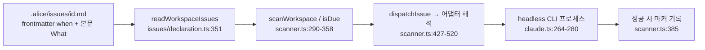

# OpenAlice — 최신화와 스케줄링

- 분석 SHA: `87bc415260aaac92a072d89a1c6440268a3efdf1` (repos.lock.tsv와 일치해야 함)
- 분석일: 2026-10-09
- 관련 공통 항목: Q3
- 검증 수준 요약: 코드 확인 40 / 추론 0 / 미확인 0 (표의 검증 열 기준 집계)

> 요약: OpenAlice에는 **"분석 파이프라인용 데이터 사전 동기화"가 거의 없다.** 미리 쌓는 것은 RSS 기사 하나뿐이고(10분), 나머지 데이터는 에이전트가 호출할 때 가져온다. "정기적으로 분석한다"는 기능은 **Issue 파일의 `when`을 60초 틱 스캐너가 읽어 헤드리스 에이전트를 띄우는 방식**이며, 스캐너는 작업 내용을 해석하지 않는다.

## 3.1 트리거

| 트리거 | 동작 | 위치 | 검증 |
|---|---|---|---|
| 대화형(수동) | 사용자가 웹 UI 채팅/터미널에서 에이전트를 띄움 | `src/workspaces/adapters/claude.ts:235-250`(`composeCommand`) | 코드 확인 |
| 스케줄 Issue | `.alice/issues/<id>.md`의 `when`이 있고 상태가 비종료인 Issue를 스캐너가 발사 | `workspaces/issues/declaration.ts:303-305`(`isFireable`), `schedule/scanner.ts:319-344` | 코드 확인 |
| 수동 즉시 실행 | `alice issue run`, 실패 재시도 `alice issue retry`(발사 마커·다음 예정 시각은 건드리지 않음) | `server/cli-commands.ts:187-188`, `scanner.ts:180-230` | 코드 확인 |
| 코멘트 | Issue 코멘트가 소유 세션을 헤드리스로 호출 | `scanner.ts:232-238`, `issues/comment-prompt.ts` | 코드 확인 |
| 가격 조건 등 이벤트 | **없음.** 스케줄 파일에 조건 필드가 없고 "조건은 What 안에 쓰라"고 명시(조건 불충족 시 조용히 종료하는 것이 정상) | `skills/self-scheduling/SKILL.md:291-293`, `:273-290` | 코드 확인(스킬 문서) |
| 외부 스케줄러(GitHub Actions, Celery 등) | **없음.** 스캐너는 앱 내부 타이머 | `scanner.ts:1-29`, `:240-256` | 코드 확인 |

## 3.2 주기와 시점

| 항목 | 내용 | 위치 | 검증 |
|---|---|---|---|
| 스캐너 틱 | 60초(`DEFAULT_INTERVAL_MS = 60_000`), `setTimeout` 재무장 방식, 첫 스캔은 생성 직후가 아니라 한 간격 뒤, 이전 스캔이 진행 중이면 이번 틱은 건너뜀 | `scanner.ts:62`, `:158-170`, `:240-256`, `:259-264` | 코드 확인 |
| `when` 종류 | `at`(ISO 1회), `every`(예: `30m`, `2h`), `cron`(5필드, `timezone`은 `local` 또는 IANA, `catchUp` 옵션) | `core/schedule-expr.ts:25-38`, `issues/declaration.ts:113-125` | 코드 확인 |
| 지원 간격 한계 | 틱이 분 단위라 분 미만 주기도 최대 분당 1회 | `skills/self-scheduling/SKILL.md:306-307` | 코드 확인(스킬 문서) |
| cron 표현 | 5필드만 허용(초 필드·별칭 차단), `cron-parser`로 DST 처리 | `schedule-expr.ts:81-101` | 코드 확인 |
| 시장 시계 | 예: `{ kind: cron, cron: "30 8 * * 1-5", timezone: America/New_York }` 형태로 **에이전트/사용자가 명시** | `docs/workspace-issues-and-scheduling.md:208-214` | 코드 확인(문서) |
| **거래일 캘린더** | **없음.** "Cron is not an exchange calendar: holidays, early closes, and 'only on a trading day' remain business conditions in What" | `docs/workspace-issues-and-scheduling.md:218-221` | 코드 확인(문서) |
| 개장 여부 확인 | 에이전트가 `alice-uta market clock`(브로커 마켓 클록: `isOpen, nextOpen, nextClose`)을 스스로 부를 수 있음. 스케줄러가 강제하지는 않음 | `tool/trading.ts:594-608` | 코드 확인 |
| 한국 휴장일 | 해당 기능 없음 → 키움/업비트용으로는 직접 구현 필요 | (없음 근거: 위 행들) | 코드 확인(없음) |
| 한 틱의 발사 판정 | 마지막 발사 시각(마커) 또는 가상 기준점에서 `computeNextRun(...) <= now`이면 due. `every`/`at`은 에포크 기준(처음 보면 즉시 due), `cron`은 `now − 스캔간격`을 기준(방금 지난 슬롯만 잡음) | `schedule/declaration.ts:80-101`, `scanner.ts:353-358` | 코드 확인 |
| 발사 후 마커 기록 | 디스패치가 **성공한 뒤에만** 마커를 씀. 재시작해도 중복 발사 안 함, 중단 중 놓친 창은 다음 스캔에서 한 번만 발사(큐가 아님) | `scanner.ts:385`, `schedule/marker-store.ts:2-18`, 저장 경로 `service.ts:2363-2366` | 코드 확인 |
| 놓친 발사(busy/용량) | 기본 catch-up(발사될 때까지 due 유지). `catchUp:false`면 슬롯을 소비하고 다음 달력 시각을 기다림 | `scanner.ts:393-425`, `schedule-expr.ts:40-43`, `docs/...:223-229` | 코드 확인 |
| 동시 실행 | 전역 헤드리스 8개 상한(`MAX_CONCURRENT_HEADLESS = 8`), 초과 시 `HeadlessCapacityError` → "fire_skipped"로 로그만. 워크스페이스별 락은 **의도적으로 없음**(동시 편집은 코딩 에이전트가 흡수) | `service.ts:216-222`, `:1914-1915`, `scanner.ts:14-19`, `:393-402` | 코드 확인 |
| 같은 Issue 중복 실행 | 이미 `running`인 Issue는 `already_running` 오류로 거부 | `scanner.ts:454-456` | 코드 확인 |
| 실행 시간 제한 | 선택 `timeout: 15m/30m/45m/60m`. **생략하면 제한 없음**. 초과 시 SIGTERM 후 유예 뒤 SIGKILL | `issues/declaration.ts:79`, `headless-task.ts:52-53`, `:524`, `skills/self-scheduling/SKILL.md:211-213` | 코드 확인 |
| 1회성 `at` | 정상 종료 후 Issue가 자동으로 `done`. 반복 일정은 그대로 | `issues/auto-complete.ts:1-10` | 코드 확인 |
| 끄는 법 | 별도 enabled 필드 없음. `status: done/canceled`로 침묵 | `issues/declaration.ts:105-108`, `self-scheduling/SKILL.md:161-165` | 코드 확인 |
| 잘못된 Issue 파일 | 매 스캔마다 재파싱, 불량 파일은 개별 격리하고 나머지는 계속 | `scanner.ts:290-316`, `self-scheduling/SKILL.md:314-315` | 코드 확인 |

### 스케줄 → 실행까지 (코드 경로)

발사되는 프롬프트는 Issue 본문(What) 그대로다(`issues/declaration.ts:341-343` `issueFirePrompt`). 즉 "무엇을 분석할지"는 전적으로 사람(또는 에이전트)이 쓴 텍스트이고, 스캐너가 종목이나 데이터를 선택·주입하지 않는다.

## 3.3 사전 동기화 (판단과 별도로 데이터를 쌓는 작업)

| 대상 | 주기 | 저장소 | 위치 | 검증 |
|---|---|---|---|---|
| RSS 기사 수집 | 10분(`intervalMinutes` 기본값), 시작 시 즉시 1회, 겹치면 진행 중인 promise 공유 | 파일 JSONL `data/news-collector/news.jsonl` + 메모리 2000건 | `domain/news/collector/rss.ts:41-52`, `:67-75`, `news/config.ts:22-26`, `news/store.ts:21` | 코드 확인 |
| 심볼 인덱스(SEC) | 부팅 시 24시간 캐시 확인 | `data/cache/equity/symbols.json` | `symbol-index.ts:42-43`, `:61-80` | 코드 확인 |
| 보드(macro, movers 등) | **미리 쌓지 않음.** 호출 시 생성 후 TTL 캐시(30분~6시간) | 메모리 | `reference/service.ts:44-53` | 코드 확인 |
| 가격 봉, 펀더멘털 | **미리 쌓지 않음.** DB 없음("Persisted state is file-backed rather than database-backed") | — | `AGENTS.md:5-6`, `bar-service.ts` | 코드 확인 |
| 브로커 계정/포지션 | UTA 서비스가 별도 프로세스로 외부 주문 관찰(15분 기본, 알려진 대기 주문은 10초 빠른 경로)·스냅샷 스케줄을 운영. 브로커 내부 구현이라 범위 밖 | UTA 서비스 파일 상태 | `core/config.ts:394-403`, `main.ts:321-323` | 코드 확인(주석·설정 수준) |
| 에이전트가 쓰는 리서치 파일 | 에이전트가 직접 파일(예: `<theme>/notes/<TICKER>.md`)로 축적. 코드가 강제하지 않음 | 워크스페이스 디렉터리(Git) | `skills/build-thesis/SKILL.md:75-84`, `scan-value-chain/SKILL.md:49-65` | 코드 확인(스킬 문서) |

→ 데이터 동기화 관점에서 우리 시스템과 가장 다른 점: **"주기적으로 DB에 시세·재무를 적재"하는 층이 없다.** 우리가 업비트/키움 데이터를 미리 쌓아 둔다면 OpenAlice의 BarService 같은 조회 계층 뒤에 두는 설계는 가능하지만(의견) 이 레포에서 그대로 가져올 구현은 없다.

## 3.4 데이터 신선도 관리

| 항목 | 동작 | 위치 | 검증 |
|---|---|---|---|
| 봉 신선도 계약 | 응답마다 `asOf`, `isLatestActual`, `staleTradingDays`(주말만 제외, 휴일 무시) + `freshness{timestampKind, delay.status('possible'/'unknown'), recordAgeSeconds, historical}`. **"기록 나이는 피드 지연이 아니다"**라고 명시 | `bar-service.ts:152-182`, `bars/freshness.ts:21-46` | 코드 확인 |
| 소스 능력 표시 | 벤더는 `delayed`로 분류(yfinance, fmp, eastmoney, twse), 브로커는 실제 권한(Alpaca 무료는 iex, CCXT는 realtime) | `bar-service.ts:34-39`, `:266-274` | 코드 확인 |
| 후보 정렬 | 비파생 우선 → 신선도 순. 소스 라벨에 `delayed/realtime`을 노출해 에이전트가 놓치지 않게 함 | `bar-service.ts:340-350`, `:386-401` | 코드 확인 |
| snapshot 경고 | 데이터가 anchor에 못 미치면 `freshnessWarning`("treat this close as stale, not 'current'") | `domain/analysis/snapshot.ts:114-116` | 코드 확인 |
| 신선도 → 판단 반영 | **코드는 확신도 하향 등을 하지 않는다.** 오직 필드와 경고를 노출하고, "stale이면 현재가로 부르지 말라"는 규칙은 스킬/프롬프트에 있다 | `skills/retrospective/SKILL.md:29-44`, `tool/snapshot.ts:31` | 코드 확인(코드는 노출만) |
| 보드 stale | 상류 갱신 실패 시 마지막 정상 값을 `meta.stale: true`로 제공("say so if it matters to the conclusion") | `reference/cache.ts:44-50`, `traderhub/SKILL.md:50-52` | 코드 확인 |
| RSS 공백 | "빈 결과는 구독 피드에 없다는 뜻이지 아무 일도 없었다는 뜻이 아니다" — 도구 설명문에 명시 | `news/query/archive.ts:197-200`, `:257-258` | 코드 확인 |
| 펀더멘털 stale | 감지 로직 없음(도구가 `asOf`를 반환하지 않음) | `tool/equity.ts` | 코드 확인(없음) |

## 3.5 실시간 스트림

| 항목 | 내용 | 위치 | 검증 |
|---|---|---|---|
| 시세 WebSocket | **없음.** 레포의 WebSocket/SSE는 워크스페이스 터미널·세션 전송용(`workspaces-ws.ts`, `persistent-session.ts` 등). 시장 데이터 스트림 코드는 찾지 못함 | `src`, `services`에서 `WebSocket\|EventSource\|text/event-stream` 파일 검색 결과 | 코드 확인(없음) |
| 화면 갱신 | 섹터 로테이션·보드 화면은 5분 폴링 | `ui/src/pages/MarketRotationPage.tsx:18`, `:66`, `MarketBoardPage.tsx:24` | 코드 확인 |
| 판단 사용 여부 | 해당 없음(스트림 자체가 없음). 에이전트는 호출 시점의 REST 조회만 사용 | — | 코드 확인 |

## 3.6 의견 (우리 시스템 관점)

의견: Issue 파일 + 60초 스캐너 모델은 구현이 단순해 "정기 분석"을 빠르게 만들 수 있으나, 한국 장 운영(휴장일, 08:30/15:30 시각 기준)과 업비트 24/7을 모두 다루려면 **거래일 캘린더와 마켓 클록 게이트를 스케줄러 앞단에 코드로 넣는 편이 안전**하다. OpenAlice는 이것을 프롬프트 조건에 맡겼고(`docs/workspace-issues-and-scheduling.md:218-221`), 그 결과 휴장일 오발사 시 LLM이 올바르게 "조건 불충족, 조용히 종료"를 해 주는지에 의존한다. 이 의존은 `추론`이며 코드로 막는 장치는 없다.
