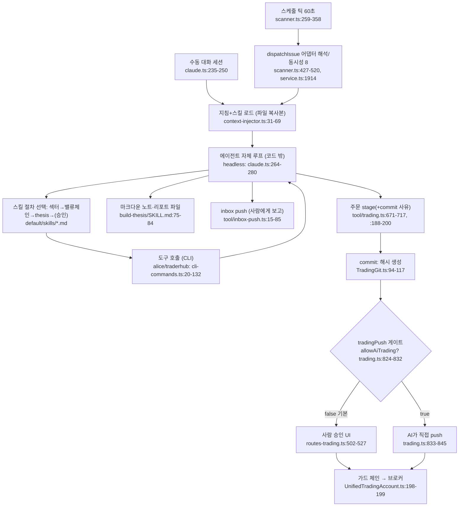

# OpenAlice — AI 판단

- 분석 SHA: `87bc415260aaac92a072d89a1c6440268a3efdf1` (repos.lock.tsv와 일치해야 함)
- 분석일: 2026-10-09
- 관련 공통 항목: Q4
- 검증 수준 요약: 코드 확인 57 / 추론 1 / 미확인 1 (표의 검증 열 기준 집계)

> 이 문서를 읽는 전제: OpenAlice에는 "프롬프트 빌더 → LLM 호출 → 결정 파서"로 이어지는 판단 코드가 **없다**(`AGENTS.md:21-23`). 판단은 외부 CLI 에이전트가 하고, 이 레포가 정하는 것은 (1) 에이전트에게 주는 **지침·스킬 문서**, (2) 에이전트가 부르는 **도구 결과**, (3) 에이전트의 결정이 주문으로 이어질 때의 **승인 경계**다. 그래서 4-3의 "판단 규칙"은 스킬 마크다운에서 인용하고, "코드가 정한다"고 말할 수 있는 것은 도구 계산과 경계에 한정된다.

## 4-1. 입력 조립

| 입력 조각 | 어떻게 들어가는가 | 위치 | 검증 |
|---|---|---|---|
| 워크스페이스 지침(`instruction.md`) | Chat 템플릿 생성 시 **같은 내용을 `CLAUDE.md`와 `AGENTS.md`로 복사**(에이전트가 시작 시 읽는 파일). 이후 갱신은 템플릿 업그레이드 경계 | `src/workspaces/context-injector.ts:31-40`, `templates/chat/files/instruction.md:1-99` | 코드 확인 |
| 스킬 문서 | `.claude/skills/<name>`와 `.agents/skills/<name>`에 **파일 복사**. 하네스 기본 7개(`alice, market-data, alice-analysis, alice-uta, traderhub, self-scheduling, file-delivery`)는 프로젝트 소유, 연구 스킬 4개+2개(`scan-value-chain, build-thesis, sector-rotation, retrospective, opencli-reader, delegate-autoquant`)는 Chat 템플릿 번들 | `alice-harness-policy.ts:8`, `alice-harness-assets.ts:22-30`, `templates/chat/template.json:9`, `context-injector.ts:43-69` | 코드 확인 |
| 스케줄 실행의 사용자 프롬프트 | Issue 본문(What)이 **그대로** 헤드리스 프롬프트(`issueFirePrompt = issue.what`). 종목·데이터·형식 주입 없음 | `issues/declaration.ts:341-343`, `scanner.ts:327-343` | 코드 확인 |
| 코멘트 응답 프롬프트 | 템플릿 `A new comment was left on Issue … {comment} … Reply directly`, 사용자 템플릿은 8,000자 이내, `{comment}` 필수 | `issues/comment-prompt.ts:18-27`, `:38-40` | 코드 확인 |
| 도구 결과(데이터) | 에이전트가 셸에서 CLI 실행 → JSON stdout. 프롬프트 템플릿에 끼워 넣지 않고 에이전트가 스스로 읽음 | `cli-commands.ts:20-270`, `alice/SKILL.md:14-16` | 코드 확인 |
| 형식 | 표/매니페스트 없음. 순수 JSON 도구 출력 + 마크다운 지침 | (위 항목들) | 코드 확인 |
| 길이 제한·자르기 | 코드 도구 쪽에만: 봉 최대 5000(`bar-service.ts:31`), 패널 최대 200(`calc-v2/evaluator.ts:60`), snapshot 기본 `bars=0`(요약만; "can be large"), RSS 검색 결과 기본 500·window 출력 40(`archive.ts:12-16`), RSS 메타 40자 절단(`archive.ts:53-57`), 헤드리스 어시스턴트 텍스트 64KB·원시 로그 16MB(`headless-task.ts:41-42`). **에이전트 컨텍스트 자체의 자르기는 에이전트 CLI가 한다** | 해당 라인 | 코드 확인 |
| 프롬프트를 만드는 함수 | 헤드리스 명령 합성 `composeHeadlessCommand`: `claude … -p --output-format stream-json --verbose -- <prompt>` | `adapters/claude.ts:264-280` | 코드 확인 |

중요한 운영 사실: 매니지드 실행은 Claude Code에 `--dangerously-skip-permissions`와 `{"enableAllProjectMcpServers":true,"sandbox":{"enabled":false}}`를 줘서 **도구 승인 프롬프트와 샌드박스를 끈다**(`claude.ts:80`, `:236`, `:274`). 따라서 에이전트는 워크스페이스 안에서 셸·파일을 자유롭게 쓸 수 있고, 안전 경계는 이 레벨이 아니라 UTA 쪽 승인에 있다. 검증: 코드 확인.

## 4-2. 판단 흐름

### 모델 계층

| 항목 | 내용 | 위치 | 검증 |
|---|---|---|---|
| quick/deep 모델 구분 | **없음.** 모델은 에이전트 런타임이 정한다. Issue frontmatter로 `agent`, `credential`, `model`, `effort(none…max)`를 새 세션에 고정할 수 있음 | `issues/declaration.ts:174-186`, `self-scheduling/SKILL.md:197-212` | 코드 확인 |
| 기본 에이전트 | 채팅 템플릿 `defaultAgents: ["claude","codex"]`, 이슈(헤드리스) 기본 런타임은 `issueDefaultAgent` 설정 | `templates/chat/template.json:5`, `core/config.ts:237` | 코드 확인 |
| 토론 라운드/종료 조건 | **없음.** 코드가 정하는 반복·합의 구조 없음 | (해당 코드 없음) | 코드 확인(없음) |
| 병렬성 | 서로 다른 Issue 발사는 병렬(전역 8개), 한 Issue 안의 단계는 에이전트가 순차/병렬 결정. 에이전트 간 위임(`alice conversation create/ask --await`)은 가능 | `service.ts:217`, `cli-commands.ts:158-164`, `delegate-autoquant/SKILL.md:33-47` | 코드 확인 |

### 흐름 다이어그램 (노드마다 코드 위치)

### 스킬이 정한 분석 순서 (에이전트가 따르는 절차, 코드로 강제되지 않음)

| 단계 | 스킬 | 내용 | 위치 | 검증 |
|---|---|---|---|---|
| ① 시장 전체 | `sector-rotation` | 기간별 순위 → FROM→TO 로테이션 → 확인(기간·breadth·뉴스) → 거시 레짐 겹치기 → 돋보이는 섹터를 밸류체인 스캔으로 인계 | `sector-rotation/SKILL.md:22-49` | 코드 확인 |
| ② 테마 분해 | `scan-value-chain` | 밸류체인 상·중·하류 분해 → 노드별 빠른 조회 → 괴리(divergence) 3–6개 → 하향식 동인 → 종목별 "why + next question" 인계 | `scan-value-chain/SKILL.md:21-47` | 코드 확인 |
| ③ 종목 thesis | `build-thesis` | 비교 집합 고정(0) → 주장 1문장(1) → 왼쪽(밸류에이션, 컨센서스와의 variant view, 반증 신호)(2) → 오른쪽(상대 강도, 자금 로테이션, 섹터·거시 순풍, 반증 신호)(3) → 컨센서스·priced-in(4) → verdict: left-side 진입 / right-side 진입 / 둘 다 아님(5) | `build-thesis/SKILL.md:26-73` | 코드 확인 |
| ④ 사후 점검 | `retrospective` | 신선도 게이트 → as-of 스냅샷 → 뉴스 정렬 → 워크스페이스 코드로 가설 테스트 → 정직한 기록 | `retrospective/SKILL.md:29-90` | 코드 확인 |
| ⑤ 실행 | `alice-uta` | 컨트랙트 해석 → stage → commit(사유) → (승인) → push | `alice-uta/SKILL.md:66-67`, `:104-129` | 코드 확인 |

연결 고리: ①의 끝은 "decompose this one(→②)", ②의 끝은 "is the thesis real(→③)", ③의 끝은 "size and place the trade ... `alice-uta` skill"(`build-thesis/SKILL.md:82-84`). 이 인계는 문서 안의 지시이며 코드가 단계 전이를 검증하지 않는다. 검증: 코드 확인(문서 문구) / 에이전트가 실제로 따르는지는 `추론`.

## 4-3. 결정 기준

### 판단 규칙 표

| 규칙 | 원문 인용 | 번역 | 위치 |
|---|---|---|---|
| 양면 판단 | "Judge the name from BOTH sides. Most real money is medium- or short-term and can't wait for value to revert — so the **right side** (is the market actually favoring this?) is usually what drives realized P&L. Don't stop at "it's cheap."" | 종목을 양면에서 판단하라. 대부분의 실제 자금은 중단기여서 가치 회귀를 기다릴 수 없으므로 시장이 실제로 이를 선호하는가(오른쪽)가 보통 실현 손익을 좌우한다. "싸다"에서 멈추지 마라. | `build-thesis/SKILL.md:22-24` |
| 변형 시각 필수 | "No variant view, no edge." | 컨센서스와 다른 시각이 없으면 우위도 없다. | `build-thesis/SKILL.md:45-46` |
| 낙폭 종목 구분 | "a laggard is either a left-side setup or a falling knife — say which." | 뒤처진 종목은 왼쪽 진입 후보이거나 떨어지는 칼날이다. 어느 쪽인지 밝혀라. | `build-thesis/SKILL.md:53-55` |
| 수급은 대리 지표 | "Flow data is thin — read it through price/volume momentum, market breadth (what's leading vs lagging), and the news narrative." | 자금흐름 데이터는 빈약하다. 가격·거래량 모멘텀, 시장 폭, 뉴스 서사로 읽어라. | `build-thesis/SKILL.md:55-57` |
| 붐비는 거래 | "A correct left+right thesis that everyone already holds is a crowded trade, not an edge" | 좌우가 모두 맞아도 모두가 이미 보유한 thesis는 우위가 아니라 붐비는 거래다. | `build-thesis/SKILL.md:65-68` |
| 판정 3분기 | "left-side entry (early, cheap, market not yet confirming) or a right-side entry (market confirming, pay up for lower timing risk) — or neither." | 왼쪽 진입(이르고 싸지만 시장 미확인), 오른쪽 진입(시장 확인, 타이밍 위험이 낮은 대신 비싸게 삼), 또는 둘 다 아님. | `build-thesis/SKILL.md:69-73` |
| 반증 신호 의무 | "*Disconfirming signals (right):* momentum break, capital rotating out, the chain rolling over. (These are exactly the hooks a position monitor watches.)" | 오른쪽 반증 신호: 모멘텀 붕괴, 자금 이탈, 밸류체인 하락 전환. 포지션 모니터가 보는 훅이다. | `build-thesis/SKILL.md:62-64` |
| 기억에서 답하지 않기 | "Procedure (don't answer from memory — run the tools)" | 절차: 기억으로 답하지 말고 도구를 실행하라. | `build-thesis/SKILL.md:26` |
| 로테이션 4분면 | "long up + short up → established uptrend (real, but maybe late)" / "long up + short down → pullback in an uptrend (buy-the-dip, not a top)" / "long down + short up → a bounce or early rotation-in — decide which" / "long down + short down → downtrend (avoid, or watch for capitulation)" | 장기↑단기↑=확립된 상승추세(진짜지만 늦을 수 있음), 장기↑단기↓=상승추세 내 눌림(저가 매수, 천장 아님), 장기↓단기↑=반등 또는 초기 로테이션(구분하라), 장기↓단기↓=하락추세(회피 또는 투매 관찰). | `sector-rotation/SKILL.md:29-35` |
| 잡음 구분 | "A one-day pop with nothing behind it is noise, not rotation." / "When only the shortest timeframe moves, distrust it." | 뒷받침 없는 하루 급등은 잡음이지 로테이션이 아니다. / 가장 짧은 기간만 움직이면 신뢰하지 마라. | `sector-rotation/SKILL.md:37-38`, `:41-42` |
| 후보 압축 | "Surface 3–6 names where there's something to pull on ... Drop the rest — a scan that returns everything returns nothing." | 끌어낼 것이 있는 3–6개 종목을 부각하고 나머지는 버려라. 전부 반환하는 스캔은 아무것도 반환하지 않는다. | `scan-value-chain/SKILL.md:38-41` |
| 신선도 게이트 | "`isLatestActual: false` → the close you're holding is STALE. Do not call it the current price." | 최신이 아니면 가진 종가는 낡았다. 현재가라 부르지 마라. | `retrospective/SKILL.md:36-38` |
| 체결 가정 | "Do not use a closing-price signal to assume an executable fill at that same close." | 종가 신호를 같은 종가의 체결 가능 가격으로 가정하지 마라. | `retrospective/SKILL.md:69-70` |
| 수치 출처 | "Every price, return, date, ratio, status, and quoted claim in the final answer must come from a tool result or a named workspace artifact." | 최종 답변의 모든 가격·수익률·날짜·비율·상태·인용은 도구 결과나 명명된 워크스페이스 산출물에서 와야 한다. | `templates/chat/files/instruction.md:28-31` |
| 근거와 판단 분리 | "Separate evidence, another Session's explanation, and your judgment." | 증거, 다른 세션의 설명, 자신의 판단을 분리하라. | `instruction.md:32-34` |
| 주문은 별도 행위 | "Trading is a separate, approval-bearing act. Research may recommend or stage a decision; only `alice-uta` touches broker state. Never imply an order succeeded without the tool result." | 거래는 승인이 따르는 별개 행위다. 리서치는 추천·stage만 할 수 있고 브로커 상태는 `alice-uta`만 만진다. 도구 결과 없이 주문이 성공했다고 암시하지 마라. | `instruction.md:44-46` |
| 헤드리스 무소음 | "If the run is a check that didn't trigger (condition not met, nothing changed), exit silently — that is the correct outcome, not a failure." | 조건이 충족되지 않은 점검은 조용히 종료하라. 그것이 정상 결과다. | `self-scheduling/SKILL.md:281-283` |
| 조건은 프롬프트에 | "Put conditions inside `what`, not in the schedule — there is no condition field." | 조건은 일정이 아니라 What에 적어라. 조건 필드는 없다. | `self-scheduling/SKILL.md:291-293` |
| 지연 데이터 주의 | "Prefer a broker barId for anything you trade or anything time-sensitive." / "Do not present a delayed or historical observation as a live quote." | 거래·시간 민감한 용도엔 브로커 barId를 선호하라. 지연·과거 관측치를 실시간 호가로 제시하지 마라. | `alice-analysis/SKILL.md:156-157`, `market-data/SKILL.md:35-36` |
| 주문 전 컨트랙트 해석 | "Resolve the contract before any order (`contract search` → `contract details`) — never guess a symbol's broker-native identity." | 주문 전에 컨트랙트를 먼저 해석하라. 브로커 고유 식별을 추측하지 마라. | `alice-uta/SKILL.md:66-67` |
| 주문 결과 보고 | "Report every order result to the user — order id, status, and what you did. Surprises in a brokerage account are never acceptable." | 모든 주문 결과(id, 상태, 조치)를 사용자에게 보고하라. 계좌의 예상 밖 상황은 용납되지 않는다. | `alice-uta/SKILL.md:93-94` |
| 도구 사용 전 이력 확인 | "IMPORTANT: Check this BEFORE making new trading decisions." (`tradingLog`) | 새 매매 판단 전에 먼저 확인하라. | `tool/trading.ts:610-612` |

검증: 위 인용은 모두 파일을 직접 열어 원문을 확인했다(코드 확인). 에이전트가 이 규칙을 지키는지는 코드로 강제되지 않는다(`추론`).

### 숫자 임계값과 공식 (코드/설정에 있는 것만)

| 항목 | 값 | 성격 | 위치 | 검증 |
|---|---|---|---|---|
| 로테이션 점수 | `rotation_score = mean(z(momentum_acceleration), z(dv_share_change))`, 높을수록 "rotating in" | **코드 계산** | `sector-rotation.ts:168-174`, `:218-221` | 코드 확인 |
| 모멘텀 가속 | `1W 수익률/5 − 3M 수익률/63` (일평균 속도 차) | 코드 계산 | `sector-rotation.ts:41`, `:142-146` | 코드 확인 |
| 거래대금 점유율 변화 | `오늘 dv/합계 − 20일 평균 dv/합계` | 코드 계산 | `sector-rotation.ts:192-203` | 코드 확인 |
| 기간 | 1D=1, 1W=5, 1M=21, 3M=63, 6M=126 거래일, 거래량 기준선 20일 | 상수 | `sector-rotation.ts:41`, `:45` | 코드 확인 |
| 로테이션 유니버스 | GICS 섹터 ETF 11개 + 벤치마크 SPY, 조회 300일 | 상수 | `sector-rotation.ts:23-38`, `:266` | 코드 확인 |
| snapshot 지표 | sma20, sma50, rsi14, 창 기본 90봉, 기간 고저 대비 거리(%) | 코드 계산 | `domain/analysis/snapshot.ts:96-165` | 코드 확인 |
| 최대 포지션 가드 | 기본 `maxPercentOfEquity = 25` (%). 평가식 `(현재 포지션 가치 + 추가 가치)/netLiq ×100 > max`이면 거부. 신규 심볼+수량 기반 주문은 가치를 추정 못 해 **통과**(브로커가 검증) | **opt-in 가드** | `guards/max-position-size.ts:5`, `:12`, `:29-45` | 코드 확인 |
| 쿨다운 가드 | 기본 60초, 심볼별 마지막 주문 이후 | opt-in 가드 | `guards/cooldown.ts:4`, `:22-28` | 코드 확인 |
| 심볼 화이트리스트 | `symbols` 배열 필수(빈 배열이면 생성 오류) | opt-in 가드 | `guards/symbol-whitelist.ts:8-14` | 코드 확인 |
| 가드 기본 구성 | **`guards: []` (기본 없음)**. 알 수 없는 가드 타입은 경고 후 **건너뜀** | 기본값 | `core/config.ts:288-291`, `:454`, `guards/registry.ts:22-35` | 코드 확인 |
| 기타 한도 | 동시 헤드리스 8, 스캔 60초, 봉 5000, 패널 200, 선택 timeout 15/30/45/60분, 안전 임계 없음(손절·목표가 공식 없음) | 상수 | `service.ts:217`, `scanner.ts:62`, `bar-service.ts:31`, `evaluator.ts:60`, `declaration.ts:79` | 코드 확인 |
| 손절/목표가/비중 공식 | **없음.** 주문 스키마에 `stopLoss`, `takeProfit`, `totalQuantity`/`cashQty`가 있을 뿐 값은 에이전트가 정함 | — | `tool/trading.ts:684-710` | 코드 확인(없음) |

### 페르소나/역할별 기준

페르소나 구분은 없다. 단일 "Alice" 정체성(`instruction.md:3-10`, 젊은 말투 설정)과 **워크스페이스 역할**만 있다: Chat(범용), AutoQuant(정량 연구, 외부 저장소 `TraderAlice/Auto-Quant-V2` v0.9.34 고정), Auto Prediction(예측시장 연구, 외부 `Auto-Prediction` v0.1.2), Workspace Manager(조정). AutoQuant·Auto Prediction은 별도 저장소를 내려받아 쓰며 이 SHA의 코드로는 판단 규칙을 확인할 수 없다 → `미확인`. (`templates/auto-quant-v2/template.json:9-38`, `templates/auto-prediction/template.json:9-21`)

## 4-4. 출력 형식

이 시스템에는 **중앙 결정 스키마(등급, 확신도, 목표가)가 없다.** 에이전트의 산출물은 자유 형식 마크다운이며, 구조화된 것은 주문 제안과 Issue 메타뿐이다.

### 출력 스키마 표

| 필드 | 타입 | 값 범위 | 설명 | 위치 |
|---|---|---|---|---|
| (thesis 노트) 본문 | markdown 파일 | 자유. 권장 구성: claim, left/right, what-must-be-true, 반증 신호 목록 | `<theme>/notes/<TICKER>.md`. 레이아웃은 사용자와 합의, 코드 강제 없음 | `build-thesis/SKILL.md:75-84` |
| (로테이션 스냅샷) | markdown | `rotation/<date>.md` 날짜별 파일 | 직전 스냅샷과 diff하는 용도 | `sector-rotation/SKILL.md:51-57` |
| `inbox_push.body` | string(마크다운, 최소 1자) | `[[relative/path.ext]]` 파일 참조 가능 | 사람에게 보내는 리포트. 파일 참조는 sha256 `revision`으로 고정, 출처(provenance) 자동 기록 | `tool/inbox-push.ts:21-22`, `:26-45` |
| `placeOrder.action` | enum | `BUY` \| `SELL` | 방향 | `tool/trading.ts:689` |
| `placeOrder.orderType` | enum | `MKT, LMT, STP, STP LMT, TRAIL, TRAIL LIMIT, MOC` | 주문 유형 | `trading.ts:689` |
| `placeOrder.totalQuantity` / `cashQty` | 양수 십진 문자열 | 서로 배타 | **비중 대신 수량·금액**을 직접 지정 | `trading.ts:690-691` |
| `placeOrder.lmtPrice/auxPrice/trailStopPrice/trailingPercent` | 양수 십진 문자열 | 유형별 필수 | 진입·손절 트리거 | `trading.ts:692-695` |
| `placeOrder.takeProfit.price` / `stopLoss.{price, limitPrice}` | string | 단일 레벨, 전체 수량 | 부착형 청산 주문 | `trading.ts:701-707` |
| `placeOrder.tif` | enum | `DAY, GTC, IOC, FOK, OPG, GTD`(기본 DAY) | | `trading.ts:696` |
| `placeOrder.commitMessage` | string(선택) | 자유 | **"your trading thesis"** — stage와 commit을 한 번에, 승인(push)은 별도 | `trading.ts:709`, `:188-200` |
| `tradingCommit.message` | string | 자유 | 매매 결정 설명(= git commit -m) | `trading.ts:779-796` |
| 커밋 해시 | 8자리 hex | sha256(message, operations, timestamp, parentHash) 앞 8자 | `expectedPendingHash`로 승인 대상 고정 | `TradingGit.ts:38-43`, `:103-108` |
| Issue frontmatter | YAML | `title`(필수), `status`(backlog/todo/in_progress/done/canceled), `priority`(urgent…none), `assignee`, `when`, `agent`, `credential`, `model`, `effort`, `timeout`, `commentPrompt` | 일정과 소유 | `issues/declaration.ts:160-201` |
| 사람의 사후 결정(Office 루틴 후속) | enum | `maintain-plan` \| `revise-plan`(+`note` ≤280자) \| `evidence-unavailable` | **사람이** 정기 리포트에 내리는 결정 기록 (에이전트 출력 아님) | `core/routine-follow-up-store.ts:30-57` |
| 추적 엔티티 | `{name, type: asset|topic, description}` | name은 kebab, 공백 없음 | 관심 종목/테마 인덱스 | `tool/entity-upsert.ts:46-62`, `core/entity-store.ts:29-43` |

등급 체계(Buy/Hold/Sell), 확신도, 점수, 목표가, 비중 필드는 **정의되어 있지 않다**(위 표가 전부). 진입가·손절·목표가는 주문 필드로만 존재하고 값은 에이전트 재량이다. 검증: 코드 확인(없음).

## 4-5. 최종 결정이 만들어지는 방식

**한 문장 답: 최종 결정(무엇을 얼마에 사고팔지)은 LLM(외부 코딩 에이전트)이 정하고, 코드는 결정 내용을 만들지 않으며 "실행해도 되는가"만 `allowAiTrading`·사람 승인·(선택)가드로 결정적으로 제한한다.**

| 코드가 LLM 결과를 제한/덮어쓰는 장치 | 동작 | 기본값 | 위치 | 검증 |
|---|---|---|---|---|
| `allowAiTrading` 마스터 스위치 | false면 `tradingPush`가 실행하지 않고 "Web UI에서 승인하라"와 대기 목록만 반환 | **false** | `core/config.ts:249`, `tool/trading.ts:824-832` | 코드 확인 |
| 승인 해시 | push/reject는 `expectedPendingHash`와 현재 대기 커밋이 같아야 함, 다르면 `PENDING_HASH_CONFLICT`. 대기 커밋이 있으면 새 stage 거부 | 항상 | `TradingGit.ts:77-92`, `:241-250`, `routes-trading.ts:508-515` | 코드 확인 |
| 계정 `readOnly`/keyless | 읽기 전용이면 push 시 외부 계정 변경 거부(제안은 가능), keyless는 제안 자체 불가 | `readOnly: false` | `core/config.ts:466-473`, `UnifiedTradingAccount.ts:550-563` | 코드 확인 |
| 트레이딩 모드 | `lite`(UTA 끊김), `readonly`(venue 변경 차단), `pro`. 자동: UTA 설정이 있으면 `pro`, 없으면 `lite` | auto | `services/trading-mode.ts:30-51`, `:53-74` | 코드 확인 |
| 운영 가드 | max-position-size/cooldown/symbol-whitelist, push 직전 체인 검사 | **없음(opt-in)** | `UnifiedTradingAccount.ts:198-199`, `guard-pipeline.ts:13-36` | 코드 확인 |
| 시그널 결합 | 가중평균·다수결·토론 결론 같은 결합 코드 **없음**. 여러 신호를 어떻게 합칠지는 에이전트가 정함 | — | (해당 코드 없음) | 코드 확인(없음) |

README와 코드의 차이: README는 "With AI trading enabled, agents can stage proposed operations and commit their rationale. You review and approve execution through Trading as Git."(`README.md:98-101`)라고만 쓴다. 코드에서 `allowAiTrading`이 true이면 AI가 승인 없이 push할 수 있다(`trading.ts:833-845`). 또한 `self-scheduling/SKILL.md:300-302`("A timer never moves money on its own")와 `routes-trading.ts:502`("only humans can push") 주석은 이 조건을 빠뜨렸다.

## 4-6. 실패 처리

| 상황 | 결과 | 위치 | 검증 |
|---|---|---|---|
| 결정 파싱 실패 | 해당 없음(코드가 결정을 파싱하지 않음) | — | 코드 확인(없음) |
| 도구 데이터 오류 | `{error:{kind,message,suggestion}}` 구조 오류 반환. `data-source` 종류는 "스크립트를 고치지 말고 소스를 바꾸거나 사용자에게 알려라" | `tool/quant.ts:76-81`, `evaluator.ts:201-204` | 코드 확인 |
| 데이터 누락 | 봉 부족이면 `insufficient-bars` 오류(`count` 늘리라는 제안), 지표는 오류로 중단 | `evaluator.ts:298-300`, `alice-analysis/SKILL.md:144-149` | 코드 확인 |
| 브로커 일부 불능 | 정상 계정 결과 + `degraded` 마커, 에이전트에게 사용자 고지 의무 | `tool/trading.ts:419-426` | 코드 확인 |
| 헤드리스 실행 실패 | 발사 마커는 쓰지 않음(다음 틱에 재시도 대상으로 남음), 최근 run이 failed/interrupted면 `issue retry` 가능 | `scanner.ts:373-402`, `src/workspaces/service.ts:2368-2371` | 코드 확인 |
| 용량 초과/바쁨 | `fire_skipped` 로그 후 다음 틱에서 재시도(catch-up) | `scanner.ts:393-402` | 코드 확인 |
| push 실패(계정별) | 계정별 격리, `handleBrokerError`로 변환 | `tool/trading.ts:835-844` | 코드 확인 |
| 알 수 없는 가드 타입 | **경고 후 건너뜀(fail-open)** — 오타가 나면 보호가 조용히 사라짐 | `guards/registry.ts:26-31` | 코드 확인 |
| 가드가 신규 심볼+수량 주문의 가치를 추정 못 함 | **통과(fail-open)**, 브로커 검증에 맡김 | `guards/max-position-size.ts:35-37` | 코드 확인 |
| 환각/미확인 수치 | 코드 방어 없음. 지침 규칙 3(`instruction.md:28-31`)만 존재 | — | 코드 확인(없음) |

## 4-7. 메모리와 사후 채점

| 항목 | 현황 | 위치 | 검증 |
|---|---|---|---|
| 과거 판단 저장 | (a) 워크스페이스 파일+Git 이력(thesis 노트, 로테이션 스냅샷), (b) Issue 파일과 `<id>.comments.json`, (c) Inbox 리포트(+sha256 revision, provenance), (d) 추적 엔티티 JSONL, (e) **TradingGit 커밋 로그**(commit message=매매 사유, 거래별 해시), (f) 활동 저널 | `build-thesis/SKILL.md:77-82`, `self-scheduling/SKILL.md:236-245`, `tool/inbox-push.ts:36-70`, `entity-store.ts:60`, `TradingGit.ts:94-117` | 코드 확인 |
| 다음 판단에 넣는 경로 | 코드가 자동 주입하지 않음. 지침이 "Read before repeating work. Check the relevant files and ... scan Inbox, Issues, and tracked entities"라고 시키고(`instruction.md:25-27`), 도구 설명이 `tradingLog`를 새 결정 전에 보라고 시킴(`trading.ts:610-612`). 즉 **에이전트가 읽기로 결정** | 위 위치 | 코드 확인 |
| 사후 수익률 채점 | **자동 채점 없음.** 검색 범위: `src`, `services`에서 hit-rate/outcome/post-mortem/scorecard 키워드는 정기 리포트 후속(사람 결정), `simulate`뿐 | `routine-follow-up-store.ts:30-57`, `domain/analysis/simulate.ts` | 코드 확인(없음) |
| `simulate` 도구 | 진입일 종가에 진입 + 청산 규칙 1개(`trailing_stop`/`ma_break`/`stop`/`target`/`hold`)로 `returnPct`, MFE/MAE, 경로를 계산. 에이전트가 필요할 때 부르는 임의 점검이며 **스케줄된 채점이 아님**. 또한 CLI에 노출되지 않음(1.1) | `domain/analysis/simulate.ts:9-37`, `tool/simulate.ts:18-67` | 코드 확인 |
| 사람 쪽 후속 결정 | 정기 리포트에 대해 `maintain-plan`/`revise-plan(note)`/`evidence-unavailable`을 사람이 기록 | `routine-follow-up-store.ts:30-57` | 코드 확인 |
| 교훈 → 다음 단계 | 없음(교훈 생성 로직 없음). 학습은 에이전트가 파일(thesis 노트의 반증 신호 목록)에 남기고 다음 세션이 읽는 방식 | `build-thesis/SKILL.md:79-84` | 코드 확인(없음) / 동작은 `추론` |

## 4-8. 비용

| 항목 | 값 | 근거 | 검증 |
|---|---|---|---|
| OpenAlice 자체 LLM 호출 | **0회.** 모델 호출은 전부 외부 CLI 프로세스 안에서 일어남 | `AGENTS.md:21-23`, `src/ai-providers/`는 모델 카탈로그·자격 증명 위주(`provider.ts:1-60`) | 코드 확인 |
| 판단 1회당 LLM 호출 수 | **코드로 알 수 없음.** 헤드리스 1회 = CLI 프로세스 1개이며 내부 툴 호출·턴 수는 에이전트 몫 | `claude.ts:264-280` | 코드 확인 |
| 턴 상한 | **코드에 없음.** 설정 스키마에 `agent.maxSteps=20`, `claudeCode.maxTurns=20`이 있으나 `src`, `services`에서 사용처가 없다(미사용 잔재) | `core/config.ts:242-269`, grep 결과 | 코드 확인 |
| 실행 시간 상한 | Issue별 선택 `timeout`(15–60분), **생략 시 무제한** | `declaration.ts:79`, `headless-task.ts:524` | 코드 확인 |
| 하루 호출량 추정식 | 스케줄 Issue 수 × 일일 발사 횟수 = 하루 헤드리스 실행 수(각 실행 안의 호출 수는 미상). 최대 동시 8. 예: `30 8 * * 1-5` 1개 = 평일 하루 1회 | `schedule-expr.ts:25-38`, `service.ts:217` | 코드 확인(식) / 호출 수는 `미확인` |
| 모델 비용 통제 | `model`/`effort`를 Issue에 고정해 헤드리스는 저렴한 모델로, 대화형은 다른 모델로 분리 가능(별도 기본값 `issueDefaultAgent`) | `declaration.ts:182-186`, `config.ts:233-237` | 코드 확인 |
