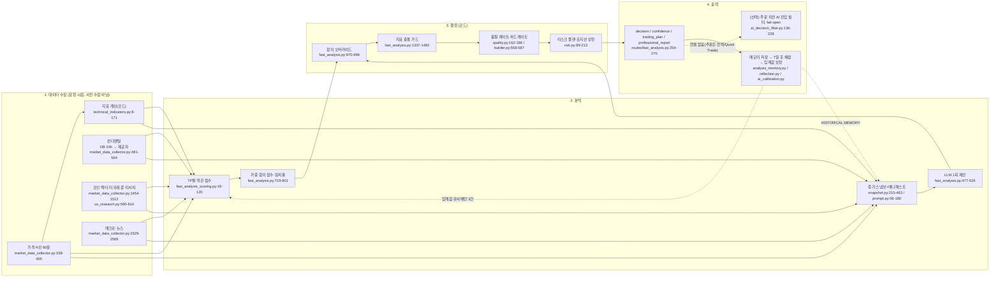

# QuantDinger — 개요

- 분석 SHA: `ba8cd667acca3e934bbc1cb354922eff413393dc` (repos.lock.tsv와 일치)
- 분석일: 2026-10-09
- 관련 공통 항목: Q1~Q7 요약
- 검증 수준 요약: 코드 확인 14 / 추론 0 / 미확인 0 (본문 표기 건수 기준)

> 약어: `BE` = `backend_api_python/app`. 코드 실행·설치는 하지 않았다. 프론트엔드는 이 레포에 없다.

## 1. 메타데이터

| 항목 | 값 | 근거 | 검증 |
|---|---|---|---|
| URL | https://github.com/OpenByteInc/QuantDinger | `trading/repos.lock.tsv` | 코드 확인 |
| 고정 SHA | `ba8cd667acca3e934bbc1cb354922eff413393dc` (detached HEAD, clean) | `git rev-parse HEAD`, `git status --porcelain` 빈 출력 | 코드 확인 |
| 커밋일 | 2026-10-07 04:59 +0800 (= 2026-10-06 UTC, lock 표기와 같은 날). 커밋 메시지 "fix: update vulnerable python dependencies" | `git log -1` | 코드 확인 |
| 버전 | 5.5.1 | `VERSION` | 코드 확인 |
| 라이선스 | 백엔드 Apache-2.0. 상표는 `TRADEMARKS.md`로 별도. 프론트엔드·모바일은 별도 저장소(source-available) | `LICENSE`, `README.md:697-708` | 코드 확인 |
| 주 언어·스택 | Python(Flask 3.1, Celery+Redis, PostgreSQL/psycopg2, yfinance, akshare, finnhub-python. 거래소는 ccxt가 아닌 자체 네이티브 REST. `professional_report`가 pydantic을 import하지만 `requirements.txt`에는 직접 명시가 없음) | `backend_api_python/requirements.txt`, `BE/data_sources/native_crypto.py:12` | 코드 확인 |
| 대상 시장 | 암호화폐(binance·bitget·bybit·okx·gate·htx), 미국주식, 홍콩주식, 중국 A주, 외환, 선물, MOEX. **전문 보고서·게이트는 미국/홍콩/암호화폐만 정식 지원.** 한국(KRX)·업비트·키움은 없음 | `BE/data_sources/factory.py:87,190-214`, `BE/professional_report/contracts.py:19` | 코드 확인 |
| 지원 LLM | OpenRouter(기본 `openai/gpt-5.4`), OpenAI, Google, DeepSeek, Grok, AtlasCloud, Custom, MiniMax, LiteLLM. 주문 진입 필터는 Jev(외부 SaaS) 우선 | `BE/services/llm.py:93-153`, `BE/services/ai_decision_filter.py:497-518` | 코드 확인 |
| 분석 진입점 | `POST /fast-analysis/analyze`(온디맨드), 포트폴리오 모니터(스케줄러 스레드), AI 채팅(리서치 에이전트) | `BE/routes/fast_analysis.py:73`, `BE/services/portfolio_monitor.py:1747`, `BE/routes/ai_chat.py:2535` | 코드 확인 |

## 2. 한 줄 정의

**"요청 시점에 데이터를 모아 증거 매니페스트로 만들고, LLM에게는 1회 해설·제안을 시키되, 최종 BUY/SELL/HOLD와 포지션 크기는 다중 타임프레임 객관 점수·가드·품질 게이트·리스크 플랜이라는 결정적 코드가 정하는 개인용 AI 트레이딩 OS."** 판단 주체는 *코드 우선, LLM은 제안자*이다.

**최종 결정은 LLM인가 코드인가 → 코드가 정한다(LLM은 방향·계획을 제안하고, 합의 점수 ±20 이상이면 코드가 덮어쓰며, 품질 게이트·리스크 플랜이 HOLD 강등과 포지션 크기를 정하되, 합의가 중립이면 가드를 통과한 LLM 방향이 그대로 남는다).** (`BE/services/fast_analysis.py:970-1003`, `BE/professional_report/builder.py:578-607`, `BE/professional_report/risk.py:171-188`)

## 3. 판단 파이프라인 다이어그램

상세 흐름과 각 노드의 라인은 [03-decision.md](03-decision.md#q4-2)에 있다.

## 4. 핵심 발견 5개

1. **코드가 LLM을 덮어쓴다.** 방향성 합의(점수 ±20 이상)가 있으면 LLM의 결정·확신도를 합의 값으로 교체한다. 단, 합의가 HOLD이면 LLM을 HOLD로 내리지 않으므로 중립 구간에서는 LLM 방향이 살아남는다. 프롬프트의 "LLM은 최종 실행 적격을 정하지 않는다"와 보고서의 `evidence_explanation_only`는 이 점에서 과장이다. — `BE/services/fast_analysis_policy.py:6-13`, `BE/services/fast_analysis.py:956-1003`, `BE/professional_report/builder.py:727-730` (코드 확인)
2. **LLM은 숫자 기준 없이 "증거만" 본다.** 프롬프트에는 RSI 30/70 같은 임계값이 없고, 모든 입력은 `evidence_id | metric | value | unit | currency | source | as_of` 행이다. "모든 주장에 증거 ID 인용" 계약은 알 수 없는 ID 제거·근거 없는 주장 삭제로 강제되지만 **결정에는 영향이 없고**, 숫자 사실 일치 검증은 없다(`numeric_tokens`는 호출처 없음). — `BE/professional_report/prompt.py:56-70,102-149`, `BE/professional_report/llm_contract.py:85-95`, `BE/professional_report/narrative.py:66-74` (코드 확인)
3. **실패 처리에 fail-open/fail-forward가 있다.** LLM 호출·파싱이 실패하면 HOLD 기본 구조가 "유효한 응답"으로 처리되고(`valid=True`, 경고는 `unknown_llm_field:report` 하나) 합의가 방향성이면 **LLM 없이도 BUY/SELL이 나올 수 있다**. 전문 보고서 빌드가 예외를 던지면 게이트 없이 원래 결정이 그대로 나간다. 주문 진입 AI 필터도 설계상 fail-open이다. — `BE/services/llm.py:1426-1445`, `BE/professional_report/llm_contract.py:68-83`, `BE/services/fast_analysis.py:573-578`, `BE/services/ai_decision_filter.py:225-238` (코드 확인, 실행 재현 없음)
4. **데이터는 온디맨드 수집이고 사전 동기화는 펀더멘털(관리자가 켠 유니버스)뿐이다.** 분석 1회가 `collect_all`을 4번 돌고, 분석·모니터는 거래일 캘린더를 보지 않으며, 포트폴리오 모니터는 가이드의 "Celery 모니터링"이 아니라 스케줄러 프로세스 스레드(30초 틱)다. 신선도 검사는 시세·지표·매크로가 구조상 항상 fresh로 기록돼 사실상 OHLCV 마지막 봉·펀더멘털·뉴스에만 의미가 있다. — `BE/services/fast_analysis.py:616-646,736-779`, `BE/services/portfolio_monitor.py:1747-1827`, `BE/startup.py:60-71`, `BE/professional_report/snapshot.py:162` (코드 확인)
5. **사후 채점·리서치 루프는 있으나 약하거나 분리되어 있다.** 채점은 "7일 이상 지난 판단을 현재가와 비교"(고정 5일 아님, 벤치마크·비용·교훈 없음)이고 결과는 유사 패턴 3줄과 매수/매도 임계값 재탐색에만 쓰인다. `research_agent`(plan→gather→assess, ≤3라운드·≤10호출·55초)는 AI 채팅 전용이며 매매 결정과 연결되어 있지 않다. — `BE/services/analysis_memory.py:766-846`, `BE/services/ai_calibration.py:163-310`, `BE/services/research_agent.py:151-321`, `BE/routes/ai_chat.py:2535-2538` (코드 확인)

## 5. 공통 항목 요약표

| 항목 | 요약 | 문서 |
|---|---|---|
| Q1 데이터 | 시세·K선 60봉·자체 계산 지표(RSI14, MACD12/26/9, MA5/10/20, BB20, ATR14)·펀더멘털(Finnhub/yfinance/SEC/Nasdaq, CN/HK는 Tencent/AkShare)·코인 팩터(CoinGlass 유료→Gate/OKX/Binance 공개)·VIX/DXY/TNX/공포탐욕·뉴스. 소셜 감성, HK 공매도/CCASS/A-H, 죽은 포맷 함수 등은 정의만 있고 미사용. 한국·업비트·키움은 없음. | [01-data.md](01-data.md#q1) |
| Q2 수집 | 전부 pre-fetch(도구 호출 없음). 시장당 소스 1개 + 소스 내부 폴백, 펀더멘털은 메모리 30분→DB 24시간→제공자 write-back, K선 캐시 3~60초. 코어 수집 마감 15~45초 후 계속 진행(가격 실패만 중단). 분석은 "지금" 기준이라 백테스트용 as_of 없음. | [01-data.md](01-data.md#q2) |
| Q3 스케줄 | 분석은 온디맨드(사용자/모니터). 모니터는 스케줄러 프로세스 스레드 30초 틱, 모니터별 주기 기본 60분. Celery Beat는 펀더멘털 동기화(60초)·사후검증·보정·카탈로그 동기화(일 1회). 캘린더 미사용, 신선도는 품질 게이트로 HOLD·확신도 상한 반영. | [02-schedule.md](02-schedule.md#q3) |
| Q4 판단 | 단일 해설 LLM 1회(앙상블 옵션) + 코드 점수·합의·가드·품질 게이트·리스크 플랜. 점수 ±20이 BUY/SELL 경계, 확신도<60은 합의 없으면 HOLD, 위험예산 1%÷손절거리로 포지션 결정. LLM 실패 시에도 합의로 방향 가능. 사후 채점은 7일+, ±2%/±5% 규칙. | [03-decision.md](03-decision.md#q4-5) |
| Q5 리서치 | fast_analysis는 도중 검색 없음(5건 미만이면 고정 쿼리 1회 보충). 리서치 루프는 AI 채팅 `research_agent`뿐: 도구 4개, 도메인 10개, ≤3라운드·≤10호출·55초, 반복 호출·임의 URL 차단, 숫자는 증거 필요(개념은 모델 지식 허용). | [04-research.md](04-research.md#q5) |
| Q6 경계 | 분석 결과→주문 자동 연결 없음. 주문은 전략/Quick Trade/에이전트에서 나가고 AI는 선택적 진입 필터(기본 꺼짐, fail-open, 청산은 우회). 하드 한도는 전략 주문 예산(fail-closed)이 AI보다 먼저. 에이전트 실거래는 3중 조건+킬스위치. UI 코드는 이 레포에 없음. | [05-boundary-and-fit.md](05-boundary-and-fit.md#q6) |
| Q7 적용(의견) | 가져갈 것: 증거 스냅샷+ID 계약, 품질 게이트, 리스크 플랜, 코드 덮어쓰기 구조, 지표 모듈, PIT 펀더멘털. 버릴 것: 죽은 코드, 감성 점수, LLM 실패 시 방향 산출, 과금/Jev 결합. 업비트·키움·DART로 대체 매핑 표 제공. Apache-2.0 코드 재사용 가능(상표·프론트 제외). | [05-boundary-and-fit.md](05-boundary-and-fit.md#q7) |

## 6. 문서 목록

- [01-data.md](01-data.md) — Q1 데이터 인벤토리, Q2 수집 방식
- [02-schedule.md](02-schedule.md) — Q3 최신화와 스케줄링
- [03-decision.md](03-decision.md) — Q4 AI 판단(규칙표, 출력 스키마, 에이전트별 입출력, 실패 처리, 메모리, 비용)
- [04-research.md](04-research.md) — Q5 실시간 리서치
- [05-boundary-and-fit.md](05-boundary-and-fit.md) — Q6 경계, Q7 적용 의견
- [next.md](next.md) — 확인 범위, 미확인, README/가이드와 코드 차이, 다음에 볼 파일
