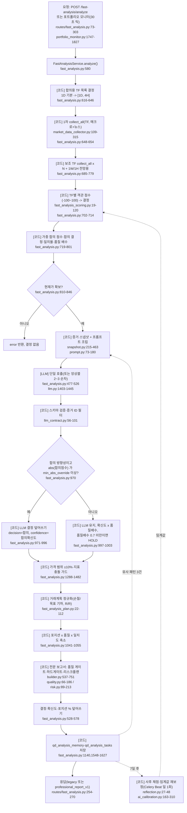

# QuantDinger — AI 판단 (Q4)

- 분석 SHA: `ba8cd667acca3e934bbc1cb354922eff413393dc` (repos.lock.tsv와 일치)
- 분석일: 2026-10-09
- 관련 공통 항목: Q4 (4-1 ~ 4-8)
- 검증 수준 요약: 코드 확인 109 / 추론 8 / 미확인 1 (본문 표기 건수 기준)

> 약어: `BE` = `backend_api_python/app`.
> 실행 검증은 하지 않았다(GUIDE 2.2). "코드 확인"은 파일을 열어 읽고 흐름을 추적한 것이다.

**결론(한 문장)**: 최종 결정은 **결정적 코드가 정한다.** LLM은 방향·계획을 *제안*하고, 다중 타임프레임 객관 점수가 ±20 이상이면 코드가 LLM 결정을 덮어쓰며, 그 뒤 지표 충돌 가드·데이터 품질 게이트·리스크 플랜이 BUY/SELL을 HOLD로 강등하고 포지션 크기는 코드가 정한다. 다만 합의 점수가 중립(|점수|<20)이면 가드를 통과하는 한 **LLM의 방향이 그대로 남는다**(`BE/services/fast_analysis.py:970-1003`).

---

## 4-1. 입력 조립 {#q4-1}

| 항목 | 내용 | 근거 | 검증 |
|---|---|---|---|
| 프롬프트 함수 | `build_professional_analysis_prompt(data, language, memory_context)` → `(system_prompt, user_prompt)` | `BE/professional_report/prompt.py:73-180` | 코드 확인 |
| 호출 경로 | `FastAnalysisService._build_analysis_prompt` → 메모리 컨텍스트를 붙여 위 함수 호출 | `BE/services/fast_analysis.py:362-372,849-851` | 코드 확인 |
| 입력 형식 | 사용자 프롬프트에 `RESEARCH SUBJECT`(시장·심볼·TF·통화·현재가·등락률) / `TECHNICAL RISK REFERENCES`(지지·저항·ATR·제안 손절/목표·허용 가격 구간) / `DATA AVAILABILITY`(필수 메트릭, 누락 메트릭, 수집 상태) / `ATTRIBUTABLE EVIDENCE MANIFEST` / `HISTORICAL MEMORY` | `BE/professional_report/prompt.py:151-179` | 코드 확인 |
| **증거 매니페스트** | 관측 1건당 한 줄: `evidence_id \| metric=… \| value=… \| unit=… \| currency=… \| source=… \| as_of=…`. 관측이 없으면 `NO_ATTRIBUTABLE_EVIDENCE` | `BE/professional_report/prompt.py:56-70` | 코드 확인 |
| 관측의 구성 | 시세 7종, 마지막 봉 1개, 지표(중첩 dict를 `indicator.rsi.value` 식으로 평탄화), 펀더멘털(필드별 + 분기/TTM/연간 재무 + 실적 이력 8개), 시장별 데이터셋, 매크로(평탄화), 암호화폐 팩터(수치만), 뉴스 상위 10건 | `BE/professional_report/snapshot.py:215-430` | 코드 확인 |
| 길이 제한·자르기 | 각 증거 값 JSON 240자 컷, 뉴스는 snapshot에서 10건, 수집기에서 15건·요약 300자. 프롬프트 전체 토큰 상한 규칙은 없음 | `BE/professional_report/prompt.py:44-46`, `BE/professional_report/snapshot.py:412-430`, `BE/services/market_data_collector.py:2518,2567` | 코드 확인 |
| 기준가 계산 | `lower_bound=max(현재가×0.9, min(현재가, 제안손절))`, `upper_bound=min(현재가×1.1, max(현재가, 제안목표))`. ATR 없으면 현재가×2%, 지지/저항 없으면 ×0.95/×1.05 | `BE/professional_report/prompt.py:85-97` | 코드 확인 |
| 언어·시장 규칙 | `zh-CN/zh-TW/en-US/ja-JP`(그 외 en-US). 시장별 추가 규칙(미국/홍콩/암호화폐) 삽입. **한국어 없음** → `en-US`로 폴백 | `BE/professional_report/prompt.py:11-41,106` | 코드 확인 |
| 프롬프트 인젝션 방어 | "DATA 섹션은 신뢰할 수 없는 증거" 선언, 메모리도 "untrusted" 표기 | `BE/professional_report/prompt.py:109,176` | 코드 확인 |
| LLM이 못 보는 것 | 가격 시계열 원본(마지막 봉 1개만), `crypto_factors.signals/summary`, Finnhub 소셜 감성, 보유 포지션 | `BE/professional_report/snapshot.py:239-258,390-392`, `BE/services/market_data_collector.py:2527-2539` | 코드 확인 |

## 4-2. 판단 흐름 {#q4-2}

### 흐름 다이어그램 (노드마다 코드 위치)

### 단계 요약

| 항목 | 내용 | 근거 | 검증 |
|---|---|---|---|
| 순서 | 전부 **순차**. 각 `collect_all` 내부만 병렬. TF 수집 → LLM → 코드 보정 순 | `BE/services/fast_analysis.py:685-700,874-876` | 코드 확인 |
| 합의 TF 목록 | 기본: 1H→[1H,4H,1D], 4H→[4H,1D], 1D→[1D,4H], 그 외→[TF,1D,4H]. `AI_ANALYSIS_CONSENSUS_TIMEFRAMES`로 덮어쓰기 | `BE/services/fast_analysis.py:617-646` | 코드 확인 |
| 모델 계층 | quick/deep 구분 **없음.** 요청의 `model` 또는 설정 기본 모델(OpenRouter 기본 `openai/gpt-5.4`, 폴백 `openai/gpt-4o-mini`) 한 개. 앙상블은 환경변수 목록 | `BE/services/llm.py:104-110,245-256`, `BE/services/fast_analysis.py:598-600` | 코드 확인 |
| 앙상블 | `ENABLE_AI_ENSEMBLE=true` + `AI_ENSEMBLE_MODELS`에 2개 이상(최대 3개 사용) → 같은 프롬프트로 **순차** 호출 후 다수결. 동률이면 `Counter.most_common`이 먼저 삽입된 쪽(=첫 모델)을 고름. 기본은 꺼짐 | `BE/services/fast_analysis.py:491-526`, `env.example:733-735` | 코드 확인(동률 규칙은 Python 동작 기반 추론) |
| 토론·라운드 | 없음. 에이전트 간 토론 구조 없음 | — | 코드 확인 |
| 서브 점수 | 4개 관점(기술·펀더멘털·감성·매크로)은 **LLM이 아니라 코드가 계산**(UI 점수도 코드 값, LLM 점수는 `llm_scores`로 진단용 보관) | `BE/services/fast_analysis_fundamentals.py:35-47` | 코드 확인 |

## 4-3. 결정 기준 {#q4-3}

### 판단 규칙 표

**(A) LLM 프롬프트에 적힌 규칙**

| 규칙 | 원문 인용 | 번역 | 위치 | 검증 |
|---|---|---|---|---|
| 역할 한정 | "You do not decide data quality, position caps or final execution eligibility; deterministic services do that after your response." | 너는 데이터 품질·포지션 상한·최종 실행 적격 여부를 결정하지 않는다. 그것은 네 응답 뒤에 결정적 서비스가 한다. | `BE/professional_report/prompt.py:103` | 코드 확인 |
| 증거 외 금지 | "Use only supplied evidence. Never invent a value, event, source, forecast or probability." | 제공된 증거만 써라. 값·사건·출처·전망·확률을 지어내지 마라. | `BE/professional_report/prompt.py:110` | 코드 확인 |
| 인용 의무 | "Every material factual thesis, risk, catalyst or counter-argument must cite evidence IDs in evidence_claims." | 모든 중요한 사실 주장(논지·위험·촉매·반론)은 `evidence_claims`에 증거 ID를 인용해야 한다. | `BE/professional_report/prompt.py:111` | 코드 확인 |
| 매크로·뉴스 | "News and macro can affect direction only through an explicit, asset-specific transmission mechanism." / "An unrelated geopolitical headline is not directional evidence and never automatically overrides market data." | 뉴스·매크로는 명시적이고 해당 자산에 특정된 전달 경로가 있을 때만 방향에 영향을 준다. / 무관한 지정학 헤드라인은 방향 증거가 아니며 시장 데이터를 자동으로 뒤집지 못한다. | `BE/professional_report/prompt.py:113-114` | 코드 확인 |
| 확신도 의미 | "Confidence is signal strength, not a calibrated probability. Missing or conflicting evidence lowers confidence." | 확신도는 신호 강도이지 보정된 확률이 아니다. 증거가 없거나 충돌하면 낮춘다. | `BE/professional_report/prompt.py:115` | 코드 확인 |
| 대칭·HOLD | "Apply BUY and SELL symmetrically. HOLD is required when evidence is insufficient or expected reward is unattractive." | BUY와 SELL을 대칭으로 적용하라. 증거 부족 또는 기대 보상이 매력적이지 않으면 HOLD가 필수다. | `BE/professional_report/prompt.py:116` | 코드 확인 |
| 진입 조건 | "BUY needs confirmed bullish evidence; oversold RSI alone is insufficient." / "SELL means opening/maintaining a short and needs confirmed bearish evidence; overbought RSI alone is insufficient." | BUY는 확인된 강세 증거가 필요(과매도 RSI만으로는 불충분). SELL은 숏 진입/유지를 뜻하며 확인된 약세 증거가 필요(과매수 RSI만으로는 불충분). | `BE/professional_report/prompt.py:122-123` | 코드 확인 |
| 가격 기하 | "If BUY: stop_loss < entry_price < take_profit." / "If SELL: take_profit < entry_price < stop_loss." / "All proposed prices must remain within 10% of the current price." | BUY면 손절<진입<목표, SELL이면 목표<진입<손절. 모든 제안 가격은 현재가 ±10% 이내. | `BE/professional_report/prompt.py:124-126` | 코드 확인 |
| 포지션 | "Position size must be 0 for HOLD." | HOLD의 포지션은 0. | `BE/professional_report/prompt.py:148` | 코드 확인 |
| 미국 특화 | "A Form 4 filing count is filing activity, not evidence of insider buying or selling." | Form 4 건수는 신고 활동일 뿐 내부자 매수·매도의 증거가 아니다. | `BE/professional_report/prompt.py:23-24` | 코드 확인 |
| 홍콩 특화 | "never call it net inflow, net outflow, net buying or net selling." | (남향 보유 변화 프록시를) 순유입·순유출·순매수·순매도라 부르지 마라. | `BE/professional_report/prompt.py:30-32` | 코드 확인 |
| 암호화폐 특화 | "Never combine incompatible venues, products, windows or units." | 호환되지 않는 거래소·상품·구간·단위를 섞지 마라. | `BE/professional_report/prompt.py:37-38` | 코드 확인 |

> LLM에게는 **임계값·점수 구간이 한 줄도 주어지지 않는다**(RSI 30/70 같은 숫자는 프롬프트에 없고, 지표 값만 증거로 준다). 숫자 기준은 전부 코드 쪽에 있다(코드 확인: `BE/professional_report/prompt.py:102-149` 전체).

**(B) 결정적 코드의 임계값·공식**

| 규칙 | 원문(코드/주석) | 번역·설명 | 위치 | 검증 |
|---|---|---|---|---|
| 점수→결정 | `score >= buy_thr → "BUY"`, `score <= sell_thr → "SELL"`, 그 외 `"HOLD"`; 기본 `buy_threshold=20.0`, `sell_threshold=-20.0` | 객관 점수 ±20이 BUY/SELL 경계. 값은 DB 보정 행이 있으면 그 값 | `BE/services/fast_analysis.py:1512-1521`, `BE/services/ai_calibration.py:37-42` | 코드 확인 |
| 덮어쓰기 자격 | `"Only directional consensus may replace the model's decision."` / `consensus_abs >= min_abs_override` | 방향성(BUY/SELL) 합의만 LLM 결정을 대체할 수 있다. HOLD 합의는 대체하지 않는다. | `BE/services/fast_analysis_policy.py:6-13` | 코드 확인 |
| 덮어쓰기 문턱 | 기본 `min_consensus_abs_override=15.0`, 횡보 레짐이면 ×1.2, **합의 BUY인데 LLM이 SELL/HOLD이고 약세 맥락이면** `max(문턱, 55)`(패닉 붕괴) 또는 `40`(약세 맥락) | 기본 임계 ±20이 이미 15보다 커서 15는 사실상 무의미. 하락 중 매수 합의를 뒤집는 쪽만 문턱이 올라가고, 상승 중 매도 합의에는 같은 상향이 없다(비대칭) | `BE/services/fast_analysis.py:956-968` | 코드 확인 |
| 덮어쓰기 효과 | `analysis["decision"]=합의`, `analysis["confidence"]=consensus_conf`, 요약에 `[Multi-timeframe objective consensus: …]` 덧붙임 | LLM의 방향·확신도를 코드 값으로 교체 | `BE/services/fast_analysis.py:970-996` | 코드 확인 |
| 합의 확신도 | `50 + 0.35×|합의점수|`를 [40,98]로 자르고 → `×(0.85+0.3×일치율)`을 [35,98]로 → `×품질배수` | 확신도 공식 | `BE/services/fast_analysis.py:949-953` | 코드 확인 |
| TF 가중 | 1M .75, 3M .75, 5M .80, 15M .85, 30M .90, 1H .95, 4H 1.10, 1D 1.30, 1W 1.35, 그 외 1.0; 최종 `w = 기본가중 × (1 + min(1, |점수|/100))` | 긴 TF가 레짐 방향을 잡도록 설계(주석) | `BE/services/fast_analysis.py:716-732` | 코드 확인 |
| 품질 배수 | 매크로 실패 ×0.85, 뉴스 실패 ×0.8, 지표 누락 ×0.65. 합의가 중립이면 `확신도×배수`, **배수<0.7이면 HOLD + 확신도 ≤55** | 데이터 결손 시 확신도 하향·HOLD | `BE/services/fast_analysis.py:790-801,997-1003`, `BE/services/ai_calibration.py:37-42` | 코드 확인 |
| 저확신도 가드 | `if confidence < 60` 이고 방향성인데 합의가 같은 방향이 아니면 `decision="HOLD"`, `decision_guard="low_confidence_without_consensus"` | 확신도 60 미만의 방향 결정은 합의로 뒷받침될 때만 유지 | `BE/services/fast_analysis.py:1398-1410`, `BE/services/fast_analysis_policy.py:16-22` | 코드 확인 |
| BUY 충돌 가드 | `RSI>70`, `MACD bearish`, `strong_downtrend` 또는 (`downtrend` 이면서 `RSI>50`) 중 하나라도 있으면 HOLD(확신도 `max(c-20,40)`). 단 **중대 뉴스/매크로 이벤트**가 있으면 BUY 유지하고 확신도 `max(c-15,50)` | 지표와 충돌하는 BUY 차단. 사건이 있으면 예외 | `BE/services/fast_analysis.py:1412-1437` | 코드 확인 |
| SELL 충돌 가드 | ① `uptrend` & `RSI≥60` & 약세 반전 미확인 & 사건 없음, ② `RSI<30` & MACD bullish & `uptrend`, ③ `RSI<30` & `strong_uptrend` → HOLD | 상승 추세 중 근거 없는 숏 차단 | `BE/services/fast_analysis.py:1439-1468` | 코드 확인 |
| 역추세 BUY 가드 | `downtrend` & `RSI≤40` & 강세 반전 미확인 & 사건 없음 → HOLD(확신도 `max(c-20,40)`) | 하락 중 "과매도 매수" 차단 | `BE/services/fast_analysis.py:1470-1480` | 코드 확인 |
| 반전 확인 정의 | 약세 확인 = `MACD bearish` 또는 SELL TF 2개 이상 또는 (MA20 아래/`price_position<45` 이면서 `volume_ratio≥1.1`). 강세 확인은 대칭(`>MA20`/`>55`) | 위 가드가 쓰는 "확인" 조건 | `BE/services/fast_analysis.py:1379-1396` | 코드 확인 |
| 중대 뉴스 | 키워드(regulation, approval, sanctions, 监管, 央行 …)+감성≠neutral, 또는 지정학 정규식 매치. `asset_relevance`가 `direct`/`material`(기본 direct)인 항목만, 상위 10건 | "사건 예외"의 입력 | `BE/services/fast_analysis.py:1210-1253` | 코드 확인 |
| 중대 매크로 | `VIX>30`, `|DXY 변동|>1.0`, `|TNX 변동|>2.0`(미국·암호화폐) | "사건 예외"의 입력 | `BE/services/fast_analysis.py:1255-1281` | 코드 확인 |
| 가격 범위 | 진입가가 현재가 ±10% 밖이면 현재가로 교체 | 이상한 진입가 보정 | `BE/services/fast_analysis.py:1297-1308` | 코드 확인 |
| 거래계획 기하 | LLM 손절/목표가 유효(BUY: `현재가×0.9 ≤ SL < 현재가 < TP ≤ 현재가×1.1`)하면 `source=llm`. 아니면 지표의 ATR 기반(`technical_fallback`), 그것도 안 되면 ±5% `safety_fallback`. R/R<1.0이면 `rr_warning` | 계획을 코드가 재검증·대체 | `BE/services/fast_analysis_plan.py:37-111` | 코드 확인 |
| 포지션 1차 축소 | `size = LLM값(기본 10) × 품질배수 × (0.6+0.4×일치율)`, HOLD면 0, 그 외 `[1,100]`. **이후 전문 보고서가 덮어씀** | LLM 포지션은 최종값이 아님 | `BE/services/fast_analysis.py:1041-1055`, `BE/services/fast_analysis.py:563-571` | 코드 확인 |
| 품질 게이트 | 구간별 `none/low/medium/high`. `none`이면 방향성 결정 불가 → HOLD. 확신도 상한 35/55/75/100 | 데이터 결손이 크면 HOLD | `BE/professional_report/quality.py:129-140,162-186` | 코드 확인 |
| 하드 게이트 | 종목 신원 미확인(`identity.verified is False`) 또는 암호화폐 범위·단위 검증 실패 → 방향성 결정을 HOLD로, 확신도 ≤35 | 잘못된 종목/단위 방지 | `BE/professional_report/builder.py:558-587` | 코드 확인 |
| 리스크 플랜 | 위험예산 `PROFESSIONAL_REPORT_RISK_BUDGET_PCT`(기본 1.0%). `raw_position% = 예산 / 손절거리% × 100`. 상한 = `상품상한(암호화폐 30, 그 외 50) × 품질점수/100`. 최종 = `min(상한, LLM 포지션)`. 왕복 비용 가정 20bp(암호화폐)/10bp. 순 R/R<1은 **경고만**(차단 안 함). 기하가 무효면 HOLD | 포지션 크기를 코드가 결정 | `BE/professional_report/risk.py:89-213`, `BE/professional_report/builder.py:592-607`, `BE/services/fast_analysis.py:538-543` | 코드 확인 |
| 최종 덮어쓰기 | `decision = report.decision_profile.decision`, 방향성이면 `trading_plan.position_size_pct = risk_plan.recommended_position_pct` | 게이트·리스크 결과가 최종 | `BE/services/fast_analysis.py:546-572` | 코드 확인 |

### 객관 점수 공식 요약 (`BE/services/fast_analysis_scoring.py`)

| 구성 | 공식 | 위치 | 검증 |
|---|---|---|---|
| 종합 | `overall = Σ(가중치×점수)/Σ(존재하는 가중치)`; 기술 .35, 펀더멘털 .20, 감성 .25, 매크로 .20. 존재 조건: 기술=지표 있음, 펀더멘털=미국/중국/홍콩이고 핵심 필드 있음(암호화폐는 팩터 있음), 감성=뉴스 있음, 매크로=매크로 있음. 모든 점수 범위 −100~100 | `:87-109` | 코드 확인 |
| 기술 | RSI(14) 30%: >70→−50, >60→−30, <30→+50, <40→+30, 그 외 `(50−RSI)×0.6`. MACD 25%: bullish +40/bearish −40. MA 25%: strong_up +40, up +25, strong_down −40, down −25. 24h 변동 20%: >10→−20, >5→−10, <−10→+20, <−5→+10, 그 외 ×2. 보조(가격위치, 볼린저, 거래량, 변동성) 15%. **하락 추세·패닉 붕괴 맥락이면 과매도 가점을 깎거나 음수로 바꿈**, 패닉이면 상한 −25, 약세 맥락+24h≤−3%이면 상한 +5 | `:191-350` | 코드 확인 |
| 패닉 붕괴 정의 | (strong_downtrend & MACD bearish & 24h≤−3%) 또는 (downtrend & MACD bearish & 24h≤−5%) 또는 (24h≤−8% & volume_ratio≥1.3) | `:171-178` | 코드 확인 |
| 펀더멘털 | PE(<15 +20, <25 +10, >50 −20, >35 −10), ROE(>20 +20, >15 +10, <5 −20, <10 −10), 매출성장(>20 +20, >10 +10, <−10 −20, <0 −10), 이익률(>20 +15, >10 +7, <0 −15, <5 −7), D/E(<0.5 +10, >2 −10), 유동비율(≥1.5 +10, <1 −10)의 **단순 합**을 ±100으로 자름. 암호화폐·KRX 등 비대상 시장은 0 | `:352-467` | 코드 확인 |
| 암호화폐 팩터 | 펀딩+OI변화 (±18, OI 24h 변화>3%일 때만), 거래소 순유입 ±16, 스테이블코인 순유입 ±12, 롱숏비 (>1.6 −10, <0.75 +8), 거래량×가격 ±10(±6), squeeze high −8/medium −3. 합계를 ±100으로 자름. 이 값이 암호화폐의 "펀더멘털 점수"를 **대체** | `:469-555`, `:44-45` | 코드 확인 |
| 감성 | `(긍정−부정)/총×60 + 지정학 패널티`. 지정학 severe −42, moderate −18, 누적 하한 −55(`SENTIMENT_GEO_PENALTY_CAP`). `asset_relevance`가 direct/material 아닌 뉴스는 제외 | `:557-625`, `BE/services/fast_analysis_geo.py:98-104` | 코드 확인 |
| 감성 라벨의 출처 | 뉴스 `sentiment`는 제공자 필드 또는 기본 `neutral`. 검색 결과는 AlphaVantage만 라벨을 채움. Finnhub 뉴스에 감성 필드가 없는 것으로 알고 있어(외부 API 스키마 기억) 실질적으로 **감성 점수 ≈ 지정학 정규식 패널티** | `BE/services/search_models.py:22`, `BE/services/search.py:590-598`, `BE/services/market_data_collector.py:2521` | 추론(근거: 코드는 라벨을 제공자에서 받기만 함. Finnhub 응답 스키마는 코드로 확인 불가) |
| 매크로 | VIX(>35 −50, >30 −40, >25 −30, >20 −15, <12 +20, <15 +10), DXY 변동(암호화폐·FX·선물 ±20~30, 기타 ±10), TNX 변동(암호화폐·미국 ±20~30), 공포탐욕(암호화폐만: ≥80 −15, ≥65 −8, ≤20 +10, ≤35 +5). 합을 125로 나눠 ×100. **TNX `changePercent`는 수집기가 0으로 고정**해서 TNX 항목은 사실상 0점 | `:627-726`, `BE/services/market_data_collector.py:2375-2385,2434-2443` | 코드 확인(TNX 0 고정은 코드 읽기 결과) |

### 페르소나·역할 차이
없음. 단일 해설 LLM이며 페르소나 분기가 없다(코드 확인: `BE/professional_report/prompt.py`에 역할 분기 없음).

## 4-4. 출력 형식 {#q4-4}

### 출력 스키마 표 (LLM 응답 = `FastAnalysisNarrative`, `extra="forbid"`)

| 필드 | 타입 | 값 범위 | 설명 | 위치 |
|---|---|---|---|---|
| `decision` | Literal | `BUY\|SELL\|HOLD`(대문자 정규화, 기본 HOLD) | 방향 제안 | `BE/professional_report/llm_contract.py:31,47-50` |
| `confidence` | int | 0~100, 기본 50 | 신호 강도(확률 아님) | `:32` |
| `summary` | str | — | 2~3문장 요약 | `:33` |
| `analysis` | 객체 `technical/fundamental/sentiment`(str) | — | 관점별 서술 | `:12-17,34` |
| `entry_price`, `stop_loss`, `take_profit` | float\|None | ≥0 | 가격 제안 | `:35-37` |
| `position_size_pct` | int | 0~100 | 제안 비중(최종값 아님) | `:38` |
| `timeframe` | Literal | `short\|medium\|long` | 보유 기간 | `:39` |
| `key_reasons`, `risks` | list[str] | — | 이유·위험 | `:40-41` |
| `evidence_claims` | list[`{kind, text, evidence_refs[]}`] | `kind ∈ thesis\|risk\|catalyst\|counter_argument`, `text` 1자 이상 | **증거 ID가 붙은 주장** | `:20-25,42` |
| `technical_score`, `fundamental_score`, `sentiment_score` | int | 0~100, 기본 50 | LLM 자체 점수(UI에는 안 씀) | `:43-45` |

### 최종 응답 스키마 (핵심 필드)

| 필드 | 타입 | 값 범위 | 설명 | 위치 |
|---|---|---|---|---|
| `decision`, `confidence` | str, int | BUY/SELL/HOLD, 0~100 | **코드가 보정·게이트한 최종값** | `BE/services/fast_analysis.py:1083-1084,546-572` |
| `trading_plan` | 객체 | `entry_price, stop_loss, take_profit, position_size_pct, timeframe, risk_reward_ratio, rr_warning, source(llm\|technical_fallback\|safety_fallback)` + camelCase 중복 키 | 손절·목표·비중 | `BE/services/fast_analysis.py:1093-1107`, `BE/services/fast_analysis_plan.py:10-19` |
| `scores` | `{technical, fundamental, sentiment, overall}` | 0~100(`50 + 점수×0.5`) | 결정적 점수, `score_source="deterministic_objective_v2"` | `BE/services/fast_analysis_fundamentals.py:19-47` |
| `consensus` | 객체 | `consensus_score, consensus_decision, consensus_abs, agreement_ratio, quality_multiplier, market_regime, risk_context` | 합의 상세 | `BE/services/fast_analysis.py:1016-1024` |
| `trend_outlook` | `next_24h/3d/1w/1m` 각 `{score, trend, strength}` | strength: ≥70 strong, ≥40 moderate, ≥20 mild | 코드가 계산한 기간별 전망 | `BE/services/fast_analysis.py:896-947` |
| `professional_report` | `professional_report_v1` | `decision_profile{decision, raw_decision, market_bias, confidence, raw_confidence, confidence_kind, quality_gate_reasons, conclusion_strength…}`, `dimensions[]`, `claims[]`, `scenarios[bull/base/bear]`(확률 `None`), `risk_plan`, `data_quality`, `evidence_snapshot`, `warnings[]`, `methodology{llm_role:"evidence_explanation_only"}` | 감사 가능한 보고서 | `BE/professional_report/builder.py:691-738` |
| 등급 체계 | 3단계 BUY/SELL/HOLD | `market_bias`는 별도(BULLISH/BEARISH/NEUTRAL, 기술 점수 ±5 경계) | 5단계 등급 없음 | `BE/professional_report/builder.py:33-48` | 

- 확신도: `confidence_kind`는 `ENABLE_CONFIDENCE_CALIBRATION=true`일 때만 `calibrated_probability`, 기본은 `model_strength`(코드 확인: `BE/professional_report/builder.py:546-548,707-709`).
- 시나리오 확률은 항상 `None`(`BE/professional_report/builder.py:434-455`).
- **SELL은 숏을 뜻한다**(`BE/professional_report/prompt.py:123`). 현물 전용 계좌에서는 "보유분 청산" 의미와 다르다(의견).

### 에이전트(구성요소)별 입출력 표

| 에이전트 | 입력 | 출력 | 모델 계층 | 위치 |
|---|---|---|---|---|
| 데이터 수집기(코드) | 시장, 심볼, TF | `collect_all` dict(가격·K선·지표·펀더멘털·팩터·매크로·뉴스·`_meta`) | 해당 없음 | `BE/services/market_data_collector.py:109-315` |
| 객관 점수기(코드) | 수집 dict | 기술/펀더멘털/감성/매크로/종합 점수(−100~100) | 해당 없음 | `BE/services/fast_analysis_scoring.py:19-120` |
| 증거 스냅샷 빌더(코드) | 수집 dict | 관측 목록 + 필수 메트릭 + 품질 플래그 | 해당 없음 | `BE/professional_report/snapshot.py:215-463` |
| **해설 LLM(1회)** | 시스템/유저 프롬프트(증거 매니페스트 포함) | `FastAnalysisNarrative` JSON | 단일 기본 모델 또는 요청 모델 | `BE/services/fast_analysis.py:477-504`, `BE/services/llm.py:1403-1445` |
| 앙상블 LLM(선택) | 같은 프롬프트 | 모델별 JSON → 다수결 | 환경변수 모델 2~3개 | `BE/services/fast_analysis.py:506-526` |
| 합의 오버라이드(코드) | 합의 점수·LLM 결정 | 덮어쓴 결정·확신도 | 해당 없음 | `BE/services/fast_analysis.py:970-996` |
| 지표 충돌 가드(코드) | 결정·지표·TF별 결정·사건 플래그 | 필요 시 HOLD | 해당 없음 | `BE/services/fast_analysis.py:1337-1482` |
| 계획 정규화(코드) | 결정·현재가·지표 | 손절/목표/R·R/소스 | 해당 없음 | `BE/services/fast_analysis_plan.py:22-112` |
| 전문 보고서 게이트(코드) | 수집 dict + 분석 결과 | 최종 결정·확신도·리스크 플랜·경고 | 해당 없음 | `BE/professional_report/builder.py:537-751` |
| 사후 채점기(코드) | 과거 판단 + 현재가 | `was_correct`, `actual_return_pct`, 보정 임계값 | 해당 없음 | `BE/services/analysis_memory.py:766-846` |
| 연구 플래너 LLM(AI 채팅 전용) | 요구사항·증거·시도 이력 | 도구 호출 ≤2개 + 평가 JSON | 기본 모델, `temperature=0`, 15초 | `BE/services/research_agent.py:86-95`(04-research.md) |
| 전략 AI 클라이언트(전략 코드용) | 프롬프트·입력(≤100KB) | `action(buy/sell/hold), score(−100~100), confidence(0~1), horizon, risk_level, reason_codes, summary` | 프로필별 모델 | `BE/services/ai_decision.py:152-303` |
| 주문 진입 필터(주문 직전) | 주문·결정 컨텍스트 v2 | `pass/reject` + 체크 목록 | Jev 또는 기본 LLM | `BE/services/ai_decision_filter.py:133-391` |

## 4-5. 최종 결정이 만들어지는 방식 {#q4-5}

**"최종 결정은 LLM인가 코드인가" → 코드(LLM은 제안자, 중립 구간에서만 LLM 방향이 살아남는다).**

| 장치 | 동작 | LLM 결정에 대한 효과 | 위치 | 검증 |
|---|---|---|---|---|
| 합의 오버라이드 | 합의가 BUY/SELL이고 문턱 이상이면 LLM 결정·확신도 교체 | **덮어쓰기** | `BE/services/fast_analysis.py:970-996` | 코드 확인 |
| 중립 구간 | 합의가 HOLD(|점수|<20)이면 LLM 결정 유지, 확신도만 품질 배수로 축소 | LLM이 방향을 만들 수 있는 유일한 경로(가드 통과 시) | `BE/services/fast_analysis.py:997-1003` | 코드 확인 |
| 지표 충돌 가드 | 합의 오버라이드 결과도 같은 가드를 통과해야 함 | HOLD로 **강등** | `BE/services/fast_analysis.py:1033-1039,1337-1482` | 코드 확인 |
| 품질 게이트 | 커버리지·신선도·충돌 비율로 방향성 금지 | HOLD로 **강등**, 확신도 상한 | `BE/professional_report/quality.py:162-186` | 코드 확인 |
| 하드 게이트 | 신원 미확인·암호화폐 범위/단위 오류 | HOLD, 확신도 ≤35 | `BE/professional_report/builder.py:558-587` | 코드 확인 |
| 리스크 플랜 무효 | 손절/목표 기하 위반 | HOLD, 확신도 ≤35 | `BE/professional_report/builder.py:602-607` | 코드 확인 |
| 포지션 크기 | 위험예산/손절거리, 상품 상한×품질 | LLM 제안 크기를 **상한으로 제한** | `BE/professional_report/risk.py:171-188` | 코드 확인 |
| 신호 결합 | TF별 점수의 **가중 평균**(합의), TF 간 **일치율**, 앙상블은 **다수결** | — | `BE/services/fast_analysis.py:719-788`, `:518-526` | 코드 확인 |

**문서와 코드의 불일치**: 보고서의 `methodology.llm_role = "evidence_explanation_only"`(설명 전용)는 과장이다. 합의가 중립이면 LLM이 BUY/SELL을 만들 수 있고 그 방향이 최종 결정이 될 수 있다(`BE/professional_report/builder.py:727-730` vs `BE/services/fast_analysis.py:997-1003`). → 코드 기준으로 기록.

**주목할 비대칭·허점(코드 읽기 결과)**
1. 합의가 HOLD라고 해서 LLM의 BUY/SELL을 HOLD로 내리지는 않는다. HOLD 강등은 가드·게이트가 한다(`fast_analysis_policy.py:11-13`). (코드 확인)
2. **LLM이 완전히 실패해도 방향 결정이 나올 수 있다**: 4-6 참고. (코드 확인, 실행 재현 없음)
3. 보조 TF는 매크로·뉴스 없이 점수를 내므로 TF마다 점수 정의(가중 구성)가 다르다. 1차 TF만 감성·매크로가 합산된다(`BE/services/fast_analysis.py:690-700`, `BE/services/fast_analysis_scoring.py:93-109`). (코드 확인)
4. `decision_votes` 딕셔너리는 채우기만 하고 읽지 않는다(죽은 변수): `BE/services/fast_analysis.py:658,714`. (코드 확인)

## 4-6. 실패 처리 {#q4-6}

| 상황 | 동작 | 분류 | 위치 | 검증 |
|---|---|---|---|---|
| 현재가를 못 구함 | `error` 반환, 결정 없음, 크레딧 환불 | 거래 불가 | `BE/services/fast_analysis.py:810-846`, `BE/routes/fast_analysis.py:233-249` | 코드 확인 |
| LLM 호출 예외·JSON 파싱 실패 | `safe_call_llm`이 `default_struct`(HOLD, 확신도 50, 요약 "Analysis failed", 포지션 10%, 손절 −5%/목표 +5%)에 `report` 메시지를 얹어 반환 | 기권 형태이나 **아래 문제** | `BE/services/llm.py:1426-1445`, `BE/services/fast_analysis.py:853-869` | 코드 확인 |
| 위 폴백의 후속 | `validate_llm_analysis`는 폴백에도 들어 있는 `report` 키를 "알 수 없는 필드"로 제거만 하고 나머지는 유효 → `_llm_contract.valid=True`, 경고는 `unknown_llm_field:report` 하나. 그 뒤 합의가 방향성이면 `decision=합의`, `confidence=합의 확신도`가 되고 요약은 `"Analysis failed [Multi-timeframe …]"`가 된다 → **LLM 없이 BUY/SELL 산출 가능** | fail-forward | `BE/professional_report/llm_contract.py:68-83,96-101`, `BE/services/fast_analysis.py:970-996` | 코드 확인(논리 추적) |
| 스키마 위반(필드 범위·타입) | 경고 `invalid_llm_field:*` 기록 후 폴백 값으로 모델 구성(`valid=False`) | 폴백 | `BE/professional_report/llm_contract.py:71-81` | 코드 확인 |
| 증거 ID 없는/잘못된 주장 | 해당 claim만 제거하고 경고. **결정은 변하지 않음** | 부분 무시 | `BE/professional_report/llm_contract.py:85-95` | 코드 확인 |
| LLM이 JSON이 아닌 형태 | `json.loads` 결과가 dict가 아니면 `dict(payload or {})`에서 예외 가능 → 상위 `except`로 분석 전체 `error` | 거래 불가(추론) | `BE/services/llm.py:1424-1425`, `BE/professional_report/llm_contract.py:68`, `BE/services/fast_analysis.py:1146-1149` | 추론(근거: 리스트 반환 시 `dict([...])` 동작을 코드로만 판단) |
| 전문 보고서 빌드 예외 | `result["professional_report_error"]`만 기록하고 **결정·포지션은 게이트 없이 그대로** | **fail-open** | `BE/services/fast_analysis.py:573-578` | 코드 확인 |
| 지원 안 하는 시장(CN/FX/선물) | 위 예외 경로로 들어갈 가능성(4-5 참고, 01-data Q1-3) | fail-open(추론) | `BE/professional_report/contracts.py:19`, `BE/professional_report/builder.py:60-72` | 추론 |
| 증거 ID 중복 | 스냅샷 계약이 `evidence_id must be unique`로 거부 → 동일 예외 경로 | fail-open(추론) | `BE/professional_report/contracts.py:160-162`, `BE/professional_report/snapshot.py:77-84` | 추론(근거: 해시 입력이 같은 중복 관측이 생기는 경우를 코드로 만들어 보지 않음) |
| 메모리 조회 실패 | `"Memory retrieval failed."` 문자열을 프롬프트에 넣고 진행 | 계속 | `BE/services/fast_analysis.py:356-358` | 코드 확인 |
| 모니터 중 종목 하나 실패 | 해당 종목에 `error` 필드를 달고 나머지 계속 | 계속 | `BE/services/portfolio_monitor.py:345-347,381-388` | 코드 확인 |
| 전략 AI 클라이언트 실패 | `_unavailable` → `action="hold"`, `available=False`. 기본 바인딩(`UnavailableAIDecisionClient`)도 hold | 거래 불가(fail-closed) | `BE/services/ai_decision.py:34-45,395-403` | 코드 확인 |
| **주문 진입 AI 필터 실패** | AI 미설정·크레딧 부족·Jev/LLM 예외·형식 오류 모두 `allowed=True`로 **통과**(`skipped`/`error_allowed`), 청산 주문은 필터 대상이 아님. LLM 경로에는 확신도 문턱이 없다 | **fail-open** | `BE/services/ai_decision_filter.py:136-238,285-293,343-391` | 코드 확인 |

### 주문 진입 AI 필터 상세 (가이드 5절 요구: fail-open 동작)

| 항목 | 내용 | 위치 | 검증 |
|---|---|---|---|
| 대상 | 진입성 액션(`open_long/open_short/add_long/add_short/buy/sell`)만. `grid/dca/martingale/layered_martingale`은 제외 | `BE/services/ai_decision_filter.py:21-22,143-150` | 코드 확인 |
| 1순위 Jev | 5개 질문(`data_quality, signal_alignment, market_regime, risk_check, execution_quality`)을 타입이 있는 선택지로 묻고 확률·확신도를 검증(합계 1, 최고 확률=선택). `risk_check`/`execution_quality` 확신도 < `JEV_MIN_CONFIDENCE`(기본 0.55)이면 예외로 처리하여 LLM 폴백 | `BE/services/ai_decision_filter.py:24-91,240-293,437-467` | 코드 확인 |
| 결정 수렴(결정적) | `allowed = risk≠block AND execution≠block AND NOT(signal=conflict AND regime=adverse, 둘 다 확신도≥문턱)`. 나머지 질문은 참고 | `BE/services/ai_decision_filter.py:295-339` | 코드 확인 |
| 2순위 LLM | 시스템 프롬프트: "You are a conservative evidence-based pre-trade entry filter… Missing data alone is not a rejection. Reject only for a concrete contradiction or material risk." (보수적 사전 진입 필터. 데이터 부족만으로는 거절하지 않고 구체적 모순·중대 위험일 때만 거절) → `{decision: pass\|reject, confidence, reason, checks}` | `BE/services/ai_decision_filter.py:352-391` | 코드 확인 |
| 둘 다 불가 | 크레딧 환불 후 `allowed=True` | `BE/services/ai_decision_filter.py:225-238` | 코드 확인 |
| 필터 이전의 하드 한도 | 전략 주문 예산: 주문·예상 총 노셔널이 `자본×레버리지×(1+버퍼≤10%)`을 넘으면 거부(검증 불가 시도 거부 = fail-closed) | `BE/services/pending_orders/order_budget.py:11-64`, `BE/services/trading_executor.py:1733-1762` | 코드 확인 |
| 입력 컨텍스트 | 다중 TF 요약(추세·RSI·MACD·ATR·거래량비·지지/저항·`is_stale`), 포지션 노출·드로다운, 최근 청산 10건 손익·연속 손실, 보호(TP/SL), 주문 예산 | `BE/services/ai_decision_context.py:229-293,387-442` | 코드 확인 |

## 4-7. 메모리와 사후 채점 {#q4-7}

| 항목 | 내용 | 위치 | 검증 |
|---|---|---|---|
| 저장 | 분석마다 `qd_analysis_memory`에 결정·확신도·분석가격·요약·이유·점수·지표 스냅샷·원본 결과·합의 점수·합의 절댓값·일치율·품질 배수 저장 + `qd_analysis_tasks`에 결과 JSON 저장 | `BE/services/analysis_memory.py:84-118,211-268`, `BE/services/fast_analysis.py:1548-1627` | 코드 확인 |
| 채점 시점 | 7일 이상 지난 미채점 행(`REFLECTION_MIN_AGE_DAYS`), 한 번에 최대 200건(`REFLECTION_VALIDATE_LIMIT`). **고정 5거래일이 아니라 "채점 시점의 현재가 vs 분석 시점 가격"** → 실제 보유 기간이 7일 이상으로 흔들림 | `BE/services/reflection.py:27-48`, `BE/services/analysis_memory.py:766-846` | 코드 확인 |
| 정답 규칙 | BUY 정답: 수익률 > +2%, SELL 정답: < −2%, HOLD 정답: \|수익률\| ≤ 5%. **벤치마크 대비 초과수익이 아님**, 수수료·슬리피지 없음 | `BE/services/analysis_memory.py:810-819`, `BE/services/ai_calibration.py:147-154` | 코드 확인 |
| 교훈 생성 | **없음.** 자연어 교훈·반성 문장을 만들지 않는다. 채점 결과(`was_correct`, `actual_return_pct`)만 저장 | `BE/services/analysis_memory.py:821-830` | 코드 확인 |
| 프롬프트 주입 | 같은 종목·같은 시장의 **채점 완료 행 중 유사 패턴 최대 3건**을 "Decision: BUY at $가격 (Outcome: Correct, Return: x%)" 형태로 `HISTORICAL MEMORY` 블록에 넣음. 유사도 = RSI(±30 스케일) 0.3 + MACD 신호 일치 0.3 + MA 추세 일치 0.25 + 변동성 등급 0.15(근접 0.08), 0.25 미만은 제외, 정답이면 +0.1 | `BE/services/analysis_memory.py:557-639`, `BE/services/fast_analysis.py:341-354`, `BE/professional_report/prompt.py:176-177` | 코드 확인 |
| 임계값 자기 보정 | 최근 30일(`AI_CALIBRATION_LOOKBACK_DAYS`)의 채점 완료 행이 80개(`AI_CALIBRATION_MIN_SAMPLES`) 이상이면 후보 임계값 `[10,12,14,16,18,20,22,25,30]` 중 합의 점수 기준 정확도가 최대인 값을 선택(동률이면 방향성 커버리지가 큰 쪽)하여 `qd_ai_calibration`에 기록 → `_score_to_decision`이 사용. 대칭(`±thr`)만 탐색, 시장은 `AI_CALIBRATION_MARKETS`(기본 Crypto) | `BE/services/ai_calibration.py:132-145,163-310`, `BE/tasks/maintenance.py:53-81` | 코드 확인 |
| 확신도 보정 | `ENABLE_CONFIDENCE_CALIBRATION=true`일 때만. 확신도 버킷(50-60…90-100)별 과거 정답률로 `raw×(정답률/기대치)` 조정, 버킷 표본 5개 미만이면 무시. 기본 꺼짐 | `BE/services/fast_analysis.py:1057-1066`, `BE/services/analysis_memory.py:848-916` | 코드 확인 |
| 사용자 피드백 | `/feedback`로 `user_feedback` 저장. 프롬프트·점수 사용처는 확인하지 못함 | `BE/routes/fast_analysis.py:467-516`, `BE/services/analysis_memory.py:641-670` | 미확인(사용처) |
| 한계 | 채점 임계 ±2%/±5%는 고정, 보유기간 비고정, 거래비용 미반영 → 보정 임계값의 신뢰도는 낮음(의견). 메모리가 LLM 결정에 주는 영향은 "참고 3줄"이고 코드 합의 점수가 우선(의견) | — | 추론 |

## 4-8. 비용 {#q4-8}

| 경로 | LLM 호출 수 | 계산 근거 | 위치 | 검증 |
|---|---|---|---|---|
| 기본 분석 1회 | **1회** | 앙상블 꺼짐이면 `safe_call_llm` 1회 | `BE/services/fast_analysis.py:498-504` | 코드 확인 |
| 앙상블 켬 | 2~3회(순차) | `AI_ENSEMBLE_MODELS` 앞 3개, 2개 미만이면 단일 | `BE/services/fast_analysis.py:491-526` | 코드 확인 |
| 포트폴리오 모니터 1틱 | 모니터당 고유 `(시장,심볼)` 수 × 1회, 틱당 최대 5개 모니터 | 중복 제거 + 배치 5 | `BE/services/portfolio_monitor.py:360-371,1769-1780` | 코드 확인 |
| 외부 데이터 호출(LLM 아님) | 분석 1회 = `collect_all` 4회 + 뉴스 검색 최대 1회(Finnhub 5건 미만일 때) + 메모리 DB 조회 1회 | 02 참고 | `BE/services/fast_analysis.py:685-779`, `BE/services/market_data_collector.py:2541-2543` | 코드 확인 |
| 크레딧 | 분석 1회당 `ai_analysis` 기능 요금을 선차감, 실패 시 환불. 모니터는 종목 수 × 요금 | `BE/routes/fast_analysis.py:139-179`, `BE/services/portfolio_monitor.py:1405-1435` | 코드 확인 |
| AI 채팅 리서치 | 계획 LLM 최대 3회(+ 최종 답변 LLM 1회 이상, 채팅 쪽 의도 분류 호출 수는 미확인) | `BE/services/research_agent.py:155,272-321` | 코드 확인(채팅 쪽 호출 수는 미확인) |
| 주문 진입 필터 | 진입 주문당 Jev 1회 또는 LLM 1회(+ Jev 실패 시 LLM 1회) | `BE/services/ai_decision_filter.py:194-223` | 코드 확인 |

## 가이드 5절 중점 항목 점검표 (QuantDinger)

| 중점 항목 | 결과 | 위치 |
|---|---|---|
| evidence manifest + "모든 주장에 evidence ID 인용" 계약 | 프롬프트가 요구하고(`prompt.py:111`), `llm_contract`가 **알 수 없는 ID를 제거하고 근거 없는 주장은 삭제**(`llm_contract.py:85-95`), 빌더가 한 번 더 검증(`builder.py:375-398,681`). **어겨도 결정은 안 바뀐다**(주장만 삭제·경고). 사실 일치(숫자가 증거와 같은지) 검증은 없음 — 숫자 토큰 추출 함수만 있고 호출처가 없음(`narrative.py:66-74`, grep) | 코드 확인 |
| 멀티 타임프레임 점수의 LLM 결정 덮어쓰기 | 4-3·4-5 참고(`fast_analysis.py:970-996`, `fast_analysis_policy.py:6-13`) | 코드 확인 |
| 앙상블 다수결 | 기본 꺼짐, 순차 호출, 동률은 첫 모델 | 코드 확인 |
| research_agent plan→gather→assess | 04-research.md. **fast_analysis에는 연결되어 있지 않음**(AI 채팅 전용) | 코드 확인 |
| `reflection.py` 사후 검증 | 4-7 | 코드 확인 |
| Celery 정기 모니터링 | 02-schedule.md. 모니터는 Celery가 아님 | 코드 확인 |
| AI 진입 필터 fail-open | 4-6 | 코드 확인 |
