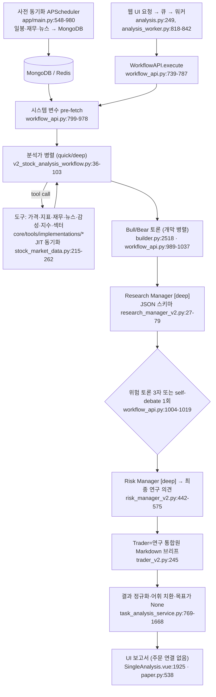

# TradingAgents-CN — 개요

- 분석 SHA: `51060a7682cf51810b4bc3a704829438d18cd8dc` (repos.lock.tsv와 일치)
- 분석일: 2026-10-09
- 관련 공통 항목: Q1~Q7 요약
- 검증 수준 요약: 코드 확인 6 / 추론 0 / 미확인 1

## 1. 메타데이터

| 항목 | 값 | 근거 |
|---|---|---|
| URL | https://github.com/hsliuping/TradingAgents-CN | `trading/repos.lock.tsv` |
| 브랜치 / SHA | `v3.0` / `51060a7682cf51810b4bc3a704829438d18cd8dc` (detached HEAD, 작업 트리 clean) | `git rev-parse HEAD`, `git status --porcelain` 확인 |
| 커밋일 | 2026-09-22 (`feat: TradingAgents-CN v3.0.0 社区版首发`) | `git log -1` |
| 라이선스 | **혼합**. Apache-2.0: `tradingagents/`, `cli/`, `docs/`, `tests/`, `web/`(없음), 루트 설정. source-available(비오픈소스, 평가·교육만): `app/`, `frontend/`, `core/`. `install/`, `config/`, `prompts/`, `skills/`는 열거되지 않음 | `LICENSE:5-20` (코드 확인) |
| 주 언어 | Python(백엔드, `requires-python >=3.10`, `.python-version` 3.10) + Vue 3/TypeScript 프런트엔드 | `pyproject.toml:10`, `frontend/package.json:32`, `:54` |
| 구성 | FastAPI + MongoDB + Redis + APScheduler + LangGraph + Vue 3 | `README.md`, `app/main.py`, `core/workflow/builder.py` |
| 대상 시장 | **중국 A주 중심**(A주 일봉·재무·뉴스·수급·섹터·칩 분포). HK/US는 일부 도구, ETF 전용 흐름 | `core/tools/implementations/market/stock_market_data.py:327-411`, `app/routers/analysis.py:338` |
| 지원 LLM | OpenAI, Anthropic, Google, DeepSeek, DashScope(Qwen), OpenRouter, Qianfan, SiliconFlow, Ollama, Zhipu, Xiaomi, Kimi, AiHubMix(시드 13개) + Volcengine, JDYun, custom_openai(코드) | `install/community_bootstrap.json` → `data.llm_providers`, `tradingagents/graph/trading_graph.py:211-360` |
| 모델 계층 | quick(시장·기본면·뉴스·소셜·칩·bull·bear·trader), deep(연구 매니저·리스크 매니저·위험 3자·대시보드·섹터). 기본 `qwen-turbo`/`qwen-plus` | `core/workflow/builder.py:201-213`, `install/community_bootstrap.json` → `data.system_configs[0].system_settings` |
| 원본 관계 | TradingAgents(TauricResearch) 포크. 본 분석은 원본 `1394a3f7…`과 비교 | `ACKNOWLEDGMENTS.md` |

## 2. 한 줄 정의

TradingAgents-CN v3.0은 원본의 멀티에이전트 토론 구조를 **A주 "연구 보조" 도구**로 바꾼 포크이며, 분석가·토론·위험 심사·요약은 전부 **LLM이** 하고 **코드는 형식·어휘·값 범위만 보정**하며 매수·매도·비중 결정 자체가 없다(`乐观/审慎/中性`).

> **최종 결정은 LLM인가 코드인가**: 최종 판단(낙관/신중/중립 연구 의견·확신도·위험 점수)은 Risk Manager 노드의 LLM JSON 출력이 정하고, 코드는 어휘 치환·범위 보정·기본값 주입·목표가 `None` 고정만 하며 거래 결정은 만들지 않는다. (`core/agents/adapters/risk_manager_v2.py:26-48`, `app/services/task_analysis_service.py:1558-1668`)

## 3. 판단 파이프라인 다이어그램

(상세: [03-decision.md](03-decision.md#4-2-판단-흐름), 데이터: [01-data.md](01-data.md))

## 4. 핵심 발견 5개

1. **운영 경로는 레거시 `TradingAgentsGraph`가 아니라 `WorkflowEngine`+`v2_stock_analysis`다.** 레거시는 서비스 3곳에서 `RuntimeError`로 차단돼 있고 CLI/`main.py`에서만 직접 호출된다. 그래서 GUIDE가 가리킨 `compliance_prompting.py`는 레거시 에이전트에서만 쓰인다. (`app/services/unified_analysis_engine.py:416-444`, `:773-796`, `app/services/simple_analysis_service.py:922-934`, `tradingagents/agents/utils/compliance_prompting.py:96-117`, `main.py:19-22`) — 코드 확인
2. **BUY/SELL을 없앤 것은 프롬프트 + 스키마 enum + 코드 어휘 치환의 3중이다.** 스키마 `Literal["乐观","审慎","中性"]`, 시스템 가드, `买入→乐观` 매핑, `target_price=None` 고정. 그러나 가드끼리 어긋난다(글로벌 가드는 "价格分析区间 허용", 연구 매니저는 금지). 결정 필드가 비면 `中性/0.5` 기본값(fail-open)이다. (`core/agents/adapters/research_manager_v2.py:27-39`, `core/agents/base.py:384-402`, `risk_manager_v2.py:769-780`, `task_analysis_service.py:1585-1597`, `:1666`) — 코드 확인
3. **원본 대비 판단 흐름이 다르다**: 분석가 **병렬 6종+칩**, 투자 토론 **개막 병렬**, Trader가 **위험 판정 뒤** 요약 작성자로 이동, 깊이 4~5에서 위험 3자 토론을 **LLM 1회 self-debate**로 대체, 사후 수익률 채점·`REVIEW` 없음. (`v2_stock_analysis_workflow.py:222-330`, `core/api/workflow_api.py:989-1037`, 원본 `tradingagents/graph/setup.py:164-185`) — 코드 확인
4. **데이터는 "사전 동기화 + 분석 직전 JIT 보충 + 지표 코드 계산" 구조다.** APScheduler가 일봉·재무·뉴스(관심종목)·시세를 MongoDB에 쌓고(`app/main.py:548-980`), 시장 도구가 DB 최신 일자와 거래일 캘린더를 비교해 오래됐으면 별도 스레드에서 최대 120초 동기화한다. MA·RSI·MACD·볼린저는 pandas로 계산하고 방향 결론까지 코드가 확정한다. 안정화 컷오프는 중국 시간 19시. (`stock_market_data.py:215-262`, `tradingagents/dataflows/data_source_manager.py:795-841`, `core/tools/trade_date_policy.py:9-28`) — 코드 확인
5. **문서·설정과 실제 동작의 간극이 곳곳에 있다**: 성장 기억 recall은 소비처가 없고, mem0 recall은 운영 경로에서 호출되지 않으며, 정화 함수 `sanitize_analysis_payload`는 테스트에서만, 기술지표 물화는 스케줄 미등록, 사후 수익률 채점은 없다. DB 템플릿(`看涨/中性/看跌`, 0-100)과 코드 스키마(`乐观/审慎/中性`, 0-1)도 불일치한다. (`core/workflow/engine.py:156-157`, `app/services/unified_analysis_service.py:996-1003`, `app/utils/compliance.py:1128`, `app/core/config.py:278-279`) — 코드 확인. 전체 목록은 [next.md](next.md) "README와 코드가 다른 곳".

## 5. 공통 항목 요약표

| 항목 | 요약 | 문서 |
|---|---|---|
| Q1 데이터 | A주 일봉 OHLCV·MA(5/10/20/60)·RSI(6/12/24/14)·MACD(12,26,9)·볼린저(20,2σ), 재무 4분기·PE/PB/PS·역사 밸류 분위, 북향·신용·상하한가·섹터 자금흐름(Tushare), 칩 분포, 뉴스(DB+AKShare), 소셜(업로드→뉴스 키워드). 코인 데이터와 US Reddit 감성(함수 정의 부재)은 사실상 없음. 정의만 있는 것: 기술지표 물화, `sanitize_analysis_payload`, `get_reddit_sentiment`, 레거시 그래프 | [01-data.md](01-data.md#q1) |
| Q2 수집 | MongoDB 우선 → Tushare/AKShare/BaoStock 폴백(DB 설정, 숫자 큰 쪽이 우선). 가격·뉴스·감성은 LLM tool call(1라운드), 기본면은 pre-fetch+tool call, 지표는 코드 계산(LLM 재계산 금지). look-ahead 차단은 약함(안정화 컷오프, 현재가 `<= 유효일`만) | [01-data.md](01-data.md#q2) |
| Q3 스케줄 | 수동(웹→Redis 큐→워커) 중심, 정기 분석은 기본 꺼짐. APScheduler가 장 마감 후(18~19시) 일봉·재무, 6분 시세, 2시간 뉴스(관심종목), 18:30 거래일 캘린더. 분석 직전 JIT 보충(최대 120초) | [02-schedule.md](02-schedule.md#q3) |
| Q4 판단 | 분석가 병렬 → bull/bear 토론 → 연구 매니저(JSON) → 위험 3자(또는 self-debate) → 리스크 매니저(JSON, 최종 의견) → Trader(Markdown 브리프). 결정은 LLM, 코드는 보정만. 호출 약 15~27회/종목, 사후 수익률 채점 없음 | [03-decision.md](03-decision.md) |
| Q5 리서치 | 종목 분석에는 자유 웹 검색 없음(고정 도구). 어시스턴트는 LLM 계획/ReAct + SearXNG·바이두·DashScope 검색·`fetch_url`, 숫자 출처 4중 방어선, 사실 기억(유효기간)이 분석 프롬프트로 환류 | [04-research.md](04-research.md) |
| Q6 경계 | 판단→주문 변환 코드 없음. 모의투자 주문은 사용자 직접 입력, `analysis_id` 링크만. AI 하드 리스크 한도·킬스위치 없음. 어시스턴트 상태 변경 도구만 HITL 확인 | [05-boundary-and-fit.md](05-boundary-and-fit.md#q6) |
| Q7 적용(의견) | 가져갈 것: 결정적 지표 계산, 스키마 계약+검증, JIT+컷오프, 관심종목 한정 동기화, 숫자 출처 방어선, self-debate 비용 절감. 버릴 것: 컴플라이언스 치환, fail-open 중립, 수익률 비채점, Mongo 프롬프트 DB. 코드 재사용은 Apache 영역(`tradingagents/`)만 가능, `app/`·`core/`는 아이디어만 | [05-boundary-and-fit.md](05-boundary-and-fit.md#q7) |

## 6. 이 폴더의 문서

- [01-data.md](01-data.md) — Q1 데이터 인벤토리, Q2 수집 방식
- [02-schedule.md](02-schedule.md) — Q3 스케줄·신선도
- [03-decision.md](03-decision.md) — Q4 판단(원본 대비 차이 포함)
- [04-research.md](04-research.md) — Q5 리서치
- [05-boundary-and-fit.md](05-boundary-and-fit.md) — Q6 경계, Q7 적용 의견
- [next.md](next.md) — 범위, 미확인, 다음에 볼 파일, README 불일치

SHA 고정 링크 예: https://github.com/hsliuping/TradingAgents-CN/blob/51060a7682cf51810b4bc3a704829438d18cd8dc/core/workflow/templates/v2_stock_analysis_workflow.py#L17-L331
