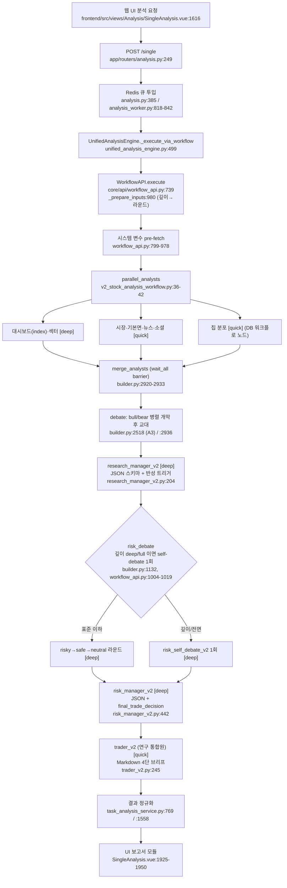

# TradingAgents-CN — AI 판단: 어떻게 결정하는가 (Q4)

- 분석 SHA: `51060a7682cf51810b4bc3a704829438d18cd8dc` (repos.lock.tsv와 일치)
- 분석일: 2026-10-09
- 관련 공통 항목: Q4 (원본 대비 차이는 4-2의 "원본 TradingAgents와의 차이" 절)
- 검증 수준 요약: 코드 확인 57 / 추론 6 / 미확인 1

> 영역 표기: [A] Apache-2.0(`tradingagents/` 등), [S] source-available(`app/`, `core/`), [?] LICENSE 미열거(`install/` 등).
> 프롬프트 위치 표기: 프롬프트 본문은 코드가 아니라 DB 시드에 있다. `install/community_bootstrap.json`은 한 줄 JSON이므로 줄번호 대신 키 경로로 적는다(GUIDE 3.2). 키 경로의 약칭 `PT[...]` = `data.prompt_templates[agent_type=…, agent_name=…, template_name=…].content.<필드>`.
> 이 문서가 다루는 경로는 운영 경로 `v2_stock_analysis`(WorkflowEngine)다. 레거시 `TradingAgentsGraph`는 서비스에서 차단돼 있다(01-data.md 1-2).

## 한 문장 답: 최종 결정은 LLM인가 코드인가

**최종 판단("낙관/신중/중립" 연구 의견과 확신도·위험 점수)은 전적으로 LLM(Risk Manager 노드의 JSON 출력)이 정하고, 코드는 어휘 정규화·값 범위 보정·기본값 주입·스키마 검증만 한다. 이 프로젝트에는 매수/매도/비중을 정하는 결정이 애초에 없다(연구 보조 도구라서 BUY/SELL/HOLD 자체를 `乐观/审慎/中性`으로 치환하고 목표가는 코드가 `None`으로 고정한다).** (코드 확인: `core/agents/adapters/risk_manager_v2.py:26-48`, `app/services/task_analysis_service.py:1558-1668`)

## 4-1. 입력 조립

| 항목 | 내용 | 위치 | 검증 |
|---|---|---|---|
| 프롬프트 6분할 | 템플릿은 `system_prompt`, `tool_guidance`, `analysis_requirements`, `output_format`, `constraints`, `user_prompt` 6개 필드. 앞 5개가 합쳐져 SystemMessage, `user_prompt`가 HumanMessage | `install/community_bootstrap.json` → `PT[...]`, `core/agents/manager.py:201-215`(합쳐진 주석) | 코드 확인 |
| 템플릿 선택 우선순위 | 디버그 템플릿 > (workflow_id+node_id) 노드 전용 > workflow 전용 > 사용자 설정 > 사용자 **위험 성향**(`aggressive/neutral/conservative`) 시스템 템플릿 > `neutral` 기본 | `tradingagents/utils/template_client.py:48-75`, `:195-260`, `:318-360` [A] | 코드 확인 |
| 변수 | `{ticker} {company_name} {market_name} {analysis_date} {currency_*} {current_price}` + 업스트림 보고서 `{market_report} {sentiment_report} {news_report} {fundamentals_report} {bull_report} {bear_report} {investment_plan} …` | 각 어댑터 `_build_user_prompt` (예: `research_manager_v2.py:507-711`) [S] | 코드 확인 |
| 동적 확장 자료 | `{analyst_reports} {research_reports} {risk_reports}`. 같은 단계(stage)의 에이전트 출력을 `### 라벨\n\n본문`으로 이어 붙임. **길이 제한·자르기 없음** | `core/workflow/stage_aggregator.py:102-140`, `core/agents/base.py:1525-1530` [S] | 코드 확인 |
| 토론 요약 | `debate_summary`는 LLM이 아니라 코드가 `value['content'][:200]`을 이어 붙인 것 | `core/agents/manager.py:384-410` [S] | 코드 확인 |
| 업종·종목 분석 차원 | 업종이 알려지면 DB의 "분석 차원" 블록을 프롬프트 끝에 덧붙임 | `core/agents/base.py:1603-1612` | 코드 확인 |
| 지식형 Skill | 에이전트에 바인딩된 knowledge Skill 본문을 덧붙임 | `core/agents/base.py:1614-1620` | 코드 확인 |
| 외부 사실 기억 | `memory_facts_summary`는 **bull/bear/risk_manager의 user 프롬프트에만** 붙음(화이트리스트) | `core/agents/base.py:46`, `:1624-1633` | 코드 확인 |
| 품질 힌트 | 분석가 품질 게이트에 걸린 보고서는 연구원 프롬프트에 "质量提示"가 앞에 붙음 | `core/agents/researcher.py:164-170`, `:284-324` | 코드 확인 |
| 글로벌 가드 | 모든 system 프롬프트 끝에 "【合规防护·必须遵守】" 블록을 코드가 덧붙임 | `core/agents/base.py:384-402`, 호출 `analyst.py:162`, `researcher.py:180`, `manager.py:189`, `trader.py:128` | 코드 확인 |
| 스키마 계약 | 연구 매니저·리스크 매니저는 JSON 스키마 계약을 system 프롬프트 **맨 앞**에 코드로 접두 | `research_manager_v2.py:465`, `risk_manager_v2.py:54-94` | 코드 확인 |

원문(글로벌 가드, `core/agents/base.py:392-401`):

> "1. 禁止输出具体买卖指令（如"买入""卖出""加仓""减仓""持有""清仓"），统一使用合规术语：乐观 / 审慎 / 中性 表达研究结论倾向。"
> 번역: "구체적 매수·매도 지시(예: 매수, 매도, 증액, 감액, 보유, 청산)는 출력하지 말고, 연구 결론의 경향은 컴플라이언스 용어인 낙관 / 신중 / 중립으로 통일해 표현하라."

> "2. 禁止给出具体目标价或风险关注价格，可输出"价格分析区间"并标注不确定性。"
> 번역: "구체적 목표가나 위험 관심 가격은 주지 말고, '가격 분석 구간'은 불확실성을 표기하여 출력해도 된다."

주의: 위 2번은 "가격 분석 구간은 허용"이지만, 연구 매니저·bull·bear 프롬프트는 "价格区间… 不得输出"로 금지한다. 계층마다 규칙이 어긋난다(아래 4-3 모순 표 참고).

## 4-2. 판단 흐름

### 4-2-a. 운영 경로 흐름도 (노드마다 코드 위치)

- 흐름의 정의: `core/workflow/templates/v2_stock_analysis_workflow.py:17-331`(코드 템플릿)과 부트스트랩 DB 워크플로 `data.workflows[id=6ede3bc3-66e3-4204-a304-dcbe8b327258]`(실제 `is_default=True`). 둘은 노드 순서가 같지만 DB 쪽에 `chip_distribution_analyst_v2`와 `valuation_analyst_v1` 노드가 추가돼 있다(코드 확인). 운영에서 어느 것이 선택되는지는 `_resolve_workflow_id`의 4단계 우선순위(작업 지정 > 사용자 기본 > 레지스트리 > 하드코딩, `unified_analysis_engine.py:66-130`)에 따르므로 사용자 설정에 달렸다.
- 분석가는 **병렬**(`NodeType.PARALLEL` → 각 분석가 → `MERGE` barrier, `builder.py:2683-2687`, `:2920-2933`), 토론은 **순차 교대**(개막 라운드만 병렬, A3), 위험 토론은 **순차**(risky→safe→neutral) 또는 단일 self-debate.
- 기본 UI는 분석가 2명(`市场分析师`, `基本面分析师`)이 선택돼 있고 사용자 선호에서 불러온다(`SingleAnalysis.vue:1021`). 선택되지 않은 분석가 노드는 빌더가 그래프에서 제거한다(`core/workflow/builder.py:1187-1254`). 단, `chip_distribution_analyst_v2`는 `ANALYST_ID_TO_TYPE`에 없어서 항상 남는다(`builder.py:918-932`, "未知类型的分析师，保留" `:1034`). (코드 확인)
- Trader가 **리스크 판정 뒤**에 온다. 원본은 `Research Manager → Trader → 위험 토론 → 결정자`(`TradingAgents/tradingagents/graph/setup.py:175-176`)이고, CN v2는 `Research Manager → 위험 토론 → Risk Manager → Trader`(`v2_stock_analysis_workflow.py:277`, `:324-330`)다. Trader는 "거래"가 아니라 사용자용 요약문 작성자로 재정의됐다.

### 4-2-b. 깊이별 라운드 매핑과 모델 계층

| 깊이 | 투자 토론 라운드 | 위험 토론 라운드 | 위험 토론 방식 | 메모리 | 근거 |
|---|---|---|---|---|---|
| 快速 | 1 | 1 | 3자 1라운드 | 끔 | `core/api/workflow_api.py:989-995`, `app/services/unified_analysis_service.py:317-323`(메모리 플래그), `install/community_bootstrap.json` → `data.workflows[id=default_analysis].config.depth_rounds_mapping` |
| 基础 | 1 | 1 | 3자 1라운드 | 켬 | 동일 |
| 标准(기본) | 1 | 2 | 3자 2라운드 | 켬 | 동일 |
| 深度 | 2 | 2 | **self-debate 1회**(`RISK_SELF_DEBATE=auto`) | 켬 | `workflow_api.py:1004-1019` |
| 全面 | 3 | 3 | **self-debate 1회** | 켬 | 동일 |

- 종료 조건: 참가자 수 × 라운드(`max_count = dynamic_rounds * num_participants`, `builder.py:2809`, `:2973`). 투자 토론 참가자 2명, 위험 토론 3명.
- 투자 토론 첫 라운드는 `_parallel_opening`이 기본 켜져 있어 bull/bear가 같은 분석가 자료로 **동시에** 개막한다(`workflow_api.py:1021-1037`, `builder.py:2518-2586`). 환경변수 `RESEARCH_PARALLEL_OPENING=off`로 끌 수 있다.
- 깊이 → 추론 예산: `RESEARCH_DEPTH_REASONING_EFFORT`를 `legacy_config["depth_reasoning_effort"]`로 전달하지만 "仅火山方舟推理模型注入"(`unified_analysis_engine.py:666-678`). (코드 확인)
- quick/deep 분배: **deep** = `research_manager_v2`, `risk_manager_v2`, `risky/safe/neutral_analyst_v2`, `risk_self_debate_v2`, `index_analyst_v2`, `sector_analyst_v2`. 나머지(시장·기본면·뉴스·소셜·칩·bull·bear·trader)는 **quick** (`core/workflow/builder.py:201-213`, 코드 확인). 기본 모델은 부트스트랩 `quick_analysis_model=qwen-turbo`, `deep_analysis_model=qwen-plus`(`install/community_bootstrap.json` → `data.system_configs[0].system_settings`).
- 분석가 도구 루프: 도구 호출 1라운드 후 **도구 없이** 보고서 작성(`core/agents/base.py:729-760`, `:925-996`). 레거시의 `should_continue_*` 3회 제한(`tradingagents/graph/conditional_logic.py:28`, `:149`(기본면은 1회), `:213`/`:249`(대시보드·섹터 2회))과는 다른 구조다.

### 4-2-c. 원본 TradingAgents와의 차이 (GUIDE 5절 중점)

원본은 `repos/TradingAgents`(SHA `1394a3f72aa4393e1a98f51b382434c4b4c2d972`)의 읽기 전용 확인이다. 중요한 전제: CN의 **레거시 그래프**(`tradingagents/graph/*`)는 원본의 옛 버전에서 갈라진 것으로 보이며, 현재 원본 main과 구조가 많이 다르다(추론: 원본 main의 `Portfolio Manager`, `REVIEW`, 병렬 분석가는 CN에 없음. 분기 시점의 정확한 버전은 확인 못함).

| 항목 | 원본 main | CN 레거시(`tradingagents/graph`, [A]) | CN 운영 v2(`core/workflow`, [S]) | 근거 |
|---|---|---|---|---|
| 분석가 실행 | 병렬 + 메모리 로그 노드 병렬 | 순차(`selected_analysts` 순서대로 연결) | **병렬 + MERGE barrier** | 원본 `graph/setup.py:164-166`, CN `graph/setup.py:285-316`, v2 템플릿 `:222-238` |
| 분석가 구성 | 시장·소셜(sentiment)·뉴스·펀더멘털 4종 | 4종 + `index_analyst`, `sector_analyst`(도구 없는 자기완결형) | 대시보드·섹터·시장·기본면·뉴스·소셜 **6종 + 칩 분포** | CN `graph/setup.py:56-63`, `:215-232`, v2 템플릿 `:35-94` |
| 도구 호출 상한 | `max_tool_rounds=20` | 분석가별 3회(기본면 1, 대시보드/섹터 2) | 1라운드 후 도구 없이 보고서 | 원본 `default_config.py:137`, CN `conditional_logic.py:28`, `base.py:925-996` |
| 투자 토론 | Bull↔Bear, `max_debate_rounds=1` | 동일 구조, `2*rounds` | 동일 + 첫 라운드 병렬 개막 | 원본 `default_config.py:133`, CN `conditional_logic.py:276`, `builder.py:2518` |
| 토론 후 | `Research Manager → Trader → Aggressive/Neutral/Conservative → Portfolio Manager` | `Research Manager → Trader → Risky/Safe/Neutral → Risk Judge` | `Research Manager → Risk 토론 → Risk Manager → Trader` | 원본 `setup.py:175-185`, CN `setup.py:335-362`, v2 `:277-330` |
| 최종 등급 | 5단계 `Buy/Overweight/Hold/Underweight/Sell` + 해독 불가 시 `REVIEW` | `买入/持有/卖出` + 목표가(`SignalProcessor`) | **`乐观/审慎/中性`**, 목표가 `None`, `REVIEW` 없음 | 원본 `agents/rating.py:22-30`, CN `signal_processing.py:20-336`, `risk_manager_v2.py:26-48` |
| 위험 토론 비용 절감 | 없음 | 없음 | 깊이/전면에서 3자 토론을 **LLM 1회 self-debate**로 대체 | `workflow_api.py:1004-1019`, `risk_self_debate_v2.py:1-15` |
| 메모리·사후 채점 | 결정 로그에 저장 → 5거래일(`holding_period_days=5`) 후 벤치마크 대비 알파로 채점·교훈 | Chroma 유사 사례(`reflect_and_remember`, 호출처 없음) | 수익률 **비채점**. 분석 텍스트·토론에서 LLM이 교훈을 뽑는다 | 원본 `default_config.py:172-180`, `memory/settlement.py:1-12`, CN `reflection_prompts.py:3-5`, `trading_graph.py:1716` |
| 컴플라이언스 | 없음 | `compliance_prompting.py`로 역할별 금지·출력 구조 오버레이 | v2 프롬프트 자체가 연구 전용 + 코드 용어 치환·정규식 정화 | CN `agents/utils/compliance_prompting.py:8-127`, 시장 분석 `market_analyst_v2.py:21-65` |
| 데이터 | yfinance, alpha_vantage, sec_edgar 등 벤더 라우터 | Tushare/AKShare/BaoStock + 일부 US | MongoDB 선적재 + JIT + 도구 래퍼, A주 중심 | 원본 `default_config.py:158-170`, CN 01-data.md |

`compliance_prompting.py`는 **레거시 에이전트**(`tradingagents/agents/researchers/*`, `trader/trader.py`, `managers/research_manager.py`)만 import한다(`grep -rn compliance_prompting` 결과). 운영 v2 경로는 이 파일을 쓰지 않고 DB 템플릿 + `base.py` 글로벌 가드 + 어댑터별 상수(`TRADER_COMPLIANCE_PROMPT`, 스키마 프롬프트)를 쓴다 (코드 확인).

## 4-3. 결정 기준

### 4-3-a. 판단 규칙 표

| 규칙 | 원문 인용 | 번역 | 위치 |
|---|---|---|---|
| 연구 매니저: 균형 심사 | "应先按双方最强论点等权审阅，再根据证据质量决定当前倾向，不预设结论。" | "양측의 가장 강한 논점을 동등 비중으로 먼저 심사한 뒤, 증거의 질로 현재 경향을 정하고 결론을 미리 정해 두지 마라." | `PT[managers_v2, research_manager_v2, "研究经理 v2.0 - Neutral v2.0 - 动态流程版"].system_prompt` |
| 연구 매니저: 매매 용어 금지 | "只输出研究判断，不输出买入、卖出、持有、加减仓、仓位比例、目标价、止损止盈或执行节奏。" | "연구 판단만 출력하고 매수·매도·보유·증감, 비중, 목표가, 손절·익절, 실행 타이밍은 출력하지 마라." | 동일 키 |
| 연구 매니저: 재료 누락 시 강등 | "如果看涨观点、看跌观点、辩论总结缺失、超时或仅返回错误说明，必须把结论降级为‘材料未提供/仍待验证’，不得继续拼装成完整研究判断。" | "강세/약세 의견이나 토론 요약이 없거나 시간 초과·오류 메시지뿐이면 결론을 '자료 미제공/검증 필요'로 강등하고, 완결된 연구 판단처럼 조립하지 마라." | 동일 키 |
| 연구 매니저: 수치 충돌 | "必须直接点明‘工具结果口径不一致’，并降低结论强度，不得自行挑选其一继续输出确定性判断。" | "'도구 결과 기준 불일치'를 직접 밝히고 결론 강도를 낮추며, 한쪽을 임의로 골라 확정적 판단을 이어가지 마라." | 동일 키 |
| 연구 매니저: 값 일관성 | "`confidence`、`risk_score` 与最终 `analysis_view` 必须相互一致，不要出现判断强烈但风险和置信度明显矛盾的写法。" | "`confidence`, `risk_score`, 최종 `analysis_view`는 서로 일관돼야 한다. 판단이 강한데 위험·확신도가 뚜렷이 모순되면 안 된다." | 동일 키 `.analysis_requirements` |
| 연구 매니저(코드 계약): 어휘 | "analysis_view 字段只能取值 "乐观" / "审慎" / "中性"。" | "`analysis_view`는 '낙관/신중/중립' 중 하나만 가능하다." | `core/agents/adapters/research_manager_v2.py:62-63` |
| 연구 매니저(코드 계약): 척도 | "confidence: 0-1 之间的浮点数（不要写 0-100）" | "확신도는 0~1 실수(0~100으로 쓰지 마라)." | `research_manager_v2.py:71` |
| 리스크 매니저: 위험 비교 | "你的任务不是平均拼接三方观点，而是判断当前哪类风险已足以限制研究结论，哪类风险仍停留在待验证阶段。" | "세 관점을 평균내 이어 붙이지 말고, 지금 어떤 위험이 연구 결론을 제한하기에 충분한지, 어떤 위험이 아직 검증 단계인지 판단하라." | `PT[managers_v2, risk_manager_v2, "风险管理者 v2.0 - Neutral v2.0 - 动态流程版"].system_prompt` |
| 리스크 매니저: 점수·등급 일치 | "`risk_score` 必须与 `risk_level` 保持一致，不要出现‘高风险但分数很低’之类的自相矛盾。" | "`risk_score`는 `risk_level`과 일관돼야 하며 '고위험인데 점수는 낮음' 같은 자기모순을 내지 마라." | 동일 키 `.analysis_requirements` |
| 리스크 매니저: 필드명 의미 | "`final_trade_decision` 只是兼容字段名，其语义必须是“风险审阅后的综合研究结论”，不是交易决策。" | "`final_trade_decision`은 호환용 필드명일 뿐이며 의미는 '위험 심사 뒤의 종합 연구 결론'이지 거래 결정이 아니다." | 동일 키 `.output_format` |
| 리스크 매니저(코드 계약): 어휘 | "investment_adjustment 与 action 字段只能取值 "乐观" / "审慎" / "中性"。" | "`investment_adjustment`와 `action`은 '낙관/신중/중립'만 가능하다." | `core/agents/adapters/risk_manager_v2.py:77` |
| Trader(연구 통합원) | "用户版简报的目标是帮助用户在 30 秒内理解‘当前怎么看、为什么这么看、为什么现在不能更强’。" | "사용자용 브리프의 목표는 30초 안에 '지금 어떻게 보는지, 왜 그렇게 보는지, 왜 지금은 더 강하게 못 말하는지'를 이해시키는 것이다." | `PT[trader_v2, trader_v2, "研究整合员 v2.0 - Neutral v2.0 - 动态流程版"].system_prompt` |
| Trader(코드 계약) | "禁止使用 "看涨" / "看跌" / "买入" / "卖出" / "加仓" / "减仓" / "持有" / "清仓" 等交易指令或市场观点术语。" | "'강세/약세/매수/매도/증액/감액/보유/청산' 등 거래 지시·시장 관점 용어를 쓰지 마라." | `core/agents/adapters/trader_v2.py:31` |
| 시장 분석가: 데이터 한정 | "只能使用工具返回的真实价格、技术指标与成交数据进行分析，不得使用模型自身记忆、常识补全、训练语料印象或未在工具结果中出现的数据做判断。" | "도구가 반환한 실제 가격·기술지표·거래 데이터만으로 분석하고, 모델 기억·상식 보충·학습 인상·도구 결과에 없는 데이터로 판단하지 마라." | `PT[analysts_v2, market_analyst_v2, "市场分析师 v2.0 - 中性型"].system_prompt` |
| 시장 분석가: 시계열 한계 | "若工具结果只提供当前值、最近5日统计或单次快照，不得写“持续放大”“继续扩大”“连续多个交易日”…" | "도구가 현재값·최근 5일 통계·단일 스냅샷만 주면 '계속 확대', '연속 여러 거래일' 같은 더 긴 시계열이 필요한 표현을 쓰지 마라." | 동일 키 |
| 시장 분석가: 금지어 자가검사 | "输出前必须做一次逐词自检：最终报告中不得出现“站上”“站稳”“有效突破”…“上行空间”这些原词；若出现，必须全部改写后再输出。" | "출력 전 단어 단위 자가검사를 해서 '안착', '유효 돌파', '상승 여력' 등 원어가 있으면 모두 바꿔 쓴 뒤 출력하라." | 동일 키, 코드 보강 `market_analyst_v2.py:21-65`, `:468-479` |
| Bull 연구원 | "不得输出收益空间、回撤幅度、概率数值、风险收益比。" | "수익 여력, 낙폭, 확률 수치, 손익비를 출력하지 마라." | `PT[researchers_v2, bull_researcher_v2, "看多研究员 v2.0 - 中性型 - 动态流程版"].system_prompt` |
| Risky 위험 분석가 | "不得自行设定利润恢复区间、同比增速门槛、bp 变化阈值、行业均值阈值或其他数值条件；若材料未明确给出，只能写成定性验证条件。" | "이익 회복 구간, 전년 대비 증가율 문턱, bp 변화 임계, 업종 평균 임계 등 수치 조건을 스스로 정하지 말고, 자료에 없으면 정성적 검증 조건으로만 써라." | `PT[debators_v2, risky_analyst_v2, "激进风险分析师 v2.0 - Neutral v2.0 - 动态流程版"].system_prompt` |
| 데이터 결측 처리(전 에이전트 공통 `constraints`) | "绝对禁止编造：严禁在没有数据的情况下编造、假设或推测任何维度的分析内容" | "절대 지어내지 마라: 데이터가 없는 차원의 분석을 만들거나 가정·추측하는 것을 엄금한다." | 각 PT `.constraints` |

### 4-3-b. 규칙끼리 어긋나는 곳 (기록)

| 충돌 | 내용 | 위치 | 검증 |
|---|---|---|---|
| 가격 구간 | 글로벌 가드는 "价格分析区间 허용"인데, 연구 매니저·bull·bear 프롬프트는 "价格区间 금지". 리스크 매니저 스키마·결과 포매터는 `price_analysis_range`, `risk_reference_price`, `risk_exposure_ratio`를 계속 허용·표시 | `base.py:398`, `risk_manager_v2.py:31-33`, `:62-72`, `:838-848`, `task_analysis_service.py:1001-1013` | 코드 확인 |
| 척도·어휘(DB vs 코드) | 리스크 매니저 DB 템플릿은 `analysis_view: "看涨|中性|看跌"`, `confidence: 0-100`, 필드 `analysis_view`. 코드 스키마는 `action: 乐观|审慎|中性`, `confidence: 0-1`. 코드가 스키마 프롬프트를 앞에 붙이고, 검증 실패 시 `_extract_final_trade_decision`이 `看涨→乐观`, `confidence>1 → /100`으로 보정해 둘을 흡수한다 | `PT[managers_v2, risk_manager_v2, …].output_format`, `risk_manager_v2.py:54-94`, `:638-767` | 코드 확인 |
| 위험 등급 임계 | 같은 `risk_score`를 `<0.3 저 / <0.6 중 / 그 외 고`(운영) 또는 `>=0.7 고 / >=0.4 중`(`report_formatter`)로 나눈다. 운영 결과는 앞쪽 | `task_analysis_service.py:1459-1465` vs `app/utils/report_formatter.py:1163-1178` | 코드 확인 |
| 용어 사전 | 레거시 `SignalProcessor`는 여전히 `买入/持有/卖出`+목표가를 뽑는다(결정 필드가 비었을 때 `format_decision`이 이 경로를 호출) 그리고 코드가 사후에 `乐观/审慎/中性`으로 번역 | `signal_processing.py:20-110`, `app/utils/report_formatter.py:819-905`, `:784-789` | 코드 확인 |

### 4-3-c. 숫자 임계값·공식 (코드에 박힌 것)

| 값 | 용도 | 위치 | 검증 |
|---|---|---|---|
| 깊이별 라운드 `{快速:1/1, 基础:1/1, 标准:1/2, 深度:2/2, 全面:3/3}` | 토론 상한 | `core/api/workflow_api.py:989-995` | 코드 확인 |
| 토론 종료 `count >= rounds × 참가자 수` | 토론 라우팅 | `builder.py:2809`, `:2973` | 코드 확인 |
| MA 기울기 임계 `±0.02 %/일`, 최근 5일 폴리핏 | MA 방향 "상행/하행/평탄" 판정(도구가 결정적으로 계산) | `tradingagents/dataflows/data_source_manager.py:866-880` | 코드 확인 |
| 시장 분석 회귀 `60일` | 지표 계산용 조회폭 | `app/core/config.py:326`, `interface.py:1553-1564` | 코드 확인 |
| 품질 게이트 `MIN_REPORT_LENGTH=50`, 결론 키워드 없음 = warning, 길이/블랙리스트 = critical(1회 재시도) | 분석가 보고서 | `core/agents/quality_gate.py:42-112` | 코드 확인 |
| 메모리 유사도 `> 0.7`, `n_results=3`, 교훈 `limit=3`, `max_chars=1500` | 연구원 과거 경험 | `core/agents/researcher.py:850-880` | 코드 확인 |
| 뉴스 관련도 점수(심볼 제목 +90, 회사명 +70, 이벤트 키워드 +18 등), 고신뢰 임계 85 | 뉴스 후보 정렬 | `core/tools/implementations/news/stock_news.py:519-592`, `:157` | 코드 확인 |
| 신뢰도 정규화 `confidence>1 → ÷100` | 결과 | `task_analysis_service.py:1611-1614`, `risk_manager_v2.py:673-676` | 코드 확인 |
| 단일 값 가격 구간 → `±5 %` 구간 변환 | 결과 | `task_analysis_service.py:1644-1648` | 코드 확인 |
| 기본값 `confidence=0.5`, `risk_score=0.5`, `risk_exposure_ratio="5%"` | 결측 시 코드 주입 | `risk_manager_v2.py:769-780`, `:756`, `task_analysis_service.py:1006`, `:1623`, `:1076-1083` | 코드 확인 |
| 위험 등급 `<0.3 저, <0.6 중, 그 외 고` | 결과 `risk_level` | `task_analysis_service.py:1459-1465` | 코드 확인 |

→ 비중·손절·진입가 같은 거래 수치는 없다. 그나마 `risk_exposure_ratio="5%"`는 LLM이 비웠을 때 코드가 넣는 **고정 문자열**이다(표시용 항목이며 주문에 연결되지 않음, Q6 참고).

### 4-3-d. 페르소나(위험 성향)별 차이

- 사용자 위험 성향 `aggressive/neutral/conservative`가 DB 템플릿을 고르는 키다(`analysis.py:346`, `template_client.py:318-360`).
- 차이는 "**분석 스타일**" 한 줄뿐이고 나머지 규칙은 동일하다. 연구 매니저 예: 중립 "平衡看多与看空证据，不放大单边叙事"(균형, 단일 서사 확대 금지) / 공격 "更敏感地识别上行催化与预期差"(상승 촉매와 기대 차이에 더 민감) / 보수 "更重视证据不足、判断脆弱点与下行风险"(증거 부족·취약점·하방 위험 중시) (`PT[managers_v2, research_manager_v2, …Aggressive/Conservative…].system_prompt`, 코드 확인).
- 위험 분석가 3인은 **역할**(high-elasticity / defensive / baseline)이고 위의 사용자 성향과는 별개다 (`v2_stock_analysis_workflow.py:164-189`).

## 4-4. 출력 형식

### 4-4-a. 출력 스키마 표

| 필드 | 타입 | 값 범위 | 설명 | 위치 |
|---|---|---|---|---|
| **ResearchManagerOutput** `analysis_view` | enum | `乐观`/`审慎`/`中性` | 연구 의견 경향 | `research_manager_v2.py:30` |
| 〃 `confidence` | float | 0~1 (`Field(ge=0, le=1)`) | 확신도 | `:31` |
| 〃 `risk_score` | float | 0~1 | 위험 점수 | `:32` |
| 〃 `summary`, `reasoning` | str | 50~120자 / 200~500자(프롬프트) | 결론 요약·근거 | `:33-34`, 프롬프트 `:52-53` |
| 〃 `core_evidence`, `uncertainties`, `invalidation_conditions`, `watch_items` | list[str] | 2~5개 권장 | 핵심 근거·불확실성·무효 조건·관찰 항목 | `:35-38` |
| 〃 `risk_warning` | str | ≤100자 | 위험 경고 | `:39` |
| **RiskAssessmentOutput** `risk_level` | enum | `低`/`中`/`高` | 위험 등급 | `risk_manager_v2.py:40` |
| 〃 `risk_score` | float | 0~1 | | `:41` |
| 〃 `investment_adjustment` | enum | `乐观`/`审慎`/`中性` | 판단 조정 방향 | `:47` |
| 〃 `key_risks`, `risk_control`, `reasoning` | list/str/str | — | 핵심 위험, "연구 신중도" 문구 | `:42-45` |
| 〃 `final_trade_decision` | `FinalTradeDecision` | 아래 | 호환 필드명. 의미는 종합 연구 결론 | `:48` |
| **FinalTradeDecision** `action` | enum | `乐观`/`审慎`/`中性` | **최종 연구 의견** | `:29` |
| 〃 `confidence` | float | 0~1 | **최종 확신도** | `:30` |
| 〃 `price_analysis_range`, `risk_reference_price`, `risk_exposure_ratio` | Optional[str] | null 허용 | 가격 구간·위험 참고가·위험 노출 서술 | `:31-33` |
| 〃 `reasoning`, `summary`, `risk_warning` | str | — | | `:34-36` |
| **최종 `decision` dict**(UI로 가는 것) `action`/`analysis_view` | str | `乐观/审慎/中性`(+원어 보정) | 코드가 어휘를 정규화 | `task_analysis_service.py:1585-1597`, `:1656-1668` |
| 〃 `confidence` | float | 0~1 (`>1`이면 ÷100) | | `:1611-1614` |
| 〃 `risk_score` | float | 0~1, 기본 0.5 | | `:1617-1625` |
| 〃 `target_price` | None 고정 | — | "不提供具体价格（合规要求）" | `:1666` |
| 〃 `price_analysis_range` | `[min,max]` 또는 None | 단일 값은 ±5 % 구간으로 변환 | | `:1629-1655` |
| 상위 결과 `recommendation` | str | 코드가 "分析观点：{action}；分析依据：…" 조립 | LLM 출력이 아님 | `task_analysis_service.py:1426-1448` |
| 상위 결과 `risk_level` | str | `低/中等/高` | | `:1459-1465` |
| **Trader 출력** | Markdown | 6개 제목 `## 一句话结论`, `## 为什么这么看`, `## 当前判断的限制`, `## 后续关注`, `## 资料边界说明`, `## 免责声明` | 사용자용 브리프, 500~800자 | `trader_v2.py:40-56`, DB `PT[trader_v2…].analysis_requirements` |

등급 체계: `乐观 / 审慎 / 中性` 3단계. 원본의 `Buy/Overweight/Hold/Underweight/Sell`, CN 레거시의 `买入/持有/卖出`을 대체한다. 진입가·손절가·목표가·비중은 **출력 스키마에 없다**(가격 구간 문자열과 `risk_exposure_ratio` 문자열만 선택 필드로 남음).

## 4-5. 최종 결정이 만들어지는 방식

| 구분 | 누가 | 내용 | 위치 | 검증 |
|---|---|---|---|---|
| 의견 라벨·확신도·위험 점수 | **LLM** (`risk_manager_v2`, deep 모델) | 연구 매니저의 의견(`investment_plan`)과 위험 3자 의견을 받아 `RiskAssessmentOutput` JSON 작성 | `risk_manager_v2.py:442-575`, 프롬프트 `PT[managers_v2, risk_manager_v2, …]` | 코드 확인 |
| 스키마 검증 | 코드(pydantic) | enum·범위 위반이면 `validation_status="failed"` + 원문 유지(차단·기권하지 않음) | `risk_manager_v2.py:481-503`, `:586-624` | 코드 확인 |
| 규칙 기반 단언 | 코드 | `agent_assertions` 컬렉션에서 단언을 로드해 용어 금지·필드 범위·정규식·섹션 필수를 검사. error 위반이면 상태를 `failed`로 표시만 한다. 시드에 단언이 없어 기본은 비어 있다 | `core/agents/assertion_executor.py:67-440`, `risk_manager_v2.py:496-520`, `app/core/config.py:178-181` | 코드 확인(시드 비어 있음은 추론: 부트스트랩 컬렉션 목록에 `agent_assertions`가 없음) |
| 어휘 치환 | 코드 | `买入→乐观`, `卖出→审慎`, `持有→中性`, `看涨→乐观`, `看跌→审慎`, `BUY/SELL/HOLD` 동일 | `risk_manager_v2.py:708-731`, `task_analysis_service.py:1585-1597`, `report_formatter.py:784-789` | 코드 확인 |
| 범위 보정·기본값 | 코드 | 4-3-c 표 | 위 | 코드 확인 |
| 가격 강제 제거 | 코드 | `target_price=None` | `task_analysis_service.py:1666` | 코드 확인 |
| 문구 필터 | 코드 | key_points에서 `买入/卖出/目标价/止损/止盈/仓位` 포함 문장 제외 | `task_analysis_service.py:1494-1504` | 코드 확인 |
| 신호 합산 | 없음(가중평균·다수결 없음) | 분석가 7개 보고서는 연구원이 읽고, 연구 매니저가 **LLM 한 번**으로 합친다. 분석가별 가중치를 수치로 곱하는 코드는 이 경로에서 찾지 못했다 | `core/agents/utils/weight_calculator.py`가 있으나 저장소 전체에서 `core/agents/utils/__init__.py:5`의 재노출 외 호출처 grep 0건 | 추론 |
| 사후 문장 정화 | 코드(정의만) | `sanitize_analysis_payload`는 테스트에서만 호출 | `app/utils/compliance.py:1128-1198` | 코드 확인(미사용) |

→ 코드의 개입은 모두 **표현·형식 보정**이고, 판단 내용을 코드 규칙이 뒤집는 장치(가드레일, 한도, 킬스위치)는 없다.

## 4-6. 실패 처리

| 상황 | 동작 | 분류 | 위치 | 검증 |
|---|---|---|---|---|
| 분석가 LLM/도구 실패, 빈 보고서 | `GENERIC_REPORT_FALLBACK` 문구를 `*_report`에 기록하고 계속 | 통과(fail-open) | `market_analyst_v2.py:231-233`, `base.py:21` | 코드 확인 |
| 분석가 보고서 품질 불량 | 1회 재시도 → 그래도 불량이면 `low_quality` 표시만 | 통과 + 하류 가중치 하향 권고 | `analyst.py:315-400`, `researcher.py:284-324` | 코드 확인 |
| 연구원 예외 | `{"error":…, "success":False}`를 출력 필드에 넣고 계속 | 통과 | `core/agents/researcher.py:249-255` | 코드 확인 |
| 매니저 LLM 빈 응답 | 5초 후 1회 재시도, 또 비면 예외 → 위 에러 dict | 재시도 후 실패 전파 | `core/agents/manager.py:221-245`, `:288-299` | 코드 확인 |
| 리스크 매니저 파싱·스키마 실패 | `validation_status="failed"`, 원문 유지, `_extract_final_trade_decision`으로 보정, 그것도 실패하면 **기본 `중립`, 확신도 0.5, `risk_exposure_ratio="5%"`, "风险评估数据不足，建议谨慎观望"** | 중립으로 기본값(fail-open) | `risk_manager_v2.py:530-575`, `:769-780` | 코드 확인 |
| 리스크 매니저 자체가 실패(에러 dict) | 스키마 검증 건너뛰고 그대로 전달 → 결과 포매터가 결정 정보를 못 찾아 **`中性`, confidence 0.5, risk_score 0.5, "暂无分析推理"** 기본 결정 | 중립으로 기본값 | `risk_manager_v2.py:459-474`, `task_analysis_service.py:1073-1084` | 코드 확인 |
| 연구 매니저 스키마 실패 | `investment_plan_validation_status="failed"`로 표시, 원문 유지, 계속 | 통과 | `research_manager_v2.py:331-352` | 코드 확인 |
| Trader 합규 검증 실패(금지어·필수 섹션 누락) | 출력은 **수정하지 않고** `trader_plan_validation_status="failed"` 경고만 | 통과(fail-open) | `trader_v2.py:319`, `:343-380`, `:393-420` | 코드 확인 |
| 노드 실패 총괄 | `degraded_nodes`에 기록, 워크플로 계속 | 통과 | `core/workflow/engine.py:1169-1175` | 코드 확인 |
| 결정 필드 부재 시 결과 단계 보조 LLM | `format_decision`이 `reasoning`이 없으면 `SignalProcessor`(LLM 1회)로 재추출 | 추가 LLM 호출 | `report_formatter.py:819-905` | 코드 확인(이 함수는 `format_analysis_result` 경로이고, 운영 `TaskAnalysisService`는 이 함수를 쓰지 않는다 — 운영 경로 호출 여부는 미확인) |

종합: **기권이나 "거래 불가" 상태가 없다.** 실패는 거의 전부 `중립`+낮은 신뢰의 기본값이거나 실패 표시를 단 원문 통과다. 우리 시스템에서는 fail-open을 그대로 가져오면 안 된다 (의견).

## 4-7. 메모리와 사후 채점

| 구성 | 저장 | 소비 | 사후 채점 | 위치 | 검증 |
|---|---|---|---|---|---|
| 벡터 메모리(에이전트별) | `ResearcherAgent._save_to_memory` | 같은 `ticker`로 `search_memories(n_results=3)`, 유사도 > 0.7만 `【历史经验】`로 프롬프트에 | 없음 | `core/agents/researcher.py:346-392`, `:753-899` | 코드 확인 |
| 반성 교훈 `analysis_lesson`/`debate_lesson` | 분석 보고서·토론+판정 텍스트를 LLM이 4항목(reasoning/improvement/summary/query) JSON으로 요약해 mem0에 저장 | `recall_lessons_sync(limit=3, max_chars=1500)`로 bull/bear `historical_context` 앞부분에 | **수익률 미사용**. "去掉‘事后收益’依赖，改为‘结论 vs 走势’维度"라는 주석만 있고 실제로 주가와 비교하는 코드는 없다 | `core/agents/reflection_prompts.py:1-60`, `reflection_helper.py:291-340`, `builder.py:40-162`, `researcher.py:394-557` | 코드 확인 |
| 같은 종목 과거 분석(mem0 `analysis_insight`) | 작업 완료 후 요약·"분석 관점" 문구 저장 | `UnifiedAnalysisService.analyze`가 `user_id`가 있을 때만 recall. **운영 경로(WorkflowAPI)는 이 recall을 호출하지 않는다** | 없음 | 저장 `task_analysis_service.py:299`, `:2054-2100`, recall `unified_analysis_service.py:1988-2020`, `:996-1003`(user_id 미전달) | 코드 확인 |
| 승인된 "성장 기억" | 작업 후 백그라운드 추출, 사람 승인(`review_level="manual_required"`) 대기 | `build_recall_context`가 `growth_memory_recall`을 `runtime_context`에 넣지만 이 키를 읽는 에이전트 코드가 없다 | 없음 | `task_analysis_service.py:1885-1940`, `core/workflow/engine.py:156-157` | 코드 확인(소비처 grep 0건) |
| 어시스턴트 사실 기억 | 어시스턴트가 웹/도구로 얻은 사실을 `assistant_memory_facts`에 저장(유효기간 `valid_until`) | 종목 분석 시 최신 8건(각 1000자)을 `memory_facts_summary`로 bull/bear/risk_manager에 | 없음 | `unified_analysis_engine.py:446-497`, `:606`, `core/agents/base.py:46`, `:1624-1633` | 코드 확인 |
| 레거시 `reflect_and_remember(returns_losses)` | 수익률을 인자로 받는 원본 방식 | 호출처 없음 | 수동 인자 | `tradingagents/graph/trading_graph.py:1716-1732`, `main.py:25-26`(주석) | 코드 확인 |

즉 **사후 수익률 채점 루프는 없다**. 원본의 "5거래일 후 벤치마크 대비 채점 → 교훈 → PM 주입"에 해당하는 장치가 CN에는 없고(위 4-2-c), 교훈은 "분석문 자체에 대한 LLM 자기반성"이다.

## 4-8. 비용 (LLM 호출 수 근사치)

계산식(추론, 코드 근거 포함):

- 분석가(도구 사용): 호출 1회로 tool_calls가 안 나오면 1회, 나오면 2회(도구 호출 + 도구 없는 보고서 작성). 보통 2회 (`core/agents/base.py:850`, `:996`). 재시도·품질 게이트 재시도는 +α.
- 투자 토론: 개막 병렬 2회 + (라운드 − 1) × 2회. 연구 매니저 1회.
- 위험 토론: 표준 이하는 `라운드 × 3`회, 深度/全面은 self-debate 1회.
- 리스크 매니저 1회, Trader 1회.
- 반성(메모리 켠 깊이): 연구 매니저·리스크 매니저 직후 각 1회 가능(`builder.py:2607-2650`).

| 깊이 | 분석가(4명+칩) | 토론 | 연구 매니저 | 위험 | 리스크 매니저 | Trader | 합계(반성 제외 / 포함) |
|---|---|---|---|---|---|---|---|
| 快速 | 10 | 2 | 1 | 3 | 1 | 1 | 18 / 20 |
| 标准 | 10 | 2 | 1 | 6 | 1 | 1 | 21 / 23 |
| 深度 | 10 | 4 | 1 | 1 | 1 | 1 | 18 / 20 |
| 全面 | 10 | 6 | 1 | 1 | 1 | 1 | 20 / 22 |

분석가를 6명 모두 선택하면 +4회, UI 기본(분석가 2명)이면 −4회(분석가 2×2 + 칩 2 = 6회 기준). 대략 **15~27회/종목**. 그중 deep 모델: 연구 매니저, 위험 토론, 리스크 매니저, 대시보드·섹터 분석가. (추론)

## 에이전트별 입출력 표

| 에이전트 | 입력 | 출력 | 모델 계층 | 위치 |
|---|---|---|---|---|
| index_analyst_v2 (대시보드) | 분석일, 시스템 변수, 도구(지수·북향·신용·상하한·시장 폭·사이클) | `index_report` (1시간 캐시) | deep | `core/agents/adapters/index_analyst_v2.py:114-290` |
| sector_analyst_v2 | 종목의 업종, 섹터·동종 비교·자금흐름 도구 | `sector_report` | deep | `core/agents/adapters/sector_analyst_v2.py:166-320` |
| market_analyst_v2 | `get_stock_market_data_unified` | `market_report` (정규식 정화) | quick | `market_analyst_v2.py:78-479` |
| fundamentals_analyst_v2 | pre-fetch(기본면·재무 4분기·현금흐름) + 나머지 도구 | `fundamentals_report` | quick | `fundamentals_analyst_v2.py:30-200`, `:519-565` |
| news_analyst_v2 | 헤드라인 → `news_id` 선택 → 본문 요점 | `news_report` | quick | `news_analyst_v2.py:29-120` |
| social_analyst_v2 | `get_stock_sentiment_unified` | `sentiment_report` | quick | `social_analyst_v2.py:29-120` |
| chip_distribution_analyst_v2 | 칩 분포 도구(없으면 "unavailable" 보고서) | `chip_report` | quick | `chip_distribution_analyst_v2.py:28-200` |
| bull_researcher_v2 / bear_researcher_v2 | 분석가 보고서, 토론 이력, 과거 경험·교훈, 사실 기억 | `bull_report` / `bear_report`, `investment_debate_state` | quick | `bull_researcher_v2.py:35`, `bear_researcher_v2.py:33`, `core/agents/researcher.py:80-262` |
| research_manager_v2 | bull/bear 보고서, 토론 요약(200자 절단), `chip_report`(위임 가능) | `investment_plan`(JSON: `analysis_view`, `confidence`, `risk_score`, …) | deep | `research_manager_v2.py:99-375` |
| risky/safe/neutral_analyst_v2 | `investment_plan`, bull/bear, 서로의 최근 발언, 분석가 보고서 | `risky/safe/neutral_opinion`, `risk_debate_state` | deep | `risky_analyst_v2.py:30`, `safe_analyst_v2.py:30`, `neutral_analyst_v2.py:30` |
| risk_self_debate_v2 | 위와 동일(깊이/전면) | 3개 `*_opinion` | deep | `risk_self_debate_v2.py:93-395` |
| risk_manager_v2 | `investment_plan`, 3개 위험 의견, 사실 기억 | `risk_assessment`(JSON), `final_trade_decision`(dict+Markdown) | deep | `risk_manager_v2.py:442-868` |
| trader_v2 (연구 통합원) | `investment_plan`, `risk_management_decision`, `final_trade_decision`, 모든 보고서, `historical_trades` | `trader_investment_plan` (Markdown 브리프) | quick | `trader_v2.py:92-611` |

## 출처 링크 (SHA 고정)

- 최종 결정 스키마: https://github.com/hsliuping/TradingAgents-CN/blob/51060a7682cf51810b4bc3a704829438d18cd8dc/core/agents/adapters/risk_manager_v2.py#L26-L94
- 결과 정규화(어휘·척도·기본값): https://github.com/hsliuping/TradingAgents-CN/blob/51060a7682cf51810b4bc3a704829438d18cd8dc/app/services/task_analysis_service.py#L1558-L1668
