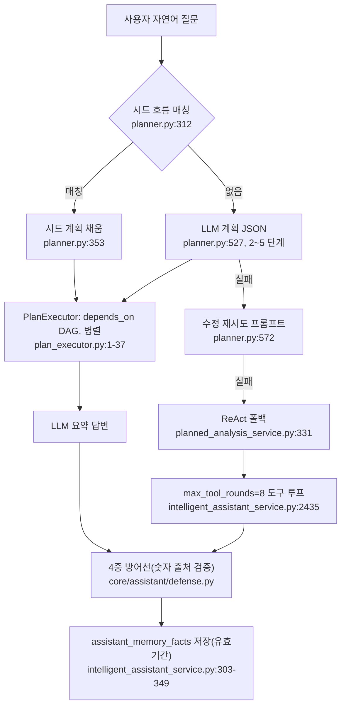

# TradingAgents-CN — 실시간 리서치 (Q5)

- 분석 SHA: `51060a7682cf51810b4bc3a704829438d18cd8dc` (repos.lock.tsv와 일치)
- 분석일: 2026-10-09
- 관련 공통 항목: Q5
- 검증 수준 요약: 코드 확인 36 / 추론 1 / 미확인 3

> 영역 표기: 이 문서의 파일은 모두 [S](`app/`, `core/`)이며, 뉴스 후보 일부 호출만 [A](`tradingagents/dataflows`)다.

## 결론 먼저

TradingAgents-CN에는 "리서치"가 **두 갈래**로 나뉜다.

1. **종목 분석 워크플로**(`v2_stock_analysis`): 판단 도중 **자유 웹 검색이나 웹 페이지 읽기가 없다**. 분석가는 DB에 연결된 고정 도구만 호출한다. LLM이 정하는 것은 "어느 도구를 어떤 인자로" 정도와 뉴스 `news_id` 선택뿐이다 (코드 확인).
2. **지능형 어시스턴트**(자연어 질문): 계획(plan)을 LLM이 짜서 도구를 병렬 실행하거나, 실패하면 ReAct 루프로 `web_search`·`fetch_url`·`search_recent_information`을 쓴다. 여기서 얻은 사실은 `assistant_memory_facts`에 유효기간과 함께 저장돼, 나중에 종목 분석의 bull/bear/리스크 매니저 프롬프트에 **간접적으로** 들어간다 (코드 확인).

## 5-1. 종목 분석 워크플로 안의 "실시간" 조회

| 질문 | 답 | 근거 | 검증 |
|---|---|---|---|
| 판단 도중 웹 검색을 하나 | 아니오. 분석가 도구 목록에 `web_search`·`fetch_url`이 없다. 부트스트랩 바인딩에서 `news_analyst_v2`는 헤드라인/상세 2개 도구뿐이다 | `install/community_bootstrap.json` → `data.tool_agent_bindings`(agent_id별 목록, 01-data.md 1-0), `core/config/binding_manager.py:15-23` | 코드 확인 |
| 뉴스 조회 | MongoDB `stock_news`(관심종목 사전 수집분) + AKShare 실시간 후보를 합치고, 점수로 정렬·제목 중복 제거 후 LLM에 목록(최대 12건 기본, 1~30) 제공 | `core/tools/implementations/news/stock_news.py:1422-1490`, `:1610-1675` | 코드 확인 |
| 검색어 생성 | **코드가 고정 형식으로 생성**. A주는 종목코드·회사명으로 DB/AKShare를 조회, HK는 `f"{ticker} 港股"` 같은 고정 문자열로 Google News 후보 조회 | `stock_news.py:1492-1514`, `:1022-1060` | 코드 확인 |
| LLM의 선택 | 헤드라인 도구 결과에서 `news_id`를 골라 상세 도구에 전달(2단 tool call) | `stock_news.py:1687-1760` | 코드 확인 |
| 몇 번 | 분석가 도구 루프는 1라운드(도구 실행 후 도구 없이 보고서 작성). `max_tool_calls` 설정은 3~4 | `core/agents/base.py:729-760`, `:925-996` | 코드 확인 |
| 공시 조회 | 전용 도구 없음. 뉴스 DB에 `category == "company_announcement"`인 항목이 점수 +15를 받을 뿐이다 | `stock_news.py:519-592`(공고 +15, importance high +12) | 코드 확인 |
| 결과 처리 | 점수화(제목에 종목코드 +90, 회사명 +70, 직접 이벤트 키워드 +18, 광역 맥락 키워드 −35 등) → 제목 키 병합·중복 제거 → 시간순 정렬. 고신뢰 임계 `85` | `stock_news.py:519-660`, `:1189-1260`, `:157` | 코드 확인 |
| 시점 표기 | 도구 출력에 분석일, 뉴스 시간 범위(기본 분석일 앞 7일) 표기 | `stock_news.py:188-197`, `:1642`, `:1651` | 코드 확인 |
| 신뢰성 규칙 | 프롬프트가 "工具结果未提供"로 쓰게 하고 모델 기억 사용을 금지. 코드로 숫자를 도구 결과와 대조하는 장치는 **분석 워크플로에는 없다** | 4-3 판단 규칙 표(03-decision.md), 아래 5-3은 어시스턴트 전용 | 코드 확인(부재) |
| US 기본면 | OpenAI Responses API의 `web_search_preview`를 쓰는 예외적 경로. 프롬프트는 "Can you search Fundamental for discussions on {ticker} during of the month before {curr_date}…" 고정 문구 | `tradingagents/dataflows/interface.py:1359-1405` [A] | 코드 확인 |

### 5-1-a. 종료 조건

- 분석가: 도구 호출 반복 상한 3(`DEFAULT_MAX_TOOL_ITERATIONS`), 실제로는 도구 1회 후 보고서 작성으로 끝난다(`core/agents/base.py:42`, `:729`, `:925-996`).
- 단계 전체: 작업 단위 타임아웃과 노드별 `timeout`(예: `market_analyst_v2` 300초)은 에이전트 설정에 있다 (`install/community_bootstrap.json` → `data.agent_configs[agent_id=market_analyst_v2].config`: `max_iterations: 3, timeout: 300`).

## 5-2. 어시스턴트의 리서치 (워크플로와 별도 경로)

### 5-2-a. 호출 흐름

### 5-2-b. 제공자와 키

| 도구 | 제공자 (우선순위) | 키 필요 | 위치 | 검증 |
|---|---|---|---|---|
| `web_search` | SearXNG 인스턴스(`SEARXNG_INSTANCES` 환경변수) → 없거나 실패 시 **바이두 HTML 스크레이핑** | 불필요 | `core/tools/implementations/assistant_ops/web_search.py:286-333`, `:230-262` | 코드 확인 |
| SearXNG 엔진 | `baidu → sogou → 360so` 순서(Bing 제외). 응답 없는 엔진은 5분 냉각 후 다음 엔진 | 불필요 | `web_search.py:29`, `:124-208` | 코드 확인 |
| `search_recent_information` | 1) SearXNG(`run_web_search`) → 2) **DashScope(qwen3.5-plus `web_search_preview`)** → 3) Google News | DashScope 키(2단계) | `core/tools/implementations/assistant_ops/recent_search.py:126-182`, `:69-123`, `:17` | 코드 확인 |
| `fetch_url` | 일반 HTTP GET + 정문 추출, 바이두 리다이렉트 해석, 최대 8000자 | 불필요 | `core/tools/implementations/assistant_ops/fetch_url.py:17`, `:143-231` | 코드 확인 |
| Tavily, SerpAPI, Exa, DDG, RSS, SEC | 사용하지 않음 | — | `grep -rli "tavily\|serpapi\|exa\b" --include='*.py' core app` 결과 없음 | 코드 확인(부재) |

### 5-2-c. 검색어를 누가 만드나, 몇 번 찾나

| 항목 | 내용 | 위치 | 검증 |
|---|---|---|---|
| 검색어 | **LLM이 직접 만든다**(도구 인자). 계획 프롬프트의 "每个步骤必须指定具体的 tool（工具 ID）和 args（参数）" | `core/agents/planner.py:51-135`(특히 `:112` "步骤数量控制在 2-5 个") | 코드 확인 |
| 계획 규칙 | 질문을 A(섹터)/B(개별 종목)/C(거시)/D(비교)로 분류해 도구 조합을 고르게 하는 프롬프트. 원문: "本系统仅支持 **A股（沪深两市）** 的个股和板块分析" / "不支持: ETF、基金、港股、美股等品种" | `planner.py:51-135` | 코드 확인 |
| 차원·횟수 | 계획 2~5단계, 단계당 타임아웃 60초 | `planner.py:112`, `core/agents/plan_executor.py:27` | 코드 확인 |
| ReAct 폴백 | `max_tool_rounds=8`, 전체 타임아웃 `ASSISTANT_TIMEOUT_SECONDS=900`(환경변수로 조정) | `app/services/intelligent_assistant_service.py:2435`, `:26` | 코드 확인 |
| 요청 제한 | SearXNG 요청 간 최소 간격 1.2초, 엔진 냉각 5분 | `web_search.py:38`, `:131-197` | 코드 확인 |

### 5-2-d. 결과 처리

| 처리 | 내용 | 위치 | 검증 |
|---|---|---|---|
| 정렬 | 재무·공식 도메인 점수표(예: `cninfo.com.cn` 95, `eastmoney.com` 90, `finance.sina.com.cn` 85)로 내림차순 | `web_search.py:42-65`, `:82-85` | 코드 확인 |
| 무관 결과 제거 | 질의의 핵심어(숫자·연도·한 글자 제외)가 제목·URL에 없으면 버림 | `web_search.py:87-121` | 코드 확인 |
| 형식 | 제목, 발행일(`publishedDate`), 링크, 요약 300자 | `web_search.py:264-283` | 코드 확인 |
| 출처·시점 표기 | 검색 도구 응답 앞에 "请优先依据发布时间最新、来源更权威的条目回答，并注意核对发布日期" 지시문을 코드가 붙임 | `recent_search.py:145-150`, `:159`, `:171` | 코드 확인 |
| 중복 제거 | 검색 결과 자체는 도메인·제목 중복 제거를 하지 않는다. 뉴스 도구는 제목 키로 병합 | `stock_news.py:692-705`, `:1235-1258` | 코드 확인 |

### 5-2-e. 신뢰성 장치

원문(DashScope 검색 프롬프트, `recent_search.py:76-92`):

> "不要凭常识补充历史背景，不要自行推断未被近期来源直接支持的结论。不要用‘很可能’‘大概率’这类模糊措辞来冒充确定结论。"
> 번역: "상식으로 역사적 배경을 덧붙이지 말고, 최근 출처가 직접 뒷받침하지 않는 결론을 스스로 추론하지 마라. '아마도', '대체로' 같은 모호한 표현으로 확정 결론인 척하지 마라."

> "请严格按下面格式输出：【最新结论】…【确证依据】…【参考报道】…【不确定点】…"
> 번역: "다음 형식으로 엄격히 출력하라: 【최신 결론】【확증 근거】【참고 보도】【불확실한 점】."

**코드 방어선 4개** (`core/assistant/defense.py`, 모든 어시스턴트 답변이 같은 문을 통과):

| 번호 | 방어선 | 동작 | 위치 | 검증 |
|---|---|---|---|---|
| 1 | 도구 결과를 JSON으로 위조한 문장 | 답변 **차단**(고정 사과문) | `defense.py:429-445`, `intelligent_assistant_service.py:2491-2500` | 코드 확인 |
| 2 | `数据来源：get_xxx` 같은 위조된 출처 표기 | 답변 차단 | `defense.py:446-471` | 코드 확인 |
| 3 | 도구를 안 불렀는데 구체 숫자가 많음 | 피드백 프롬프트로 **1회 재시도**, 또 위반이면 중단 | `defense.py:472-484`, `:39-50`, `intelligent_assistant_service.py:2513-2533` | 코드 확인 |
| 4 | 도구는 불렀지만 도구 결과에서 **추적 불가한 고위험 숫자**(단위 환산 포함, 허용 오차 1%, 퍼센트 5%, 최대 6개 보고) | 1회 재시도 후 투명화 주석 | `defense.py:84-123`, `:485-` , `intelligent_assistant_service.py:2534-` | 코드 확인 |

→ 가이드가 말하는 "숫자는 도구 결과에서만 가져온다"에 가장 가까운 **코드 수준** 구현이다. 종목 분석 워크플로(5-1)에는 이 방어선이 적용되지 않는다(해당 모듈 import가 어시스턴트 서비스·ReplyGate 쪽에만 있음, 코드 확인).

### 5-2-f. 사실 기억 (리서치 결과의 재사용)

| 항목 | 내용 | 위치 | 검증 |
|---|---|---|---|
| 저장 대상 | 온라인 도구(`search_recent_information`, `get_stock_news_unified`, `web_search`, `fetch_url`)의 성공 결과에서 **숫자+사실 키워드가 있는 짧은 문장**만(턴당 6건, 150자) | `intelligent_assistant_service.py:304-335`, `:433-470` | 코드 확인 |
| 유효기간 | 범주별: 시세 3일, 산업 지표 30일, 재무 90일, 회사 정적 정보 365일, 기본 7일 | `intelligent_assistant_service.py:314-347` | 코드 확인 |
| 종목 분석에서 사용 | `valid_until >= now`이고 `symbol` 또는 `related_terms`가 종목코드와 일치하는 최신 8건(각 1000자)을 "采集于/来源" 라벨과 함께 `memory_facts_summary`로 붙임. **bull/bear/risk_manager의 user 프롬프트에만** 들어감 | `app/services/unified_analysis_engine.py:446-497`, `core/agents/base.py:46`, `:1624-1633` | 코드 확인 |
| 충돌 규칙 | 주입 문구 "若与本次分析获取的最新数据不一致，以本次数据为准" | `unified_analysis_engine.py:481-484` | 코드 확인 |

## 5-3. 미확인·메모

- 외부 Skill/MCP 도구(`core/tools/external/*`, `skills/`, 예: `ifind-repilot-news-search`)로 분석 워크플로가 웹 정보를 끌어오는 경로는 열어보지 않았다 (미확인).
- `core/tools/external/iteration_controller.py`의 "반복 컨트롤러"(정찰 `reconnaissance`)가 리서치 루프인지, Skill 생성용인지는 확인하지 않았다 (미확인).

## 우리 시스템 관점 (의견)

- 가져갈 것: ① 뉴스 후보를 **점수화 → 헤드라인 목록 → LLM이 id 선택 → 상세**로 푸는 2단 구조는 토큰을 아끼고 LLM이 본문을 고르게 해서 유용하다. ② "도구 결과에 없는 숫자는 거부" 방어선은 우리 리서치 에이전트에 이식할 가치가 크다. ③ 사실 기억에 **수집일과 유효기간**을 다는 방식.
- 버릴 것: 바이두 스크레이핑·SearXNG 한중 엔진 구성(한국 시장과 무관).
- 대체: 한국 뉴스·공시는 DART(공시), 네이버/구글 뉴스 API, 키움 REST의 종목 뉴스 TR로 대체 (분석자 의견).
- 라이선스: 위 파일은 모두 [S]라 코드 재사용 불가. 구조와 아이디어만 참고.
