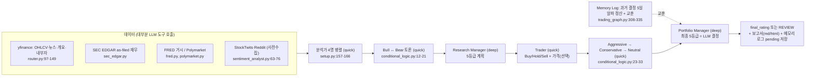

# TradingAgents — 개요

- 분석 SHA: `1394a3f72aa4393e1a98f51b382434c4b4c2d972` (repos.lock.tsv와 일치)
- 분석일: 2026-10-09
- 관련 공통 항목: Q1-Q7 전체 (입구 문서)
- 검증 수준 요약: 코드 확인 22 / 추론 1 / 미확인 1
- 작업트리: clean (`git status --porcelain` 빈 출력), detached HEAD가 고정 SHA와 일치 확인. 코드는 읽기만 했고 설치·실행하지 않았다.

## 1. 메타데이터

| 항목 | 값 | 근거 | 검증 |
|---|---|---|---|
| URL | https://github.com/TauricResearch/TradingAgents | `repos.lock.tsv` | 코드 확인 |
| SHA | `1394a3f72aa4393e1a98f51b382434c4b4c2d972` ("Merge pull request #1478 from TauricResearch/v0.6.0") | `git log -1` | 코드 확인 |
| 커밋일 | 2026-10-03 (`2026-10-03T16:30:07-05:00`) | `git log -1` | 코드 확인 |
| 버전 | 0.6.0 | `tradingagents/__init__.py:3` | 코드 확인 |
| 라이선스 | Apache-2.0 | `LICENSE:1` | 코드 확인 |
| 주 언어 | Python ≥ 3.11 (LangGraph/LangChain 기반) | `pyproject.toml:10-29` | 코드 확인 |
| 대상 시장 | Yahoo Finance가 다루는 전 시장(미국·홍콩·도쿄·인도·한국 `.KS/.KQ`·중국 A주 등) + 코인(`BTC-USD`). 재무 as-filed는 미국 SEC 등록사만 | `README.md:218-226`, `default_config.py:182-204`, `sec_edgar.py:14-15` | 코드 확인 |
| 지원 LLM | OpenAI, Google, Anthropic, xAI, DeepSeek, Qwen, GLM, MiniMax, OpenRouter, Mistral, Kimi, Groq, NVIDIA, Azure, Bedrock, Ollama, OpenAI 호환 엔드포인트. quick/deep 계층별 별도 공급자 가능 | `README.md:160-190`, `llm_clients/factory.py:133-152` | 코드 확인(README 목록 + 계층 분리 코드) |
| 기본 모델 | deep `gpt-6-sol`, quick `gpt-6-luna` | `default_config.py:92-94` | 코드 확인 |
| 진입점 | CLI `tradingagents`(`cli/main.py`), 파이썬 `TradingAgentsGraph.propagate()` | `pyproject.toml:43-44`, `trading_graph.py:167-190` | 코드 확인 |
| 분석 중 README와 코드가 다른 곳 | 아래 "README ↔ 코드 차이" 참조 | - | 코드 확인 |

## 2. 한 줄 정의

TradingAgents는 **LangGraph로 "분석가 4명 → 불/베어 토론 → 리서치 매니저 → 트레이더 → 리스크 3자 토론 → 포트폴리오 매니저"의 가상 투자팀을 구성해 종목·날짜 1건당 5등급(Buy/Overweight/Hold/Underweight/Sell) 서술형 결정을 내는 연구용 프레임워크**이며, **판단 주체는 LLM**이다(PM의 구조화 출력 등급이 그대로 최종 결과, 코드는 검증·`REVIEW` 표식·날짜 클램프만 수행). 주문·비중·리스크 한도 코드는 없다. 근거: `tradingagents/agents/managers/portfolio_manager.py:78-86`, `tradingagents/graph/setup.py:157-185`, `tradingagents/backtest.py:9-15`.

## 3. 판단 파이프라인 다이어그램

## 4. 핵심 발견 5개

1. **최종 결정은 LLM이 하고, 코드 덮어쓰기·수치 한도가 없다.** PM의 `decision.rating.value`가 곧 `final_rating`이며 RM·Trader·PM 간 일관성 강제도, 종목당 상한·킬스위치도 없다. 근거: `tradingagents/agents/managers/portfolio_manager.py:78-86`, `tradingagents/graph/setup.py:175-185`. 코드 확인.
2. **파싱 불가는 Hold가 아니라 `REVIEW`.** 자유 텍스트 폴백에서 등급 라벨이 없거나 서로 충돌하면 거래 불가 센티널로 처리하고, 메모리·백테스트에서도 "unscored"로 분리한다. 근거: `tradingagents/agents/rating.py:26-30,55-103`, `tradingagents/backtest.py:193-207`. 코드 확인.
3. **point-in-time 정합성에 가장 공을 들였다.** 도구가 LLM이 준 날짜를 `trade_date`로 클램프하고, SEC는 공시일 기준 as-filed, FRED는 빈티지 고정, 보류 문구 패턴으로 과거 런에서 live-only 데이터를 막는다. 단 소셜 피드는 보관본이 없어 보장 불가라고 스스로 밝힌다. 근거: `tradingagents/dataflows/date_window.py:78-170`, `tradingagents/dataflows/vendors/sec_edgar.py:153-187`, `tradingagents/agents/analysts/sentiment_analyst.py:10-13`. 코드 확인.
4. **메모리는 "5거래일 알파 정산 → 2-4문장 교훈 → PM에만 주입"의 단일 루프.** 벤치마크는 지역 지수(`.KS`→`^KS11`), 과거 날짜 런은 `resolved <= trade_date`인 교훈만 본다. 정산은 분석가와 병렬로 도는 `Memory Log` 노드나 `settle_all_pending()`이 한다. 근거: `tradingagents/memory/settlement.py:52-155`, `tradingagents/memory/log.py:93-130`, `tradingagents/agents/managers/portfolio_manager.py:35-40`. 코드 확인.
5. **스케줄러·사전 동기화·웹 리서치·주문 계층이 모두 없다.** 호출 때마다 가져오고, 주기 실행은 사용자 몫이며(비대화형 CLI 플래그 제공), LLM이 쓸 수 있는 도구는 정해진 12개 데이터 도구뿐이고 결정 단계는 도구 호출을 금지당한다. 근거: `tradingagents/agents/tools.py:18-291`, `tradingagents/agents/structured.py:36-39`, `cli/main.py:52-66`. 코드 확인(부재는 grep 근거).

## 5. 공통 항목 요약표

| 항목 | 요약 | 문서 |
|---|---|---|
| Q1 데이터 | 가격·지표(stockstats 12종)·펀더멘털(yfinance/SEC EDGAR)·뉴스·StockTwits·Reddit·FRED·Polymarket·메모리 사용. 수급·코인 전용 지표는 없음. Alpha Vantage·`mfi`·가격/비중 필드는 기본 경로에서 미사용 | [01-data.md](01-data.md#q1) |
| Q2 수집 | 모든 도구가 `route_to_vendor` 폴백 체인(기본 yfinance, `sec_edgar,yfinance`)을 거치고 3종 예외로 장애/무데이터를 구분. 센티널 문자열로 계속 진행. Sentiment만 pre-fetch, 나머지는 tool call. 날짜 클램프로 look-ahead 차단 | [01-data.md](01-data.md#q2) |
| Q3 스케줄 | 스케줄러·사전 동기화 DB·실시간 스트림 없음. CLI/API/백테스트/`settle_all_pending` 수동 트리거. stale은 OHLCV 10일 규칙만, 확신도 하향 없음 | [02-schedule.md](02-schedule.md#q3) |
| Q4 판단 | 분석가 4(병렬)→불·베어→RM(deep)→Trader→리스크 3자→PM(deep). 5등급 구조화 출력, 최종은 LLM. 실패 시 자유텍스트 재시도 후 `REVIEW`. 5일 알파 정산 교훈을 PM에만 주입. 호출 약 15-40회 | [03-decision.md](03-decision.md#q4) |
| Q5 리서치 | 웹 검색·페이지 읽기 없음. 고정 글로벌 뉴스 쿼리 5개 + LLM이 쓰는 FRED 지표명·Polymarket topic. 도구 라운드 상한 20 + WRAP_UP, 결정 단계는 도구 금지 | [04-research.md](04-research.md#q5) |
| Q6 경계 | 주문 변환·승인·리스크 한도 코드 없음(등급 문자열 출력이 끝). `REVIEW`가 유일한 사람 확인 신호. UI는 rich CLI 패널 + md/html 보고서 | [05-boundary-and-fit.md](05-boundary-and-fit.md#q6) |
| Q7 적용(의견) | 가져갈 것: point-in-time 유틸, 벤더 라우터·예외 계층, 검증 스냅샷, 도구 라운드 상한, `REVIEW` 센티널, 정산 루프, PortfolioContext. 버릴 것: 토론 전체(비용), 소셜, Yahoo 의존. 코드 게이트는 우리가 별도 구현. Apache-2.0 | [05-boundary-and-fit.md](05-boundary-and-fit.md#q7) |

## 6. README ↔ 코드 차이 (코드를 기준으로 삼음)

| README/주석 주장 | 코드 | 위치 | 검증 |
|---|---|---|---|
| "PM이 승인/거절하고 승인 시 주문이 시뮬레이션 거래소로 전송·체결" | 주문·거래소 시뮬레이션 코드 없음. 레포 스스로 체결 모델이 없다고 명시 | `README.md:107-108` vs `tradingagents/backtest.py:9-15` | 코드 확인 |
| 분석가 이름 "Technical Analyst" | 노드 이름은 "Market Analyst" | `README.md:84` vs `tradingagents/graph/analyst_execution.py:21-26` | 코드 확인 |
| `default_config.py` 주석: "내부 에이전트 토론은 영어로 유지" | 불·베어·리스크 프롬프트에도 언어 지시가 붙음 | `default_config.py:129-130` vs `tradingagents/agents/researchers/bull_researcher.py:49` | 코드 확인 |
| `default_config.py` 주석: 개요·내부자 도구는 Yahoo | 내부자 도구는 `news_data` 카테고리 소속이라 그 설정을 따름 | `default_config.py:161-163` vs `tradingagents/dataflows/router.py:67-74` | 코드 확인 |
| `sentiment_analyst.py` 주석: 사전 수집기는 예외를 올리지 않는다 | 뉴스는 `get_news.func` → 라우터 경유라 핵심 카테고리의 비정형 예외는 `raise`될 수 있음(Yahoo 기본 경로에선 드묾) | `sentiment_analyst.py:63-66` vs `router.py:288-295` | 코드 확인(경로), 빈도는 추론 |
| Market Analyst 프롬프트의 지표 목록(12종) | 벤더는 `mfi`까지 13종 지원(프롬프트 목록 누락) | `market_analyst.py:22-44` vs `yahoo/market.py:143` | 코드 확인 |

## 7. 문서 목록

- [01-data.md](01-data.md): Q1 데이터 인벤토리, Q2 수집 방식
- [02-schedule.md](02-schedule.md): Q3 최신화와 스케줄링
- [03-decision.md](03-decision.md): Q4 AI 판단(흐름도, 규칙 표, 스키마 표, 에이전트 입출력, 메모리, 비용)
- [04-research.md](04-research.md): Q5 실시간 리서치
- [05-boundary-and-fit.md](05-boundary-and-fit.md): Q6 경계, Q7 적용 의견
- [next.md](next.md): 확인 범위, 미확인, 다음에 볼 곳
