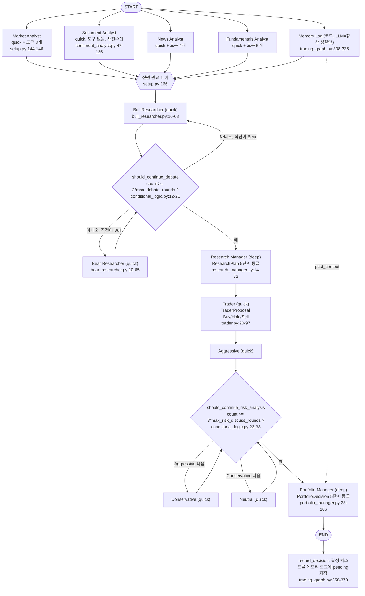

# TradingAgents — AI 판단

- 분석 SHA: `1394a3f72aa4393e1a98f51b382434c4b4c2d972` (repos.lock.tsv와 일치)
- 분석일: 2026-10-09
- 관련 공통 항목: Q4 (4-1 ~ 4-8)
- 검증 수준 요약: 코드 확인 88 / 추론 6 / 미확인 0

**한 문장 결론: 최종 결정은 LLM이 내린다.** Portfolio Manager(deep 모델)의 구조화 출력 `rating`이 그대로 최종 등급이 되고(`tradingagents/agents/managers/portfolio_manager.py:80-86`), 코드는 enum 형식 검증, 파싱 실패 시 `REVIEW` 표식, 날짜 클램프만 할 뿐 수치 임계값·비중 공식·리스크 한도로 LLM 결과를 덮어쓰는 장치가 없다. 코드 확인.

permalink 예시: `https://github.com/TauricResearch/TradingAgents/blob/1394a3f72aa4393e1a98f51b382434c4b4c2d972/tradingagents/graph/setup.py#L157-L185`, `.../tradingagents/agents/managers/portfolio_manager.py#L78-L86`

## 4-2. 판단 흐름 (다이어그램을 먼저 둔다)

### 흐름도

| 노드 | 코드 위치 | 검증 |
|---|---|---|
| 그래프 조립(병렬 분석가 + Memory Log → Bull) | `tradingagents/graph/setup.py:109-187` (병렬 fan-out/join: 157-166) | 코드 확인 |
| 분석가 1명 = 독립 서브그래프(agent ↔ tools, 상한 후 wrap_up) | `graph/setup.py:53-90` | 코드 확인 |
| 토론 라우팅 | `graph/conditional_logic.py:12-33` | 코드 확인 |
| 모든 조건 엣지에 완전한 path map 사용(#1088, 레이블 드리프트로 인한 크래시 방지) | `graph/setup.py:31-45,168-183` | 코드 확인 |
| 모델 계층 선택(quick/deep) | `setup.py:126-140`, `llm_clients/factory.py:133-152` | 코드 확인 |
| 상태 정의 | `agents/state.py:7-73` | 코드 확인 |
| 초기 상태 | `graph/propagation.py:13-65` | 코드 확인 |
| 진입점 | `cli/run.py:98-127`, `main.py:12-16`, `trading_graph.py:167-190,372-404` | 코드 확인 |

### 실행 순서 요약

1. **병렬**: 선택된 분석가들(기본 4명)과 Memory Log가 동시에 시작한다. 모두 끝나야 Bull이 시작한다(`setup.py:157-166`). 코드 확인.
2. **연구 토론**: Bull → Bear → (…) → Research Manager. 기본 `max_debate_rounds=1`이므로 Bull 1회, Bear 1회 후 종료(`conditional_logic.py:15-18`, `default_config.py:133`). 종료 조건은 순수 카운터이며 합의 여부는 보지 않는다. 코드 확인.
3. **Trader**: Research Manager 계획을 받아 Buy/Hold/Sell과 선택적 진입가·손절가를 낸다.
4. **리스크 토론**: Aggressive → Conservative → Neutral 순환, 기본 `max_risk_discuss_rounds=1`이면 3명이 1번씩 말하고 종료(`conditional_logic.py:25-33`, `default_config.py:134`). 코드 확인.
5. **Portfolio Manager**: 최종 등급. Memory Log의 `past_context`를 읽는 유일한 에이전트.
6. **그래프 밖**: `record_decision`이 결정 텍스트를 pending으로 기록(`trading_graph.py:358-370,399`).

### 모델 계층

| 계층 | 사용처 | 근거 | 검증 |
|---|---|---|---|
| quick | 4 분석가, Bull, Bear, Trader, 리스크 3인, **Reflector(성찰)** | `setup.py:126-139`, `trading_graph.py:106` | 코드 확인 |
| deep | Research Manager, Portfolio Manager | `setup.py:134,140` | 코드 확인 |
| 계층별 별도 공급자·엔드포인트 | `quick_think_provider`, `deep_think_provider` 및 `*_backend_url` | `default_config.py:101-107`, `factory.py:133-152` | 코드 확인 |
| 기본 모델명 | `gpt-6-sol`(deep), `gpt-6-luna`(quick) | `default_config.py:92-94` | 코드 확인 |

---

## 4-1. 입력 조립

| 에이전트군 | 입력 조립 방식 | 길이 제한·자르기 | 위치 | 검증 |
|---|---|---|---|---|
| 도구 분석가(Market/News/Fundamentals) | ChatPromptTemplate: 공통 시스템 프롬프트 + `{tool_names}`, `{current_date}`(=trade_date), `{instrument_context}` + 역할별 `system_message` + 메시지 이력. 매 턴마다 새로 조립 | 자르기 없음. 도구 결과가 메시지 이력에 누적 | `market_analyst.py:55-77`, `news_analyst.py:34-56`, `fundamentals_analyst.py:35-57` | 코드 확인 |
| Sentiment Analyst | 사전 수집한 3블록을 `<start_of_news>`, `<start_of_stocktwits>`, `<start_of_reddit>` 태그로 감싸 f-string 삽입 | StockTwits 30건·본문 280자, Reddit 서브레딧당 5건·본문 240자, 뉴스 최대 20건 | `sentiment_analyst.py:57-125,130-199`, `stocktwits.py:132-140`, `reddit.py:323-331` | 코드 확인 |
| Bull/Bear | 4개 분석 보고서 **전문** + 토론 전체 이력(`history`) + 상대 직전 발언을 f-string으로 삽입. 빈 보고서는 "(No X report ... not an empty finding)" 표식, 첫 발언자엔 "has not spoken yet" 표식 | 자르기 없음. `history`가 라운드마다 누적(`history + "\n" + argument`) → 라운드·보고서가 커지면 프롬프트도 선형 증가(추론: 자르는 코드 없음) | `bull_researcher.py:15-49,56`, `context.py:37-48,190-201` | 코드 확인 / 증가 영향은 추론 |
| Research Manager | 토론 이력 + 종목 컨텍스트 + 등급 척도(분석가 보고서는 **안 봄**, 토론에 흡수된 것만) | 없음 | `research_manager.py:23-51` | 코드 확인 |
| Trader | 리서치 계획 + (있으면) Market 보고서 전문 + 포트폴리오 컨텍스트. 뉴스·펀더멘털·센티먼트 보고서는 **안 봄** | 없음 | `trader.py:32-83` | 코드 확인 |
| 리스크 3인 | Trader 제안 + 4개 보고서 + 포트폴리오 + 리스크 토론 이력 + 다른 두 명의 직전 발언 | 없음 | `aggressive_debator.py:30-46` | 코드 확인 |
| Portfolio Manager | 종목 컨텍스트 + 포트폴리오 + Research Manager 계획 + Trader 제안 + (있으면) 과거 교훈 + 리스크 토론 이력. 분석가 보고서는 직접 보지 않음 | 없음 | `portfolio_manager.py:42-76` | 코드 확인 |

프롬프트 생성 함수 위치: 각 `create_*` 팩토리의 노드 함수 내부(위 표). 공통 컨텍스트 함수는 `agents/context.py`(`get_language_instruction` 14-34, `build_instrument_context` 107-169, `get_portfolio_context_from_state` 204-218).

---

## 4-3. 결정 기준

### 판단 규칙 표

| 규칙 | 원문 인용 | 번역 | 위치 | 검증 |
|---|---|---|---|---|
| 5단계 등급 척도(Research Manager) | "**Buy**: Strong conviction in the bull thesis; recommend taking or growing the position … **Sell**: Strong conviction in the bear thesis; recommend exiting or avoiding the position" | Buy는 불 논거에 강한 확신(보유 시작·확대), Sell은 베어 논거에 강한 확신(청산·회피) | `research_manager.py:29-34` | 코드 확인 |
| 갈등만으로 Hold 금지(Research Manager) | "The debate always contains conflicting arguments; deciding which side is stronger is the job, so conflict alone is not a reason to Hold. … Choose Hold only when the evidence is still balanced after that weighing, or too thin to support a call" | 토론엔 늘 상반된 주장이 있다. 어느 쪽이 강한지 가리는 게 일이므로 갈등만으로 Hold 하지 말고, 가중 후에도 균형이거나 근거가 얇을 때만 Hold | `research_manager.py:36` | 코드 확인 |
| 순서 편향 배제 | "Weigh the bull and bear cases on their merits, independent of which side spoke first or last." | 누가 먼저/나중에 말했는지와 무관하게 장점으로 평가 | `research_manager.py:36` | 코드 확인 |
| Trader 3분류 매핑 | "A research recommendation of Overweight is a Buy and Underweight is a Sell, sized by how strong the case is; conflict alone is not a Hold." | Overweight=Buy, Underweight=Sell로 보고 확신 정도로 크기를 정한다 | `trader.py:76-78` | 코드 확인 |
| Trader 가격은 절대값 | "State entry price and stop-loss as absolute price levels in the instrument's quote currency (for example 189.5), never a percentage or a range" | 진입가·손절가는 시세통화 절대 가격, 퍼센트·범위 금지 | `trader.py:56-59` | 코드 확인 |
| Trader 가격 근거 | "Ground concrete price levels (entry, stop-loss, position sizing) in the technical market report's price structure -- current price, support/resistance, ATR, and volatility" | 가격 수준은 기술 보고서의 가격 구조(현재가, 지지·저항, ATR, 변동성)에 근거 | `trader.py:36-40` | 코드 확인 |
| PM 갈등 규칙 | "The risk debate always contains conflicting stances; deciding which is stronger is the job, so conflict alone is not a reason to Hold. Commit to the stronger case, sized by how decisively it wins." | 리스크 토론의 상반된 입장 중 강한 쪽에 확정하되 이긴 정도로 크기를 정한다 | `portfolio_manager.py:66` | 코드 확인 |
| 근거 요구 | "Ground every conclusion in specific evidence from the analysts." | 모든 결론을 분석가들의 구체적 근거에 둔다 | `portfolio_manager.py:66` | 코드 확인 |
| 포트폴리오 미제공 시 | "Portfolio context: not provided. You do not know the caller's current holdings or cash, so do not assume a flat book" | 보유 현황을 모르니 빈 계좌로 가정하지 말라 | `context.py:214-218` | 코드 확인 |
| 숫자 근거는 검증 스냅샷에서만 | "treat it as the source of truth for any exact OHLCV, price-level, or indicator-value claim … Do not claim historical validation, support/resistance bounces, or exact percentage moves unless they are directly supported by tool output with concrete dates and prices." | 정확한 가격·지표 주장은 스냅샷을 진실원으로, 도구 근거 없는 검증·반등·정확한 퍼센트 주장 금지 | `market_analyst.py:48` | 코드 확인 |
| RSI 임계값(프롬프트 안내) | "Apply 70/30 thresholds and watch for divergence to signal reversals." | RSI 70/30 임계와 다이버전스 | `market_analyst.py:35` | 코드 확인 |
| 지표 선택 상한 | "choose up to **8 indicators** that provide complementary insights without redundancy" | 중복 없이 상호보완적인 지표를 최대 8개 선택 | `market_analyst.py:22` | 코드 확인 |
| 센티먼트 비율 해석 | "A 70/30 bullish/bearish split is moderately bullish; ≥90/10 may indicate over-extension and contrarian risk; 50/50 is uncertainty." | 70/30은 온건 강세, 90/10 이상은 과열·역발상 위험, 50/50은 불확실 | `sentiment_analyst.py:174` | 코드 확인 |
| 센티먼트 점수 구간(스키마 설명) | "Bullish ~6.5–10, Mildly Bullish ~5.5–6.4, Neutral/Mixed ~4.5–5.5, Mildly Bearish ~3.5–4.4, Bearish ~0–3.4. Only the 0–10 bounds are enforced." | 밴드와 점수 구간 가이드. 코드가 강제하는 건 0-10 범위뿐 | `schemas.py:336-339` | 코드 확인 |
| 분석가 역할 한정 | "Report what your tools support; another agent decides the trade." | 도구가 뒷받침하는 것만 보고하고 매매 결정은 다른 에이전트가 한다 | `market_analyst.py:62` 외 3곳(`news_analyst.py:42`, `fundamentals_analyst.py:43`, `sentiment_analyst.py:93`) | 코드 확인 |

**숫자 임계값과 공식 정리**: 의사결정에 영향을 주는 코드 수준의 수치 규칙은 **없다**. 존재하는 수치는 (a) 데이터 길이/개수 제한(Q2 표), (b) 토론 라운드 종료 카운터(`2*N`, `3*N`), (c) 도구 라운드 상한 20, (d) 정산 보유기간 5거래일, (e) OHLCV stale 10일이며, 어느 것도 매수·매도 비중이나 등급을 결정하지 않는다. 코드 확인(전수 확인한 범위: `agents/`, `graph/`, `memory/`).

### 페르소나별 차이

| 페르소나 | 기준 | 위치 | 검증 |
|---|---|---|---|
| Bull | 성장 잠재력, 경쟁우위, 긍정 지표, 베어 반박 | `bull_researcher.py:31-38` | 코드 확인 |
| Bear | 리스크·도전, 경쟁 약점, 부정 지표, 불 반박 | `bear_researcher.py:31-39` | 코드 확인 |
| Aggressive | "actively champion high-reward, high-risk opportunities" 고수익·고위험 옹호 | `aggressive_debator.py:32` | 코드 확인 |
| Conservative | "protect assets, minimize volatility, and ensure steady, reliable growth" 자산 보호·변동성 최소화 | `conservative_debator.py:32` | 코드 확인 |
| Neutral | "balanced perspective, weighing both the potential benefits and risks" 균형·분산 | `neutral_debator.py:32` | 코드 확인 |

---

## 4-4. 출력 형식

### 출력 스키마 표

| 필드 | 타입 | 값 범위 | 설명 | 위치 |
|---|---|---|---|---|
| `ResearchPlan.recommendation` | `PortfolioRating` enum | Buy / Overweight / Hold / Underweight / Sell | 연구팀 방향 | `schemas.py:66-73,104-112` |
| `ResearchPlan.rationale` | str | 자유 | 어떤 논거가 결정했는지 | `schemas.py:113-119` |
| `ResearchPlan.strategic_actions` | str | 자유 | 표준 비중 대비 크기 안내 포함 | `schemas.py:120-127` |
| `TraderProposal.action` | `TraderAction` enum | Buy / Hold / Sell | 거래 방향 | `schemas.py:76-87,155-157` |
| `TraderProposal.reasoning` | str | 2-4문장 안내 | 근거 | `schemas.py:158-163` |
| `TraderProposal.entry_price` | float \| None | 절대가격. "15%"·범위·"N/A" 등은 `None`으로 강등 | 진입가(선택) | `schemas.py:33-58,164-171,185-188` |
| `TraderProposal.stop_loss` | float \| None | 동일 | 손절가(선택) | `schemas.py:172-179` |
| `TraderProposal.position_sizing` | str \| None | 자유(예: "5% of portfolio") | 비중 안내(선택, **코드가 파싱·적용하지 않음**) | `schemas.py:180-183` |
| `PortfolioDecision.rating` | `PortfolioRating` enum | 5단계 | **최종 등급** | `schemas.py:230-239` |
| `PortfolioDecision.executive_summary` | str | 2-4문장 안내 | 진입 전략·비중·리스크 수준·기간 | `schemas.py:240-245` |
| `PortfolioDecision.investment_thesis` | str | 자유 | 근거, 과거 교훈 반영 | `schemas.py:246-252` |
| `PortfolioDecision.price_target` | float \| None | 시세통화 | 목표가(선택) | `schemas.py:253-256,262-265` |
| `PortfolioDecision.time_horizon` | str \| None | 예: "3-6 months" | 보유 기간(선택) | `schemas.py:257-260` |
| `SentimentReport.overall_band` | enum | Bullish / Mildly Bullish / Neutral / Mixed / Mildly Bearish / Bearish | 센티먼트 방향 | `schemas.py:296-328` |
| `SentimentReport.overall_score` | float | 0.0-10.0 (`ge`/`le` 강제) | 5=중립 | `schemas.py:330-341` |
| `SentimentReport.confidence` | Literal | low / medium / high | 데이터 품질 기반 확신 | `schemas.py:342-349` |
| `SentimentReport.narrative` | str | 자유 | 출처별 분석+요약표 | `schemas.py:350-363` |
| 토론 에이전트(불/베어/리스크 3인), 도구 분석가 3명 | 자유 텍스트 | 형식 강제 없음(마크다운 표 말미 추가만 요청) | - | `bull_researcher.py:51-53`, `market_analyst.py:51` |

- 구조화 출력은 **결정 에이전트 3명 + Sentiment**에만 걸린다(`schemas.py:1-17` docstring). 렌더 함수가 같은 마크다운 모양으로 되돌려 이후 단계·메모리·리포트가 같은 텍스트 경로를 쓴다(`render_*`: `schemas.py:130-138,191-213,268-288,366-379`). 코드 확인.
- **확신도(confidence) 점수는 최종 결정에 없다.** 등급 5단계가 곧 방향+강도다. 코드 확인.
- **진입가·손절가·비중은 선택·비강제**다(없으면 "not provided"로 렌더, `schemas.py:203-208,285-287`). 코드 확인.
- 비중은 "5% of portfolio" 같은 자유 문자열이며 비중을 계산하는 코드는 없다. 코드 확인.

---

## 4-5. 최종 결정이 만들어지는 방식

| 질문 | 답 | 근거 | 검증 |
|---|---|---|---|
| 최종 결정 주체 | **LLM**(Portfolio Manager, deep). 구조화 호출 결과 `decision.rating.value`가 `final_rating` | `portfolio_manager.py:78-86` | 코드 확인 |
| 코드의 개입 | ① enum/범위 검증(Pydantic) ② 가격 필드 정제(`_coerce_optional_float`) ③ 자유 텍스트 폴백일 때만 정규식으로 등급 추출, 못 읽으면 `REVIEW` ④ 날짜 클램프 | `schemas.py:33-58`, `rating.py:55-112` | 코드 확인 |
| 덮어쓰기·가드레일·한도 | **없음.** Research Manager 등급, Trader 액션, PM 등급이 서로 달라도(예: RM=Sell, PM=Buy) 코드가 일치를 강제하지 않는다. 포지션 상한·일일 한도·킬스위치 코드 없음 | `portfolio_manager.py:88-104`(PM 출력이 그대로 상태에 기록), `setup.py:175-185`(RM→Trader→리스크→PM 단방향, 검증 노드 없음) | 코드 확인 |
| 신호 결합 방식 | 가중평균·다수결 없음. **서술형 토론 결론**을 상위 에이전트가 읽고 종합. 분석가 4명 → Bull/Bear 토론 → RM → Trader → 리스크 3자 토론 → PM이 연쇄 | `setup.py:157-185` | 코드 확인 |
| 과거 교훈 | PM 프롬프트에만 삽입(주입 지점 하나) | `portfolio_manager.py:35-40` | 코드 확인 |

---

## 4-6. 실패 처리

| 상황 | 동작 | 근거 | 검증 |
|---|---|---|---|
| 구조화 출력 미지원 | `bind_structured`가 `None` 반환 → 자유 텍스트 생성으로 진행 | `structured.py:42-56` | 코드 확인 |
| 구조화 호출 실패·`None` | 경고 로그 후 같은 프롬프트로 **자유 텍스트 1회 재시도**(RM·Trader·Sentiment), PM도 동일 | `structured.py:59-95`, `portfolio_manager.py:84-86` | 코드 확인 |
| 재시도(자유 텍스트)도 예외 | 잡는 코드 없음 → 노드 예외 → 런 중단(체크포인트 켰다면 재개 가능) | `structured.py:95`(plain_llm.invoke 무보호) | 코드 확인 |
| PM이 자유 텍스트일 때 등급 파싱 실패 | `final_rating="REVIEW"` ("거래 가능 포지션이 아님", Hold로 강등하지 않음) | `portfolio_manager.py:86`, `rating.py:26-30,96-103` | 코드 확인 |
| `REVIEW`가 되는 조건 | 텍스트에 `Rating: X` 라벨이 없음 / 라벨이 둘 이상이고 값이 서로 다름 / 등급 단어가 산문에만 있음(예: "not a Sell") / 등급 척도 설명 줄만 있음. 라벨 첫 줄(헤딩 제외)이 `- ` 없는 본인 등급줄이면 그것을 채택 | `rating.py:34-93` | 코드 확인 |
| `REVIEW` 이후 | CLI가 "읽을 수 있는 등급이 없으니 재실행 또는 직접 판단"을 노란 경고로 표시. 메모리 로그에는 `REVIEW` 태그로 저장되고 백테스트에서는 "unscored"로 제외 | `cli/run.py:377-384`, `backtest.py:193-207`, `memory/log.py:56-57` | 코드 확인 |
| 구조화 PM 성공 | `final_rating`은 enum 값이라 `REVIEW`가 될 수 없음 | `portfolio_manager.py:82-83` | 코드 확인 |
| 도구 데이터 누락 | 센티널 문자열로 LLM에 전달, 분석은 계속. `WRAP_UP`이 "못 가져온 데이터를 밝혀라"를 지시 | `router.py:176-197`, `turn.py:7-10` | 코드 확인 |
| 분석가 보고서가 빈 경우 | 하위 프롬프트에 "(No X report in this run: it is not available, not an empty finding.)" 삽입 | `context.py:190-201` | 코드 확인 |
| Memory Log 노드 실패 | 런 계속, `memory_note`에 사유 기록 | `trading_graph.py:318-335` | 코드 확인 |
| 도구 호출 폭주 | `max_tool_rounds=20` 초과 시 도구 없이 보고서 작성(wrap-up) 강제, 그 턴이 분석가를 끝냄 | `setup.py:76-90`, `turn.py:13-27`, `default_config.py:137` | 코드 확인 |
| 재귀 상한 | `max_recur_limit=100`, `2*max_tool_rounds+2 >= max_recur_limit`면 시작 시 `ValueError` | `trading_graph.py:88-95`, `default_config.py:135` | 코드 확인 |

---

## 4-7. 메모리와 사후 채점

### 저장

- 런이 끝나면 `record_decision`이 **PM의 최종 결정 텍스트**를 `[날짜 | 티커 | 등급 | pending]` 태그와 `DECISION:` 본문으로 마크다운 파일에 append(LLM 호출 없음). 같은 (날짜, 티커)가 이미 있으면 저장하지 않는다(멱등). 코드 확인: `trading_graph.py:358-370`, `memory/log.py:32-60`.
- 파일 락 사용(`log.py:46`). 저장소 기본 경로 `~/.tradingagents/memory/trading_memory.md`(`default_config.py:86`). 코드 확인.

### 사후 채점(settlement)

| 항목 | 내용 | 근거 | 검증 |
|---|---|---|---|
| 채점 시점 | 이후 런의 `Memory Log` 노드(분석가와 병렬) 또는 `settle_all_pending()` 호출 시 | `trading_graph.py:308-321,348-356` | 코드 확인 |
| 대상 | pending이면서 보유기간 전체가 거래된 결정. 창이 덜 지났으면 건너뛰고 다음 런에 재시도 | `settlement.py:78-89,136-137` | 코드 확인 |
| 기간 | `holding_period_days = 5` 거래일(진입 = 분석일 이후 첫 종가, 청산 = 5번째 이후 종가) | `default_config.py:180`, `settlement.py:83,91` | 코드 확인 |
| 지표 | 원수익률 `raw = (exit-entry)/entry`, 알파 `alpha = raw - 벤치마크 수익률` | `settlement.py:91-94` | 코드 확인 |
| 벤치마크 | `benchmark_ticker`가 있으면 그것, 없으면 접미사 맵(`.KS`→`^KS11` 등), 기본 SPY | `settlement.py:14-35`, `default_config.py:181-204` | 코드 확인 |
| 가격 소스 | yfinance 종가(`get_closes`) | `settlement.py:73-76`, `yahoo/market.py:268-272` | 코드 확인 |
| 교훈 생성 | quick LLM이 "2-4 문장 평문, 알파 수치 인용, 창이 짧으면 그렇게 말하라, 다음에 적용할 구체적 교훈 1개"를 생성 | `memory/reflection.py:13-63` | 코드 확인 |
| 결과 기록 | 태그를 `[날짜 \| 티커 \| 등급 \| +x.x% \| +y.y% \| 5d \| resolved:YYYY-MM-DD]`로 교체하고 `REFLECTION:` 섹션 추가, 임시파일+`os.replace`로 원자적 쓰기 | `log.py:134-201,258-271` | 코드 확인 |
| 실패 | 가격 조회·성찰 실패는 해당 항목을 pending으로 남기고 `failed`로 보고, 런은 계속 | `settlement.py:132-151` | 코드 확인 |

### 주입 경로

| 항목 | 내용 | 근거 | 검증 |
|---|---|---|---|
| 읽기 | 정산 끝난 항목만. 같은 종목 최근 5건(결정+성찰 전문), 타 종목 최근 3건(성찰만, 없으면 결정 앞 300자) | `log.py:93-130,343-359` | 코드 확인 |
| point-in-time | 과거 날짜 런은 `resolved <= trade_date`인 항목만(미래 결과로 학습 방지). 현재 날짜 런은 필터 없음 | `log.py:105-107`, `trading_graph.py:130-138` | 코드 확인 |
| 주입 지점 | Portfolio Manager 프롬프트의 "Lessons from prior decisions and outcomes" 한 곳. 분석가·토론·RM·Trader에는 **주입되지 않음** | `portfolio_manager.py:35-40`, `state.py:71`, `grep past_context` 결과 | 코드 확인 |
| 한계 | 한 종목의 직전 결정은 5거래일이 지나야 교훈이 된다. 5일 알파는 "창이 짧다"는 문구를 성찰 프롬프트가 요구(`reflection.py:24-25`) | 해당 줄 | 코드 확인 |
| 회전 | `memory_log_max_entries`(기본 None=무제한) 설정 시 오래된 정산 항목부터 삭제, pending은 보존 | `log.py:273-308` | 코드 확인 |

### 백테스트 채점(별도 도구)

- `run_backtest`는 격자 셀마다 `propagate`를 돌려 자기 전용 메모리 로그에 쌓고, `summarize`가 등급별 건수·방향 적중률·평균 알파를 낸다. 포트폴리오 시뮬레이터가 아니며 주문·체결 모델이 없다고 명시한다(`backtest.py:9-15`). 방향은 Buy/Overweight=+1, Sell/Underweight=-1, Hold=0(방향 없음)(`backtest.py:88-90`). 코드 확인.

---

## 4-8. 비용

기본 설정(분석가 4명, `max_debate_rounds=1`, `max_risk_discuss_rounds=1`)의 **LLM 호출 수** 근사:

| 단계 | 호출 수 | 계산 근거 | 검증 |
|---|---|---|---|
| Market / News / Fundamentals 각 | 최소 2, 상한 21 | agent 호출 = 도구 라운드 수 + 최종 1회. 라운드 상한 20 후 wrap-up 1회 | `setup.py:73-90`, `default_config.py:137` |
| Sentiment | 1 (구조화 실패 시 +1) | 단일 호출 | `sentiment_analyst.py:114-120`, `structured.py:84-95` |
| Bull + Bear | 2 | 기본 1라운드 | `conditional_logic.py:15-21` |
| Research Manager | 1 (deep) | | `research_manager.py:53-59` |
| Trader | 1 | | `trader.py:85-91` |
| 리스크 3인 | 3 | 기본 1라운드 | `conditional_logic.py:25-33` |
| Portfolio Manager | 1 (deep) | | `portfolio_manager.py:80-86` |
| 정산 성찰 | 정산되는 결정 수만큼(quick) | 결정당 1회 | `settlement.py:139-145` |

- 합계: **최소 약 15회**(분석가 도구 라운드 1회씩 가정) / 일반적으로 도구 라운드가 늘어 **약 20-40회**(추론: 도구 라운드 수는 모델 의존이라 코드로 확정할 수 없음) / 이론 상한 약 72회(21×3 + 1 + 8) + 정산 성찰 + 구조화 실패 폴백. 도구 라운드 1회의 한 메시지에 병렬 도구호출이 여럿일 수 있어 도구 **호출** 수는 라운드 수보다 크다(`setup.py:73-74`는 도구호출 포함 메시지 수를 센다). 코드 확인(공식), 일반 범위는 추론.
- 토큰 증가 요인: 토론 이력 누적, 4개 보고서 전문이 Bull·Bear·리스크 3인에게 각각 재전달(5개 에이전트 × 4개 보고서)(`bull_researcher.py:42-48`). 코드 확인.
- 병렬 실행으로 지연은 분석가 중 가장 느린 것 기준(`setup.py:157-166`). 코드 확인.

---

## 에이전트별 입출력 표

| 에이전트 | 입력 | 출력 | 모델 계층 | 위치 |
|---|---|---|---|---|
| Market Analyst | trade_date, 종목 컨텍스트, 도구 `get_stock_data`/`get_indicators`/`get_verified_market_snapshot` 결과 | `market_report`(마크다운 + 요약표) | quick | `market_analyst.py:15-84` |
| Sentiment Analyst | 사전 수집한 뉴스·StockTwits·Reddit 블록 | `sentiment_report`(밴드·점수·확신도 헤더 + 서사), 도구 없음 | quick | `sentiment_analyst.py:47-127` |
| News Analyst | 도구 `get_news`/`get_global_news`/`get_macro_indicators`/`get_prediction_markets` 결과 | `news_report` | quick | `news_analyst.py:21-63` |
| Fundamentals Analyst | 도구 `get_fundamentals`/재무제표 3종/`get_insider_transactions` 결과 | `fundamentals_report` | quick | `fundamentals_analyst.py:23-64` |
| Memory Log 노드 | 모든 티커의 pending 결정, 가격(yfinance) | `past_context`, `memory_note` (+정산 부작용: 메모리 로그 갱신) | quick(성찰만) | `trading_graph.py:308-335` |
| Bull Researcher | 4개 보고서, 토론 이력, 베어 직전 발언 | `investment_debate_state`(이력·`count+1`) | quick | `bull_researcher.py:10-63` |
| Bear Researcher | 동일, 불 직전 발언 | 동일 | quick | `bear_researcher.py:10-65` |
| Research Manager | 토론 이력, 종목 컨텍스트 | `investment_plan`(Recommendation/Rationale/Strategic Actions) | **deep** | `research_manager.py:14-72` |
| Trader | `investment_plan`, Market 보고서, 포트폴리오 | `trader_investment_plan`(Action/Reasoning/Entry/Stop/Sizing + `FINAL TRANSACTION PROPOSAL: **X**` 줄) | quick | `trader.py:20-97`, `schemas.py:191-213` |
| Aggressive / Conservative / Neutral | Trader 제안, 4개 보고서, 포트폴리오, 리스크 토론 이력, 다른 둘의 직전 발언 | `risk_debate_state`(`latest_speaker`, `count+1`) | quick | `aggressive_debator.py:10-68`, `conservative_debator.py`, `neutral_debator.py` |
| Portfolio Manager | RM 계획, Trader 제안, 리스크 이력, 포트폴리오, `past_context` | `final_trade_decision`(마크다운) + `final_rating` | **deep** | `portfolio_manager.py:23-106` |
| Reflector | 결정 텍스트, raw/alpha 수익률, 벤치마크, 보유일 | 2-4문장 교훈 | quick | `reflection.py:36-63` |

---

## 4-9. 판단 구조에서 눈에 띈 점 (분석 메모)

1. **세 단계 모두 같은 5단계 척도**를 쓰고 (RM·PM) 중간 Trader만 3분류라 정보가 축소된다(Overweight→Buy). 코드 확인: `schemas.py:66-87`.
2. **일관성 강제가 없다**: RM→Trader→PM 사이 불일치를 잡는 코드가 없다. 코드 확인(위 4-5).
3. **프롬프트에 "Hold 편향 억제" 문구가 3곳**(RM·PM·스키마 설명) 반복된다. 이 레포가 겪은 Hold 편향을 프롬프트로 다루려 했다는 정황이다(추론: 문구가 반복되고 CHANGELOG에서 "clearer decision signals" 언급, 근거: `research_manager.py:36`, `portfolio_manager.py:66`, `schemas.py:104-112,230-239`, `README.md:45`).
4. **외부 텍스트(뉴스·Reddit·StockTwits)가 프롬프트에 그대로 들어간다.** 프롬프트 인젝션 방어 장치는 코드에서 찾지 못했다(`safe_ticker_component`는 경로 안전만 다룸, `symbols.py:147-180`). 추론: 방어 로직이 있다면 `agents/`·`dataflows/vendors`에 있어야 하나 grep에서 확인되지 않음.
5. 토론 종료는 카운터뿐이고 조기 합의·품질 점검이 없다. 코드 확인.
