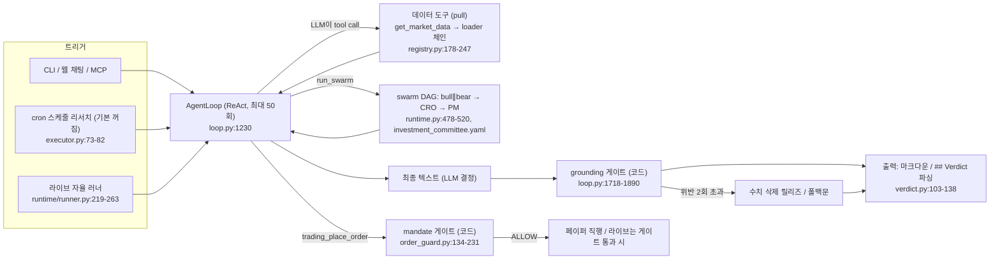

# Vibe-Trading — 개요

- 분석 SHA: `e532650b527ba3fb146ef00d533f6fc5040d5d2d` (repos.lock.tsv와 일치)
- 분석일: 2026-10-09
- 관련 공통 항목: Q1–Q7 요약
- 검증 수준 요약: 코드 확인 13 / 추론 0 / 미확인 0

## 1. 메타데이터

| 항목 | 값 | 근거 | 검증 |
|---|---|---|---|
| URL | https://github.com/HKUDS/Vibe-Trading | repos.lock.tsv | 코드 확인 |
| 고정 SHA / 커밋일 | `e532650b527ba3fb146ef00d533f6fc5040d5d2d` / 2026-10-08 (merge #1738) | `git rev-parse HEAD`, 작업트리 clean | 실행 확인 (git만, 레포 코드는 미실행) |
| 라이선스 | MIT | `LICENSE:1-3`, `pyproject.toml:6` | 코드 확인 |
| 주 언어 | Python ≥3.11 (에이전트·백테스트), TypeScript (프론트) | `pyproject.toml:5`, `frontend/src/pages/*.tsx` | 코드 확인 |
| 버전 | 0.1.16 | `pyproject.toml:3` | 코드 확인 |
| 대상 시장 | 코드: A주·HK·US·인도·한국·캐나다·영국 등 equity, 크립토, 선물, 외환 (loader 체인 15개 시장) | `agent/backtest/loaders/registry.py:178-247` | 코드 확인 |
| 한국 연동 | 일봉(pykrx) + 백테스트 엔진(KRX 규칙) + Upbit·KIS 조회/페이퍼 커넥터. 키움·DART·한국 뉴스·한국 수급 없음 | 01-data.md 1-3 | 코드 확인 |
| 지원 LLM | 25종 프로바이더(openrouter, openai, anthropic, deepseek, gemini, ollama 등). 모델 계층 구분 없음, 온도 기본 0.0 | `agent/src/providers/llm_providers.json`, `agent/src/config/env_schema.py:164` | 코드 확인 |
| 규모 | 스킬 90, swarm 프리셋 30, 도구 모듈 84개 파일, 데이터 소스 28 | `agent/src/skills/`, `agent/src/swarm/presets/*.yaml`, `agent/src/tools/`, `registry.py:36-66` | 코드 확인 |

## 2. 한 줄 정의

**금융 리서치용 도구 루프 에이전트(ReAct)와 멀티에이전트 팀(swarm)이며, 판단 주체는 LLM이고 코드는 "수치 근거 검증"과 "라이브 주문 한도 집행"만 맡는다.** 매매 신호를 코드가 내는 시스템이 아니다.

> **최종 결정은 LLM인가 코드인가: LLM이 정하고, 코드는 그 결정의 근거 수치를 검증해 삭제·거절하거나(grounding 게이트) 라이브 주문 한도를 넘지 못하게 막을 뿐(mandate 게이트) 신호 합성이나 등급 산정은 하지 않는다.** (단 백테스트에서는 LLM이 쓴 `SignalEngine` 코드가 결정적으로 실행된다.)

## 3. 판단 파이프라인 다이어그램

## 4. 핵심 발견 5개

1. **구조화된 결정 객체가 없다.** 메인 에이전트의 출력은 자유 마크다운이다. Buy/Sell 등급·점수 스키마가 없고, 확신도는 swarm PM 프롬프트의 "0–100%"가 전부다 (`agent/src/swarm/presets/investment_committee.yaml:235`, `agent/src/agent/context.py:259`).
2. **분석 에이전트는 "조언 금지"가 기본이다.** system prompt 원칙 4가 매수·매도·보유 지시와 포지션 크기 지시를 금지한다 (`agent/src/agent/context.py:56-59`). 반면 swarm 프리셋 PM과 라이브 러너 프롬프트는 방향·크기·손절을 요구하거나 "자유롭게 거래하라"고 지시해 서로 긴장 관계다 (`investment_committee.yaml:224-236`, `agent/src/live/runtime/runner.py:241-245`).
3. **LLM 답변의 수치를 코드가 검증한다.** 소수·%·통화가 붙은 모든 수치는 `figures` 블록에 역할(observed/derived/proposed/cited/count)과 출처를 선언해야 하고, 게이트가 이번 세션 도구 결과와 대조해 위반 수치를 삭제한다 (`agent/src/agent/context.py:192-248`, `agent/src/agent/loop.py:1718-1890`, `agent/src/agent/grounding/ledger.py:321-398`). 이 레포에서 가장 독창적인 부분이다. 단 swarm 워커에는 적용되지 않고 프롬프트 규율만 있다 (`agent/src/swarm/worker.py:278-298`).
4. **데이터는 전부 pull이고 사전 동기화가 없다.** 가격은 시장별 폴백 체인(한국은 pykrx → yahoo → yfinance → local)을 도구가 훑고, 캐시는 기본 꺼진 파일 캐시뿐이다 (`agent/backtest/loaders/registry.py:220`, `agent/backtest/loaders/base.py:457-485`). 스케줄 리서치도 데이터를 쌓지 않고 프롬프트를 cron으로 세션에 던질 뿐이다 (`agent/src/api/scheduled_routes.py:64-90`).
5. **라이브 주문은 LLM이 직접 도구로 부르되 코드 게이트가 막는다. 업비트·KIS는 라이브 주문 경로가 아예 없다.** mandate(1회 금액·총노출·레버리지·일일 건수·허용 상품·유니버스) + 파일 kill switch가 LLM 협조와 무관하게 동작한다 (`agent/src/live/order_guard.py:134-231`, `agent/src/live/halt.py:1-16`). 업비트는 페이퍼 시뮬, KIS는 모의투자 서버만 지원하고 한국 자산군·KRW 한도·KRX 장 시간이 mandate에 없다 (`agent/src/trading/connectors/upbit/sdk.py:407-411`, `agent/src/trading/connectors/kis/sdk.py:494-498`, `agent/src/live/mandate/model.py:34-43`).

### README와 코드가 다른 곳

| 항목 | README/문구 | 코드 | 위치 | 검증 |
|---|---|---|---|---|
| swarm 팀 수 | system prompt "29 multi-agent swarm teams" | 프리셋 YAML 30개, README·SKILL.md도 30 | `agent/src/agent/context.py:23`, `README.md:763`, `agent/SKILL.md:4` | 코드 확인 |
| 워커 도구 호출 한도 | 프롬프트 "HARD LIMIT of 20 tool calls" | 20회 집행 코드 없음, 실제 상한은 `max_iterations`(50)와 타임아웃 | `agent/src/swarm/worker.py:343,361`, `agent/src/config/env_schema.py:381-382` | 코드 확인 |
| 소스 수 | README "28 market-data sources" | `VALID_SOURCES`는 28 + `auto` = 29개 항목, 그중 4개(nobitex, wallex, qveris, tickerall)는 어떤 시장 체인에도 없음(명시 요청 전용) | `README.md:578`, `agent/backtest/loaders/registry.py:36-66,155-157` | 코드 확인 |
| 거래 범위 | README 고지 "research and trading software ... holds no funds, runs no execution venue" | 브로커 주문 도구와 자율 러너가 코드에 존재 | `README.md:2343`, `agent/src/tools/trading_connector_tool.py:730` | 코드 확인 |

## 5. 공통 항목 요약표

| 항목 | 요약 | 문서 |
|---|---|---|
| Q1 데이터 | 가격은 loader 28종(시장별 폴백 체인), 지표는 RSI14·MACD12/26/9·BB20·SMA20/50/200을 코드 계산. 수급·뉴스·재무는 대부분 A주/HK/US(Eastmoney·SEC·Yahoo). **한국은 pykrx 일봉만**(수급·재무·뉴스 없음), 업비트·KIS는 커넥터 조회로만 존재. 프리셋이 안 쓰는 도구 8개, 체인에 없는 loader 4개 | [01-data.md](01-data.md#q1) |
| Q2 수집 | 메인 에이전트는 LLM이 도구를 호출하는 pull 방식. swarm만 최근 30일 가격을 사전 조회. 폴백 순서는 `FALLBACK_CHAINS`와 `MARKET_DATA_ORDER_*` 환경변수. 캐시 기본 꺼짐, 백테스트는 신호 1봉 지연으로 look-ahead 차단 | [01-data.md](01-data.md#q2) |
| Q3 스케줄 | 사전 동기화 없음. 앱 내부 asyncio 폴러(60초 틱, 기본 꺼짐)가 cron 프롬프트를 세션에 투입. 플레이북 5종(한국용 없음). 라이브 트리거 시장은 US·crypto뿐. stale 감지는 프롬프트의 as-of 규칙뿐이고 코드 검사는 못 찾음 | [02-schedule.md](02-schedule.md#q3) |
| Q4 AI 판단 | 4갈래(ReAct, swarm, 스케줄 브리핑, 백테스트). 결정은 LLM, 코드는 grounding 게이트(수치 삭제)와 mandate 게이트만. 수치 임계값은 프롬프트 안(샤프 0.5/1.0, MDD 40/20% 등)에만 있고 코드 집행 규칙 없음. 사후 채점 없음, 모델 계층 없음 | [03-decision.md](03-decision.md) |
| Q5 리서치 | 별도 리서치 루프 없음. LLM이 `web_search`(IQS→ddgs→sogou/bing), `read_url`(Jina), 뉴스·공시 도구를 자유 호출. 검색어는 LLM 생성. 중복 실패 호출 차단·50회 상한·인젝션 경고 메타. 한국 뉴스·공시 도구 없음 | [04-research.md](04-research.md#q5) |
| Q6 경계 | `trading_place_order`를 LLM이 직접 호출. 페이퍼는 직행, 라이브는 mandate(건별 승인 없음, mandate 커밋 때 1회 사람 승인)+HALT 파일. 업비트·KIS는 라이브 주문 불가, mandate에 KR 자산군·KRW 없음. UI는 도구 타임라인·grounding 상태·Verdict 목록 | [05-boundary-and-fit.md](05-boundary-and-fit.md#q6) |
| Q7 적용(의견) | MIT. 가져갈 것: fail-closed 주문 게이트 순서, 파일 kill switch, Verdict 엄격 파서, grounding 아이디어(최소판), 한국 엔진 규칙, 읽기/쓰기 분류표. 버릴 것: 중화권 소스, LLM 자유 서술 사이징, 스크립트 기반 리스크 계산. 수급은 키움 `ka10059`, 재무는 DART로 대체 | [05-boundary-and-fit.md](05-boundary-and-fit.md#q7) |

## 6. 문서 목록

- [01-data.md](01-data.md) — Q1 데이터 인벤토리, Q2 수집 방식, 한국 시장 현황
- [02-schedule.md](02-schedule.md) — Q3 트리거, 동기화, 신선도
- [03-decision.md](03-decision.md) — Q4 판단 흐름, 규칙 표, 스키마, 결정 주체, 실패 처리
- [04-research.md](04-research.md) — Q5 실시간 리서치
- [05-boundary-and-fit.md](05-boundary-and-fit.md) — Q6 경계(업비트·KIS·mandate), Q7 적용 의견
- [next.md](next.md) — 범위, 미확인, 다음 파일
