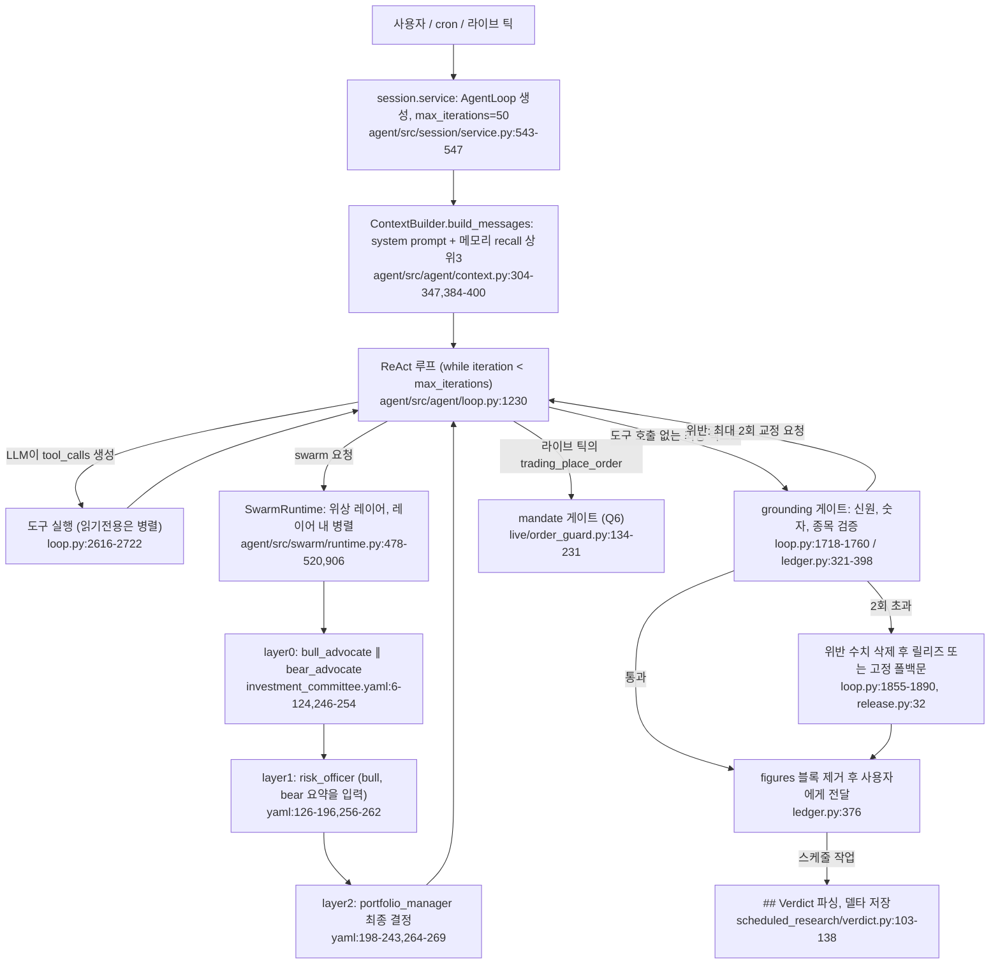

# Vibe-Trading — AI 판단: 어떻게 결정하는가

- 분석 SHA: `e532650b527ba3fb146ef00d533f6fc5040d5d2d` (repos.lock.tsv와 일치)
- 분석일: 2026-10-09
- 관련 공통 항목: Q4
- 검증 수준 요약: 코드 확인 31 / 추론 3 / 미확인 0

> **먼저 읽을 것.** Vibe-Trading은 "종목 → Buy/Sell 등급"을 내는 판단기가 아니다. 기본 정체성은 **리서치 에이전트**이고, system prompt가 "분석이지 조언이 아니다"를 못 박는다 (`agent/src/agent/context.py:56-59`). 판단 경로가 4갈래로 나뉘고 각각 결정 주체가 다르다.
>
> | 경로 | 진입점 | 결정 주체 | 코드의 역할 |
> |---|---|---|---|
> | A. 메인 ReAct 에이전트 | CLI·웹 채팅 | **LLM** (자유 도구 루프, 최대 50회) | 최종 답변의 숫자·종목을 **사후 검증**하고 거절·삭제(grounding 게이트) |
> | B. swarm 프리셋 (`investment_committee` 등) | `run_swarm` 도구 | **LLM** (PM 에이전트가 방향·비중·손절 결정) | DAG 순서 집행, 산출물 형식 검사. 수치 임계값 규칙 없음 |
> | C. 스케줄 리서치 | cron → 세션 | **LLM** (브리핑 작성), 단 마지막 `## Verdict` 줄은 코드가 엄격 파싱 | 상태 토큰(`HOT/QUIET` 등) 파싱, 델타 계산 |
> | D. 백테스트 전략 | `backtest` 도구 | **LLM이 쓴 `SignalEngine` 코드**가 결정적으로 실행 | 다음 봉 시가 체결, 시장별 거래 규칙, 비용 |
> | E. 라이브 자율 러너 | `LiveRunner` 틱 | **LLM** (프롬프트: "Trade freely INSIDE the limits") | **하드캡·kill switch·mandate 게이트**가 주문을 허용/거절 |

## 4-2. 판단 흐름 (다이어그램 1개, 노드마다 코드 위치)

### 모델 계층

`quick`/`deep` 구분이 **없다**. 모델은 환경변수 `LANGCHAIN_PROVIDER`/`LANGCHAIN_MODEL_NAME` 하나로 정해지고, 기본 온도는 0.0 (`agent/src/config/env_schema.py:164`). 프로바이더는 25종 목록(`agent/src/providers/llm_providers.json`)이다. swarm 워커도 같은 모델을 쓴다. | 코드 확인

## 4-1. 입력 조립

| 항목 | 내용 | 근거 | 검증 |
|---|---|---|---|
| 시스템 프롬프트 | 고정 템플릿 `_SYSTEM_PROMPT`에 도구 설명, 스킬 한 줄 요약(전문은 `load_skill`로 지연 로드), 메모리 스냅샷, 현재 시각을 끼워 넣음. "Output Principles"는 치환 없는 리터럴이라 세션마다 바이트 동일(캐시 친화) | `agent/src/agent/context.py:23-269,304-347` | 코드 확인 |
| 데이터 주입 | **데이터는 프롬프트에 직접 넣지 않는다.** LLM이 도구를 불러 결과(JSON 봉투)가 `tool` 메시지로 쌓임 | `agent/src/agent/loop.py:2272-2400` | 코드 확인 |
| 사용자 메시지 | 영속 메모리 최대 3건을 `<recalled-memories>`로 앞에 붙임(각 본문 500자), 활성 goal이 있으면 `<user-message>`로 감쌈 | `agent/src/agent/context.py:390-400`, `agent/src/agent/loop.py:1160-1170` | 코드 확인 |
| 길이 제한 | 5단계 컴팩션(마이크로컴팩트로 오래된 도구 결과 비우기, 컨텍스트 collapse, 요약). 예산 기반 `_compact_to_budget` | `agent/src/agent/loop.py:531-646,3097-3150,3437-3521` | 코드 확인 |
| swarm 워커 프롬프트 | `Role → 스킬 → 시장데이터 정책 → "Data Citation Discipline (HARD RULE)" → 에이전트 YAML 프롬프트(`{upstream_context}` 치환) → Ground Truth 가격 블록 → 실행 규칙 → 현재 시각` | `agent/src/swarm/worker.py:223-379` | 코드 확인 |
| swarm 상류 요약 | 상류 작업의 `report.md` 전문(없으면 최종 텍스트)이 `input_from` 키로 하류 프롬프트에 들어감. 자르기 규칙은 **못 찾음** | `agent/src/swarm/runtime.py:980-986`, `agent/src/swarm/worker.py:1312-1322` | 코드 확인 (자르기 규칙 없음은 해당 구간 기준) |

## 4-3. 결정 기준

### 판단 규칙 표

| 규칙 | 원문 인용 | 번역 | 위치 |
|---|---|---|---|
| 숫자는 도구에서 | "Every number points at a tool. For each figure you report, you must be able to name the tool call in this session that returned it." | 보고하는 모든 수치는 이번 세션의 어떤 도구 호출이 반환했는지 지목할 수 있어야 한다. | `agent/src/agent/context.py:41-44` |
| as-of 필수 | "An undated number is an unusable number." | 날짜 없는 숫자는 쓸 수 없는 숫자다. | `agent/src/agent/context.py:45-48` |
| 빈틈을 메우지 않음 | "What the tools did not return, you do not supply." | 도구가 주지 않은 것은 채우지 않는다. | `agent/src/agent/context.py:49-55` |
| 분석만, 조언 금지 | "Analysis, not advice. ... Do not tell the user what to buy, sell, or hold, and do not prescribe position sizes." | 무엇을 사고팔지 말하지 말고 포지션 크기를 지시하지 말 것. | `agent/src/agent/context.py:56-59` |
| 충분하면 멈춤 | "Once you have sufficient evidence to answer the user's question, stop calling tools and respond." | 질문에 답할 증거가 충분하면 도구 호출을 멈추고 답하라. | `agent/src/agent/context.py:60-66` |
| 소리 내어 거절 | "Refuse out loud, never silently." | 원칙 위반 요청은 조용히 따르지 말고 어느 원칙과 충돌하는지 밝혀라. | `agent/src/agent/context.py:67-72` |
| 이름 → 심볼 확정 | "call `search_symbol` first and wait for its result" | 회사·펀드명만 있으면 먼저 `search_symbol`을 호출하고 결과를 기다려라. | `agent/src/agent/context.py:170-176` |
| 백테스트 사후 분류 | "At-risk (Sharpe ≤ 0.5 or MaxDD ≥ 40%)", "Sub-optimal (Sharpe ≤ 1.0 or MaxDD ≥ 20%)", "Healthy (everything else)" | 위험(샤프 0.5 이하 또는 MDD 40% 이상), 차선(샤프 1.0 이하 또는 MDD 20% 이상), 양호(그 외) | `agent/src/agent/context.py:93-98` |
| 벤치마크 대비 유의성 | "If α is not significant (\|t\| < 2), warn ..." | α가 유의하지 않으면(\|t\|<2) 벤치마크 노출과 구분되지 않는다고 경고 | `agent/src/agent/context.py:107-114` |
| 몬테카를로 | "If p-value > 0.05, warn ..." | p>0.05면 무작위 순서와 구분되지 않는다고 경고 | `agent/src/agent/context.py:123-126` |
| 국면 편중 | "Flag if >60% of total profit comes from a single regime" | 이익의 60% 초과가 한 국면에서 나오면 표시 | `agent/src/agent/context.py:117-121` |
| 보유기간 구간 | "short (<3 days), medium (3–20 days), long (>20 days)" | 단기 3일 미만, 중기 3~20일, 장기 20일 초과 | `agent/src/agent/context.py:105` |
| 숫자 선언 규칙 | "`observed` / `derived` / `proposed` / `cited` / `count`" 역할 + `value \| role \| note \| ref` 형식 | 소수점·%·통화 기호가 붙은 수치는 `figures` 블록에 역할과 근거를 선언해야 게이트를 통과 | `agent/src/agent/context.py:192-248` |
| swarm PM | "Decisions must be executable; reject vague “it depends.” Every key number must be explicit." | 결정은 실행 가능해야 하며 "상황에 따라"는 거부. 핵심 수치는 명시. | `agent/src/swarm/presets/investment_committee.yaml:238` |
| swarm PM 종합 | "weighting, not head-count voting" / "independent judgment, not a naive average of three votes" | 다수결이 아니라 가중 판단. 세 의견의 단순 평균이 아님 | `investment_committee.yaml:201,213` |
| swarm CRO 사이징 | "From current vol, infer reasonable position upper bound (Kelly / fixed fraction)", "Single-name cap (often 5–10% of NAV)" | 변동성으로 비중 상한을 추정(켈리/고정비율), 종목 상한은 보통 NAV의 5–10% | `investment_committee.yaml:147,176` |
| swarm 수치 규율 | "You may NOT cite numbers from memory or training data." | 기억·학습 데이터의 숫자를 인용 금지 | `agent/src/swarm/worker.py:278-298` |
| swarm bear | "there is no DCF engine here, so do NOT report a DCF intrinsic value" | DCF 엔진이 없으니 DCF 내재가치를 보고하지 말 것 | `investment_committee.yaml:75-78` |
| 플레이북 경계 | "No buy, sell, or hold calls, no price targets, no position sizing, no leverage suggestions." | 매수·매도·보유, 목표가, 사이징, 레버리지 제안 금지 | `agent/src/scheduled_research/playbooks/premarket-brief.md:101-102` |
| Verdict 상태 | "STATE one of `HOT`, `MIXED`, `QUIET`" | 상태 토큰은 플레이북이 선언한 소수 어휘 | `premarket-brief.md:92` |

위 규칙 표의 모든 행은 해당 파일을 열어 원문을 확인했다(검증: 코드 확인). 프롬프트 원문이므로 "코드가 이 규칙을 집행한다"는 뜻은 아니다. 집행 여부는 4-5절 표를 본다.

**숫자 임계값은 프롬프트 안에만 있다.** 메인 에이전트 경로에 코드로 실행되는 임계값(예: "MA5 대비 5% 초과 시 추격 금지")은 **없다**. 코드가 집행하는 수치는 grounding 상수(수정 2회, 복구 6회, 심볼 해석 2회, 가격 증거 3회: `agent/src/agent/grounding/release.py:28-61`)와 라이브 mandate 한도(Q6)뿐이다. | 코드 확인

### 페르소나·역할별 차이 (investment_committee)

| 에이전트 | 관점 | 필수 산출 | 위치 |
|---|---|---|---|
| bull_advocate | 상승 근거 | 상승 논거 3–5줄(확신도 high/medium), 기술·펀더멘털·수급, 촉매 캘린더 1–3개월, 상승 목표가 3각도, 논거 무효화 시나리오 2–3개 | `investment_committee.yaml:37-44` |
| bear_advocate | 하락·리스크 | 약세 논거(심각도), 반등 시 저항·손절, 밸류 버블, VaR·CVaR·MDD·GPD 꼬리, 하락 목표가, "반박 시 무효화 조건" | `investment_committee.yaml:108-115` |
| risk_officer | 독립 리스크 | 지지/조건부/반대 결론, 논거별 신뢰도 1–5, 사각지대, **포지션 크기 범위**, 손절·헤지(옵션 가격까지 산출) | `investment_committee.yaml:180-187` |
| portfolio_manager | 최종 결정 | 결정문(방향·크기·근거), 논거별 채택/기각, CRO 항목별 수용·조정·거부, 실행 계획, 목표·손절, **확신도 0–100%**, 재평가 트리거, 백테스트 요약 | `investment_committee.yaml:229-236` |

## 4-4. 출력 형식

### 출력 스키마 표

> 이 표의 모든 행은 코드 확인.

| 필드 | 타입 | 값 범위 | 설명 | 위치 |
|---|---|---|---|---|
| (메인 에이전트) 답변 본문 | 마크다운 문자열 | 자유. 다행 데이터는 파이프 표 | 구조화 결정 객체가 **없다** | `agent/src/agent/context.py:259` |
| `figures` 블록 한 줄 | `value \| role \| note \| ref` | role ∈ observed, derived, proposed, cited, count | 사용자에게 전달 전에 제거됨 | `agent/src/agent/context.py:192-248`, `agent/src/agent/grounding/figures.py` |
| Verdict 한 줄 | `- SYMBOL: STATE - reason` | SYMBOL `[A-Z0-9][A-Z0-9._-]*`, STATE `[A-Z][A-Z0-9-]*`(플레이북별 어휘) | 형식 위반이면 `contract_violation`, 섹션 없으면 `no_verdict_section` | `agent/src/scheduled_research/verdict.py:19-30,103-130` |
| VerdictRecord | session_id, recorded_at, parse, outcome, items[], previous | outcome = `no_calls` / 단일 상태 / `mixed` | 직전 기록 1단계만 임베드해 델타 표시 | `agent/src/scheduled_research/verdict.py:53-100,133-138` |
| swarm 산출 | `report.md` + 2–3문장 요약 | 에이전트별 필수 항목은 4-3 표 | 방향(long/short/wait/hedge), 크기, 목표·손절, 확신도 0–100% | `investment_committee.yaml:224-236`, `agent/src/swarm/worker.py:351-355` |
| 백테스트 지표 | total_return, sharpe, max_drawdown, trade_count (+attribution) | 숫자 | 항상 보고 | `agent/src/agent/context.py:259` |
| SignalEngine 출력 | `Dict[code, Series]` | [-1.0, 1.0] (1=풀롱, 0=청산, -1=풀숏) | 엔진이 1봉 shift 후 `sum(abs(w)) <= 1`로 정규화 | `agent/src/skills/strategy-generate/SKILL.md:46-63`, `agent/backtest/engines/base.py:247-248` |

- **등급 체계**: Buy/Hold/Sell 같은 고정 등급 **없음**. 확신도는 swarm PM의 "0–100%"(LLM 자기 평가)뿐이다.
- **진입가·손절·목표가·비중**: swarm PM과 CRO가 **프롬프트로 요구**한다. 메인 에이전트는 금지(원칙 4)이지만 `proposed` 역할로 "관측 가격 범위 안의 제안 수준"은 허용한다 (`context.py:224-227`). | 코드 확인

## 4-5. 최종 결정이 만들어지는 방식

**결론 한 문장: 최종 결정은 LLM이 정하고, 코드는 그 결정을 (a) 근거 없는 숫자·종목 사칭 차단과 (b) 라이브 주문 한도 집행으로만 제한한다.** 코드가 신호를 합치거나 점수로 등급을 매기는 경로는 없다.

| 장치 | 무엇을 하나 | LLM 결과를 덮어쓰나 | 위치 | 검증 |
|---|---|---|---|---|
| grounding 게이트 | 최종 답변을 검사: ① 종목 신원(심볼·거래소·통화) ② 이번 세션 증거에 없는 종목에 붙은 수치 ③ `figures` 선언 대 도구 결과 대조(허용 오차·산식 평가는 `ast` 기반) | **예.** 위반 수치를 `(omitted※)` 표지로 삭제하고 각주를 붙여 릴리즈. 신원 문제 등 삭제 불가면 고정 폴백문 | `agent/src/agent/loop.py:1718-1890`, `agent/src/agent/grounding/ledger.py:350-398`, `agent/src/agent/grounding/release.py:35-61` | 코드 확인 |
| provenance 자동 보정 | 출처·통화·심볼 접미사만 빠진 초안은 모델 재호출 없이 각주로 덧붙임 | 예(첨가) | `agent/src/agent/loop.py:1728-1748`, `release.py:47-51` | 코드 확인 |
| swarm 산출물 계약 | 빈 결과·툴콜 마크업·"mock data"·원시 JSON 봉투·계획만 있는 스텁·데이터 에이전트의 무도구 호출을 **실패로 분류** | 예(실패 처리) | `agent/src/swarm/worker.py:1206-1310` | 코드 확인 |
| swarm 의존성 게이트 | 상류가 실패하면 하류를 `blocked`로 두고 실행 안 함(리스크 거부권이 우회되지 않게) | 예(실행 차단) | `agent/src/swarm/runtime.py:920-960` | 코드 확인 |
| swarm 프리셋 선택 | 사용자가 프리셋을 지정 안 하면 **키워드 가중치 점수**로 선택(LLM 아님) | - | `agent/src/tools/swarm_tool.py:32-436` | 코드 확인 |
| Verdict 파서 | 줄 형식이 어긋나면 추측하지 않고 `contract_violation` | 예(무효 처리) | `agent/src/scheduled_research/verdict.py:103-130` | 코드 확인 |
| 백테스트 엔진 | LLM이 쓴 신호를 1봉 지연, 한국은 롱온리·±30% 상하한·틱 그리드·비용 스택 적용 | 예(체결 규칙) | `agent/backtest/engines/base.py:316-334`, `agent/backtest/engines/korea_equity.py:157-228` | 코드 확인 |
| mandate 게이트(라이브) | Q6 참조 | 예(주문 거절) | `agent/src/live/order_guard.py:134-231` | 코드 확인 |

- **여러 신호의 합성**: 코드 가중평균·다수결 **없음**. swarm에서는 PM LLM이 상류 요약을 읽고 "가중 판단"한다(프롬프트 지시).
- **README와 코드 불일치 1**: system prompt는 "29개 swarm 팀"이라 쓰는데(`context.py:23`) 프리셋 YAML은 30개이고 README·SKILL.md도 30이다 (`agent/src/swarm/presets/*.yaml` 30개, `README.md:763`, `agent/SKILL.md:4`). 코드 상수가 아니라 문자열 하드코딩의 드리프트다.
- **README와 코드 불일치 2**: swarm 워커 프롬프트는 "HARD LIMIT of 20 tool calls. After that you will be cut off"라고 하지만, 코드는 20회를 세지 않는다. 실제 상한은 `max_iterations`(기본 50, YAML 50)와 타임아웃(YAML 1800초)이다 (`worker.py:343,361`, `env_schema.py:381-382`). 프롬프트 문구일 뿐 집행 장치가 아니다. | 코드 확인
- **메인 프롬프트와 라이브 러너의 긴장**: 원칙 4는 "무엇을 사고팔라고 하지 말라"인데 라이브 러너는 같은 에이전트에 "Trade freely INSIDE the limits below"를 사용자 메시지로 보낸다 (`context.py:56-59` 대 `agent/src/live/runtime/runner.py:241-245`). system prompt가 이긴다고 보장하는 코드는 못 찾았다. | 추론 (두 프롬프트를 모두 열어 확인했고, 충돌 해소 로직은 `grep`으로 찾지 못함)

## 4-6. 실패 처리

| 상황 | 동작 | 위치 | 검증 |
|---|---|---|---|
| 빈 응답(텍스트·툴콜 없음) | 1회 넛지 후 재시도, 2연속이면 중단 | `agent/src/agent/loop.py:86,1641-1665` | 코드 확인 |
| 마지막 반복에서 툴콜 DSL을 텍스트로 출력 | 거부, 1회 재시도, 예산 없으면 중립 폴백문 | `agent/src/agent/loop.py:1676-1716` | 코드 확인 |
| 반복 상한 도달 | 80% 지점에 "마무리하라" 넛지, 마지막 반복은 도구 없이 텍스트만 | `agent/src/agent/loop.py:1212,1277-1285,1395-1400` | 코드 확인 |
| grounding 위반 | 교정 턴(도구 금지) → 2회 초과 시 수치 삭제 릴리즈 → 불가 시 고정 폴백. 심볼 해석 실패는 제한적 복구(read-only 재조회) | `agent/src/agent/loop.py:1760-1890`, `release.py:28-61` | 코드 확인 |
| 도구 오류 | 응답의 `ok:false`/`success:false`/에러 상태를 도구 실패로 취급하라고 프롬프트가 지시 | `agent/src/agent/context.py:186-191` | 코드 확인 |
| 워커 실패(swarm) | 재시도(`max_retries: 1`) 후에도 실패면 하류 `blocked`, 런은 `failed` | `investment_committee.yaml:52,123`, `agent/src/swarm/runtime.py:609-621,920-960` | 코드 확인 |
| 파싱 실패(Verdict) | `contract_violation`으로 저장하고 UI는 "읽을 수 없음"으로 표시, 틀린 판정을 보여주지 않음 | `agent/src/scheduled_research/verdict.py:6-10,126-127`, `frontend/src/pages/Scheduled.tsx:342-349` | 코드 확인 |
| **fail-open 지점** | 사전 조회(swarm grounding) 실패는 경고만 남기고 계속, 라이브 어드바이저리 검토는 실패해도 주문 진행(관찰용, 기본 꺼짐) | `agent/src/swarm/runtime.py:850-864`, `agent/src/live/advisory/__init__.py:1-22` | 코드 확인 |

## 4-7. 메모리와 사후 채점

| 항목 | 내용 | 근거 | 검증 |
|---|---|---|---|
| 판단 저장 | 세션·run 단위 trace와 grounding 증거는 저장. 영속 메모리(`remember` 도구)는 **LLM이 스스로 저장**(사용자 선호·전략 인사이트) | `agent/src/agent/context.py:263`, `agent/src/memory/persistent.py:20-30` | 코드 확인 |
| 가설 레지스트리 | 상태 `exploring/testing/validated/rejected/monitoring`를 JSON으로 관리하는 순수 코드 저장소 | `agent/src/hypotheses/registry.py:1-30` | 코드 확인 |
| 수익률 사후 채점 | **없음.** LLM의 매매 의견을 N일 후 수익률로 채점하는 경로를 못 찾음. 찾아본 곳: `grep reflection\|post_mortem\|forward_return` → 팩터 벤치·감쇠 모듈뿐, `strategy_store/decay.py`는 **팩터·전략 산출물**의 IC·IR 감쇠 감시(LLM 판단 아님) | `agent/src/strategy_store/decay.py:1-25` | 코드 확인 (없음) |
| 교훈의 재주입 | 위 채점이 없으므로 없음. 메모리 recall만 다음 세션 프롬프트에 들어감 | `agent/src/agent/context.py:390-400` | 코드 확인 |

## 4-8. 비용 (LLM 호출 수 근사)

| 경로 | 근사 | 계산 근거 | 검증 |
|---|---|---|---|
| 메인 질의 1회 | 보통 5–15회, 상한 50회 + grounding 교정 최대 2회 | 반복당 LLM 1회(`loop.py:1230`), 상한 `max_iterations=50`(`session/service.py:547`). 일반 범위는 **실측이 아닌 추정** | 추론 |
| investment_committee 1회 | 상한 4 에이전트 × 50 반복 × (재시도 1회 포함 2) = 400, 일반 40–80 추정 | 에이전트 4개, `max_iterations: 50`, `max_retries: 1` (`investment_committee.yaml:51,122,194,241`), 레이어 병렬은 `max_workers=4`(`runtime.py:266`) | 추론 |
| 스케줄 리서치 1회 | 메인 질의 1회와 같음(세션에 프롬프트 1개 투입) | `scheduled_routes.py:81-89` | 코드 확인 |

## 에이전트별 입출력 표

| 에이전트 | 입력 | 출력 | 모델 계층 | 위치 |
|---|---|---|---|---|
| 메인 ReAct | 사용자 메시지 + recall 3건 + 도구 결과 | 마크다운 답변 + `figures` 블록(게이트에서 제거) | 단일 모델 | `context.py:365-400`, `loop.py:1096-1400` |
| bull_advocate | `{target}`, `{market}`, 가격 Ground Truth | `report.md`(7항목) | 단일 모델 | `investment_committee.yaml:6-53` |
| bear_advocate | 동일 | `report.md`(7항목, 위험지표는 quantlib 산출) | 단일 모델 | `investment_committee.yaml:55-124` |
| risk_officer | bull·bear 요약(`input_from`) | `report.md`(7항목, 사이징·손절·헤지) | 단일 모델 | `investment_committee.yaml:126-196,256-262` |
| portfolio_manager | risk_officer 요약(`full_debate`) | `report.md`(7항목) + 백테스트 선택 사용(도구 `backtest`) | 단일 모델 | `investment_committee.yaml:198-243,264-269` |
| 스케줄 브리핑 | 플레이북 프롬프트 | 마크다운 + `## Verdict` | 단일 모델 | `playbooks/premarket-brief.md:78-105` |
