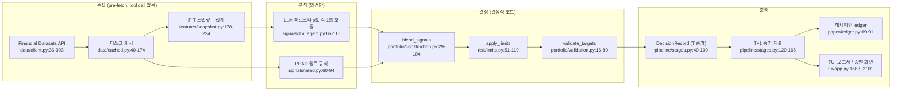

# ai-hedge-fund — 개요

- 분석 SHA: `78b779c1389e2d1452dc29606d2c4126d859b964` (repos.lock.tsv와 일치)
- 분석일: 2026-10-09
- 관련 공통 항목: Q1~Q7 (요약)
- 검증 수준 요약: 실행 확인 3 / 코드 확인 19 / 추론 0 / 미확인 0

## 1. 메타데이터

| 항목 | 내용 | 근거 | 검증 |
|---|---|---|---|
| URL | https://github.com/virattt/ai-hedge-fund | `trading/repos.lock.tsv` | 코드 확인 |
| 분석 SHA / 브랜치 | `78b779c1389e2d1452dc29606d2c4126d859b964` / main (detached HEAD, clean). 커밋 메시지 "Bump version to 2.5.0" | `git rev-parse HEAD`, `git status --porcelain` 빈 출력 | 실행 확인(git 명령만, 대상 코드는 실행하지 않음) |
| 커밋일 | 2026-10-02 | `git log -1` | 실행 확인(git 명령) |
| 패키지 / 버전 | `aihf` 2.5.0, 엔트리 `aihf = hedge_fund.run:main` | `pyproject.toml:1-4`, `pyproject.toml:37-38` | 코드 확인 |
| 라이선스 | MIT (저작권: Virat Singh) | `LICENSE:1-3`, `pyproject.toml:6` | 코드 확인 |
| 주 언어 | Python ^3.11 (pydantic, pandas/numpy, requests, textual TUI, langchain 공급자 래퍼) | `pyproject.toml:19-35` | 코드 확인 |
| 대상 시장 | 미국 주식(Financial Datasets API). 코인/한국 주식 없음 | `hedge_fund/data/client.py:45` | 코드 확인 |
| 지원 LLM | Anthropic, OpenAI, DeepSeek, Google, xAI, Kimi, TypeSafe(Jev). 기본 `claude-opus-5-5`, `HEDGE_FUND_LLM_MODEL`/`--model`로 변경 | `hedge_fund/llm/registry.py:20-33`, `hedge_fund/llm/client.py:36`, `llm/client.py:225-292`, `hedge_fund/run.py:77-78` | 코드 확인 |
| 코드 규모 | 추적 파일 115개(테스트 포함), `hedge_fund/` 패키지만 존재. v1 `src/`, `app/` 없음 | `git ls-files` | 실행 확인(git 명령) |
| 실행 형태 | Textual TUI(`aihf`), CLI(`aihf backtest`, `aihf paper create/tick/status/list/halt/resume`). 실주문 없음(paper 전용) | `hedge_fund/run.py:1-37`, `README.md:3-8`, `ROADMAP.md:92` | 코드 확인 |

## 2. 한 줄 정의

LLM 투자자 페르소나 5명(Buffett, Munger, Graham, Lynch, Druckenmiller)과 퀀트 모델(PEAD)이 공시 기반 스냅샷을 보고 **`[-1,+1]` 의견(Signal)만** 내면, **결정적 코드가 가중평균·정규화·리스크 클램프·정수 주식 수 계산으로 비중과 주문을 만들고 해시체인 ledger에 기록하는** 미국 주식 백테스트/페이퍼 트레이딩 엔진이다. 판단 주체: **의견은 LLM, 최종 결정(비중·주문)은 코드.**

## 3. 판단 파이프라인 다이어그램

## 4. 핵심 발견 5개

1. **"LLM은 의견만, 결정은 코드"가 코드로 구현돼 있다.** LLM 응답은 `bullish/neutral/bearish x confidence/100`으로 `[-1,+1]` 값이 되고(`hedge_fund/signals/llm_agent.py:37`, `llm_agent.py:176`), 이후 비중·한도·주문은 순수 산술이다(`portfolio/construction.py:29-104`, `risk/limits.py:51-102`, `pipeline/execution.py:16-53`). `reasoning`은 판단에 쓰이지 않는다. (`코드 확인`)
2. **LLM이 보는 것은 공시 기반 펀더멘털 표 한 장뿐이다.** 현재가, 거래량, 기술지표, 뉴스, 거시, 수급은 입력에 없다(`features/snapshot.py:109-136`, `signals/druckenmiller.py:60-61`). 가격은 사이징 mark에만 쓰이고(`pipeline/stages.py:173-196`), `get_news`/`get_insider_trades`는 정의만 있고 미사용이다(`data/client.py:126-156`). (`코드 확인`)
3. **포지션 크기는 확신도의 절대 크기가 아니라 종목 간 상대 크기로 정해진다.** `weight = score / Σ|score| x gross_target` 이므로 종목 1개면 확신도가 낮아도 전액이 배정된 뒤 종목 상한(예시 25%)으로 잘린다. 잘린 분은 재분배 없이 현금(`portfolio/construction.py:96-102`, `risk/limits.py:8-10`). (`코드 확인`, 해석 일부 직접 계산)
4. **백테스트 신뢰성 장치가 촘촘하다.** 공시일 기준 PIT 필터(`data/client.py:98-120`), 사후 기억 누수를 줄이는 blind 렌더(`features/snapshot.py:95-175`, `run.py:190-194`), 결정 T → 체결 T+1(`pipeline/session.py:11-15`), 완료된 일봉만 사용(`data/sessions.py:12-14`), 해시체인 ledger와 장부 대조(`paper/ledger.py:106-122`, `session.py:185-198`). 단 paper는 unblind라 백테스트와 프롬프트가 다르다(`paper/tick.py:132`). (`코드 확인`)
5. **메모리, 사후 채점, 실시간 리서치, 스케줄러가 없다.** 과거 판단은 기록만 되고 다음 프롬프트에 안 들어간다(`signals/llm_agent.py:72-73`). 검색/뉴스 도구 없음(`04-research.md`). 스케줄은 외부 cron이 멱등 `tick`을 호출(`paper/tick.py:1-15`). 사람 승인은 TUI에만 있고 CLI `tick`에는 없다(`tui/app.py:1683-1760`, `run.py:255-267`). (`코드 확인`)

## 5. 공통 항목 요약표

| 항목 | 요약 | 문서 |
|---|---|---|
| Q1 데이터 | 단일 공급자 FD API의 PIT 재무지표 14개 필드(ttm 20행)+집계, 실적 EPS 서프라이즈(PEAD), sector/industry. 가격은 사이징용 종가뿐. 뉴스·내부자거래·거래량 등은 정의만 있고 미사용 | [01-data.md](01-data.md#q1) |
| Q2 수집 | 전부 pre-fetch(도구 호출 없음), 벤더 라우터/폴백 없음. 디스크 캐시(가격만 완료성 검사), `filing_date_lte` PIT, blind 렌더, 429 재시도 후 fail loud | [01-data.md](01-data.md#q2) |
| Q3 스케줄 | 내장 스케줄러 없음. 외부 cron이 멱등 `aihf paper tick`(세션 1개씩)을 호출하고 어떤 예외든 자동 halt. 사전 동기화/DB 없음(파일 ledger), stale 반영 장치 없음 | [02-schedule.md](02-schedule.md#q3) |
| Q4 판단 | 페르소나 5명이 독립적으로 1회씩 호출되어 JSON 의견(방향+확신도)을 내고, 코드가 가중평균→상대 정규화→종목/총노출 클램프→재검증→정수 주식 수로 결정. 토론·메모리·사후 채점 없음, 단일 모델 | [03-decision.md](03-decision.md#q4-1) |
| Q5 리서치 | 없음. 에이전트에 도구가 없고 검색/뉴스/공시 조회 코드가 없다. 로드맵에도 미구현 | [04-research.md](04-research.md#q5) |
| Q6 경계 | 비중→주문 변환 코드는 있으나 브로커는 SimBroker/PaperBroker뿐(실주문 없음). 사람 승인은 TUI 모달에만, CLI는 무승인. 한도는 종목·총노출 2종, 킬스위치 수동+자동 | [05-boundary-and-fit.md](05-boundary-and-fit.md#q6) |
| Q7 적용(의견) | "의견/결정 분리", 권한 메타데이터, 이중 검증, T→T+1 ledger, PIT 계약은 가져갈 만함(MIT). 페르소나·펀더멘털 단일 입력·상대 사이징·SimBroker는 교체. 수급(ka10059)·DART·업비트 시세로 대체 | [05-boundary-and-fit.md](05-boundary-and-fit.md#q7) |

## 6. README와 코드의 차이

| # | README/문서 주장 | 코드 사실 | 위치 | 검증 |
|---|---|---|---|---|
| 1 | 가이드(`GUIDE.md` 3.3절)는 "README가 아직 v1 구조를 설명한다"고 가정 | 이 SHA의 루트 README는 이미 v2 기준(`aihf` TUI, paper 펀드, 해시체인 ledger, 승인 단계)이다. v1 흔적은 `hedge_fund/README.md`와 `ROADMAP.md`의 문구에만 남아 있음 | `README.md:24-58` | 코드 확인 |
| 2 | `hedge_fund/README.md`: "developed alongside the shipped v1 app (`src/`, `app/`)" | 이 SHA에는 `src/`, `app/`이 **존재하지 않는다**(`git ls-files` 해당 경로 0개). `ROADMAP.md`의 "Web dashboard ... frontend scaffold exists; still runs on the v1 engine"도 트리에서 확인 불가 | `hedge_fund/README.md:3-4`, `ROADMAP.md:112` | 코드 확인(부재 확인) |
| 3 | `hedge_fund/README.md` 빠른 시작: "ANTHROPIC_API_KEY ... only for LLM agents (Buffett)" | 페르소나는 5명이며 공급자는 7종(`ANTHROPIC/OPENAI/XAI/DEEPSEEK/GOOGLE/KIMI/TYPESAFE`) 중 선택 | `hedge_fund/README.md:52`, `llm/registry.py:20-28` | 코드 확인 |
| 4 | `hedge_fund/README.md`: paper와 같은 세션을 돌리면 "byte-identical records" | 백테스트는 `Fund(spec, blind=True)`, paper는 `Fund(spec)`(blind 없음)이라 LLM 프롬프트가 달라 기록이 같을 수 없다. 퀀트(PEAD)만 모델 응답 의존이 없어 일치 가능 | `hedge_fund/README.md:41-43`, `run.py:194`, `paper/tick.py:132` | 코드 확인 / "일치 조건" 해석은 추론 |
| 5 | `hedge_fund/README.md` 표: `validation/` ⬜ | 일치. 빈 패키지(docstring뿐) | `hedge_fund/validation/__init__.py:1-5` | 코드 확인 |
| 6 | `README.md:8`: "the system does not actually make any trades" | 일치. 브로커는 Sim/Paper뿐이고 라이브 브로커 ⬜ | `ROADMAP.md:92`, `brokers/paper.py:26-74` | 코드 확인 |
| 7 | `hedge_fund/README.md`/모델 레지스트리의 모델명(`claude-opus-5-5` 등) | 코드가 하드코딩한 기본값과 JSON 목록이 일치. 모델 가용성 자체는 확인하지 않음 | `llm/client.py:36`, `llm/api_models.json` | 코드 확인 / 가용성 미확인 |

## 7. 문서 목록

- [01-data.md](01-data.md): Q1 데이터 인벤토리 + Q2 수집 방식
- [02-schedule.md](02-schedule.md): Q3 최신화와 스케줄링
- [03-decision.md](03-decision.md): Q4 AI 판단(규칙표, 출력 스키마표, 에이전트 입출력표)
- [04-research.md](04-research.md): Q5 실시간 리서치(없음과 그 근거)
- [05-boundary-and-fit.md](05-boundary-and-fit.md): Q6 경계 + Q7 적용 의견
- [next.md](next.md): 확인 범위, 미확인, 다음에 볼 파일
