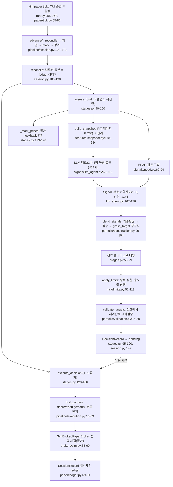

# ai-hedge-fund — AI 판단: 어떻게 결정하는가

- 분석 SHA: `78b779c1389e2d1452dc29606d2c4126d859b964` (repos.lock.tsv와 일치)
- 분석일: 2026-10-09
- 관련 공통 항목: Q4 (4-1 ~ 4-8)
- 검증 수준 요약: 코드 확인 82 / 추론 3 / 미확인 1

**한 문장 결론.** 최종 결정(종목별 목표 비중, 주문 수량)은 결정적 코드가 만들고, LLM은 `{signal, confidence, reasoning}`으로 `[-1,+1]` 의견(`Signal`)만 낸다. 그 값은 코드의 가중평균 → 정규화 → 마스터 리스크 클램프 → 검증 → 정수 주식 수 계산을 거쳐서만 비중과 주문이 된다. (`코드 확인`: `hedge_fund/signals/llm_agent.py:167-176`, `hedge_fund/portfolio/construction.py:29-104`, `hedge_fund/risk/limits.py:51-102`, `hedge_fund/pipeline/execution.py:16-53`; 설계 원칙 원문 `hedge_fund/README.md:137-139` "The LLM never touches the trade.")

## 4-1. 입력 조립 {#q4-1}

| 항목 | 내용 | 근거 | 검증 |
|---|---|---|---|
| 프롬프트 구성 | `system` = 페르소나 고정 문자열(`get_system_prompt()`), `user` = `FundamentalsSnapshot.render(blind=...)` 텍스트 1개. 대화 이력·도구·few-shot 없음 | `signals/llm_agent.py:72-73`, `llm_agent.py:121-141` | 코드 확인 |
| 입력 형식 | 텍스트 표(파이프 구분). 요약 5줄 + 기간별 행(최대 20행, 최신순) | `features/snapshot.py:109-137` | 코드 확인 |
| 입력 필드 (unblind, 라이브) | `Company/Sector/Industry`, 요약(시총, ROE avg, net margin avg, gross margin trend, BVPS CAGR, D/E latest), 이력 컬럼 `period, filed, mktcap, P/E, ROE, gross_m, op_m, net_m, D/E, curr, rev_gr, EPS, BVPS, FCF/sh` | `snapshot.py:109-136` | 코드 확인 |
| 입력 필드 (blind, 백테스트) | 회사명 `(withheld)`, `Sector`만 유지, `Size:` 시총 분위, 기간 `t-0..t-n`, 컬럼 `P/E, ROE, gross_m, op_m, net_m, D/E, curr, rev_gr, eps_idx, bvps_idx, fcf_idx, eps_yoy`(per-share는 가장 오래된 값=100 지수, `eps_yoy`는 t-0 행에만) | `snapshot.py:139-175` | 코드 확인 |
| 날짜 제거 | 렌더에 `as_of`가 없다. 같은 공시 구간의 모든 날짜가 동일 프롬프트 → 캐시 적중(비용 0) | `snapshot.py:9-13`, `snapshot.py:87-94` | 코드 확인 |
| 길이 제한/자르기 | `periods=20`(행 수), `MIN_PERIODS=4`. 토큰 단위 자르기 없음. 출력 `max_tokens=4096` | `snapshot.py:182`, `snapshot.py:27`, `llm/client.py:228` | 코드 확인 |
| 프롬프트 생성 함수 | `LLMAgent.build_user_prompt()`(스냅샷 render), `build_snapshot()`(PIT 수집) | `signals/llm_agent.py:125-141` | 코드 확인 |
| PEAD(퀀트) 입력 | 프롬프트 없음. `get_earnings_history(limit=8)` 결과를 코드가 규칙으로 판정 | `signals/pead.py:60-94` | 코드 확인 |

## 4-2. 판단 흐름 {#q4-2}

### 흐름 요약

- **오케스트레이터는 LangGraph 같은 그래프가 아니라 평범한 함수 호출**이다: `advance()` → `assess_fund()` → (전략별) `blend_signals()` → 전략 간 네팅 → `apply_limits()` → `validate_targets()`; 다음 세션에 `execute_decision()`.
- **에이전트 간 토론/상호 참조가 없다.** 5명의 페르소나는 서로의 출력을 보지 못하고 같은 스냅샷을 독립 평가한다(`llm_agent.py:72-73`: 입력은 `get_system_prompt()`와 스냅샷뿐). 매니저/트레이더 에이전트도 없다. 합의는 코드의 가중평균이 한다.
- **순차 실행**: `for ticker in tradeable: for model in staff: model.predict(...)` (`pipeline/stages.py:58-62`). 병렬 LLM 호출은 TUI의 캐시 warm 단계에서만(`tui/app.py:2260`, `app.py:3027`).
- **모델 계층 없음**: 모든 에이전트가 하나의 모델을 쓴다(기본 `claude-opus-5-5`, `--model` 또는 `HEDGE_FUND_LLM_MODEL`로 변경). quick/deep 구분 없음. (`llm/client.py:36`, `client.py:225-250`, `run.py:77-78`)
- **토론 라운드/종료 조건 없음**(해당 사항 없음; 에이전트당 LLM 1회 호출).

### 다이어그램 (노드마다 코드 위치)



### T일 결정 → T+1일 체결 상세

| 순서 | 동작 | 근거 | 검증 |
|---|---|---|---|
| 1 | 세션 T 종가 후 `assess_fund(T)` → `DecisionRecord`(주문·브로커 없음) | `stages.py:40-100` | 코드 확인 |
| 2 | `SessionRecord(T).decision`에 저장, `next_state`가 `pending`으로 승계 | `session.py:149-163`, `session.py:173-182` | 코드 확인 |
| 3 | 세션 T+1에 `execute_decision`. `session <= original.as_of`이면 오류 | `stages.py:125-126` | 코드 확인 |
| 4 | 직전 달력일(`previous_day(session)`)이 결정일과 다르면(주말·휴장) **뷰를 다시 평가해서 체결**. 같으면 기존 결정 사용. 이때 두 결정 모두 `CycleRecord`에 보존 | `stages.py:129-132`, `stages.py:163-165` | 코드 확인 |
| 5 | mandate가 결정 이후 바뀌면 거부 | `stages.py:127-128` | 코드 확인 |
| 6 | T+1 정확 종가로 equity 계산 → `build_orders` → 예상 포지션이 한도 위반이면 `ValueError` → 주문 체결 | `stages.py:134-154` | 코드 확인 |
| 의미 | 체결은 "의견이 만들어진 다음 거래일 종가". 리프레시 평가는 주말에 `as_of`가 일요일이 되어도 공시가 안 바뀌면 프롬프트가 같아 LLM 캐시 적중(추론: 캐시 키가 프롬프트 텍스트이고 렌더에 날짜가 없기 때문 `snapshot.py:87-94`, `llm/cache.py:25-28`) | - | 추론 |

### 백테스트와 라이브의 동일성

| 항목 | 내용 | 근거 | 검증 |
|---|---|---|---|
| 같은 경로 | `backtest_fund`는 `advance`를 과거 세션마다 호출(인메모리 `FundState` + `SimBroker`). paper는 같은 `advance`를 ledger 재생 상태 + `PaperBroker`로 호출 | `backtesting/fund.py:132-147`, `paper/tick.py:131-135` | 코드 확인 |
| 유일한 차이 | 백테스트는 `Fund(spec, blind=True)`, paper는 `Fund(spec)`(blind 없음) → **프롬프트가 다르므로 백테스트와 paper의 LLM 응답은 같지 않다.** README의 "byte-identical records"는 같은 프롬프트/캐시 조건에서만 성립 | `run.py:194`, `paper/tick.py:132`, `hedge_fund/README.md:41-43` | 코드 확인(코드 차이) / 해석은 추론 |

## 4-3. 결정 기준 {#q4-3}

### 판단 규칙 표

| 규칙 | 원문 인용 | 번역 | 위치 |
|---|---|---|---|
| 공통: 현재 시점 | "Treat the most recent filing date shown as the present day; do not use any knowledge of anything that happened after it. Do not invent numbers." | 화면에 보이는 가장 최근 공시일을 현재로 간주하고 그 이후 지식을 쓰지 말 것. 숫자를 지어내지 말 것 | `signals/buffett.py:49-51` (동일 문구가 graham/lynch/munger:50-52, druckenmiller:57-59) |
| 공통: 출력 스키마 | `{"signal": "bullish" \| "bearish" \| "neutral", "confidence": <0-100>, "reasoning": "<...2-4 sentences>"}` | JSON만, 정확히 이 스키마로 | `signals/buffett.py:54-56` 외 4개 |
| Buffett: 체크리스트 | "Circle of competence ... Competitive moat ... Management quality ... Financial strength ... Valuation ... Long-term prospects" | 능력 범위 → 해자 → 경영진(자본배분) → 재무건전성 → 밸류에이션 → 10년 보유 가능성 | `signals/buffett.py:27-37` |
| Buffett: 신호 정의 | "bullish: a strong, durable business at a reasonable or better price. / bearish: a weak or deteriorating business, or a price that demands perfection. / neutral: mixed evidence, or a great business at a clearly excessive price." | 강하고 지속 가능한 사업이 합리적 이하 가격이면 강세, 약하거나 악화 중이거나 완벽을 요구하는 가격이면 약세, 근거가 엇갈리거나 훌륭하지만 너무 비싸면 중립 | `buffett.py:39-43` |
| Buffett: 확신도 | "90-100 exceptional conviction with strong evidence; 70-89 solid conviction; 40-69 mixed; 10-39 weak or speculative." | 90-100 탁월, 70-89 견고, 40-69 혼재, 10-39 약함 | `buffett.py:45-46` |
| Buffett: 데이터 부족 | "If the data is insufficient to judge, say so and go neutral." | 판단 불가면 중립 | `buffett.py:52` |
| Graham: P/E 기준 | "A P/E far above 15-20 demands extraordinary justification you will rarely grant." | P/E가 15~20을 크게 넘으면 정당화가 거의 안 됨 | `signals/graham.py:33-34` |
| Graham: 재무 기준 | "current ratio comfortably above 1.5, modest debt to equity. A weak balance sheet disqualifies regardless of prospects." | 유동비율 1.5 훨씬 위, 낮은 D/E. 약한 재무면 자격 박탈 | `graham.py:35-37` |
| Graham: 과대평가 | "Overvaluation IS a bearish fact." | 고평가 자체가 약세 요인 | `graham.py:47` |
| Lynch: 분류 | "a fast grower (20%+ earnings growth), a stalwart (10-12%), a slow grower, or a turnaround" | 20%+ 급성장, 10-12% 안정성장, 저성장, 턴어라운드 | `signals/lynch.py:28-30` |
| Lynch: PEG | "A P/E well below the growth rate is attractive; a P/E far above it means you're paying for a story." | P/E가 성장률보다 훨씬 낮으면 매력, 훨씬 높으면 스토리에 돈을 내는 것 | `lynch.py:31-33` |
| Munger: 역발상 | "Invert, always invert — what would make this investment fail?" | 늘 뒤집어서, 무엇이 이 투자를 실패시킬지 | `signals/munger.py:28-29` |
| Munger: too-hard pile | "if the numbers don't paint a clear picture, this belongs in the too-hard pile. Say so and go neutral. Most things do." | 숫자가 불분명하면 "too hard"로 두고 중립 | `munger.py:37-39` |
| Druckenmiller: 변곡 | "Direction and rate-of-change matter more than levels." | 수준보다 방향과 변화율 | `signals/druckenmiller.py:33-35` |
| Druckenmiller: 비대칭 | "go big only when the inflection and the price line up. If the setup is merely average, the correct position is none." | 변곡과 가격이 맞을 때만 크게. 평범하면 포지션 없음 | `druckenmiller.py:41-43` |
| Druckenmiller: 숏 | "deteriorating fundamentals plus leverage ... That combination is a short or a pass, never a hold." | 악화된 펀더멘털 + 레버리지는 숏이거나 패스 | `druckenmiller.py:43-45` |
| Druckenmiller: 한계 고지 | "You have no macro or price-action data here — reason from the fundamentals' trajectory only, and don't pretend otherwise." | 거시/가격 데이터가 없으니 펀더멘털 궤적만으로 판단하고 아는 척 말 것 | `druckenmiller.py:60-61` |

### 코드가 정하는 숫자 규칙 (임계값·공식)

| 규칙 | 값/공식 | 위치 | 검증 |
|---|---|---|---|
| 확신도 → Signal | `value = {bullish:+1, neutral:0, bearish:-1} x confidence/100` (범위 -1..+1) | `signals/llm_agent.py:37`, `llm_agent.py:176` | 코드 확인 |
| 확신도 검증 | `0 <= confidence <= 100` 아니면 파싱 실패 → abstain | `llm_agent.py:153-155` | 코드 확인 |
| 최소 이력 | 공시 기간 4개(`MIN_PERIODS`) 미만 → abstain | `features/snapshot.py:27`, `snapshot.py:198-202` | 코드 확인 |
| 블렌딩 점수 | 종목별 가중평균 `conviction = Σ(w·v)/Σw`. 점수 `score = max(conviction,0) + (min(short_assessment,0) if mode != long_only else 0)` | `portfolio/construction.py:60-82` | 코드 확인 |
| 숏 증거 | 숏 가능(`long_short`) 분석가는 부호 있는 값, `long_only` 분석가는 `max(value,0)`만 숏 평가에 기여 → long-only 페르소나의 약세는 보유 점수를 낮출 뿐 숏을 만들지 못함 | `construction.py:39-44`, `construction.py:72-75` | 코드 확인 |
| 기권/중립 | 기권은 분자·분모 모두에서 제외, 중립(0.0)은 투표에 포함(희석) | `construction.py:39-40`, `construction.py:69-70` | 코드 확인 |
| 비중 정규화(롱온리/롱숏) | `weight = score / Σ|score| x gross_target` (gross_target 기본 1.0). `Σ|score| < 1e-9`면 전부 0, `flat_reason="no_eligible_positions"` | `construction.py:96-102`, `construction.py:17` | 코드 확인 |
| 비중 정규화(dollar_neutral) | 롱합·숏합이 각각 1e-9 이상일 때만 `score / (longs 또는 shorts) x gross_target/2`; 한쪽이 없으면 전부 0(`missing_long_side` 등) | `construction.py:85-95` | 코드 확인 |
| 전략 슬라이스 | `slice = strategy.weight / Σ strategy.weight`, `netted[t] += slice x weight` | `stages.py:55`, `stages.py:68-70` | 코드 확인 |
| 종목 상한 | `|w| > max_position_pct`면 부호 유지한 채 상한으로 클램프 (예시 mandate 0.25) | `risk/limits.py:82-92`, `fund/example.yaml:29` | 코드 확인 |
| 총노출 상한 | `Σ|w| > max_gross_exposure`면 전체를 `max_gross/gross`로 비례 축소 (예시 1.0) | `limits.py:94-100`, `example.yaml:30` | 코드 확인 |
| 중립 보존 | `dollar_neutral` 전략이 하나라도 있으면 개별 클립 대신 **공통 배율**(`min(1, cap/largest)`)로 축소해 중립 유지 | `stages.py:81-82`, `limits.py:105-119` | 코드 확인 |
| 잘린 노출 처리 | 클램프로 제거된 노출은 **다른 종목에 재분배하지 않고 현금**으로 둔다(리스크가 포지션을 키우는 것을 방지) | `limits.py:8-10` | 코드 확인 |
| 주식 수 | `target_shares = int(weight x equity / mark)` (0 방향 내림), 1주 미만 주문 없음, 매도 먼저 → 매수, 종목명 알파벳순 | `pipeline/execution.py:22-30`, `execution.py:40-44` | 코드 확인 |
| 체결가 | 주문 기준가 = 체결 세션 종가, SimBroker는 전량·무슬리피지·무수수료 체결 | `execution.py:45-50`, `brokers/sim.py:1-12`, `sim.py:38-60` | 코드 확인 |
| 리밸런스 | `daily`는 매 세션, `weekly`는 ISO 주의 첫 세션, `monthly`는 월의 첫 세션 | `pipeline/session.py:201-217` | 코드 확인 |
| PEAD | `BEAT` → +1.0, `MISS` → -1.0(크기 고정 ±1), 이벤트가 기준일로부터 `signal_window_days=4`일 이내일 때만. 8-K만 인정(`announcement_only=True`), 공시지연 45일 이상 폐기, 같은 분기 중복은 8-K 우선+가장 이른 날짜 | `signals/pead.py:21-22`, `pead.py:42-48`, `pead.py:73-78`, `pead.py:123-143` | 코드 확인 |

### 페르소나별 차이

| 페르소나 | `investment_approach` | 관점 | 위치 | 검증 |
|---|---|---|---|---|
| Buffett | `long_only` | 해자·자본배분·재무 건전성·적정가 | `signals/buffett.py:17` | 코드 확인 |
| Munger | `long_only` | 역발상, 품질 일관성, 못 알아보면 중립 | `signals/munger.py:17` | 코드 확인 |
| Graham | `long_only` | 안전마진, 유동비율 >1.5, 이익 안정성 | `signals/graham.py:17` | 코드 확인 |
| Lynch | `long_only` | 성장 분류, PEG, 스토리 검증 | `signals/lynch.py:17` | 코드 확인 |
| Druckenmiller | `long_short` | 변곡(가속/둔화)과 비대칭, 숏 허용 | `signals/druckenmiller.py:19` | 코드 확인 |
| PEAD | `long_short` | EPS 서프라이즈 후 드리프트 | `signals/pead.py:40` | 코드 확인 |

`investment_approach`는 프롬프트와 무관한 "권한 메타데이터"로, 클래스에 직접 선언해야 한다(상속 불가, `signals/__init__.py:28-39`; `signals/base.py:20-22`).

### 전략 라이브러리 (YAML, 코드 수정 없이 추가)

| 전략 | 구성 | 모드 | 비고 | 위치 |
|---|---|---|---|---|
| deep-value | graham(가중 2.0), buffett, munger | long_only | | `strategies/deep-value.yaml:4-14` |
| earnings-drift | pead | long_short | 퀀트 pod | `strategies/earnings-drift.yaml:4-11` |
| fundamental-ls | buffett, munger, graham, lynch, druckenmiller | dollar_neutral | 주석: "Shorts require support from Druckenmiller; long and short targets have equal dollar exposure." | `strategies/fundamental-ls.yaml:1-17` |
| inflections | druckenmiller, lynch | long_short | | `strategies/inflections.yaml:4-12` |
| (예시 mandate) | deep-value 0.6 + earnings-drift 0.4, 종목 25%, 총노출 1.0, 주간 | - | | `fund/example.yaml:12-33` |

### 숫자 예시 (직접 계산, 코드 공식 적용)

- 롱온리, 종목 2개: 블렌딩 conviction이 A=0.8, B=0.2 → 점수 합 1.0 → 비중 A=0.8, B=0.2 → `max_position_pct=0.25` 클램프 → A=0.25, B=0.2, 나머지 55%는 현금(재분배 없음, `limits.py:8-10`).
- 종목이 1개이고 conviction이 0.1뿐이어도 `weight = score/|score|·gross_target = 1.0`이 된 뒤 25%로 잘린다. 즉 **비중은 확신도의 절대 크기가 아니라 종목 간 상대 크기**로 정해진다(`construction.py:96-102`, "This relative sizing does not calibrate conviction into expected returns." `construction.py:47`). (`코드 확인`, 산술은 직접 계산)

## 4-4. 출력 형식 {#q4-4}

### 출력 스키마 표

| 필드 | 타입 | 값 범위 | 설명 | 위치 |
|---|---|---|---|---|
| LLM 응답 `signal` | str | `bullish`/`neutral`/`bearish` | 방향 | `signals/llm_agent.py:37`, `llm_agent.py:150-152` |
| LLM 응답 `confidence` | float | 0~100 | 투자 확신도(수익 확률 아님) | `llm_agent.py:153-155`, `llm/contract.py:7-9` |
| LLM 응답 `reasoning` | str | 2-4문장 | 서술. **코드 판단에 쓰이지 않고 기록·표시용** | `llm_agent.py:156-160`, `signals/buffett.py:55-56` |
| `Signal.model_name` | str | 레지스트리 키 | 분석가 | `models.py:21` |
| `Signal.ticker` / `date` | str | 티커 / YYYY-MM-DD | 기준일 | `models.py:22-23` |
| `Signal.value` | float | -1.0 ~ +1.0 | 부호 x 확신도/100 | `models.py:24` |
| `Signal.reasoning` | str \| None | - | 근거 문장(기권 시 `abstained: ...`) | `models.py:25`, `llm_agent.py:196-204` |
| `Signal.metadata` | dict | `abstained`, `abstain_reason`, `signal`, `confidence`, `model`, `prompt_key`, `snapshot_hash`, `cached`, `provider_metadata` | 감사용 | `llm_agent.py:177-194` |
| `BlendResult` | model | `convictions`, `eligible_scores`, `weights`, `flat_reason` | 전략 슬리브 | `portfolio/construction.py:20-26` |
| `StrategyRecord` | model | `signals`, `convictions`, `weights`, `eligible_scores`, `flat_reason`, `final_contribution` | 전략별 기록 | `pipeline/models.py:30-40` |
| `DecisionRecord` | model | `target_weights`(네팅 후, 리스크 전), `clamps`, `final_weights`(리스크 후), `risk_scale_factor`, `marks`, `skipped`, `universe`, `spec` | 판단 결과. 주문 없음 | `pipeline/models.py:43-57` |
| `CycleRecord` | model | `orders`, `fills`, `positions`, `cash`, `nav`, `equity_before`, `original_assessment`, `refreshed_assessment`, `execution_as_of`, `execution_policy="next_close"` | 체결 결과 | `pipeline/models.py:60-86` |
| `SessionRecord` | model | `nav`, `cash`, `positions`, `marks`, `benchmark_close`, `rebalance`, `executed`, `decision`, `prev_hash`, `hash`, `code_version`, `mandate_hash`, `llm_model` | ledger 1행 | `pipeline/session.py:80-102` |

### 등급 체계·확신도·가격 필드

- 등급은 3단계(`bullish/neutral/bearish`)뿐이고 Buy/Hold/Sell 같은 라벨 체계는 없다. 확신도는 0-100(`코드 확인`, `llm_agent.py:37`, `llm_agent.py:153-155`).
- **진입가·손절가·목표가는 없다.** 비중과 정수 주식 수만 있다. 체결 기준가는 다음 세션 종가(`execution.py:45-50`). 손절/목표 로직 없음(grep 결과 해당 없음, `코드 확인`).
- 비중은 자금 대비 부호 있는 비율이며 음수는 숏이다(`brokers/models.py:15-20`). 숏은 시뮬레이션 상 허용되나 마진/차입 비용은 모델링하지 않는다(`brokers/sim.py:8-12`).

### 에이전트별 입출력 표

| 에이전트 | 입력 | 출력 | 모델 계층 | 위치 |
|---|---|---|---|---|
| Buffett | `FundamentalsSnapshot.render()` 텍스트 | `{signal, confidence, reasoning}` → `Signal` | 단일 모델(기본 `claude-opus-5-5`) | `signals/buffett.py:14-56` |
| Munger | 동일 | 동일 | 동일 | `signals/munger.py:14-57` |
| Graham | 동일 | 동일 | 동일 | `signals/graham.py:14-61` |
| Lynch | 동일 | 동일 | 동일 | `signals/lynch.py:14-61` |
| Druckenmiller | 동일(거시/가격 없음) | 동일 | 동일 | `signals/druckenmiller.py:16-65` |
| PEAD | 실적 이력(8건) | `Signal(value=±1 또는 0)`, 프롬프트 없음 | LLM 없음 | `signals/pead.py:25-94` |
| 블렌더(코드) | 전략별 `Signal` 목록 + 모델 가중치 | `BlendResult` | LLM 없음 | `portfolio/construction.py:29-104` |
| 리스크(코드) | 네팅된 비중 | 클램프된 비중 + `ClampEvent` | LLM 없음 | `risk/limits.py:51-102` |
| 검증기(코드) | 신호·프로필·최종 비중 | 통과 또는 `ValueError` | LLM 없음 | `portfolio/validation.py:16-80` |
| Jev(옵션) | 동일 프롬프트를 `investor_prompt`/`financial_snapshot`로 감싼 typed 질문 3개 | 방향 choice + 강세/약세 강도(0-4)를 25배해 confidence로 변환 | TypeSafe 전용 엔드포인트 | `llm/contract.py:47-111`, `llm/client.py:106-222` |

## 4-5. 최종 결정이 만들어지는 방식 {#q4-5}

**LLM이 정하는가, 코드가 정하는가: 코드가 정한다.** LLM은 의견(`Signal`)과 서술만 내고, 비중·한도·주문은 전부 결정적 산술이다. 단 LLM 의견의 **부호와 크기가 코드 공식의 입력**이므로 방향성 자체는 LLM에서 나온다.

| 장치 | 내용 | 위치 | 검증 |
|---|---|---|---|
| 신호 합성 | 가중 평균(투표). 토론·다수결·점수 가중 외의 합성 없음 | `portfolio/construction.py:60-82` | 코드 확인 |
| 권한 게이팅 | 숏 근거는 숏 가능 분석가만. `long_only` 분석가가 약세여도 숏 불가 | `construction.py:72-75` | 코드 확인 |
| 하드 리스크 | 종목당 상한 + 총노출 상한. "분석가가 덮어쓸 수 없음", 협상 불가 | `risk/limits.py:1-11` | 코드 확인 |
| 이중 검증 | `validate_targets`가 신호와 선언 프로필에서 숏 증거·점수·총노출을 **독립 재계산**해 `ValueError`. 목표/최종 비중이 mandate에 맞는지, 전략 기여의 합이 최종 비중과 같은지 확인 | `portfolio/validation.py:16-80` | 코드 확인 |
| 체결 직전 검증 | 예상 포지션이 `max_position_pct`, `max_gross_exposure`를 넘으면 주문 전에 실패 | `stages.py:143-153` | 코드 확인 |
| 장부 대조 | 브로커 장부 ≠ ledger이면 `BookMismatch`로 거래 중단 | `session.py:185-198` | 코드 확인 |
| mandate 고정 | 결정 후 mandate가 바뀌면 체결 거부 | `stages.py:127-128` | 코드 확인 |
| 감사 | 모든 세션 기록이 해시체인으로 연결, 변조 시 `replay`가 거부 | `paper/ledger.py:106-122`, `session.py:104-106` | 코드 확인 |
| LLM 응답 무시 필드 | `reasoning`은 어떤 코드 경로에서도 판단에 쓰이지 않는다(`Signal.reasoning`을 참조하는 곳은 표시/저장뿐) | `llm_agent.py:182`, `tui/app.py:1158` | 코드 확인(판단 경로에서 미참조는 `hedge_fund/portfolio`, `pipeline`, `risk` grep 근거) |

## 4-6. 실패 처리 {#q4-6}

| 상황 | 동작 | 위치 | 검증 |
|---|---|---|---|
| 데이터 부족(<4기간) | 해당 분석가 abstain(`value=0.0`, `abstained=True`) | `llm_agent.py:68-69` | 코드 확인 |
| 데이터 계층 오류(인증, 429 소진, 네트워크, 5xx) | **전파(fail loud)**. paper는 펀드 halt | `llm_agent.py:70`, `paper/tick.py:136-142` | 코드 확인 |
| LLM 호출 실패 | abstain + 경고 로그. `LLMCallError`면 진단 레코드까지 캐시에 저장 | `llm_agent.py:92-103` | 코드 확인 |
| JSON 파싱/검증 실패(잘못된 signal, confidence 범위 밖 등) | 원문 저장 후 abstain. **재시도 없음** | `llm_agent.py:105-112`, `llm_agent.py:147-165` | 코드 확인 |
| JSON 추출 | ```` ```json ```` 펜스 → 전체 문자열 → 첫 균형 `{...}` 순서로 시도, 모두 실패 시 `LLMParseError` | `llm/client.py:333-361` | 코드 확인 |
| 모든 분석가 기권/중립 | 점수 0 → `flat_reason`, 비중 0(현금화 방향: 기존 보유는 목표 0으로 매도) | `construction.py:97-102`, `execution.py:4-6`, `execution.py:38-44` | 코드 확인 |
| 신호 값 범위 오류(NaN, ±1 초과) | `ValueError`(fail loud) | `construction.py:67-68` | 코드 확인 |
| LLM 키 없음 | `Fund` 생성(에이전트 생성) 시점에 `ValueError: <ENV> not found` | `llm/client.py:320-330`, `llm_agent.py:50` | 코드 확인 |
| 거래 불가 종목 | 분석에서 `TickerSkip`, 보유 중이면 체결 단계에서 정확 종가 없으면 전체 실패 | `stages.py:190-194`, `stages.py:111-112` | 코드 확인 |
| fail-open 여부 | 의견 수준에서는 abstain(=투표 제외)이므로 "그대로 통과"가 아니라 **기권**이다. 다만 여러 분석가 중 일부만 기권해도 나머지로 결정이 진행된다(전부 기권이면 flat) | `construction.py:69-70` | 코드 확인 |

주의(의견이 아니라 코드 사실): 한 페르소나가 연속 기권(예: 파싱 실패)해도 오류가 `SessionRecord`에 `reasoning="abstained: ..."`로만 남고 펀드는 계속 진행한다. 기권 비율에 대한 경보/중단 임계값은 없다(grep 결과 해당 없음). 그래서 장기 운영 시 모델 장애가 "조용한 중립"으로 보일 수 있다. (`추론`: 코드에 기권 집계 로직이 없다는 점에 근거)

## 4-7. 메모리와 사후 채점 {#q4-7}

| 항목 | 내용 | 위치 | 검증 |
|---|---|---|---|
| 과거 판단 저장 | 있음: ledger(`SessionRecord`), 프롬프트/응답 캐시(`~/.hedge-fund/cache/llm/`) | `paper/ledger.py:69-91`, `llm/cache.py:1-48` | 코드 확인 |
| 사후 수익률 채점 | **없음.** 기간별 사후 채점·벤치마크 대비 신호 평가 코드가 없다. 성과 지표(`total_return`, `sharpe`, `max_drawdown`, `excess_return`)는 백테스트 결과 요약에만 계산된다 | `backtesting/fund.py:180-221` | 코드 확인 |
| 교훈의 다음 판단 주입 | **없음.** 과거 판단·교훈이 프롬프트에 들어가지 않는다 | `llm_agent.py:72-73`(입력은 시스템 프롬프트와 스냅샷뿐) | 코드 확인 |
| 로드맵 | validation(CPCV/PBO)은 빈 패키지, "Research lab/Strategy generator" 미구현 | `hedge_fund/validation/__init__.py:1-5`, `ROADMAP.md:100-102` | 코드 확인 |
| 캐시를 메모리로 오해 금지 | PromptCache는 "같은 프롬프트면 비용 0"과 감사용이며 학습/교훈이 아니다 | `llm/cache.py:1-11` | 코드 확인 |

## 4-8. 비용 {#q4-8}

판단 1회(리밸런스 세션 1번)당 LLM 호출 수의 근사:

`호출 수 ≈ (종목 수 N) x (펀드에 쓰인 서로 다른 LLM 페르소나 수 M) x (캐시 미스 비율)`

| 시나리오 | 계산 | 근거 | 검증 |
|---|---|---|---|
| 예시 mandate(graham·buffett·munger + pead), 종목 5개 | 최대 5x3=15회(PEAD는 LLM 없음). 같은 페르소나가 두 전략에 있어도 프롬프트가 같으면 두 번째는 캐시 적중 | `fund/example.yaml:14-27`, `stages.py:52-54`, `llm/cache.py:25-28` | 코드 확인(식), 수치는 계산 |
| fundamental-ls(5 페르소나), 종목 5개 | 최대 5x5=25회 | `strategies/fundamental-ls.yaml:8-13` | 코드 확인(식), 수치는 계산 |
| 캐시 효과 | 렌더/해시에서 `as_of`를 제외하므로 새 공시가 없으면 날짜가 바뀌어도 호출 0. 새 호출은 (종목 x 페르소나)별 **새 공시 발생 시**에만 | `snapshot.py:9-13`, `snapshot.py:77-94` | 코드 확인 |
| 백테스트(78주 기본 창, 주간) | 리밸런스 약 78번이지만 고유 프롬프트 수는 종목·페르소나당 대략 공시 횟수(분기 ≈ 6~7회) | `tui/shared.py:74`, `backtesting/fund.py:164-177` | 추론(공시가 분기마다라는 가정, 정확한 횟수는 미실행) |
| 호출당 토큰 | 입력: 페르소나 시스템 프롬프트 + 표(최대 20행 x 14열), 출력: JSON 한 개(`max_tokens=4096` 상한). 정확한 토큰 수는 실행하지 않아 미확인 | `llm/client.py:228` | 미확인 |
| 체결 전 refresh | 직전 달력일이 결정일이 아닐 때만 재평가(캐시 적중 가능성 높음) | `stages.py:129-132` | 코드 확인 |
| 병렬화 | 엔진은 순차. TUI warm만 최대 8 스레드로 병렬 | `stages.py:58-62`, `tui/app.py:2260`, `app.py:3027` | 코드 확인 |
| 온도 등 샘플링 파라미터 | `temperature`/`top_p` 지정 없음(공급자 기본값 사용) | `hedge_fund/` grep 결과 없음, `llm/client.py:253-281` | 코드 확인 |

## 근거 표 (요약)

| 구분 | 위치 | 식별자 | 설명 | 검증 |
|---|---|---|---|---|
| 진입점 | `hedge_fund/run.py:71-96` | `main()` | TUI/backtest/paper | 코드 확인 |
| 세션 오케스트레이터 | `hedge_fund/pipeline/session.py:109-170` | `advance()` | 한 세션 | 코드 확인 |
| 평가 | `hedge_fund/pipeline/stages.py:40-100` | `assess_fund()` | 분석가 호출→블렌드→리스크→검증 | 코드 확인 |
| 체결 | `hedge_fund/pipeline/stages.py:120-166` | `execute_decision()` | T+1 종가 체결 | 코드 확인 |
| 에이전트 베이스 | `hedge_fund/signals/llm_agent.py:40-204` | `LLMAgent` | 프롬프트·호출·파싱·기권 | 코드 확인 |
| 신호 합성 | `hedge_fund/portfolio/construction.py:29-104` | `blend_signals()` | 가중평균 → 비중 | 코드 확인 |
| 리스크 | `hedge_fund/risk/limits.py:51-119` | `apply_limits()` | 종목/총노출 클램프 | 코드 확인 |
| 검증 | `hedge_fund/portfolio/validation.py:16-80` | `validate_targets()` | 재계산 교차검증 | 코드 확인 |
| 주문 | `hedge_fund/pipeline/execution.py:16-53` | `build_orders()` | 정수 주식 수 | 코드 확인 |

permalink:
- https://github.com/virattt/ai-hedge-fund/blob/78b779c1389e2d1452dc29606d2c4126d859b964/hedge_fund/portfolio/construction.py#L29-L104
- https://github.com/virattt/ai-hedge-fund/blob/78b779c1389e2d1452dc29606d2c4126d859b964/hedge_fund/pipeline/stages.py#L40-L100
