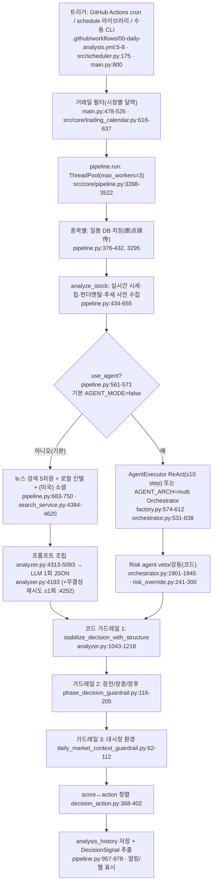

# daily_stock_analysis — 개요

- 분석 SHA: `ce364e457aab288863a5707e7b3df79786ad07f2` (repos.lock.tsv와 일치)
- 분석일: 2026-10-09
- 관련 공통 항목: Q1~Q7 전체 요약
- 검증 수준 요약: 코드 확인 19 / 추론 0 / 미확인 2 (실행 확인 0; 본문 내 표기 횟수 기준 근사치)

경로 약어: `analyzer.py`=`src/analyzer.py`, `pipeline.py`=`src/core/pipeline.py`, `base.py`=`data_provider/base.py`, `config.py`=`src/config.py`, `search_service.py`=`src/search_service.py`, `storage.py`=`src/storage.py`, `orchestrator.py`/`runner.py`/`executor.py`/`factory.py`/`protocols.py`=`src/agent/…`, `defaults.py`/`aggregator.py`/`router.py`/`deliberation.py`=`src/agent/skills/…`, `agents/*_agent.py`=`src/agent/agents/…`, `search_tools.py`/`data_tools.py`=`src/agent/tools/…`, `stock_analyzer.py`=`src/stock_analyzer.py`. 그 외는 레포 루트 기준 상대경로를 그대로 적었다.

SHA 고정 확인: `git rev-parse HEAD` = 위 SHA, `git status --porcelain` 비어 있음(clean). 코드는 읽기만 했고 설치·실행하지 않았다. (`코드 확인`)

---

## 1. 메타데이터

| 항목 | 값 | 검증 |
|---|---|---|
| URL | https://github.com/ZhuLinsen/daily_stock_analysis | 코드 확인 |
| SHA / 커밋일 | `ce364e45...` / 2026-10-05 (`feat: 新增规则化 ETF 双动量轮动（--etf-rotation） (#2376)`) | 코드 확인 |
| 라이선스 | MIT (`LICENSE:1-3`, "MIT License / Copyright (c) 2026 ZhuLinsen") | 코드 확인 |
| 주 언어 | Python 3 백엔드(`main.py`, `src/`, `data_provider/`, `api/`, `bot/`) + React 웹(`apps/dsa-web/`) + Electron 데스크톱(`apps/dsa-desktop/`) | 코드 확인 |
| 대상 시장 | A주, 홍콩, 미국, 일본(`.T`), **한국(`.KS`/`.KQ`)**, 대만(`.TW`/`.TWO`), ETF/지수 (`README.md:17`, `data_provider/base.py:243-258`, `src/services/market_symbol_utils.py:25-28`) | 코드 확인 |
| 지원 LLM | LiteLLM 라우터 경유 다수(Gemini, OpenAI호환, Anthropic, DeepSeek, Moonshot, DashScope 등) + 로컬 CLI backend(`src/llm/local_cli_backend.py`) + Codex app server (`.github/workflows/00-daily-analysis.yml:68-277`의 환경변수 목록, `src/analyzer.py:3479`의 `_get_generation_backend`) | 코드 확인 |
| 출력 언어 | `REPORT_LANGUAGE` = zh / en / **ko** (한국어 프롬프트 지시문 내장: `src/analyzer.py:2715-2725`) | 코드 확인 |
| 코드 규모 | 추적 파일 1,210개, `src/analyzer.py` 5,730줄, `src/core/pipeline.py` 4,377줄, `data_provider/base.py` 4,979줄 | 코드 확인 |

## 2. 한 줄 정의

**A주 중심 일일 종목 분석 시스템. 기본 경로는 "코드가 기술지표·수급·뉴스를 미리 모아 프롬프트에 넣고 LLM이 점수(0-100)와 액션 JSON 1개를 내면, 결정적 코드(가드레일)가 그 결과를 매수→관망 쪽으로 덮어쓰는" 구조이다.** 최종 결정 주체는 LLM이 초안을 쓰고 코드가 보수적으로 제한하는 혼합형이며, 코드는 매수 신호를 약화시키는 방향으로만 개입한다(상세는 아래 6절).

## 3. 판단 파이프라인 다이어그램

## 4. 핵심 발견 5개

1. **기본 경로는 "단일 LLM 호출 + 규칙 프롬프트"이다.** `AGENT_MODE` 기본값 false(`src/config.py:1055`), GitHub Actions 워크플로도 `AGENT_MODE`를 넘기지 않는다(`00-daily-analysis.yml` 전체에 해당 키 없음, grep 확인). 기본 스킬은 `bull_trend` 하나이고 이때만 "레거시 기본 프롬프트"(`LEGACY_DEFAULT_SYSTEM_PROMPT`, `src/analyzer.py:1949-2134`)가 쓰인다(`src/agent/factory.py:199-217`). `코드 확인`
2. **매매 원칙은 프롬프트 상수 + 코드 상수에 이중으로 박혀 있다.** `CORE_TRADING_SKILL_POLICY_ZH`(`src/agent/skills/defaults.py:26-59`)는 "MA5 대비 +5% 초과 시 매수 금지, MA5>MA10>MA20 필수"를 LLM에 지시하고, 같은 임계값이 코드 점수 계산(`src/stock_analyzer.py:585-754`, `BIAS_THRESHOLD` 기본 5.0 `src/config.py:1049`)에도 있다. 다만 이 점수는 LLM 입력 참고값(`系统评分`)일 뿐 최종 결정을 직접 정하지 않는다. `코드 확인`
3. **코드가 LLM의 매수를 낮추는 3중 가드레일이 있다.** (a) `stabilize_decision_with_structure`: 지지/저항/자금흐름 기준으로 buy→hold 강등, 점수를 45~59로 클램프(`analyzer.py:1119-1217`, `:1429`); (b) 장전/비거래일 즉시 매매 문구를 "대기"로 교체하고 신뢰도 상한(`phase_decision_guardrail.py:159-197`); (c) 대시장 요약에 "观望/谨慎" 등이 있으면 buy→hold, 점수 ≤52(`daily_market_context_guardrail.py:78-93`). 매도→매수로 올리는 경로는 없다. `코드 확인`
4. **한국 종목(`.KS`)은 LLM이 buy를 내도 후처리에서 hold로 강등된다(코드 경로 추적).** 한국은 일봉·시세·펀더멘털이 모두 yfinance 단일 경로(`data_provider/base.py:644`, `:2483-2494`), 자금흐름 블록은 항상 `not_supported`(`base.py:4057-4075`), 그러면 `stabilize_decision_with_structure`가 "자금흐름 미확인 → buy는 hold로 강등"한다(`analyzer.py:1093-1117`). 뉴스 검색은 `.KS`가 외국 티커 정규식에 안 맞아 중국어 쿼리 템플릿으로 간다(`search_service.py:2279`의 `_US_STOCK_RE`, 영어 템플릿 `:4412-4466` 대신 중국어 템플릿 `:4467-4524` 사용). `코드 확인`(정적 추적, 실행 확인 아님)
5. **수집은 하지만 쓰지 않는 데이터와 미사용 모듈이 있다.** 성장률·실적예고·용호방·기관보유 변화는 레거시 프롬프트에 들어가지 않고(`analyzer.py:4497-4690` 프롬프트 표에 없음, 알림 표시용 `src/notification.py:2239-2344`에만 사용), `AgentMemory`(`src/agent/memory.py`)와 `PortfolioAgent`(`src/agent/agents/portfolio_agent.py`)는 정의만 있고 오케스트레이터가 호출하지 않는다. 백테스트 결과도 다음 판단 프롬프트에 주입되지 않는다. `코드 확인`

## 5. 공통 항목 요약표 (상세 문서 링크)

| 항목 | 요약 | 문서 |
|---|---|---|
| Q1 데이터 | 일봉/시세/칩/재무(akshare 등)/주력자금흐름/뉴스(7종 검색엔진)/미국 소셜/시장단계/대시장 복기. 코인 전용 데이터 없음. 성장률·용호방·기관보유는 수집만 하고 레거시 프롬프트 미사용. | [01-data.md](01-data.md#q1) |
| Q2 수집 | 벤더 우선순위 efinance(P0)>akshare>pytdx>baostock>yfinance>tencent(+tushare 키 있으면 -1), 실시간은 tencent>sina>efinance>em. 기본은 pre-fetch→프롬프트 주입, Agent 모드만 tool call. 서킷브레이커 3회/5분, 지표는 코드 계산. | [01-data.md](01-data.md#q2) |
| Q3 스케줄 | Actions cron `0 10 * * 1-5`(=북경 18:00), 로컬은 `schedule` 라이브러리 일 1회+30초 폴링, 시장별 거래일 필터. 사전 DB 동기화 없음(분석 시 on-demand 저장, Actions는 DB 비영속). | [02-schedule.md](02-schedule.md#q3) |
| Q4 AI 판단 | LLM 1회가 0-100 점수·buy/hold/sell·저격가 포함 대시보드 JSON을 생성 → 코드 3중 가드레일이 매수를 약화. 점수 구간표 80/60/40/20, 건전성 상수 MA5 乖离 5%. Agent 모드는 technical→intel→(risk)→decision. | [03-decision.md](03-decision.md#q4) |
| Q5 리서치 | 판단 전 고정 쿼리 템플릿 5차원 검색(LLM이 쿼리를 만들지 않음). Agent 모드에서만 LLM이 `search_stock_news`/`search_comprehensive_intel` 도구를 호출(종목명·코드만 LLM이 넘김). | [04-research.md](04-research.md#q5) |
| Q6 경계 | 주문 코드 없음(주문/실행 grep 결과 없음). 출력은 DecisionSignal(entry/stop/target)·분석이력 DB 저장까지. 하드 한도·킬스위치 없음(집중도·낙폭은 경고만). 유일한 규칙 기반 비중 산출은 LLM 없는 ETF 로테이션(`1/top_n`). 웹 UI는 저격가·입력 데이터 블록·진단 표시. | [05-boundary-and-fit.md](05-boundary-and-fit.md#q6) |
| Q7 적용(의견) | 가져갈 것: 점수↔액션 정본표, 3중 가드레일, 데이터 품질 블록, 6차원 검색 템플릿 구조. 버릴 것: A주 전용 수급·칩·용호방, 중국어 프롬프트 의존. 한국은 키움 데이터+DART로 대체 필요. MIT라 코드 재사용 가능. | [05-boundary-and-fit.md](05-boundary-and-fit.md#q7) |

## 6. "최종 결정은 LLM인가 코드인가"

**LLM이 점수와 액션 초안을 정하고, 결정적 코드가 지지/저항·자금흐름·장단계·대시장 환경에 따라 매수를 hold/관망으로 낮추는 "LLM 제안 + 코드 거부권(하향 전용)" 구조이며, Agent 모드(multi, full/specialist)에서는 Risk agent의 veto도 코드(`risk_override.py`)가 적용한다.** (근거: `src/analyzer.py:1043-1218`, `src/phase_decision_guardrail.py:159-197`, `src/daily_market_context_guardrail.py:78-93`, `src/agent/risk_override.py:241-300`; `코드 확인`)

## 7. README와 코드가 다른 곳

| README 주장 | 코드 | 위치 | 검증 |
|---|---|---|---|
| 기본 무료 소스를 "AkShare、Baostock、YFinance 등"으로 소개 (`README.md:62`) | 기본 우선순위 0번은 **Efinance**, 다음 Akshare, Pytdx, Baostock, Yfinance, Tencent. README 표(`README.md:58`)에는 efinance/tencent/pytdx가 보이지 않음 | `data_provider/base.py:1791-1806`, `efinance_fetcher.py:282` | 코드 확인 |
| "비거래일(含 A/H/US 휴장일) 미실행" (`README.md:151`) | 거래일 달력은 cn/hk/us/jp/kr/tw 6개 시장 (`MARKET_EXCHANGE`) | `src/core/trading_calendar.py:41-50` | 코드 확인 |
| "일일 18:00(북경시간) 실행" (`README.md:151`) | 워크플로 cron은 UTC 10:00. 한국 시간(KST)으로는 19:00. 로컬 `SCHEDULE_TIME` 기본 "18:00"은 서버 로컬 시간 | `.github/workflows/00-daily-analysis.yml:6`, `src/config.py:1260` | 코드 확인 |
| 결정 대시보드를 모델이 만든다는 서술 | 실제 최종 필드(`decision_type`, `operation_advice`, 점수)는 후처리 코드가 덮어쓴다 | `src/analyzer.py:1043-1218` | 코드 확인 |

## 8. 문서 목차

- [01-data.md](01-data.md): Q1 데이터 인벤토리 + Q2 수집 방식
- [02-schedule.md](02-schedule.md): Q3 최신화와 스케줄링
- [03-decision.md](03-decision.md): Q4 AI 판단(규칙 표, 스키마 표, 에이전트 표 포함)
- [04-research.md](04-research.md): Q5 실시간 리서치
- [05-boundary-and-fit.md](05-boundary-and-fit.md): Q6 경계 + Q7 적용 의견
- [next.md](next.md): 확인 범위, 미확인, 다음에 볼 파일
