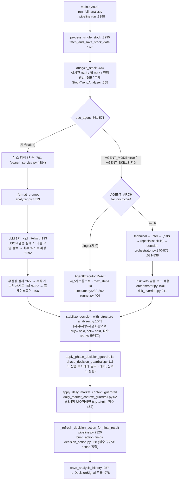

# daily_stock_analysis — AI 판단

- 분석 SHA: `ce364e457aab288863a5707e7b3df79786ad07f2` (repos.lock.tsv와 일치해야 함)
- 분석일: 2026-10-09
- 관련 공통 항목: Q4 (4-1 ~ 4-8)
- 검증 수준 요약: 코드 확인 108 / 추론 2 / 미확인 2 (실행 확인 0; 본문 내 표기 횟수 기준 근사치)

경로 약어: `analyzer.py`=`src/analyzer.py`, `pipeline.py`=`src/core/pipeline.py`, `base.py`=`data_provider/base.py`, `config.py`=`src/config.py`, `search_service.py`=`src/search_service.py`, `storage.py`=`src/storage.py`, `orchestrator.py`/`runner.py`/`executor.py`/`factory.py`/`protocols.py`=`src/agent/…`, `defaults.py`/`aggregator.py`/`router.py`/`deliberation.py`=`src/agent/skills/…`, `agents/*_agent.py`=`src/agent/agents/…`, `search_tools.py`/`data_tools.py`=`src/agent/tools/…`, `stock_analyzer.py`=`src/stock_analyzer.py`. 그 외는 레포 루트 기준 상대경로를 그대로 적었다.

핵심 permalink
- 코드 가드레일 본체: https://github.com/ZhuLinsen/daily_stock_analysis/blob/ce364e457aab288863a5707e7b3df79786ad07f2/src/analyzer.py#L1043-L1218
- 매매 원칙 상수: https://github.com/ZhuLinsen/daily_stock_analysis/blob/ce364e457aab288863a5707e7b3df79786ad07f2/src/agent/skills/defaults.py#L26-L59

경로 용어: **레거시 경로**(기본, `GeminiAnalyzer.analyze`) / **Agent 경로**(`AGENT_MODE=true`; 아키텍처 `single`=ReAct 단일 에이전트(기본), `multi`=오케스트레이터). 두 경로 모두 마지막에 같은 코드 가드레일을 통과한다(`pipeline.py:906-936`, `:1718-1778`). `코드 확인`

---

## Q4. AI 판단 {#q4}

### 4-1. 입력 조립

| 구분 | 내용 | 근거 | 검증 |
|---|---|---|---|
| 시스템 프롬프트 생성 | 시장 역할(`get_market_role`)·시장 가이드라인(A주/홍콩/미국/일본/한국/대만별 문구)을 템플릿에 끼우고 → 기본이면 `LEGACY_DEFAULT_SYSTEM_PROMPT`(매매원칙 상수 포함), 스킬 명시 시 `SYSTEM_PROMPT`(스킬 지침 + 필요 시 기본 원칙) → 마지막에 출력 언어 지시(zh/en/ko) | `src/analyzer.py:2669-2733`, `:1949-2134`(레거시), `:2136-2320`(스킬형), `src/market_context.py:60-140` | 코드 확인 |
| 유저 프롬프트 생성 함수 | `GeminiAnalyzer._format_prompt()` | `src/analyzer.py:4313-5093` | 코드 확인 |
| 입력 형식 | **마크다운 표 + 불릿**(JSON 아님). 순서: 기본정보 → 시장 단계 → 대시장 복기 요약 → 시장 구조 → 컨텍스트팩 요약(데이터 품질) → 기술면(시세/이평) → 실시간 보강(量比·换手率·PE·PB·시총·60일 등락) → 재무/배당 → 주력 자금흐름 → (대만) 3대 법인 → 칩 분포 → 추세 사전판단(코드 점수·이유·위험) → 量价变化 → 뉴스 → 결측 경고 → 분석 과제·출력 요구 | `analyzer.py:4400-5093`(섹션 헤더 위치: `:4400, :4409, :4448, :4455, :4483, :4543, :4614, :4662, :4692, :4780/:4812, :4849, :4890, :4941, :5017`) | 코드 확인 |
| 코드가 계산한 값을 LLM에 "판단 보조"로 제공 | `系统信号`, `系统评分`(0-100), 乖离率 경고(`🚨 超过5%，严禁追高！` / `✅ 安全范围`), 지지/저항, 점수 이유/위험 요인 | `analyzer.py:4780-4848`, `src/stock_analyzer.py:585-754` | 코드 확인 |
| 길이 제한·자르기 | 뉴스: 차원당 목표 3건(`target_per_dimension=3`), 보고서에는 차원당 최대 4건·요약 150자 컷(`snippet[:150]`). `max_output_tokens`=8192. **프롬프트 전체 길이 상한/요약 로직은 찾지 못함** (로그에 길이만 출력) | `search_service.py:4526`, `:4638-4693`, `analyzer.py:4179` | 코드 확인(뉴스·출력 한도) / 추론(전체 길이 무제한: `analyze()` 전체를 읽어 자르는 코드가 없음을 확인) |
| 프롬프트 내 "신뢰 경계" | 대시장 복기 요약을 `BEGIN_UNTRUSTED_MARKET_SUMMARY` 센티널로 감싸는 상수 존재 | `src/services/daily_market_context.py:37-40` | 코드 확인(상수 존재, 사용처 미열람) |
| 한국어 출력 | `REPORT_LANGUAGE=ko`면 영어 스캐폴딩 + "모든 JSON 값은 한국어로" 지시 | `analyzer.py:2715-2725`, `:4990-5003`(유저 프롬프트 말미) | 코드 확인 |

### 4-2. 판단 흐름

| 노드 | 코드 위치 | 병렬/순차 | 검증 |
|---|---|---|---|
| 종목 병렬 | `ThreadPoolExecutor(max_workers=3)` | 종목 단위 병렬, 종목 내부 순차 | 코드 확인(`pipeline.py:3522`) |
| 레거시 LLM | `analyzer.py:4193`, 재시도 루프 `:4187-4275` | 순차, 호출 1회 + 선택적 보완 재시도 | 코드 확인 |
| 단일 에이전트 | `executor.py:230-262`(워크플로: 1) 시세·K선 → 2) 추세·칩 → 3) 뉴스 → 4) 보고서; "각 단계는 이전 단계 결과가 돌아온 뒤", 한 호출에 단계 혼합 금지) | 단계는 순차, 단계 내 도구는 병렬 가능(`runner.py:518-531`) | 코드 확인 |
| 멀티 에이전트 | `orchestrator.py:840-872`: `quick=[technical, decision]`, `standard=[technical, intel, decision]`(기본), `full/specialist=[technical, intel, risk, decision]` | **순차**(specialist 스킬 에이전트만 `decision` 직전에 스레드풀 병렬, 동시성 ≤4) | 코드 확인 |
| 토론 라운드 | **LLM 토론 라운드는 없다.** 에이전트끼리 반박·재토론하지 않는다. 다만 specialist 모드의 `StrategySynthesizer`가 상충하는 스킬 의견(최대 3건)에 대해 **규칙 기반 1라운드 숙의**(`mode="mediator_v0"`, `rounds=1`)를 돌려 `softened`(신호 한 단계 완화: strong→일반, 신뢰도 ×0.9, 하한 0.3) 또는 `unchanged`로 기록하고 설명 payload를 만든다. LLM 중재자(`LLMDeliberationMediator`, `MultiRoundDeliberationMediator`)는 정의만 있고 기본 경로에 연결되지 않는다. decision 입력에는 `agent_disagreement_summary`도 들어간다 | `skills/deliberation.py:22-28`, `:89-147`, `:195-216`, `skills/synthesis.py:202-225`, `skills/engine.py:191`, `skills/aggregator.py:75-84`, `skills/__init__.py:67-79`(LLM 중재자는 지연 export만), `decision_agent.py:227-231` | 코드 확인 |
| 종료 조건 | 단계 실패 시 `intel`/`risk`는 비치명(성능 저하 후 계속), 나머지 단계 실패는 파이프라인 중단. 타임아웃 시 부분 결과. 단일 에이전트는 `max_steps`(기본 10) 초과 시 오류 | `orchestrator.py:79`, `:740-757`, `runner.py:589-598` | 코드 확인 |
| 모델 계층 | **quick/deep 구분 없음.** 일반 분석은 `LITELLM_MODEL`(+`LITELLM_FALLBACK_MODELS`), Agent는 `AGENT_LITELLM_MODEL`. 에이전트별 타임아웃만 별도(`agent_risk_agent_timeout_s` 등) | `config.py:815-845`, `pipeline.py:1573`, `orchestrator.py:195-212` | 코드 확인 |
| 백엔드 폴백 | `GENERATION_BACKEND` 실패(fallbackable) 시 `GENERATION_FALLBACK_BACKEND`(Actions 기본 `litellm`)로 재시도 | `analyzer.py:3489-3600`, `00-daily-analysis.yml:69` | 코드 확인 |

### 4-3. 결정 기준

#### 판단 규칙 표

| 규칙 | 원문 인용 | 번역 | 위치 | 검증 |
|---|---|---|---|---|
| 乖离率 5% 초과 매수 금지 | "**绝对不追高**：当股价偏离 MA5 超过 5% 时，坚决不买入" / "乖离率 < 2%：最佳买点区间" / "乖离率 2-5%：可小仓介入" / "乖离率 > 5%：严禁追高！直接判定为"观望"" | 절대 추격 매수 금지: 주가가 MA5에서 5% 넘게 벗어나면 절대 사지 않는다 / 乖离 2% 미만이 최적 / 2~5%는 소량 진입 / 5% 초과는 추격 금지, 곧바로 "관망"으로 판정 | `src/agent/skills/defaults.py:31-34` | 코드 확인 |
| 다두배열 필수 | "**多头排列必须条件**：MA5 > MA10 > MA20" / "只做多头排列的股票，空头排列坚决不碰" | 정배열(MA5>MA10>MA20)이 필수 조건. 정배열 종목만 매매하고 역배열은 절대 건드리지 않는다 | `defaults.py:37-39` | 코드 확인 |
| 칩 구조 | "90%集中度 < 15% 表示筹码集中" / "70-90% 获利盘时需警惕获利回吐" / "现价高于平均成本 5-15% 为健康" | 90% 집중도 15% 미만이면 집중 / 이익 비율 70~90%면 차익실현 경계 / 현재가가 평균단가보다 5~15% 높으면 건전 | `defaults.py:42-44` | 코드 확인 |
| 매수 위치 | "**最佳买点**：缩量回踩 MA5 获得支撑" / "**次优买点**：回踩 MA10 获得支撑" / "**观望情况**：跌破 MA20 时观望" | 최선은 거래량 줄며 MA5 눌림 지지, 차선은 MA10 지지, MA20 이탈 시 관망 | `defaults.py:47-49` | 코드 확인 |
| 리스크 점검 | "减持公告、业绩预亏、监管处罚、行业政策利空、大额解禁" | 감자(대주주 매도) 공시, 실적 적자 예고, 규제 처벌, 산업 정책 악재, 대규모 락업 해제 | `defaults.py:52` | 코드 확인 |
| 밸류에이션 | "PE 明显偏高时需在风险点中说明" | PE가 눈에 띄게 높으면 리스크 항목에 적는다 | `defaults.py:55` | 코드 확인 |
| 강세 추세 완화 | "强势趋势股可适当放宽乖离率要求，轻仓追踪但需设止损" | 강한 추세주는 乖离 기준을 완화하되 소량·손절 필수 | `defaults.py:57-58` | 코드 확인 |
| 점수↔액션 정본 | "80-100：强烈买入，`action=buy`，`decision_type=buy`" / "60-79：买入" / "40-59：观望，`action=watch`，`decision_type=hold`" / "20-39：减仓，`action=reduce`，`decision_type=sell`" / "0-19：卖出" | 80-100 강한 매수, 60-79 매수, 40-59 관망(=hold), 20-39 비중축소(=sell), 0-19 매도 | `src/schemas/decision_scale.py:25-43` | 코드 확인 |
| 구간 괴리 사유 | "若 score >= 60 但最终 `action` 是 `hold/watch`，或 score < 40 但最终 `action` 是 `hold/watch`，必须在 `guardrail_reason` 或 `dashboard.decision_stability.reason` 中说明降级原因" | 점수 60 이상인데 최종 액션이 hold/watch이거나 40 미만인데 hold/watch면 강등 사유를 반드시 적어야 한다 | `decision_scale.py:43` | 코드 확인 |
| 안정성 제약 | "不得仅因为单日涨跌或评分跨线就在“买入/卖出”之间剧烈切换。" / "股价位于支撑与压力之间、资金流不明确时，优先输出“持有/震荡/观望/洗盘观察”…`decision_type` 仍保持 `hold`。" / "只有在接近支撑确认或有效突破压力，且资金流/量价配合时，才能给出买入；接近压力且资金流出时不得追买。" / "只有在跌破关键支撑、主力资金持续流出或风险显著放大时，才能给出卖出/减仓。" | 하루 등락이나 점수 경계만으로 매수↔매도를 급변하지 말 것 / 지지와 저항 사이이고 자금흐름이 불명확하면 보유·박스·관망·흔들기 관찰 우선(decision_type은 hold) / 지지 확인 또는 유효 돌파+자금흐름·거래량 확인 시에만 매수, 저항 근처+자금유출이면 추격 금지 / 지지 붕괴·주력 지속 유출·리스크 급증 시에만 매도·비중축소 | `analyzer.py:2125-2133`(레거시), `:2311-2319`(스킬형) | 코드 확인 |
| 데이터 품질 상한 | "quote/daily_bars/technical 存在 stale、fallback、missing、fetch_failed、partial 或 estimated 时，`confidence_level` 不得为高。" | 시세·일봉·기술 데이터가 stale/폴백/결측/실패/부분/추정이면 신뢰도를 "높음"으로 쓸 수 없다 | `analyzer.py:2134`(레거시), `:2320` | 코드 확인 |
| 뉴스 시간 규칙 | "输出到 `risk_alerts` / `positive_catalysts` / `latest_news` 的每一条都必须带具体日期（YYYY-MM-DD）" / "时间未知、无法确定发布日期的新闻一律忽略" | 위험·호재·최신뉴스의 각 항목에 날짜(YYYY-MM-DD)를 반드시 붙이고, 날짜 불명 뉴스는 모두 무시 | `analyzer.py:4913-4918` | 코드 확인 |
| 자금흐름은 필터 | "资金流向只能作为价格位置的过滤器：接近压力且主力流出时不得追买；接近支撑且未放量跌破时，优先判断为持有观察、震荡或洗盘观察。" | 자금흐름은 가격 위치의 필터일 뿐: 저항 근처 + 주력 유출이면 추격 금지, 지지 근처 + 거래량 동반 붕괴가 아니면 보유관찰/박스/흔들기 | `analyzer.py:4623` | 코드 확인 |
| 결측 시 | "在回答技术面问题（如均线、乖离率）时，请直接说明“数据缺失，无法判断”，**严禁编造数据**。" | 이평·乖离 같은 기술 질문은 "데이터 없음, 판단 불가"라고 쓰고 데이터 조작 절대 금지 | `analyzer.py:4941-4947` | 코드 확인 |
| 기술적 일관성 | "严禁把“空头排列”和“多头排列”等互斥结论同时当作有效依据" | 역배열과 정배열 같은 상충 결론을 동시에 근거로 쓰지 말 것 | `analyzer.py:5057` | 코드 확인 |
| 장전·비거래일 | "当前尚未开盘，不得描述“今日走势已经发生”；只能基于上一完整交易日…生成开盘计划、观察价位与风险预案。" | 아직 개장 전이므로 오늘 흐름이 일어난 것처럼 쓰지 말고 직전 완전 거래일과 장전 정보로 개장 계획·관찰가·리스크 대응만 작성 | `src/market_phase_prompt.py:140-143` | 코드 확인 |
| Decision agent 비중 | "Technical opinion weight: ~40%" / "Intel / sentiment weight: ~30%" / "Risk flags weight: ~30% (negative override: any high-severity risk caps signal at "hold")" / "If a skill opinion is present, blend it at 20% weight" | 기술 40%, 인텔/감성 30%, 리스크 30%(심각 위험이 하나라도 있으면 신호를 hold로 상한), 스킬 의견이 있으면 20% 혼합 | `src/agent/agents/decision_agent.py:81-85` | 코드 확인(프롬프트 지시일 뿐, 비중을 코드가 계산하지는 않음) |
| Risk agent 체크 | "PE > 100 or negative, PB > 10 (flag as anomaly)" / `"signal_adjustment": "none|downgrade_one|downgrade_two|veto"` | PE 100 초과·음수, PB 10 초과는 이상치로 플래그 / 신호 조정은 없음·1단계 강등·2단계 강등·거부권 | `src/agent/agents/risk_agent.py:56-84` | 코드 확인 |
| 단일 에이전트 규칙 | "**必须调用工具获取真实数据** — 绝不编造数字，所有数据必须来自工具返回结果。" / "**工具失败处理** — 记录失败原因，使用已有数据继续分析，不重复调用失败工具。" | 반드시 도구로 실데이터를 얻고 숫자를 지어내지 말 것 / 도구 실패 시 이유를 기록하고 있는 데이터로 계속, 실패 도구 재호출 금지 | `src/agent/executor.py:252-259` | 코드 확인 |

#### 숫자 임계값과 공식 (코드 상수)

| 항목 | 값 | 위치 | 검증 |
|---|---|---|---|
| 乖离률 임계 `BIAS_THRESHOLD` | 기본 5.0(%), 최소 1.0. 코드 점수에서 `STRONG_BULL` & 추세강도 ≥70이면 임계×1.5 | `src/config.py:1049`, `:1980`; `stock_analyzer.py:623-630` | 코드 확인 |
| 코드 종합점수 배점 | 추세 30(강한 정배열 30/정배열 26/약한 정배열 18/횡보 12/약한 역배열 8/역배열 4/강한 역배열 0) + 乖离 20 + 거래량 15(축량 하락 15, 방량 상승 12, 보통 10, 축량 상승 6, 방량 하락 0) + 지지 10(MA5 5 + MA10 5) + MACD 15(영축 위 골든 15, 골든 12, 영축 상향 10, 다두 8, 공두 2, 하향돌파 0, 데드 0) + RSI 10(과매도 10, 강세 8, 중립 5, 약세 3, 과매수 0) | `stock_analyzer.py:585-735` | 코드 확인 |
| 乖离 점수 | bias<0: >-3 → 20, >-5 → 16, 그 이하 8 / 0~2 → 18 / 2~임계 → 14 / 임계 초과 → 4(강세 추세 보상 구간 10) | `stock_analyzer.py:620-666` | 코드 확인 |
| 추세 상태 | 정배열이며 MA5-MA20 간격이 5일 전보다 넓고 >5% → 강한 정배열(강도 90), 정배열 75, MA5>MA10이나 MA10≤MA20 → 약한 정배열 55, 횡보 50, 약한 역배열 40, 역배열 25, 강한 역배열 10 | `stock_analyzer.py:341-392` | 코드 확인 |
| 거래량 판정 | 5일 평균 대비 ≥1.5 방량, ≤0.7 축량, MA 지지 허용오차 2% | `stock_analyzer.py:186-188`, `:411-447`, `:449-465` | 코드 확인 |
| RSI | RSI(12) 기준: >70 과매수, >60 강세, 40~60 중립, 30~40 약세, <30 과매도 | `stock_analyzer.py:545-583` | 코드 확인 |
| 코드 매수 신호 | 점수 구간(정본표) + 추세 상태로 `STRONG_BUY/BUY/WAIT/SELL/STRONG_SELL` | `stock_analyzer.py:735-754` | 코드 확인 |
| 가드레일 가격 구조 | 지지 붕괴 `price < support×0.985`, 지지 근접 `price ≤ support×1.03`, 돌파 `price > resistance×1.01`, 저항 근접 `price ≥ resistance×0.97`, 박스 중간 `support×1.03 < price < resistance×0.97` | `analyzer.py:1119-1131` | 코드 확인 |
| 자금흐름 편향 | `main_net_inflow, inflow_5d, inflow_10d` 중 0 아닌 값들의 방향이 모두 같으면 inflow/outflow, 섞이면 neutral, 전부 None이면 unavailable | `analyzer.py:1322-1361` | 코드 확인 |
| 점수 클램프 | 가드레일 강등 시 `min(59, max(45, score))` | `analyzer.py:1419-1437`(핵심 `:1429`) | 코드 확인 |
| 대시장 가드 | 점수 `min(52, score)`(기본 52), 신뢰도 高→中 | `daily_market_context_guardrail.py:47`, `:85-93`, `:280-285` | 코드 확인 |
| 신뢰도 상한(장단계) | 핵심 데이터 degrade면 高→中, 비장중에 즉시 매매 신호가 있으면 高→低 | `phase_decision_guardrail.py:159-186` | 코드 확인 |
| 스킬 합의 점수 | 신호를 5/4/3/2/1점으로 환산해 `confidence × 성과가중치(0.83~1.2)`로 가중평균, ≥4.5 strong_buy / ≥3.5 buy / ≥2.5 hold / ≥1.5 sell / 그 미만 strong_sell | `agent/protocols.py:91-101`, `agent/skills/aggregator.py:36-42`, `:205-223`, `skill_opinion_weight_service.py:28-35` | 코드 확인 |

#### 페르소나/역할별 기준 차이

| 역할 | 기준 | 위치 | 검증 |
|---|---|---|---|
| 기본(레거시) | `bull_trend` 단일 스킬 + 위 7개 원칙. 스킬을 명시하면(`AGENT_SKILLS` 등) 기본 원칙은 **제거**되고 해당 스킬 지침만 남는다 | `defaults.py:108-117`, `factory.py:199-217`, `:529-550` | 코드 확인 |
| 스킬 15종 | `bull_trend, ma_golden_cross, shrink_pullback, volume_breakout, bottom_volume, box_oscillation, one_yang_three_yin, dragon_head, emotion_cycle, hot_theme, event_driven, expectation_repricing, growth_quality, chan_theory, wave_theory`(YAML). 각 YAML에 `instructions`와 `sentiment_score ±N` 조정 권고 포함(예: `bull_trend` 정배열+강도 良好 +12, 회조 후 안정 +8, 돌파 +10, MA20 이탈 -12) | `strategies/*.yaml`, `strategies/bull_trend.yaml:1-49` | 코드 확인(15종 이름 목록, `bull_trend` 내용 열람 / 나머지 YAML은 미열람) |
| 스킬 선택 | 규칙 기반 `SkillRouter`(사용자 지정 → 수동 모드 → 시장 국면 `regime` 감지 → 기본). LLM이 고르지 않는다 | `src/agent/skills/router.py:1-60` | 코드 확인 |
| 시장별 | A주(±10/20/30% 상한·T+1), 홍콩, 미국, 일본·한국·대만에는 "A주 전용 개념(북향자금·용호방·융자융권)을 적용하지 말라"는 문구 | `src/market_context.py:78-140` | 코드 확인 |

### 4-4. 출력 형식

#### 출력 스키마 표 (결정 대시보드 JSON, `AnalysisReportSchema` + 프롬프트)

스키마 검증은 **관대(lenient)**: `AnalysisReportSchema`(`extra="allow"`, 필드 전부 Optional)로 검증하되 실패해도 "원 파서 계약으로 계속"하고, 최소 키 중 하나(`sentiment_score, trend_prediction, operation_advice, analysis_summary, dashboard`)만 있으면 통과한다(`src/schemas/report_schema.py:339-388`, `analyzer.py:5372-5401`). `코드 확인`

| 필드 | 타입 | 값 범위 | 설명 | 위치 | 검증 |
|---|---|---|---|---|---|
| `stock_name` | str | - | 종목명 | `analyzer.py:2151` | 코드 확인 |
| `sentiment_score` | int | 0-100 (`ge=0, le=100`) | 종합 점수 | `report_schema.py:360`, `decision_scale.py:58-67` | 코드 확인 |
| `trend_prediction` | str | 强烈看多/看多/震荡/看空/强烈看空 | 추세 예측 | `analyzer.py:2153` | 코드 확인 |
| `operation_advice` | str | 买入/加仓/持有/减仓/卖出/观望 (+가드레일이 쓰는 震荡观望/洗盘观察/持有观察) | 조작 의견 | `analyzer.py:2154`, `:1575-1590` | 코드 확인 |
| `decision_type` | str | `buy|hold|sell` | 통계 호환용 3상태 | `analyzer.py:2155`, `decision_scale.py:42` | 코드 확인 |
| `action` | str | `buy/add/hold/reduce/sell/watch/avoid/alert` 8상태 | 세부 액션 | `analyzer.py:2156`, `src/schemas/decision_action.py:21` | 코드 확인 |
| `guardrail_reason` | str | 자유 텍스트 | 점수와 액션 괴리 사유 | `analyzer.py:2157`, `:5452-5457` | 코드 확인 |
| `confidence_level` | str | 高/中/低 | 신뢰도(수치 확률 아님) | `analyzer.py:2158` | 코드 확인 |
| `dashboard.core_conclusion` | obj | `one_sentence`(30자 이내), `signal_type`(🟢🟡🔴⚠️), `time_sensitivity`(立即行动/今日内/本周内/不急), `position_advice{no_position, has_position}` | 핵심 결론, 보유/미보유 분리 조언 | `analyzer.py:2161-2170`, `report_schema.py:18-31` | 코드 확인 |
| `dashboard.data_perspective` | obj | `trend_status{ma_alignment,is_bullish,trend_score 0-100}`, `price_position{current_price,ma5,ma10,ma20,bias_ma5,bias_status 安全/警戒/危险,support_level,resistance_level}`, `volume_analysis{volume_ratio,volume_status,turnover_rate,volume_meaning}`, `chip_structure{profit_ratio,avg_cost,concentration,chip_health}` | 데이터 관점 | `analyzer.py:2171-2199`, `report_schema.py:34-80` | 코드 확인 |
| `dashboard.intelligence` | obj | `latest_news, risk_alerts[], positive_catalysts[], earnings_outlook, sentiment_summary` | 정보 | `analyzer.py:2201-2207`, `report_schema.py:82-89` | 코드 확인 |
| `dashboard.battle_plan` | obj | `sniper_points{ideal_buy, secondary_buy, stop_loss, take_profit}`(문자열 "XX元（…）" 또는 수치), `position_strategy{suggested_position("X成"), entry_plan, risk_control}`, `action_checklist[]`(✅/⚠️/❌ 6개) | **진입가·손절가·목표가·비중** (모두 LLM이 쓴 자유 텍스트) | `analyzer.py:2209-2229`, `report_schema.py:92-115` | 코드 확인 |
| `dashboard.phase_decision` | obj | `phase_context{phase: premarket/intraday/lunch_break/closing_auction/postmarket/non_trading/unknown}, action_window, immediate_action(立即行动/等待确认/观察/止损止盈预警/禁止追高/无盘中动作), watch_conditions[], next_check_time, confidence_reason, data_limitations[]` | 장단계 기반 의사결정(7필드 필수) | `analyzer.py:2231-2239`, `report_schema.py:117-127` | 코드 확인 |
| `dashboard.signal_attribution` | obj | 4개 기여도 0-100(합계를 코드가 100으로 정규화) + `strongest_bullish_signal`, `strongest_bearish_signal` | 판단 근거 구성 | `analyzer.py:2241-2249`, `report_schema.py:129-200` | 코드 확인 |
| `dashboard.decision_stability` | obj (**코드가 추가**) | `applied, reason, current_price, support, resistance, capital_flow_bias, capital_flow_status, raw_score, adjusted_score, final_action` | 가드레일 적용 흔적 | `analyzer.py:1440-1492` | 코드 확인 |
| `dashboard.decision_score_calibration` | obj (**코드가 추가**) | `scale_version, score, score_band, signal_key, canonical_action, canonical_decision_type, raw_score, adjusted_score, final_action, guardrail_reason` | 점수 보정 기록 | `analyzer.py:1396-1416`, `decision_scale.py:97-111` | 코드 확인 |
| 서술 필드 | str | `analysis_summary(100자), key_points, risk_warning, buy_reason, trend_analysis, short_term_outlook(1-3일), medium_term_outlook(1-2주), technical_analysis, ma_analysis, volume_analysis, pattern_analysis, fundamental_analysis, sector_position, company_highlights, news_summary, market_sentiment, hot_topics, search_performed, data_sources` | 서술형 | `analyzer.py:2251-2271` | 코드 확인 |

등급 체계: 정본 5단계 점수표(`strong_buy/buy/watch/reduce/sell`) → 3상태(`buy/hold/sell`) → 8상태 `action`. 신뢰도는 高/中/低 3단계. 별도 수치 확률은 없음.

진입·손절·목표·비중: **전부 LLM이 문장으로 생성**하며(예: `"ideal_buy": "理想入场位：XX元"`), 비중 공식 코드는 없다. DecisionSignal 추출 단계에서 문자열에서 수치를 뽑아 `entry_low/high, stop_loss, target_price`로 저장한다(`decision_signal_extractor.py:368-377`, `storage.py:1034-1075`). `코드 확인`

### 4-5. 최종 결정이 만들어지는 방식

**한 문장 답: LLM이 점수·액션 초안을 만들고, 결정적 코드가 하향 방향으로만 덮어쓰며(buy→hold/관망), Agent multi 모드에서는 Risk agent의 veto/강등도 코드가 적용한다.** `코드 확인`

덮어쓰기 장치

| 장치 | 조건 → 동작 | 위치 | 검증 |
|---|---|---|---|
| (1) 자금흐름 미확인 | 자금흐름 블록이 `not_supported/unavailable/empty`이고 판단이 buy(또는 advice가 buy)면 `decision_type="hold"`, 신뢰도 "低", 점수를 45~59로 클램프, `operation_advice="持有观察"`. **한국·미국·일본·대만·ETF는 자금흐름이 항상 `not_supported`라 매수가 항상 강등된다** | `analyzer.py:1093-1117`, `:1495-1535`, `data_provider/base.py:4057-4075`, `:4627` | 코드 확인(정적 추적) |
| (2) 저항 근처 + 자금 비유입 | buy & 저항 근접 & `flow != inflow` → hold("震荡观望") | `analyzer.py:1136-1146` | 코드 확인 |
| (3) 자금 유출 | buy & `flow == outflow` & 돌파 아님 → hold | `analyzer.py:1147-1157` | 코드 확인 |
| (4) 박스 중간 + 중립 | buy & 박스 중간 & `flow == neutral` → hold | `analyzer.py:1158-1168` | 코드 확인 |
| (5) 매도 완화 | sell & 지지 근접 & `flow != outflow` & 구조적 리스크 없음 → hold("洗盘观察"); sell & inflow & 지지 미붕괴 & 리스크 없음 → hold("持有观察") | `analyzer.py:1169-1191` | 코드 확인 |
| (6) hold 문구 정리 | hold인데 전일 대비 하락 & 지지 근접 & 유출 아님 → "洗盘观察", 박스 중간 → "震荡观望" (문구만) | `analyzer.py:1192-1215` | 코드 확인 |
| (7) 장단계 | 비장중(premarket/non_trading/unknown)에 즉시 매수/매도 신호(`decision_type`이 buy/sell 포함)면 `immediate_action`을 "等待盘中确认，禁止追高。"로 교체, 高→低. 장중에 장후 복기 문구가 있으면 교체. **`decision_type` 자체는 바꾸지 않는다** | `phase_decision_guardrail.py:116-205` | 코드 확인 |
| (8) 대시장 환경 | 대시장 요약에 `risk_tags`(`high_risk, market_cooling, conservative, low_position_cap`) 또는 "退潮/观望/高风险/谨慎/保守/仓位上限/轻仓" 문구가 있으면 공격적 매수 문구(`立即买入/建议买入/分批买入/加仓…`)가 있는 buy를 hold·"观望"으로, 점수 ≤52, 신뢰도 高→中, 포지션 조언 문구 교체. 부정 접두어("不建议" 등)는 예외 처리 | `daily_market_context_guardrail.py:16-47`, `:62-112` | 코드 확인 |
| (9) 점수↔액션 정렬(표시층) | `action`이 `hold/watch`인데 점수가 buy/reduce/sell 구간이고 `guardrail_reason`이 없으면 **점수 구간의 액션으로 되돌림** | `decision_action.py:389-396`, `decision_scale.py:158-171` | 코드 확인 |
| (10) Risk agent veto(코드) | `veto_buy` 또는 `signal_adjustment=="veto"` 또는 **severity "high"인 플래그가 하나라도** 있고 현재 buy면 hold로, `downgrade_one/two`면 buy→hold→sell로 1~2단계 강등. `AGENT_RISK_OVERRIDE` 기본 true. **Risk agent가 체인에 있는 `full`/`specialist` 모드에서만 실질 작동**(기본 `standard`에는 risk 단계가 없고, intel 플래그는 기본 severity "medium"이라 high 트리거가 안 됨). 단일 에이전트(`AGENT_ARCH=single`)에는 이 장치가 없다(`executor.py`에 `risk_override` 호출 없음) | `risk_override.py:13-16`, `:241-300`, `orchestrator.py:1309-1339`, `:1901-1945`, `agents/intel_agent.py:106-109`, `protocols.py:192-198`, `config.py:1078`, `orchestrator.py:840-872` | 코드 확인 |
| (10b) Agent multi 후처리 | Risk 조정이 **적용된 경우** 점수를 최종 신호의 구간으로 클램프(buy 60-79, hold 40-59, sell 0-39)하고 `operation_advice`를 "买入/观望/减仓/卖出（原建议已被风控下调）"로 재작성, 포지션 조언도 코드 문구로 교체. decision LLM이 점수를 안 주면 `base opinion`의 신뢰도로 점수를 추정(buy 65-79, hold 45-59, sell 20-39 구간 선형). 대시보드 자체가 없으면 "多 Agent 未生成完整仪表盘，当前按…处理"로 기본 의견 기반 대시보드 생성 | `orchestrator.py:1385-1412`, `:1466-1480`, `:2051-2073`, `:2112-2160`, `:1442` | 코드 확인 |
| 방향성 | 위 모든 코드 장치는 **매수 쪽을 낮추는 방향** 또는 문구 교정이다. sell→buy, hold→buy로 올리는 규칙은 없음(점수 구간 정렬 (9)만 점수가 높으면 buy로 되돌릴 수 있음) | 위 위치 전체 | 코드 확인 |

여러 신호를 합치는 방식

| 방식 | 내용 | 위치 | 검증 |
|---|---|---|---|
| 레거시 | 합치지 않음. LLM 한 번이 코드 점수·뉴스·지표를 보고 종합 | `analyzer.py:4313-5093` | 코드 확인 |
| multi / standard·full | decision LLM이 technical·intel·risk 의견을 읽고 ~40/30/30% 가이드로 종합(비중은 프롬프트 지시일 뿐 코드 계산 아님) | `decision_agent.py:81-99`, `:179-231` | 코드 확인 |
| specialist | 스킬 에이전트 ≤4개 의견을 코드가 가중평균(`confidence×성과 가중치`)해 합의 신호를 만들어 decision에 증거로 전달. 근거 불충분이면 `hold` | `orchestrator.py:989-1070`, `aggregator.py:86-170` | 코드 확인 |
| 다수결 | 없음 | - | 코드 확인(해당 코드 없음) |

### 4-6. 실패 처리

| 상황 | 동작 | 분류 | 위치 | 검증 |
|---|---|---|---|---|
| API 키 없음 / 백엔드 설정 오류 | 점수 50, "震荡", "持有", 신뢰도 低, `success=False`, 안내 문구 | 거래 불가(기권) | `analyzer.py:4044-4125` | 코드 확인 |
| LLM 호출 예외 | 같은 기본값 + `error_message`, `success=False` | 기권 | `analyzer.py:4285-4311` | 코드 확인 |
| JSON 파싱 불가 | 모델 폴백 → 최후에 텍스트 키워드 파싱(긍정어-부정어 차이 >1이면 65/35점과 buy/sell). 이 결과는 `success=False`, "분석 결과는 저장되지 않음"으로 표시 | 부분 fail-open(낮은 신뢰도 결과 생성) 그러나 **저장·집계에서 제외** | `analyzer.py:5427-5530`, `:5592-5659`, `pipeline.py:3550-3564` | 코드 확인 |
| 필수 필드 누락 | 보완 프롬프트로 재시도 1회(`REPORT_INTEGRITY_RETRY=1`), 그래도 누락이면 플레이스홀더로 채우고 계속 | fail-open(경고만) | `analyzer.py:327-403`, `:4244-4275`, `:406-527`, `config.py:1185-1186` | 코드 확인 |
| 데이터 누락 | 일봉 없음 → `data_missing=True`, 프롬프트가 조작 금지와 뉴스 중심 분석 지시. 지표 계산 불가(20행 미만) → 위험 요인 "数据不足" | 계속 진행(신뢰도 하향은 LLM 지시 + 가드레일) | `pipeline.py:763-775`, `stock_analyzer.py:219-222`, `analyzer.py:4941-4947` | 코드 확인 |
| 가드레일 내부 예외 | `stabilize_decision_with_structure`의 최상위 `try/except`가 경고만 로그하고 **통과(fail-open)** | fail-open | `analyzer.py:1043-1218`(마지막 `except`: `[decision_stability] skipped`) | 코드 확인 |
| 자금흐름 불가 | **buy만 hold로 강등**, 비-buy는 `decision_stability.applied=False`로 기록만 | 보수적(fail-closed on buy) | `analyzer.py:1094-1117` | 코드 확인 |
| Agent 단계 실패 | intel/risk 실패는 성능저하 후 계속, technical/decision 실패는 중단 | 혼합 | `orchestrator.py:79`, `:740-757` | 코드 확인 |
| Agent 최종 JSON 파싱 불가 | `Failed to parse dashboard JSON from agent response` 오류 반환 | 거래 불가 | `orchestrator.py:810-826` | 코드 확인 |

### 4-7. 메모리와 사후 채점

| 항목 | 내용 | 위치 | 검증 |
|---|---|---|---|
| 과거 판단 저장 | 모든 성공 분석을 `analysis_history`(+컨텍스트 스냅샷)에, 결정 신호를 `decision_signals`(entry/stop/target/만료/상태)에 저장 | `pipeline.py:957-1000`, `storage.py:344`, `:1034-1075` | 코드 확인 |
| 수익률 채점(분석 단위) | `BacktestService.run_backtest`가 분석일 이후 `eval_window_days`(기본 10거래일) 봉으로 평가. 중립 밴드 ±2%: 기대방향 up이면 수익률 ≥+2% win / ≤-2% loss, 그 사이 neutral. 손절·목표 선도달 시뮬레이션(같은 봉에서 둘 다면 손절 우선 가정). 일봉만 사용(장중 순서 불가). 벤치마크(지수 대비 초과수익) **없음** | `core/backtest_engine.py:46-110`, `:158-275`, `:603-642`, `services/backtest_service.py:45-310`, `config.py:1233-1236` | 코드 확인 |
| 신호 단위 채점 | `decision_signal_outcome_service`가 신호별 결과를 계산(1,000줄+, 내부 미열람) | `services/decision_signal_outcome_service.py` | 미확인(내부) |
| 스킬 의견 채점 | 스킬 의견 샘플을 1d/3d/5d… 호라이즌별로 평가, 표본 30개 이상일 때만 성과 가중치(0.83~1.2배) 산출 | `skill_opinion_outcome_service.py`, `skill_opinion_performance_service.py:21`, `skill_opinion_weight_service.py:28-35`, `core/skill_opinion_outcome_evaluator.py:14-18` | 코드 확인 |
| 채점 결과가 다음 판단에 들어가는 곳 | **(a) specialist 모드의 스킬 가중평균 가중치(`agent_skill_autoweight` 기본 true)에만 반영**. (b) 레거시 프롬프트에는 교훈/성과 요약이 주입되지 않음(`analyzer.py`·`pipeline.py`의 프롬프트 조립 경로에서 `backtest/learning` 주입 코드 없음, grep). (c) `AgentMemory.calibrate_confidence`는 호출처가 없음 | `agent/skills/aggregator.py:205-266`, `agent/memory.py:262` | 코드 확인 |
| 교훈 생성(LLM) | **없음**(채점은 통계 계산이고 LLM이 교훈 텍스트를 만들지 않는다) | - | 코드 확인(해당 코드 없음) |

### 4-8. 비용 (판단 1회당 LLM 호출 수 근사)

| 경로 | 호출 수 | 계산 근거 | 검증 |
|---|---|---|---|
| 레거시(기본) 종목 1개 | **1회**(성공 시). 필수 필드 누락 시 +1(`REPORT_INTEGRITY_RETRY=1`). 모델 폴백이 일어나면 실패한 호출만큼 추가 | `analyzer.py:4187-4275`, `config.py:1186` | 코드 확인 |
| 시장 복기 | 지역당 +1회(`generate_market_review`), 거래일 필터 후 열린 시장 수만큼 | `market_analyzer.py:779-904`, `main.py:478-526` | 코드 확인(호출 1회 구조는 함수 구조 기반, 내부 상세 미열람) |
| Agent single | 프롬프트가 4단계로 강제 → 통상 **4~5회**, 상한 `AGENT_MAX_STEPS=10` | `executor.py:230-262`, `runner.py:404`, `config.py:184` | 코드 확인(상한) / 추론(통상 횟수) |
| Agent multi `standard`(기본) | technical ≤6 + intel ≤4 + decision ≤3 = **≤13** | `technical_agent.py:25`, `intel_agent.py:27`, `decision_agent.py:28` | 코드 확인 |
| Agent multi `full` | + risk ≤4 = **≤17** | `risk_agent.py:32` | 코드 확인 |
| Agent multi `specialist` | + 스킬 에이전트 ≤4개 × ≤4 step = 최대 **≤33** | `skill_agent.py:28`, `orchestrator.py:874-905`, `:214-220` | 코드 확인 |

### 에이전트별 입출력 표

| 에이전트 | 입력 | 출력 | 모델 계층 | 위치 |
|---|---|---|---|---|
| `GeminiAnalyzer`(레거시, 에이전트 아님) | 시스템 프롬프트(시장 역할+가이드+매매원칙+정본 점수표+JSON 스키마) + 사전 조립 마크다운 표 프롬프트 | 결정 대시보드 JSON | `LITELLM_MODEL`(+폴백) | `analyzer.py:3989-4311` |
| `AgentExecutor`(단일 ReAct) | `AGENT_SYSTEM_PROMPT`(4단계 워크플로+규칙+점수표) + `initial_context`(시세·칩·추세·펀더멘털·뉴스 이미 있으면 재호출 방지) + 도구 전체 | 결정 대시보드 JSON | `AGENT_LITELLM_MODEL` | `executor.py:230-385`, `pipeline.py:1503-1530` |
| `TechnicalAgent` | "Perform technical analysis on stock X" + 도구(`get_realtime_quote, get_daily_history, analyze_trend, calculate_ma, get_volume_analysis, analyze_pattern, get_chip_distribution, get_analysis_context`) | `{signal strong_buy…strong_sell, confidence 0-1, reasoning, key_levels{support,resistance,stop_loss}, trend_score, ma_alignment, volume_status, pattern}` | Agent 모델 | `agents/technical_agent.py:23-102` |
| `IntelAgent` | 종목 + 도구(`search_stock_news, search_comprehensive_intel, get_stock_info, get_capital_flow` + FXMacro) | `{signal, confidence, reasoning, risk_alerts[], positive_catalysts[], sentiment_label, capital_flow_signal, key_news[]}`. 위험 알림은 `ctx.add_risk_flag`로 전파(severity 기본 medium) | Agent 모델 | `agents/intel_agent.py:25-117` |
| `RiskAgent`(full/specialist) | 종목 + intel 결과 재사용 + 도구(`search_stock_news, get_realtime_quote, get_stock_info` + FXMacro) | `{risk_level, risk_score 0-100, flags[{category,severity,description,source}], veto_buy, reasoning, signal_adjustment}` → 코드가 veto/강등 적용 | Agent 모델 | `agents/risk_agent.py:30-138` |
| `SkillAgent`(specialist) | 라우터가 고른 스킬 ≤4개 각각 | 스킬 의견(signal/confidence) → `SkillAggregator`가 가중평균 | Agent 모델 | `skills/skill_agent.py:28`, `orchestrator.py:874-905` |
| `DecisionAgent` | 앞선 의견 전체(신호·신뢰도·근거·key levels·extra)+risk flags+불일치 요약+무효 스킬 의견(진단용). **도구 없음**, `max_steps=3` | 결정 대시보드 JSON(+`phase_decision` 7필드 필수, `signal_attribution` 선택) | Agent 모델 | `agents/decision_agent.py:24-289` |
| `PortfolioAgent` | - | - | - | **미사용**(체인에 없음) |
