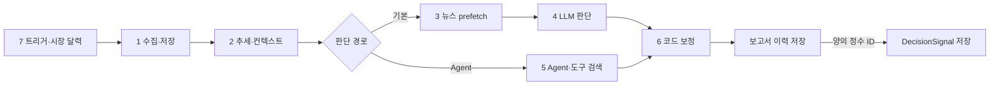

# daily_stock_analysis — feature map과 기능 스펙

## 1. 기본 정보

- URL: https://github.com/ZhuLinsen/daily_stock_analysis
- 기준: `ce364e457aab288863a5707e7b3df79786ad07f2`, 기존 lock 유지. 작업트리 clean(코드 확인).
- 목적: 업비트·키움 기반 개인 AI 트레이딩 시스템의 데이터 계층·판단 계층 설계 및 기능 재구현에 활용한다. 알림과 브로커 내부는 trading/GUIDE.md 기준 제외한다.
- 라이선스: 루트 `LICENSE:1-21` MIT(코드 확인). `src/services/screening/LICENSE:1-4`는 Apache-2.0이며 screening은 AlphaSift 파생 코드다(코드 확인). 그 외 제3자 조건은 후속 확인 필요.
- 제품: Python CLI/서버, API·봇 진입점, React/Vite 웹 앱, Electron 앱. 앱 manifest 확인; 각 표면의 내부 호출은 미확인.
- 스펙 범위: **승인됨: 행 1~7** (2026-11-11). 행 8~11은 사용자 승인 범위에서 제외(목적 밖·보조 기능). subagent 3개, 모두 `gpt-6.1-terra` / effort `medium`; 메인은 수집·결과 경계·통합 검토를 담당한다.
- 기존 Q1~Q7 분석: [00-overview.md](00-overview.md). 기존 결론을 이번 확인으로 일괄 승격하지 않는다.

## 2. Feature map

선행은 재구현 시 필요한 계약 의존이며 런타임 호출 순서와 다르다. 승인된 행 1~7의 스펙을 작성했다. 모든 검증은 기준 SHA의 원본을 읽은 정적 코드 확인이며 실행 확인은 없다.

| # | 기능 | 사용자 동작·경계 | 진입점·처음 읽을 코드 | 선행 | 구분 | 스펙·상태 | 검증 수준 |
|---|---|---|---|---|---|---|---|
| 1 | 데이터 수집·정규화 | 일봉·실시간·칩·펀더멘털을 공통 입력으로 수집 | `src/core/pipeline.py:509-559` | 없음 | 핵심 | [data-collection](capabilities/data-collection.md) · ready | 코드 확인 |
| 2 | 분석 컨텍스트 조립 | DB 이력과 실시간·추세·시장 정보를 결합 | `src/core/pipeline.py:758-798` | 1 | 핵심 | [analysis-context](capabilities/analysis-context.md) · ready | 코드 확인 |
| 3 | 뉴스·리서치 | 고정 검색과 저장 인텔을 분석 입력으로 결합 | `src/core/pipeline.py:683-755` | 없음 | 핵심 | [research](capabilities/research.md) · ready | 코드 확인 |
| 4 | 기본 LLM 판단 | 컨텍스트·뉴스 → 분석 결과 | `src/core/pipeline.py:835-853` | 2, 3 | 핵심 | [llm-decision](capabilities/llm-decision.md) · ready | 코드 확인 |
| 5 | Agent 판단 패밀리 | 명시 설정·스킬에 따른 대체 판단 경로 | `src/core/pipeline.py:561-577; _analyze_with_agent` | 1, 3, 4 | 핵심 | [agent-decision](capabilities/agent-decision.md) · ready | 코드 확인 |
| 6 | 결과 보정·저장·신호 경계 | 최종 액션 갱신·이력 저장·DecisionSignal 추출 | `src/core/pipeline.py:930-985` | 4, 5 | 핵심 | [decision-output](capabilities/decision-output.md) · ready | 코드 확인 |
| 7 | 트리거·스케줄·시장 달력 | CLI·정기 실행·거래일 필터 | `main.py; src/scheduler.py; src/services/runtime_scheduler.py; src/core/trading_calendar.py; src/services/scheduled_analysis_claim.py; .github/workflows/00-daily-analysis.yml` | 없음 | 핵심 | [scheduling](capabilities/scheduling.md) · ready | 코드 확인 |
| 8 | 시장 복기·스크리닝·ETF 패밀리 | 종목 분석 외 시장·후보·규칙 전략 | `src/core/etf_rotation.py; src/services/screening/` | 1 | 부속 | `capabilities/adjacent-strategies.md` · 미작성 | 미확인(파일 목록만 대조) |
| 9 | 사후 평가·보유 위험 | 백테스트·신호 평가·포트폴리오 위험 | `src/core/backtest_engine.py; src/services/portfolio_risk_service.py` | 6 | 부속 | `capabilities/evaluation.md` · 미작성 | 미확인(기존 분석 후보) |
| 10 | 웹·API·봇·데스크톱 | 분석 실행 접수와 근거 표시, 별도 앱 배포 | `api/; bot/; webui.py; server.py; apps/dsa-web/package.json; apps/dsa-desktop/package.json` | 6 | 부속 | `capabilities/surfaces.md` · 미작성 | 코드 확인(앱 manifest); 내부 미확인 |
| 11 | 알림·운영·배포 | 결과 전달·컨테이너·CI·운영 스크립트 | `src/notification.py; docker/; scripts/; .github/workflows/` | 6 | 부속 | `capabilities/operations.md` · 미작성 | 미확인(파일 목록만 대조) |

### 공유 계약

| 계약 | 쓰는 기능 | 근거 | 소유·상태 | 검증 |
|---|---|---|---|---|
| 수집 컨텍스트 | 1~5 | `src/core/pipeline.py:758-798` `_enhance_context` 호출 | [행 2](capabilities/analysis-context.md)에서 필드·결측·시장 시간 소유, ready | 코드 확인(전달부) |
| AnalysisResult·최종 액션 | 4~6, 9~11 | `src/core/pipeline.py:930-985` | [행 4](capabilities/llm-decision.md) 생성 타입 소유, [행 6](capabilities/decision-output.md) 최종 보정·신호 계약 소유, ready | 코드 확인(사용부) |

### 대조한 범위와 미탐색 영역

추적 파일 목록 → README 기능 표 → 루트 pyproject·앱 package manifest → pipeline의 수집·분기·검색·LLM·저장 호출부를 읽었다. 중첩 앱과 Python 서버·봇·배포 입구는 10~11에 묶었다. 기존 문서 01~05는 상세 조사 후보로 유지했다. 스펙 단계에서 개별 fetcher 패밀리, Agent single/multi·15개 전략, 설정 기본값, 실패 전파, 결과 보정·신호 생성 및 스케줄 구현까지 원본으로 재검증했다. API/UI 전체·별도 전략·사후 평가·알림 운영 내부는 승인 범위 밖이다. 테스트 실행은 없으며 수락 사례는 구현에서 도출했다. README와 구현 차이는 각 스펙 2.1에 기록했다. 기존 00~05 문서 전체를 이번 스펙과 같은 검증 범위로 승격하지 않는다.

## 3. 구조도와 그림 해설

[구조도 HTML](diagrams/structure.html) · [JSON](diagrams/structure.json)

기본 종목 경로만 그렸다. 읽는 순서는 수집 → 검색 → 컨텍스트 → LLM → 저장이다. 각 노드는 pipeline이 소유한 단계이며 별도 프로세스를 뜻하지 않는다.

| 단계 | 입력 → 처리 → 출력 | 근거 | 검증 |
|---|---|---|---|
| 시세 수집 | 종목 → fetcher_manager 호출 → 시세·칩 | `src/core/pipeline.py:509-559` | 코드 확인 |
| 검색 | 종목 코드·이름 → search_comprehensive_intel(max_searches=5) → 뉴스 문맥 | `src/core/pipeline.py:683-755` | 코드 확인 |
| 컨텍스트 | DB 문맥·시세·추세 → _enhance_context → enhanced_context | `src/core/pipeline.py:758-798` | 코드 확인 |
| LLM | enhanced_context·news_context → analyzer.analyze → result | `src/core/pipeline.py:835-853` | 코드 확인 |
| 보존 | result → 최종 액션 갱신·save_analysis_history → 신호 추출 | `src/core/pipeline.py:930-985` | 코드 확인 |

검색·시세 실패 시 일부 입력만으로 진행하는 분기는 `pipeline.py:533-541, 763-776`에서 확인했다. Agent 전환은 `561-577`의 명시 설정과 스킬 조건이므로 기본 경로 그림에서는 제외했다. 외부 서비스 실제 응답·실행 결과는 미확인이다.

## 4. 질문

[Q1: 기능 용어·코드 규모](questions/q1-features-and-size.md): 시장 상황 요약·후보 선정·과거 판단 평가·보유 위험은 서로 다른 기능. 런타임 소스 약 24.1만 물리 줄. 기존 질문은 [qa.md](qa.md)를 참조한다.

### 통합 검토 (2026-11-11)

1. **누락 점검:** 승인 행 1~7에 spec 7개가 있고, 제외 행 8~11은 미작성으로 유지했다. ready 7 / draft 0 / 미작성 4.
2. **경계·상태 소유:** 수집은 행1, DB 최신 두 봉·trend/실시간 봉 결합은 행2, 기본 prefetch·공유 저장 인텔/social은 행3, AnalysisResult 생성 및 기본 context pack은 행4, Agent 실행·변환·보정 설명은 행5, 공통 가드레일·이력·신호는 행6, 발생·claim은 행7이 소유한다. 코드 확인 근거는 각 spec 2.1.
3. **선행·SHA:** 동일 SHA의 C-ID·선행 존재와 비순환을 검사했다. 행3/7은 행1을 직접 소비하지 않아 선행에서 제거. 행5는 기본 prefetch를 건너뛰지만 행3의 저장 인텔/social 계약을 공유한다. 행6의 helper는 판단기 내부에서도 호출되므로 행4/5에는 설명용 링크만 두고 depends 순환을 피했다.
4. **대표 흐름:** 아래 입력→최종 신호 흐름을 원본 호출부 및 각 스펙과 대조했다. 보고서 저장과 신호 저장은 별도 transaction이다. 코드 확인이며 실제 API·LLM·주문 실행 확인은 아니다.

### 기능을 가로지르는 대표 흐름

입력 `005930.KS` → 행7의 한국 시장 거래일 필터 → 행1의 Yfinance 일봉·시세 및 해외 펀더멘털 → 행2의 DB 최신 두 봉·추세 계산·컨텍스트 결합 → 행3의 고정 뉴스 검색(이 코드 형태는 중국어 검색어 분기) → 행4의 prompt·LLM·AnalysisResult → 행6의 수급·시장 가드레일 → 보고서 이력 저장 → 양의 정수 history ID에 한해 DecisionSignal 생성. 예를 들어 수급 블록이 `not_supported`이고 모델이 buy라고 해도 코드가 hold로 강등할 수 있다([결과 규칙 R-03](capabilities/decision-output.md)). 수급 결측을 neutral로 바꿔 읽지 않는다.

Agent는 기본 뉴스 prefetch 이전에 분기하므로 위 그림의 ‘2’는 공유 trend/입력 계약을 뜻하며 기본 enhanced_context 호출 전체를 Agent가 그대로 실행한다는 뜻은 아니다. 정확한 분기는 `src/core/pipeline.py:639-755`, Agent 조립은 `1460-1562`, 기본 조립은 `758-823`이다(코드 확인).

## 5. 다음 작업

승인 범위는 재현 준비 완료. [next.md](next.md)에 검증 범위·남은 범위 밖 조사와 재개 지점을 정리했다. 새 범위 승인 또는 실제 실행 검증 요청이 있을 때 이어 간다.
