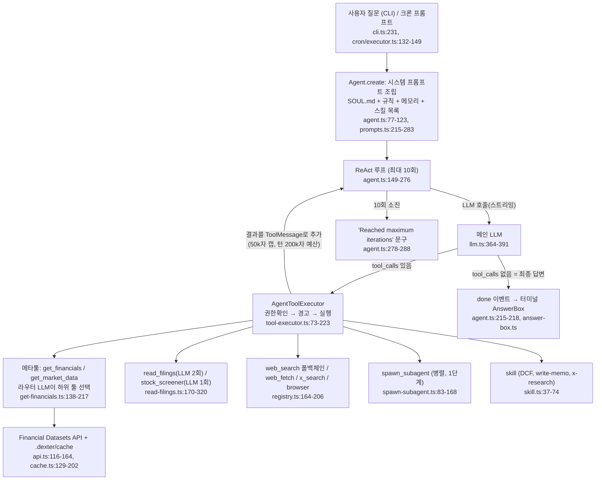

# dexter — 개요

- 분석 SHA: `534f6be455523c5926eba72bdaf4f914555be5c9` (repos.lock.tsv와 일치)
- 분석일: 2026-10-09
- 관련 공통 항목: Q1~Q7 전체 (입구 문서)
- 검증 수준 요약: 코드 확인 약 60 / 추론 약 6 / 미확인 약 4 (근사치, 문서 내 표기 기준)

> 범위: 알림(WhatsApp 게이트웨이)은 GUIDE §0에 따라 제외한다. 단, cron/heartbeat가 알림 경로와 결합돼 있어 스케줄 문서(02)에서 "결합 사실"만 짧게 기록한다.

## 1. 메타데이터

| 항목 | 값 | 근거 | 검증 |
|---|---|---|---|
| URL | https://github.com/virattt/dexter | `README.md:78` | 코드 확인 |
| 고정 SHA / 커밋일 | `534f6be4...` / 2026-09-23 | `trading/repos.lock.tsv`, `git rev-parse HEAD` | 코드 확인 |
| 라이선스 | README는 MIT. **LICENSE 파일 없음** (`git ls-files`에 license 파일 0건) | `README.md:190-192` | 코드 확인 |
| 주 언어/런타임 | TypeScript(ESM), Bun 실행, Ink류 TUI(`@mariozechner/pi-tui`), LangChain | `package.json:10-19,20-45`, `AGENTS.md:4` | 코드 확인 |
| 대상 시장 | **미국 주식 + 코인(BTC-USD 형식)**. 데이터원이 Financial Datasets(SEC 기반). 한국 시장 지원 없음 | `src/tools/finance/api.ts:4`, `get-financials.ts:87-89`(티커 예시가 전부 미국), `crypto.ts:16` | 코드 확인 |
| 지원 LLM | OpenAI(기본), Anthropic, Google, xAI, Moonshot, DeepSeek, OpenRouter, Ollama, Ollama Cloud | `src/providers.ts:21-91` | 코드 확인 |
| 기본 모델 표기 불일치 | `agent.ts`는 `gpt-5.6-sol`, `llm.ts`는 `gpt-6-astra`, `AGENTS.md`는 `gpt-5.5` | `src/agent/agent.ts:23`, `src/model/llm.ts:19`, `AGENTS.md:49` | 코드 확인 |

## 2. 한 줄 정의

dexter는 **매매 결정을 하지 않는 금융 리서치용 ReAct 에이전트**다. 질문 하나를 받아 LLM이 도구(재무·시세·공시·웹검색)를 반복 호출한 뒤, **도구 호출이 없는 LLM 응답을 그대로 최종 답변으로 출력**한다. 판단 주체는 전적으로 LLM이고, 코드는 반복 횟수 상한·권한 확인·컨텍스트 관리만 한다 (`src/agent/agent.ts:149-218`).

## 3. 판단(리서치) 파이프라인

- 주문·포지션·비중 결정 노드는 **없다**(§5 Q6 참조).

## 4. 핵심 발견 5개

1. **순수 ReAct이며 계획/자기검증 코드는 없다.** 종료 조건은 (a) 도구 호출 없는 응답, (b) 최대 10회, (c) LLM 오류, (d) 사용자 거부 4가지뿐이다 (`src/agent/agent.ts:149,215-218,185-196,245-257,278-288`). README의 "Intelligent Task Planning / Self-Validation"(`README.md:37-39`)에 해당하는 별도 플래너·검증 모듈은 코드에서 찾지 못했다(검증은 스킬 마크다운의 체크리스트로만 존재). 검증: 코드 확인.
2. **"메타툴 + 라우터 LLM" 2단 구조.** `get_financials`/`get_market_data`는 내부에서 또 LLM을 불러 하위 도구를 고르고(`get-financials.ts:143-147`), 이 라우터 LLM은 **메인 모델과 동일한 모델**이다(`createGetFinancials(model)`, `registry.ts:52`). 라우터 프롬프트는 존재하지 않는 도구명 `get_financial_metrics_snapshot`을 가리키고(`get-financials.ts:98`, 실제는 `key-ratios.ts:16`의 `get_key_ratios`), "company facts" 도구는 바인딩되지 않았는데(`get-financials.ts:60-73`) DCF 스킬은 이에 의존한다(`skills/dcf/SKILL.md:53-60`). 검증: 코드 확인(영향은 추론).
3. **루프 방지는 "경고만, 차단 없음".** 도구당 3회(제안 한도), 단어 Jaccard 0.7 이상이면 "유사 질의" 경고를 주지만 항상 `allowed: true`이고 `isBlocked: false`다 (`src/agent/scratchpad.ts:49-53,131-175,212`). 실제 하드 스톱은 반복 10회뿐이다. 검증: 코드 확인.
4. **데이터는 전부 판단 시점에 가져오며(pull) 사전 동기화·신선도 관리·look-ahead 차단이 없다.** 단일 공급자(Financial Datasets), 디스크 캐시 TTL 15분~24시간(`utils.ts:11-14`), 시각 기준은 프롬프트에 박은 "현재 날짜" 문자열뿐이다(`prompts.ts:19-27,236`). 검증: 코드 확인(없음 = grep 결과).
5. **수치 판단 규칙은 스킬 마크다운에 있고 계산도 LLM이 한다.** DCF 스킬의 FCF 성장률 15% 상한, 연 5% 감쇠, 터미널 2.5%, WACC 섹터 범위, "계산 EV가 보고 EV의 30% 이내" 같은 검증 기준은 코드가 아니라 프롬프트 지침이다 (`skills/dcf/SKILL.md:68-114`, `skills/dcf/sector-wacc.md:11-23`). 정기 모니터링(cron/heartbeat)은 결과를 WhatsApp으로만 내보내는 구조에 결합돼 있다 (`cron/executor.ts:110-116,172-179`). 검증: 코드 확인.

## 5. 공통 항목 요약표

| 항목 | 요약 | 문서 |
|---|---|---|
| Q1 데이터 | 가격·재무제표·키 비율·세그먼트·실적·뉴스·내부자/13F/13D·SEC 공시 본문·스크리너(전부 financialdatasets.ai), 웹 검색 4종, X(트위터), 웹페이지. 기술지표·수급·거시·온체인·감성 지수 없음. 정의만 있고 안 쓰이는 도구 `get_institutional_investors` 1개. | [01-data.md](01-data.md#q1) |
| Q2 수집 | 전부 LLM tool call(pre-fetch 없음). 벤더 폴백은 웹검색 4종에만 존재, 금융 데이터는 단일 공급자·재시도 없음. 파일 캐시(.dexter/cache), look-ahead 방지 없음, 메타툴 실패는 `_errors`로 부분 반환 후 계속. | [01-data.md](01-data.md#q2) |
| Q3 스케줄 | 기본은 수동 질의. cron(`at/every/cron`)과 heartbeat(기본 30분)가 있으나 전달이 WhatsApp에 결합. 사전 동기화·stale 감지·실시간 스트림 없음. | [02-schedule.md](02-schedule.md) |
| Q4 판단 | LLM이 도구 결과를 읽고 자유 텍스트로 결론. 스키마·등급·확신도·진입/손절가 없음(단, write-memo 스킬만 목표가/사이징 서식 존재). 코드 가드레일은 반복 상한·권한뿐. 사후 채점 없음(evals는 사실 Q&A 채점). | [03-decision.md](03-decision.md) |
| Q5 리서치(핵심) | 웹검색은 LLM이 검색어를 직접 생성, 호출당 결과 5건(LangSearch만 10건), 폴백체인 Exa→Perplexity→Tavily→LangSearch, 서브에이전트 병렬 위임(1단계, 8회 상한), 스킬 `x-research`가 3~5쿼리 루프를 지시. | [04-research.md](04-research.md) |
| Q6 경계 | 주문 변환 코드 없음, 하드 리스크 한도 없음. 승인 단계는 파일쓰기·bash에만. UI는 도구 호출 로그+답변만 표시, 출처 URL은 화면에 안 나옴. | [05-boundary-and-fit.md](05-boundary-and-fit.md) |
| Q7 적용 | 루프·컨텍스트 관리·서브에이전트·스킬 체크리스트 패턴을 아이디어로 가져가고, 데이터층은 키움/업비트/DART로 교체. 라이선스 불명확(LICENSE 파일 없음)이라 코드 직접 복사는 보류. | [05-boundary-and-fit.md](05-boundary-and-fit.md#q7) |

## 6. "최종 결정은 LLM인가 코드인가"

**LLM이다.** dexter에는 결정 자체가 없고(매수/매도/비중 산출 코드 없음), 도구 결과를 읽은 LLM의 마지막 응답이 곧 최종 출력이며 코드는 반복 10회 상한·권한 승인·컨텍스트 압축으로만 개입한다 (`src/agent/agent.ts:215-218`).

## 7. 문서 목록

- [01-data.md](01-data.md) — Q1 데이터 인벤토리, Q2 수집 방식
- [02-schedule.md](02-schedule.md) — Q3 스케줄
- [03-decision.md](03-decision.md) — Q4 판단
- [04-research.md](04-research.md) — Q5 실시간 리서치
- [05-boundary-and-fit.md](05-boundary-and-fit.md) — Q6 경계, Q7 적용 의견
- [next.md](next.md) — 확인 범위와 남은 항목

핵심 근거 permalink:
- 루프: https://github.com/virattt/dexter/blob/534f6be455523c5926eba72bdaf4f914555be5c9/src/agent/agent.ts#L149-L289
- 루프 방지: https://github.com/virattt/dexter/blob/534f6be455523c5926eba72bdaf4f914555be5c9/src/agent/scratchpad.ts#L131-L175
