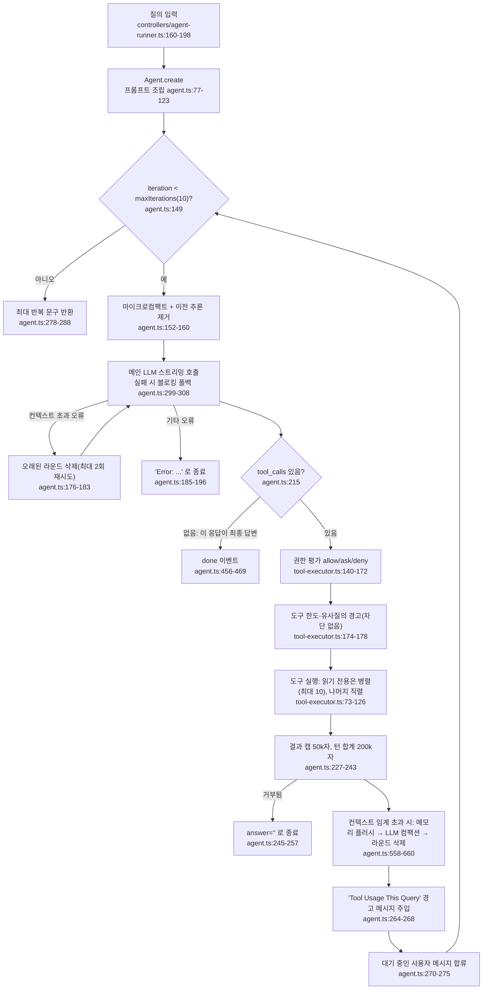

# dexter — AI 판단 (리서치 결론이 만들어지는 방식)

- 분석 SHA: `534f6be455523c5926eba72bdaf4f914555be5c9` (repos.lock.tsv와 일치)
- 분석일: 2026-10-09
- 관련 공통 항목: Q4 (4-1 ~ 4-8)
- 검증 수준 요약: 코드 확인 약 75 / 추론 약 8 / 미확인 0 (근사치)

> **먼저 밝혀 둘 것**: dexter에는 매수/매도/보유 같은 **트레이딩 결정이 없다.** 이 문서는 (a) 에이전트가 "결론/조언"에 도달하는 과정과 (b) 그 과정에서 무엇이 **없는지**를 있는 그대로 기록한다. README는 "계획 수립, 자기 성찰(self-reflection)"을 내세우지만(`README.md:3,37-39`) 코드에는 별도 플래너·리플렉션 모듈이 없고 단일 ReAct 루프뿐이다 (`src/agent/agent.ts:149-289`).

## 4-1. 입력 조립

### 시스템 프롬프트 (질의마다 새로 조립)

조립 함수: `buildSystemPrompt()` (`src/agent/prompts.ts:215-283`). 호출 지점: `Agent.create()` (`src/agent/agent.ts:93-121`). 구성 요소는 다음 순서다.

| 순서 | 내용 | 위치 | 비고 | 검증 |
|---|---|---|---|---|
| 1 | 정체성+채널 프리앰블+오늘 날짜(영문) | `prompts.ts:234-238`, `channels.ts:7-43` | CLI 프로필은 "짧고 간결하게" | 코드 확인 |
| 2 | 도구 목록(이름+1~2문장 요약) | `prompts.ts:240-242`, `registry.ts:263-267` | 상세 스키마는 `bindTools()`로 별도 전달 | 코드 확인 |
| 3 | 도구 사용 정책 6줄 | `prompts.ts:244-252` | 메타툴 1회 호출, 서브에이전트 병렬 | 코드 확인 |
| 4 | 스킬 목록(이름+설명)과 "관련되면 즉시 호출" 정책 | `prompts.ts:67-86` | 스킬 본문은 호출 시에만 로드 | 코드 확인 |
| 5 | 메모리: 파일 목록 + 세션 컨텍스트(MEMORY.md+오늘/어제 일지, 2000토큰 상한) + "개인화 조언 전 memory_search 필수" | `prompts.ts:88-119`, `memory/store.ts:118-146`, `memory/index.ts:22` | | 코드 확인 |
| 6 | 행동 지침(채널별) | `prompts.ts:258-260`, `channels.ts:10-17` | | 코드 확인 |
| 7 | 사용자 규칙 `.dexter/RULES.md` | `prompts.ts:54-61,262-271` | 파일이 없으면 생략 | 코드 확인 |
| 8 | 정체성 `SOUL.md`(사용자 오버라이드 `.dexter/SOUL.md` 우선) | `prompts.ts:32-48,273-278`, `SOUL.md` | 버핏·멍거 철학 | 코드 확인 |
| 9 | 응답 형식(표 규칙 등) | `prompts.ts:280-282`, `channels.ts:18-42` | | 코드 확인 |

- 서브에이전트는 위 전체 대신 **자체 워커 프롬프트**(`systemPromptOverride`)만 사용해 SOUL·규칙·메모리를 건너뛴다 (`agent.ts:94-96`, `subagent/types.ts:47-74`).
- **데이터는 프롬프트에 미리 넣지 않는다.** 모든 데이터는 도구 결과(ToolMessage)로 대화에 누적된다 (`agent.ts:221-243`). 입력 형식은 JSON 문자열 `{"data":..., "sourceUrls":[...]}` (`tools/types.ts:6-12`) 이며, 금융 메타툴은 그 `data`를 **마크다운 표 문자열**로 압축해 넣는다 (`finance/formatters.ts:416-438`).

### 길이 제한과 자르기

| 장치 | 값 | 위치 | 검증 |
|---|---|---|---|
| 도구 결과 1건 상한 | 50,000자 초과 시 디스크에 저장하고 앞 2,000자 미리보기만 주입, `read_file`로 조회 유도 | `utils/tool-result-storage.ts:13,16,56`, `agent.ts:227-238` | 코드 확인 |
| 한 턴의 도구 결과 합계 상한 | 200,000자, 큰 것부터 디스크로 | `utils/tool-result-budget.ts:13,21-66`, `agent.ts:241` | 코드 확인 |
| 마이크로컴팩트 | 읽기 전용 도구 결과가 8개 초과 또는 추정 80k 토큰 초과 → 최근 4개만 남기고 `[Old tool result content cleared]`로 치환 | `agent/microcompact.ts:14-30,51-114` | 코드 확인 |
| 이전 추론 텍스트 제거 | 도구 호출을 동반한 AI 메시지의 텍스트는 최근 2개만 유지 | `agent.ts:160,484-508` | 코드 확인 |
| 자동 컴팩트 임계 | `컨텍스트창 − 20,000(출력 예약) − 13,000` 토큰 (예: OpenAI 1,047,576 → 1,014,576) | `utils/tokens.ts:27-52`, `providers.ts:28` | 코드 확인 |
| 대화 이력 | 최근 10턴, 최근 3턴은 전문·이전 턴은 LLM 1~2문장 요약 | `utils/in-memory-chat-history.ts:4-5,102-122` | 코드 확인 |
| 웹 페이지 | 마크다운 100,000자에서 절단 후 빠른 모델로 질의 | `fetch/utils.ts:74,331-345` | 코드 확인 |

## 4-2. 판단 흐름

### 흐름도 (노드마다 코드 위치)

### 실행 순서·병렬성

- 루프는 **순차**(LLM 호출 → 도구 실행 → 다음 LLM 호출)다. 한 응답에 여러 `tool_calls`가 있으면, **연속된 `concurrencySafe` 도구**를 묶어 최대 10개 병렬 실행하고 안전하지 않은 도구는 직렬 실행한다 (`tool-executor.ts:31,94-115,120-126`). 안전 표시는 레지스트리에 도구별로 박혀 있다(`ask_user_question`, `write_file`, `edit_file`, `memory_update`, `skill`, `bash`가 false, `registry.ts:50-228`).
- **스킬 중복 방지**: 같은 질의에서 이미 실행한 스킬을 다시 부르면 실행 목록에서 조용히 제외한다 (`tool-executor.ts:98-102`, `scratchpad.ts:443-447`). 제외된 호출은 "Skipped (already executed)" ToolMessage로 채워진다 (`agent.ts:419-425`).
- **서브에이전트 병렬 위임**: `spawn_subagent`는 `concurrencySafe: true`라 한 턴에 여러 번 호출하면 병렬로 돈다 (`registry.ts:79-84`, `prompts.ts:249-251`). 서브에이전트는 `Agent.create({maxIterations: 8, memoryEnabled: false, toolAllowlist, systemPromptOverride})`로 **독립 루프**를 만들고 최종 답 1개만 반환하며, 대화 맥락을 볼 수 없고 자신이 서브를 만들 수 없다(1단계) (`spawn-subagent.ts:83-168`, `subagent/types.ts:27,55-85`). 서브에이전트 유형 3종(general-purpose/research/analysis)과 허용 도구는 `subagent/types.ts:55-74`. 검증: 코드 확인.

### 종료 조건·반복 상한 (이 레포의 핵심 확인 항목)

| 종료 경로 | 조건 | 결과 | 위치 | 검증 |
|---|---|---|---|---|
| 정상 종료 | LLM 응답에 tool_calls 없음 | 해당 텍스트가 최종 답 | `agent.ts:215-218` | 코드 확인 |
| 반복 상한 | `iteration >= 10`(기본, cron 6, 서브 8) | "Reached maximum iterations (10). I was unable to complete the research in the allotted steps." (부분 결과 요약 없이 **고정 문구**) | `agent.ts:24,149,278-288`, `cli.ts:232`, `cron/executor.ts:146`, `subagent/types.ts:60` | 코드 확인 |
| LLM 오류 | 재시도 3회 소진 등 | `Error: <사용자용 메시지>` | `agent.ts:185-196`, `model/llm.ts:30-50` | 코드 확인 |
| 컨텍스트 초과 | 오류 메시지 판별 후 최근 3라운드만 남기고 재시도, 최대 2회 | 2회 후에도 실패하면 오류 종료 | `agent.ts:25-26,176-183` | 코드 확인 |
| 사용자 거부 | 승인 요청에 deny | 즉시 종료, `answer: ''` | `agent.ts:245-257`, `tool-executor.ts:153-163` | 코드 확인 |
| 중단 | AbortSignal | 컨트롤러가 'interrupted' 처리 | `controllers/agent-runner.ts:216-222` | 코드 확인 |
| 도구 없음 | 사용 가능한 도구 0개 | "No tools available..." | `agent.ts:131-134` | 코드 확인 |

- **시간 제한은 에이전트 루프에 없다**(evals 러너만 `timeoutMs`로 abort, `evals/run.ts:92-99`). 도구별 60초 제한은 메타툴 하위 호출에만 있다 (`finance/utils.ts:8`). 검증: 코드 확인.

### 루프 방지 장치 (유사 질의 경고·도구 한도)

| 장치 | 동작 | 값 | 위치 | 검증 |
|---|---|---|---|---|
| 도구별 호출 횟수 | 3회째부터 "suggested limit" 경고 | `maxCallsPerTool: 3` | `scratchpad.ts:49-53,131-144` | 코드 확인 |
| 유사 질의 감지 | 질의 문자열을 3자 초과 단어 집합으로 만들어 Jaccard 유사도 ≥ 0.7이면 경고 | `similarityThreshold: 0.7` | `scratchpad.ts:245-283`, 질의 키 추출 `tool-executor.ts:225-233`(`query/search/question/q/text/input`) | 코드 확인 |
| 1회 남음 경고 | 한도 직전 안내 | | `scratchpad.ts:165-172` | 코드 확인 |
| 경고 전달 | ① 도구 실행 전 `tool_limit` 이벤트(UI용) ② 매 반복 끝에 "## Tool Usage This Query" HumanMessage를 대화에 추가 | | `tool-executor.ts:174-178`, `agent.ts:264-268`, `scratchpad.ts:223-239` | 코드 확인 |
| **차단 여부** | **절대 차단하지 않음**(`allowed: true`, `isBlocked: false`). 하드 스톱은 반복 10회뿐 | | `scratchpad.ts:131-175,212` | 코드 확인 |
| 한계 | 유사도 검사는 `query` 류 키가 있는 도구(web_search, 메타툴)에만 의미가 있고, 인자가 `ticker`뿐인 도구는 대상 아님 | | `tool-executor.ts:225-233` | 코드 확인(해석은 추론) |
| 스킬 | 질의당 1회 | | `tool-executor.ts:98-102` | 코드 확인 |
| 서브에이전트 | 자체 스크래치패드를 가져 **자체 한도(도구당 3회)** 가 별도로 적용 | | `spawn-subagent.ts:95-104`, `run-context.ts:22-26` | 코드 확인 |

> 경고 문구의 권고 "(3) proceeding with what you have and noting any data gaps to the user" (`scratchpad.ts:141-142`)와 CLI 행동 지침 "If data is incomplete, answer with what you have without exposing implementation details" (`channels.ts:16`)는 **데이터 공백을 사용자에게 알리라는 쪽과 구현 세부를 숨기라는 쪽이 공존**한다. 검증: 코드 확인.

### 모델 계층 (quick vs deep)

| 용도 | 모델 | 위치 | 검증 |
|---|---|---|---|
| 메인 루프 | 사용자가 고른 모델 | `agent.ts:58`, `cli.ts:232` | 코드 확인 |
| **메타툴 라우터(get_financials, get_market_data, read_filings 계획/선택, stock_screener)** | **메인과 같은 모델**(fast 아님) | `registry.ts:52,59,66,73`, `get-financials.ts:143-147`, `read-filings.ts:177-181,247-251`, `screen-stocks.ts:142-146` | 코드 확인 |
| 빠른 모델(`providers.ts`의 `fastModel`) | 컨텍스트 컴팩션, 웹 페이지 요약, 내부자 이름 LLM 매칭 | `compact.ts:198-208`, `fetch/utils.ts:342-350`, `insider_trades.ts:76-93` | 코드 확인 |
| 메인 모델 | 메모리 플러시, 대화 요약 | `agent.ts:586-592`, `in-memory-chat-history.ts:47-60` | 코드 확인 |
| 서브에이전트 | 부모와 같은 모델 | `spawn-subagent.ts:95-96` | 코드 확인 |
| 모델 지정 우회 | `AgentConfig.modelProvider`는 `agent.ts`에서 쓰이지 않고 `resolveProvider(model)`의 접두어 규칙만 쓴다 | `agent.ts:58`(modelProvider 참조 0건), `providers.ts:99-104` | 코드 확인 |

### 에이전트별 입출력 표

| 에이전트 | 입력 | 출력 | 모델 계층 | 위치 |
|---|---|---|---|---|
| 메인(Dexter) | 시스템 프롬프트 + 최근 대화 + 질의 + 누적 도구 결과 | 도구 호출 또는 최종 자유 텍스트 | 사용자 지정(deep) | `agent.ts:128-289` |
| 서브: general-purpose | `task`(+`context`)만 | 최종 답 1개(+토큰 푸터) | 메인과 동일 | `subagent/types.ts:56-61`, `spawn-subagent.ts:106-167` |
| 서브: research | 〃 (web_search, x_search, web_fetch, read_filings, get_market_data) | 〃 | 〃 | `subagent/types.ts:62-67` |
| 서브: analysis | 〃 (get_financials, get_market_data, stock_screener, read_filings) | 〃 | 〃 | `subagent/types.ts:68-73` |
| 라우터: get_financials | 자연어 질의 + 라우팅 지침 + 8개 하위 도구 스키마 | 하위 도구 tool_calls | 메인과 동일 | `get-financials.ts:79-147` |
| 라우터: get_market_data | 질의 + 12개 하위 도구 | tool_calls | 〃 | `get-market-data.ts:89-170` |
| read_filings ① 계획 | 질의 | `{ticker, filing_types[10-K,10-Q,8-K], limit 1~10}` 구조화 출력 | 〃 | `read-filings.ts:49-63,177-182` |
| read_filings ② 선택 | 질의+공시 메타+Item 목록 | Item 도구 호출(최대 3건 사용) | 〃 | `read-filings.ts:103-152,247-262` |
| stock_screener | 질의+스크리너 필드 목록 | `{filters[{field,operator,value}], currency, limit}` | 〃 | `screen-stocks.ts:53-61,142-147` |
| 컴팩션 | 질의+누적 도구 결과 | `<analysis>`+`
` 텍스트 | fast | `compact.ts:45-102,194-227` |
| 메모리 플러시 | 질의+도구 결과 | 지속 사실 bullet 또는 `NO_MEMORY_TO_FLUSH` | 메인 | `memory/flush.ts:7-69` |

## 4-3. 결정 기준

### 판단 규칙 표 (프롬프트·스킬에 적힌 규칙)

| 규칙 | 원문 인용 | 번역 | 위치 |
|---|---|---|---|
| 메타툴은 1회만 | "Call get_financials or get_market_data ONCE with the full natural language query — they handle multi-company/multi-metric requests internally. Do NOT break up queries into multiple calls." | get_financials/get_market_data는 전체 자연어 질의로 한 번만 호출하라. 여러 회사·지표는 내부에서 처리하니 쪼개지 마라. | `agent/prompts.ts:246` |
| 직접 답변 허용 범위 | "Only respond directly for conceptual definitions, stable historical facts, or conversational queries." | 개념 정의, 변하지 않는 역사적 사실, 일상 대화에만 도구 없이 직접 답하라. | `prompts.ts:252` |
| 스킬 우선 | "When a skill is relevant, invoke it IMMEDIATELY as your first action" | 스킬이 관련되면 첫 행동으로 즉시 호출하라. | `prompts.ts:83` |
| 개인화 조언 전 메모리 | "Before giving any personalized financial advice — buy/sell decisions, portfolio suggestions, stock recommendations, or trade sizing — ALWAYS call memory_search first to recall the user's goals, risk tolerance, position limits, and prior decisions." | 매수/매도, 포트폴리오, 추천, 사이징 같은 개인화 조언 전에 반드시 memory_search로 사용자의 목표·위험성향·한도·과거 결정을 먼저 떠올려라. | `prompts.ts:105-108` |
| 정직성 | "Prioritize accuracy over validation - don't cheerfully agree with flawed assumptions" | 동조보다 정확성을 우선하라. 잘못된 가정에 흔쾌히 동의하지 마라. | `agent/channels.ts:11` |
| 공백 처리 | "If data is incomplete, answer with what you have without exposing implementation details" | 데이터가 불완전하면 구현 세부를 드러내지 말고 가진 것으로 답하라. | `channels.ts:16` |
| 데이터 먼저 | "I gather data first, form a view second. This order matters." | 데이터를 먼저 모으고 견해는 나중에 만든다. | `SOUL.md:67` |
| 안전마진 | "Margin of safety is non-negotiable. The future is uncertain. The numbers should leave room for being wrong." | 안전마진은 타협 불가. 숫자는 틀릴 여지를 남겨야 한다. | `SOUL.md:24` |
| 불확실성 표기 | "I'll tell you what I'm confident about and what I'm guessing about." | 확신하는 것과 추측하는 것을 구분해 말한다. | `SOUL.md:57` |
| 가치함정 경고 | "If I think you're about to walk into a value trap, I'll say so. Clearly." | 가치함정에 빠질 것 같으면 분명히 말한다. | `SOUL.md:59` |
| 스킬 자기검증(DCF) | "If validation fails, reconsider assumptions before presenting results." | 검증에 실패하면 결과를 제시하기 전에 가정을 재검토하라. | `skills/dcf/SKILL.md:114` |
| 비대칭 점검(메모) | "**Asymmetry check**: if upside/downside < 2x, flag this prominently. A weak-asymmetry setup is a coin flip, not a trade." | 상승/하락 비율이 2배 미만이면 눈에 띄게 표시하라. 비대칭이 약하면 거래가 아니라 동전던지기다. | `skills/write-memo/SKILL.md:88` |
| 수치 날조 금지(메모) | "Do not invent consensus numbers — if you do not have them from a tool call, say so in the memo" | 도구 호출로 얻지 못한 컨센서스 숫자를 지어내지 마라. 없으면 메모에 없다고 써라. | `skills/write-memo/SKILL.md:188`, `memo-style.md:39` |
| 반박 서술(메모) | "If the bear paragraph reads weaker than the bull paragraph, rewrite it." | 약세 문단이 강세 문단보다 약하면 다시 써라. | `skills/write-memo/SKILL.md:128` |

> **없는 것(코드 확인)**: "도구 결과에서만 숫자를 가져와라"를 일반 규칙으로 두는 문장은 **시스템 프롬프트에 없다**(`prompts.ts:128-283` 전체에 해당 문장 없음). 숫자 날조 금지는 write-memo 스킬과 웹페이지 요약기(`fetch/utils.ts:347-348` "Answer the request using only the provided web page content.")에만 있다. 출처(`sourceUrls`) 인용 의무도 프롬프트에 없고, `sourceUrls`를 참조하는 코드는 `tools/types.ts`와 3개 메타툴 파일뿐이다(`grep -rn sourceUrls src` 4개 파일).

### 숫자 임계값과 공식

| 규칙 | 값 | 출처 | 위치 | 검증 |
|---|---|---|---|---|
| 반복 상한 | 10 (cron 6, 서브 8) | 코드 상수 | `agent.ts:24`, `cron/executor.ts:146`, `subagent/types.ts:60` | 코드 확인 |
| 도구 호출 제안 한도 / 유사도 | 3회 / 0.7 | 코드 상수(경고만) | `scratchpad.ts:50-53` | 코드 확인 |
| 컴팩션 최소 도구 결과 수 / 연속 실패 허용 | 3 / 3 | 코드 상수 | `compact.ts:19,22` | 코드 확인 |
| 자동 컴팩트 임계 | 창 − 33,000토큰 | 코드 | `utils/tokens.ts:27-52` | 코드 확인 |
| 폴백 시 유지 도구 결과 수 | 5 | 코드 | `utils/tokens.ts:66`, `agent.ts:655` | 코드 확인 |
| DCF: FCF 성장 상한 | **15%** ("Cap at 15%") | 프롬프트(LLM 수행) | `skills/dcf/SKILL.md:68-70` | 코드 확인 |
| DCF: CAGR 보수화 | 안정적이면 CAGR에 10~20% 헤어컷 | 프롬프트 | `SKILL.md:69` | 코드 확인 |
| DCF: 2~5년차 성장 감쇠 | ×0.95, 0.90, 0.85, 0.80 | 프롬프트 | `SKILL.md:89` | 코드 확인 |
| DCF: 터미널 성장 | 2.5% (고든 성장) | 프롬프트 | `SKILL.md:91` | 코드 확인 |
| DCF: 기본 가정 | 무위험 4%, ERP 5~6%, 부채비용 5~6%(세후 약 4%, 세율 30%) | 프롬프트 | `SKILL.md:76-79` | 코드 확인 |
| DCF: WACC 섹터 범위 | 유틸리티 6~7%, 필수소비재 7~8%, 부동산 7~9%, 산업재 8~9%, IT 8~12%, 에너지 9~11% 등 | 프롬프트(표) | `skills/dcf/sector-wacc.md:11-23` | 코드 확인 |
| DCF: WACC 가감 | D/E>1.5 +1~2%, 시총<$2B +1~2%, 신흥시장 +1~3%, 해자 −0.5~1% 등 | 프롬프트 | `sector-wacc.md:27-37` | 코드 확인 |
| DCF: 합리성 | WACC는 ROIC보다 2~4%p 낮아야 함 | 프롬프트 | `SKILL.md:83`, `sector-wacc.md:41-42` | 코드 확인 |
| DCF: 민감도 | WACC ±1% × 터미널 성장 2.0/2.5/3.0% 3×3 | 프롬프트 | `SKILL.md:97-99` | 코드 확인 |
| DCF: 검증① | 계산 EV가 보고 EV의 **30% 이내** | 프롬프트 | `SKILL.md:105-106` | 코드 확인 |
| DCF: 검증② | 터미널 가치 비중 **50~80%**(성숙 기업), >90% 과도, <40% 공격적 | 프롬프트 | `SKILL.md:108-110` | 코드 확인 |
| DCF: 검증③ | 주당 FCF × **15~25배**와 대조 | 프롬프트 | `SKILL.md:112` | 코드 확인 |
| 메모: 시나리오 확률 | 3개 합 100% | 프롬프트 | `skills/write-memo/SKILL.md:80,151` | 코드 확인 |
| 메모: 비대칭 | 상승/하락 ≥ **2배**, 미달 시 헤더에 표시 | 프롬프트 | `SKILL.md:86-88,150` | 코드 확인 |
| 메모: 확률가중 수익률 | Σ(확률 × 수익률), 비대칭 = 강세 수익 절댓값 / 약세 수익 절댓값 | 프롬프트 | `SKILL.md:84-86` | 코드 확인 |
| 메모: 기본 기간/확신도 | 12개월 / medium | 프롬프트 | `SKILL.md:31-32` | 코드 확인 |
| 스크리너 기본값 | "low P/E" → `lt 15`, "high growth" → `gt 0.20`, 결과 25건, 통화 USD | 프롬프트 | `screen-stocks.ts:92-96` | 코드 확인 |
| 스크리너 단위 | 마진·ROE·성장률은 소수(15% → 0.15) | 프롬프트 | `screen-stocks.ts:91` | 코드 확인 |
| 공시 읽기 상한 | 최대 3건, Item 지정 필수 | 프롬프트+코드 | `read-filings.ts:138-139,262` | 코드 확인 |
| heartbeat 기본 알림 기준 | 지수 1세션 **2%** 초과 변동 | 프롬프트(기본 체크리스트) | `gateway/heartbeat/prompt.ts:7-8` | 코드 확인 |

> 위 DCF·메모 수치는 **LLM이 읽고 따르는 지침**일 뿐, 코드가 계산하거나 강제하지 않는다. 계산 모듈이 소스 트리에 없다 (`src/skills/dcf/`에는 `SKILL.md`, `sector-wacc.md`뿐). 검증: 코드 확인.

### 페르소나·역할별 차이

- 페르소나는 `SOUL.md` 하나(버핏·멍거 가치투자 어조)이며 사용자가 `.dexter/SOUL.md`로 교체할 수 있다 (`prompts.ts:32-48`). 서브에이전트는 SOUL을 받지 않고 중립 워커 프롬프트("Complete only the assigned task...")만 받는다 (`subagent/types.ts:47-53`).
- 채널별(CLI/WhatsApp) 차이는 문체·표 사용뿐이며 판단 기준은 같다 (`channels.ts:7-67`).

## 4-4. 출력 형식

**메인 에이전트의 출력에는 결정 스키마가 없다.** 최종 답변은 자유 텍스트(마크다운, CLI에서는 표를 박스로 렌더, `components/answer-box.ts`)다. 코드가 규정하는 것은 이벤트 래퍼뿐이다.

### 출력 스키마 표

| 필드 | 타입 | 값 범위 | 설명 | 위치 |
|---|---|---|---|---|
| `DoneEvent.answer` | string | 자유 텍스트. 반복 소진/오류 시 고정 문구 | 최종 답변 전체 | `agent/types.ts:283-291` |
| `DoneEvent.toolCalls[]` | `{tool,args,result}` | | 사용한 도구 기록(스크래치패드에서 복원) | `types.ts:286`, `scratchpad.ts:411-419` |
| `DoneEvent.iterations / totalTime / tokenUsage` | number / number / object | 반복 ≤ 10 | 운영 메타데이터 | `types.ts:287-290` |
| 등급 체계(Buy/Hold/Sell 등) | **없음** | - | `overweight/rating/backtest` 등 grep 0건 | 코드 확인(없음) |
| 확신도·점수 | **메인에는 없음.** write-memo의 `conviction`은 high/medium/low를 LLM이 채우는 서식 슬롯 | high/medium/low | 사용자 입력 또는 기본 medium | `skills/write-memo/SKILL.md:32`, `memo-template.html:315` |
| 진입가·손절가·목표가·비중 | **메인 출력엔 없음.** write-memo 스킬만 `price_target_base`, `upside_pct`, `prob_weighted_return`, `asymmetry`, `position_management`(사이징 %NAV·진입가·손절/스케일아웃)를 HTML 슬롯에 채우도록 지시 | 자유 텍스트/수치 | 선택적 스킬 산출물, 코드 검증 없음 | `skills/write-memo/SKILL.md:81-82,136-137`, `memo-template.html:295-376` |
| 메모 산출물 | HTML 1페이지 `.dexter/memos/[TICKER]_[LONG/SHORT]_[날짜].html`, 채팅에는 `[TICKER] · [LONG/SHORT] · Target $X (+Y%) · Asymmetry N.Nx · [Conviction]` 한 줄 | | | `skills/write-memo/SKILL.md:160-176` |
| 내부 구조화 출력 | read_filings 계획, stock_screener 필터, 이름 매칭 `{matches[]}` — 데이터 조회용이며 투자 판단 아님 | | | `read-filings.ts:49-63`, `screen-stocks.ts:53-61`, `insider_trades.ts:65-69` |

## 4-5. 최종 결정이 만들어지는 방식

- **LLM이 정한다.** 최종 출력은 도구 호출이 없는 마지막 LLM 응답 텍스트이며 코드는 이를 수정·검증·덮어쓰지 않는다 (`agent.ts:205-218,456-469`).
- **결정적 코드의 개입(덮어쓰기/한도)은 아래뿐이다.**

| 장치 | 무엇을 제한하나 | 판단 내용 덮어쓰기? | 위치 | 검증 |
|---|---|---|---|---|
| 반복 상한 10 | 루프 길이 | 아니오(미완료 고정 문구로 대체) | `agent.ts:149,278-288` | 코드 확인 |
| 권한 엔진 | `write_file`/`edit_file`은 항상 승인 요청, `bash`는 규칙+기본 ask, 나머지 자동 허용 | 아니오 | `permissions/engine.ts:23-24,107-116` | 코드 확인 |
| 채널별 도구 제거 | 비-CLI 채널에서 `ask_user_question`, `bash` 제거 | 아니오 | `agent.ts:29,85-88` | 코드 확인 |
| 승인 콜백 미설정 시 | 승인 요청이 `deny`로 처리(무인 실행에서 파일 쓰기 차단) | 아니오 | `tool-executor.ts:153-158` | 코드 확인 |
| 서브에이전트 도구 제한 | 읽기 전용 도구만, 재위임 불가 | 아니오 | `subagent/types.ts:27-45` | 코드 확인 |
| 응답 억제(cron/heartbeat) | `HEARTBEAT_OK`·정규식 "no action needed"·24시간 중복 | **예: 메시지를 삼킨다**(발송 여부만, 내용 수정 아님) | `gateway/heartbeat/suppression.ts:43-97` | 코드 확인 |

- **여러 신호를 합치는 방식**: 가중평균·다수결·토론 구조가 **없다.** 합성은 LLM이 대화 안에서 자유롭게 하며, 서브에이전트 결과도 "한 개의 최종 답을 오케스트레이터가 종합(synthesize)하라"는 프롬프트 지시뿐이다 (`prompts.ts:251`).
- **결론의 질을 코드가 보증하지 않는다**: 어떤 숫자가 도구에서 왔는지 대조하는 코드가 없다. 검증: 코드 확인.

## 4-6. 실패 처리

| 상황 | 동작 | 분류 | 위치 | 검증 |
|---|---|---|---|---|
| 도구 예외 | `Error: ...`를 도구 결과로 LLM에 전달, 루프 계속 | fail-soft(계속) | `tool-executor.ts:216-222` | 코드 확인 |
| 메타툴 라우터가 도구 미선택 | `{error:'No tools selected for query'}`를 결과로 반환 | 계속 | `get-financials.ts:152-154` | 코드 확인 |
| 하위 도구 일부 실패 | 성공분 + `_errors` 반환 | 부분 성공 | `get-financials.ts:189-214` | 코드 확인 |
| read_filings 계획 파싱 실패 | `{error:'Failed to plan filing search'}` 반환 | 계속 | `read-filings.ts:183-191` | 코드 확인 |
| 스크리너 필터 파싱 실패 | 에러 객체 반환 | 계속 | `screen-stocks.ts:148-156` | 코드 확인 |
| 존재하지 않는 도구명 호출 | `Tool 'x' not found` 에러 결과 | 계속 | `tool-executor.ts:185-188` | 코드 확인 |
| LLM 스트리밍 실패 | 블로킹 호출로 폴백(오류 종류 구분 없이 전부) | 계속 | `agent.ts:299-308` | 코드 확인 |
| LLM 최종 실패 | `Error: ...` 답변으로 종료 | 종료 | `agent.ts:185-196` | 코드 확인 |
| 컴팩션 실패 | 3회 연속까지 허용 후 라운드 삭제 폴백 | 계속 | `agent.ts:603-651,654-659`, `compact.ts:19` | 코드 확인 |
| 메모리 플러시 실패 | 무시(`catch`) | 계속 | `agent.ts:592` | 코드 확인 |
| API 키 없음 | Financial Datasets는 빈 키로 호출 시도(경고 로그), LLM 키 없으면 팩토리에서 throw | 비일관 | `api.ts:80-84`, `llm.ts:59-65` | 코드 확인 |
| 파싱 실패→기권/Hold | **해당 개념 없음**(결정 필드가 없으므로) | - | - | - |
| 숫자 불일치/누락 데이터 | 코드는 감지하지 않음. LLM이 알아서 언급하거나 생략 | fail-open | `channels.ts:16` | 코드 확인 |

## 4-7. 메모리와 사후 채점

- **과거 판단 저장**: 판단/추천을 구조화해 저장하는 코드는 없다. 저장되는 것은 ① 대화 이력(인메모리, 프로세스 종료 시 소멸, `in-memory-chat-history.ts`), ② 입력 히스토리 파일 `.dexter/messages/chat_history.json`(UI 입력 탐색용, `long-term-chat-history.ts:21-22`), ③ 컴팩션 직전 LLM이 뽑은 "지속 사실"(재무 목표, 위험성향, 거래 이력과 이유 등)을 일일 md에 append (`memory/flush.ts:7-25,67`), ④ LLM이 `memory_update`로 직접 쓰는 메모리 (`prompts.ts:112-118`), ⑤ 스크래치패드 JSONL(디버깅용, `scratchpad.ts:55-65,452-454`). 검증: 코드 확인.
- **검색**: SQLite FTS5(BM25) + 임베딩 벡터 하이브리드(0.7/0.3), 시간 감쇠 반감기 30일(MEMORY.md는 상시 유지), MMR(λ=0.7), 최대 6건, 최소 점수 0.1, 청크 400토큰/겹침 80 (`memory/index.ts:18-33`, `memory/search.ts:31-145`). 임베딩 키가 없으면 키워드 검색만 쓴다 (`search.ts:57-62`). 검증: 코드 확인.
- **수익률 사후 채점: 없음.** 조언 이후 가격을 추적해 성과를 매기거나 교훈을 생성해 다음 판단에 주입하는 코드가 없다(`backtest/pnl/benchmark/rating` grep 0건). 검증: 코드 확인(없음).
- **evals는 별개**: `src/evals/`는 FinanceAgent 유형의 Q&A 데이터셋(`evals/dataset/finance_agent.csv`)을 에이전트에 던지고 **LLM 심사관이 정답 루브릭(correctness/contradiction)** 으로 채점한다. 모순 기준이 하나라도 걸리면 0점, 아니면 통과 비율 (`evals/evaluator.ts:48-74,108-112`, `evals/run.ts:92-99`). 개발자용 회귀 평가이며 런타임 판단에 피드백되지 않는다. 검증: 코드 확인.

## 4-8. 비용 (판단 1회당 LLM 호출 수, 추론 포함)

계산 근거: 메인 루프 1반복 = 메인 LLM 1회 (`agent.ts:166-170`), 메타툴 1회 호출 = 라우터 LLM 1회 (`get-financials.ts:143`), `read_filings` = 2회 (`read-filings.ts:177,247`), `stock_screener` = 1회 (`screen-stocks.ts:142`), `web_fetch` = 빠른 모델 1회 (`fetch/utils.ts:345`), 응답 후 대화 요약 = 1회 (`in-memory-chat-history.ts:81-89`), 내부자 이름 매칭은 토큰 매칭 실패 시에만 빠른 모델 1회 (`insider_trades.ts:104-110`).

| 시나리오 | 메인 호출 | 도구 내부 LLM | 합계(근사) | 검증 |
|---|---|---|---|---|
| 개념 질문(도구 없음) | 1 | 0 | 약 2 (요약 포함) | 추론 |
| 종목 한 개 간단 조회(예: 현재가+뉴스) | 2(호출→답변) | 라우터 1 | 약 4 | 추론 |
| 일반 리서치(재무+가격+공시+웹) | 3~5 | 라우터 3~4 + 공시 2 + 웹요약 1~2 | **약 10~14** | 추론 |
| DCF 스킬 | 약 4~5(스킬→데이터 병렬→계산·답변) | 라우터 약 4(현금흐름·지표·BS·시세) | 약 9~10 | 추론 |
| 이론 최대(단일 에이전트) | 10 | 반복마다 병렬 도구 N개 × 라우터 1~2 | 상한 없음(반복 10 × 도구 수) | 추론 |
| 서브에이전트 | 위 + 서브당 최대 8 + 서브 내부 라우터 | 병렬 N개 | 서브 1개당 약 +4~12 | 추론 |
| cron/heartbeat 1회 | 최대 6 | 위와 동일 | 6 + 라우터 | 추론 |

- 토큰 비용 방어 장치: Anthropic은 시스템 프롬프트에 `cache_control: ephemeral`을 붙여 프리픽스 캐시 (`model/llm.ts:212-225,281-302`). 도구 결과는 5~10배 작은 마크다운 표로 압축 (`formatters.ts:3-7`). 검증: 코드 확인.
- `TokenCounter`가 입력/출력 토큰을 누적해 `done` 이벤트에 싣는다 (`agent.ts:200-203,466-468`). 검증: 코드 확인.
